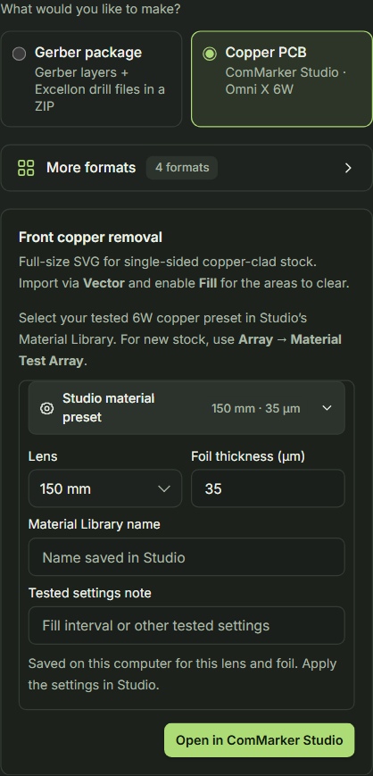

# Prepare a copper PCB for ComMarker Studio

In the board's **Outputs** tab, select **Copper PCB** and choose **Open in ComMarker Studio**. FabDesk uses the saved board revision to generate full-size, front-side removal artwork for pre-cut copper-clad stock. Black regions are the areas to engrave. Pads, tracks and copper pours remain clear. The drill map and perimeter cuts are separate operations.

On Windows and macOS, FabDesk opens Studio and copies the local SVG path, including when the project is on a remote FabDesk core. If prompted, locate your copy of Studio. In a fresh Studio workspace, choose **Vector** and paste the path. In a Mac file picker, press **⌘⇧G** first. The browser client downloads the same SVG.

Keep the import at 1:1 and compare its orientation with FabDesk's preview. If copper reaches an entire edge, the engraved shape can be smaller than the board. Resizing the shape to the full board dimensions would stretch the artwork. Select the artwork, enable **Fill**, and check that the preview leaves the pads and tracks clear. [Studio vector and fill controls](https://blog.commarker.com/archives/55321)

## Set up a reusable Omni X 6W material

In **Studio material preset**, confirm the lens and foil thickness. The initial selection is a **150 mm lens and 35 µm copper**. FabDesk can remember your Studio Material Library name and your tested settings notes for that combination. Select the imported artwork, open the **Library** control in Studio's **Laser Settings**, choose the matching material, and check the Fill interval. The SVG carries the board geometry. Studio applies the laser parameters.

For new stock, use **Array → Material Test Array** on a scrap of the same laminate. Inspect for copper left in the gaps and damage to the substrate. For a board test, import the [20 × 12 mm coupon artwork](examples/omni-x-copper-coupon-remove.svg) or open its [KiCad board](examples/omni-x-copper-coupon.kicad_pcb) in FabDesk. Verify continuity from TP1 to TP2 and from TP3 to TP4, and an open circuit from TP1 to TP3. Once a combination passes, save it in Studio's material library under a name that identifies the lens and stock. Select that entry on subsequent imports. [ComMarker material test procedure](https://commarker.com/dist/js/uploads/Machines/OmniSeries/OmniX/Manual/OmniXOperationTutorial.pdf)

ComMarker's Omni X 6W tables provide **PCB Marking** entries for the 70 mm and 150 mm lenses. They give no copper thickness or electrical isolation result. ComMarker's separate direct-ablation example uses a **12W** UV laser on 18 µm and 35 µm foil. These references do not establish a 6W removal preset. [Omni X 6W material tables](https://commarker.com/dist/js/uploads/Machines/OmniSeries/OmniX/MaterialSettings/Omni%20X%206W%20Material%20Settings.pdf) · [ComMarker copper-clad PCB experiments](https://blog.commarker.com/archives/59265)
