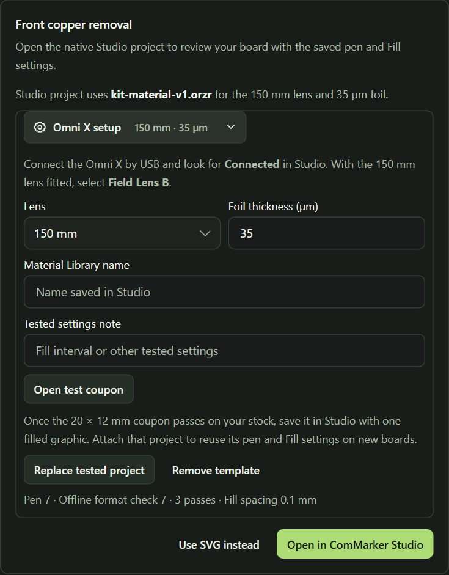
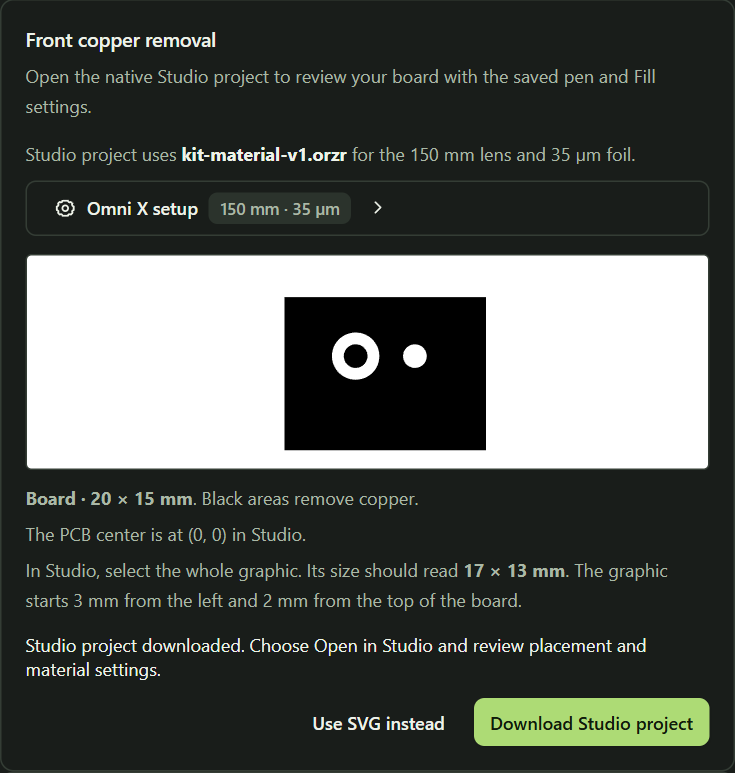

# Prepare a copper PCB for ComMarker Studio

In **Outputs → Copper PCB**, FabDesk prepares the saved board’s front copper for pre-cut copper-clad stock. Black regions are the copper to remove. Pads, tracks and pours remain clear. Drilling and perimeter cutting are separate operations.

 

### With a tested Studio project

1. Under **Omni X setup**, select the installed lens and foil thickness. Choose **Attach tested project** and pick the `.orzr` you saved after qualifying the material. Use a project with one filled vector and one active pen shared by its Fill layers. FabDesk keeps the material on this workstation, keyed to the lens and foil.
2. Choose **Open in ComMarker Studio**. FabDesk prepares a new editable `.orzr` containing the current board and the template’s pen, passes and Fill settings. It places the center of the full PCB at Studio’s field origin and discards the template’s geometry, position and repeats.
3. Studio opens and FabDesk copies the project path. In Studio choose **Open** and paste it. In a Mac file picker, press **⌘⇧G** first. Check the material, preview and alignment against the physical stock. Marking is controlled in Studio.

FabDesk locates Studio on the computer running the desktop app, including when a different machine hosts the project. For a portable installation, select Studio when prompted. **Copy project path** restores the path without regenerating. A browser downloads the project for opening in Studio.

### First setup or SVG import

With no tested project attached, **Open in ComMarker Studio** prepares an SVG and copies its local path. Choose **Create → Vector** in Studio and paste the path. In a Mac file picker, press **⌘⇧G** first. The browser downloads the SVG. **Use SVG instead** makes the same artwork available when a template is attached.

Keep the import at 1:1. Select the whole graphic and compare its width and height with the expected graphic size in FabDesk. When copper reaches an entire edge, the engraved shape can be smaller than the board. FabDesk also shows its offset from the board's top-left corner for alignment. Select the artwork, enable **Fill**, and check that the preview leaves the pads and tracks clear. [Studio vector and fill controls](https://blog.commarker.com/archives/55321)

## Connect Studio to the Omni X

For a stock machine, connect the Windows PC or Mac to the Omni X by **USB**. At the first connection, follow Studio’s prompt to load the parameters from the machine and restart Studio. Check that Studio shows **Connected**. Under **Laser Device → Field Lens**, select **B** for the installed 150 × 150 mm lens or **A** for the 70 × 70 mm lens. The lens selector in FabDesk identifies your material preset. Studio controls the machine’s field calibration. [ComMarker desktop setup](https://blog.commarker.com/archives/55321) · [Omni X user manual, printed pp. 12–16](https://commarker.com/dist/js/uploads/Machines/OmniSeries/OmniX/Manual/OmniXUserManual.pdf)

ComMarker documents the Omni X’s **Wi-Fi** connection for its mobile app. Its Windows and macOS instructions use USB. Direct job transfer over Wi-Fi from FabDesk remains unverified. [Omni X specifications](https://commarker.com/omni-x-uv-laser-engraver/spec) · [ComMarker mobile pairing](https://blog.commarker.com/archives/55493)

For custom software, ComMarker offers an SDK for evaluation by request. Its published service costs US$1,000 per machine and includes installation of a BSL DBK21B USB controller. With that configuration, the Omni loses autofocus, electronic lifting, glass internal engraving and relief engraving. [ComMarker SDK integration terms](https://support.commarker.com/hc/en-us/articles/63061519589401-ComMarker-SDK-Integration-Services-FAQ)

## Set up a reusable Omni X 6W material

In **Omni X setup**, confirm the lens and foil thickness. The initial selection is a **150 mm lens and 35 µm copper**. Choose **Open test coupon** to check Studio import independently of the active design. The sample should measure 20 × 12 mm and display two clear traces connecting four round pads when Fill is enabled.

When using SVG, select the imported artwork, open **Library** in Studio’s **Laser Settings**, choose the material, enable Fill, and check its interval. FabDesk can remember the library name and your notes for this lens and foil. Once you have a tested native project, attaching it also carries the applied pen and Fill into future jobs.

For new stock, use **Array → Material Test Array** on a scrap of the same laminate. Inspect for residual copper and damage to the substrate. Run the two-trace coupon on the same stock and check continuity from TP1 to TP2 and from TP3 to TP4, and an open circuit from TP1 to TP3. Once a combination passes, save the coupon with its single filled graphic as a Studio project. Attach that file in FabDesk. [Coupon artwork](examples/omni-x-copper-coupon-remove.svg) · [KiCad coupon](examples/omni-x-copper-coupon.kicad_pcb) · [ComMarker material test procedure](https://commarker.com/dist/js/uploads/Machines/OmniSeries/OmniX/Manual/OmniXOperationTutorial.pdf)

ComMarker's Omni X 6W tables provide **PCB Marking** entries for the 70 mm and 150 mm lenses. They give no copper thickness or electrical isolation result. ComMarker's separate direct-ablation example uses a **12W** UV laser on 18 µm and 35 µm foil. These references do not establish a 6W removal preset. [Omni X 6W material tables](https://commarker.com/dist/js/uploads/Machines/OmniSeries/OmniX/MaterialSettings/Omni%20X%206W%20Material%20Settings.pdf) · [ComMarker copper-clad PCB experiments](https://blog.commarker.com/archives/59265)
