# Enclosure design and PCB fit

Open **CAD → Enclosure**. Work through **Start → Space → PCB → Review**. Related editing controls stay in the left inspector; **View & fit** contains camera and visibility controls. The footer keeps the next action, Save and undo/redo in consistent positions.

## Start with boards or an existing case

- **New enclosure:** generate a rectangular base and lid around project PCBs. Initial dimensions include estimated component overhangs and underside parts; suggested posts and openings remain editable. Holes belonging to components are not automatically turned into screw posts.
- **Existing case:** import a closed STL or solid STEP, confirm units and define usable interior space. STL displays immediately. Modification uses the native FabPlane CAD bridge to carve the cavity, preserve protected obstacle volumes, add bored posts and cut connector openings. It writes a copy and preserves the original.

Import accepts one STL/STEP at a time, up to 50 MB. Dropping a file into Enclosure imports it into this workflow. Invalid or empty STL files are rejected before copying. STEP display requires a native preview; the UI explains this and offers STL for immediate positioning.

The app shows backend readiness where the dependent action appears. The bundled CAD runtime currently reports Windows and Linux as unsupported; generating a new enclosure works locally. A regular FreeCAD installation alone does not establish the FabPlane CAD bridge connection.

## Controls where they belong

| Location                      | Controls                                                                                    |
| ----------------------------- | ------------------------------------------------------------------------------------------- |
| Start                         | New/existing case, source import, dimensions and confirmation                               |
| Space                         | Clearance, obstacles, mounting posts and connector openings                                 |
| PCB → Position boards         | Board selection, Camera/Move/Rotate, center X/Y, height, rotation, focus, center and remove |
| PCB → Edit actual project PCB | Separate Outline, Component and Hole choices with only the relevant fields                  |
| Review                        | Fit findings, Show in 3D, Preview, Apply and matched export                                 |
| View & fit                    | Standard views, transparency, hide case, interior/risk overlays                             |
| Footer                        | Save, next/back, undo and redo                                                              |

Choose a board from the list or click it in 3D. Move uses axis/plane handles; Rotate and the numeric rotation field both pivot around its center. X/Y fields describe that center in enclosure coordinates. Saved placements retain native PCB offsets. Placement does not change PCB source files.

**Focus board**, **Top view**, **Hide case**, **Fit view** and **Center in usable space** help reach occluded or displaced boards. Centering is a positioning aid, not a fit guarantee. Camera controls collapse at narrower widths; inspectors scroll independently. Arrange has a searchable parts list and explicit empty-search feedback.

Moving or undoing a board position reuses its cached geometry instead of rebuilding it. A changed PCB revision refreshes the geometry; the live edit/undo check dropped from four decodes to zero, while a changed-and-restored board thickness produced the two expected refreshes.

The viewport shares the dotted workspace background. Guidance text permits camera gestures; native text/image dragging is suppressed. Cancelled pointers, lost capture and window focus loss release camera/part controls and discard unfinished moves. Model fitting reserves space for the inspector and expanded view tools.

## Recoverable editing

- Whole-design undo/redo covers placement, dimensions, imports and removed constraints, retaining up to 50 edits.
- Numeric input commits on blur or Enter; Escape cancels the input draft. Invalid values retain the previous value and explain the allowed range.
- Outside text inputs, Ctrl/Cmd+Z undoes; Ctrl/Cmd+Shift+Z or Ctrl+Y redoes. F focuses the selected board or fits the view; Escape clears selection.
- Unsaved settings survive Add/Arrange switches. A local recovery copy can be restored after reopening the workspace or restarting the daemon/app. Recovery is offered explicitly and never silently replaces project settings.
- If saved project settings changed since the draft, restoring it requires dimensions to be confirmed again. Corrupt/unavailable browser storage shows a warning; Save remains the durable project record. Recovery is browser-local and does not synchronize across devices.
- Settings edits invalidate the previous fit report, preview and export. Stale fit responses are ignored. Changed imported-file bytes invalidate the displayed source cache.

## Fit review and red highlights

Checks cover transformed PCB/component envelopes, underside parts, interior and obstacle clearance, board-to-board overlap, post/component conflicts, mounting-hole alignment and connector-opening coverage. Blocking findings prevent Apply/export while still allowing a visual preview.

Imported STL triangle surfaces are checked against estimated PCB/component boxes and their clearance margins. This catches a board crossing a real wall even when its rectangular interior settings would otherwise miss the wall. Located findings highlight red; **Show in 3D** focuses the affected area.

Surface findings are **review warnings**, not exact solid-collision proof: boxes may contain empty space or mounting holes. Checks do not establish containment inside a closed solid, watertightness, exact component geometry, cables, fastener access, manufacturing tolerances or electrical DRC. Large meshes/complex checks have explicit limits and report incomplete coverage rather than claim success. STEP surface review becomes available from the modified STL after a native preview.

For modified imported cases, preview/build/export review the **resulting case mesh**, not the original shell. The exported fit report describes that result. Connected outline segments are recognized regardless of order/direction; arc bounds include exact cardinal extrema. Irregular outlines retain an explicit bounding-box limitation.

## Actual PCB editing

The **Edit actual project PCB** section changes canonical `board.kicad_pcb` through the existing recoverable native transaction:

- Resize a rectangular outer boundary while retaining circular cutouts. Ambiguous curves/internal contours are refused for manual editing.
- Move a selected component while preserving its rotation and connectivity.
- Add a circular Edge.Cuts mounting cutout after checking board edges, existing holes and component envelopes. This guided hole edit requires a known closed rectangular board boundary.

Edits require confirmed dimensions, a matching saved PCB revision and the FabPlane PCB bridge. Outline changes require an unrotated enclosure placement; component/hole editing uses native PCB coordinates and supports rotated placements. Preflight checks reject proposed component/outline collisions, off-board component anchors, same-board component overlap and overlapping new holes. Separate edit types prevent one operation bypassing another's checks.

Existing copper is preserved; rerouting and electrical DRC remain separate required checks. Additional imported PCBs are source references. Arrange transforms and enclosure placements remain independent.

## Preview and coordinated export

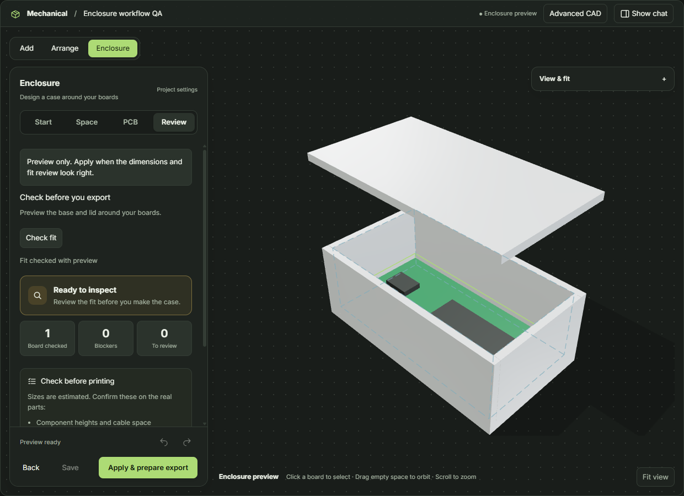

`cad/enclosure-design.json` stores the validated settings. Save rejects a stale settings revision. Apply checks the preview fingerprint against settings, PCB bytes and imported source, including another check after generation.

An immutable `exports/mechanical-<revision>-<id>.zip` contains:

- case STL and STEP, plus lid STL for a new enclosure;
- exact source PCB files and their enclosure placements;
- settings, fit-review results and a SHA-256 manifest.

All values use millimetres, PCB XY coordinates and Z up. Use the included placements when assembling exported PCB models. The ZIP is a coordinated design snapshot, not a Gerber/fabrication release.

## Validation — 2026-10-29

- **Root typecheck and desktop production build pass.** No `.map` files in desktop output.
- **65 focused tests pass / 987 assertions** across history, recovery, input/import planning, center rotation, defaults, PCB geometry, mechanical checks, STL surface checks, CAD tool contracts, scene geometry and camera fitting. Native service contracts in automated tests use mocks.
- **Full root suite: 1,918 pass / 41 skip / 35 fail.** This includes the same 34 failures from the earlier audit run plus a timing-sensitive MCP progress assertion that also varies in isolated reruns. Root tests are not green; failures include Windows process/symlink/CLI behavior, fixtures, speech cleanup and media encoding. The root script stops before its final scripts/test phase when workspace tests fail.
- Background app checks: placement field and keyboard undo/redo, recovery after daemon restart, stale/corrupt recovery handling, input validation, import drop routing, source-byte reload, search/clear, generated preview and matched ZIP pass.
- Four panel sizes checked: 2108×860, 1100×700, 778×600 and 600×500. No horizontal overflow, tool/inspector collision or footer overlap; compact tools remain scrollable.
- Live VAIO copy: imported wall crossing appears red and can be focused. Cached surface checking of the 23,534-triangle bottom cover took approximately 7.4 ms in the measured run. Source PCB and original shell hashes are unchanged.
- Additional audit: 31 main VAIO PCB files parse, produce schema-valid defaults with no default fit blockers, and generate readable base/lid STL and STEP output; this is not proof that all fit the original VAIO case. Independent checks match Three.js for 20,000 triangle/box cases and 1,000 source transforms. A live 20-edit/20-undo run preserves geometry/texture counts and restores the original placement.
- ZIP verification: every manifest entry matches its file hash; included PCB bytes match the project source.
- Earlier real FreeCAD 1.1 fixture generated valid STL/STEP and verified cavity, through-opening, bored post and protected obstacle. That verifies the solid operation, not desktop bridge integration.

**Remaining integration gate:** actual PCB writes and imported-case modification still need successful live desktop tests with compatible native bridges. The Windows test environment could not supply those bridges. Generated exports contain primitive shells/solids; review their unions and manifoldness in a CAD tool or slicer before printing. No claim of complete VAIO fit or manufacturing certification is made.

## Further work

Prioritize native bridge end-to-end validation, transferable Arrange/Enclosure placements and exact solid containment/collision checks. These are distinct from the implemented conservative fit review.

## PCB geometry in the viewport — 30 October

Arrange and Enclosure automatically load KiCad-exported GLB geometry for the saved PCB revision: actual Edge.Cuts, holes, pads, silkscreen, solder mask and linked component models. The renderer preserves KiCad millimetres and the PCB coordinate frame, including bottom-side models. Missing or unreadable component models are listed; they are not replaced with estimated boxes. Export errors remain visible with a Refresh action.

The model card downloads binary PCB STL from the same geometry, with transforms baked and mirrored triangle winding corrected. STL is geometry-only; the viewport retains GLB materials. Incomplete component coverage produces a `-partial.stl` filename. This is a visualization/export improvement: collision review and enclosure dimensions still use conservative feature bounds and estimated heights, not exact component solids. Missing models must be assigned in the source PCB and refreshed.

Validation: nine focused tests pass for coverage, source revision guards, request reuse, coordinates and STL units/winding. Live KiCad 10.0.5 checks cover a real CM5 board (12/15 component models), L-shaped and circular fixtures, and a linked-model fixture with bottom-side components. Adding a missing model and refreshing changes coverage from 9/13 to 10/13 without changing PCB bytes. Live PCB STL downloads preserve 65 × 32 mm CM5 bounds and the linked fixture's Z range −1.215 to 6.695 mm. Enclosure preview remains usable, and three tested panel sizes have no horizontal overflow or hidden footer. The broader four-package run has 948 pass, 2 skip and 15 failures; all failure names match the prior audit. This is not a green full-repository test result or fabrication certification.

The interface uses [progressive disclosure](https://www.nngroup.com/articles/progressive-disclosure/), [visible system status](https://www.nngroup.com/articles/visibility-system-status/) and [recognition rather than recall](https://www.nngroup.com/articles/recognition-and-recall/): a short task sequence, visible states and secondary controls shown when needed.

## PCB holes and mounting hardware — 30 October

Space → **PCB holes & screw posts** lists measured plated/non-plated drills and slots. Round mounting holes offer a post action; connector/pin holes and slots are excluded from automatic posts. Unclassified circular cutouts require a deliberate selection. Missing drill dimensions never produce an invented mounting hole, and routing vias are not listed. DNP footprints still contribute their physical drills.

Linked posts follow their PCB's position, rotation and floor height. Green/amber rings show whether a post is aligned to a candidate hole. Existing posts can be explicitly linked when a unique measured hole matches. Each post expands to reveal bore, support and actual screw dimensions. Bare mounting-hole/fiducial footprints without a component model no longer count as missing component geometry.

Fit review blocks shifted/missing holes, oversized bores or shafts, unsupported boards, thin/overlapping posts, screws reaching the floor, and screw-head conflicts with components, other boards, obstacles, walls or lid. Missing screw measurements remain a visible review item. Bores are **unthreaded**: select a suitable pilot/insert diameter and verify threading, engagement and manufacturing tolerances physically. The generator does not infer screw standards from hole size or certify a perfect fit.

Validation: **73 focused tests / 387 assertions pass**; all five changed packages typecheck; the desktop build passes with zero source maps. A native KiCad 10.0.5 Excellon export independently confirms a rotated fixture's 3.2 mm hole at (13, 8), 2.2 mm hole at (40, 24), and 2 × 4 mm slot. Copper-pad offset does not move the drill centre. Live UI rotation/translation updates both linked posts exactly; two Undo operations restore the original positions. Three panel sizes have no horizontal overflow or hidden footer.

Live backend checks reject seven invalid mounting configurations at export. A manually arranged **six-PCB fixture with twelve posts** produces one shared enclosure and a coordinated ZIP containing all six PCB files. This is a synthetic test, not the actual VAIO assembly or automatic placement optimization. The broader five-package run has **1,043 pass / 2 skip / 14 fail**; every failure name also appears in the earlier audit. The full suite is not green.

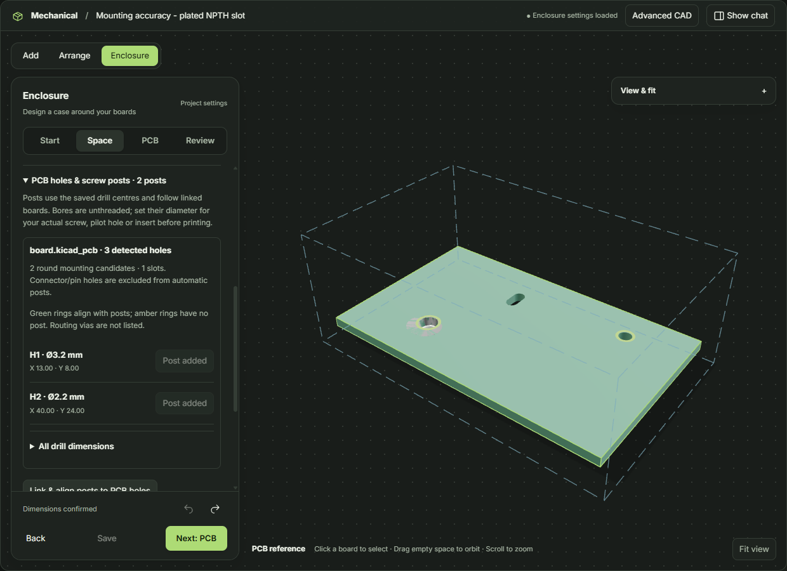

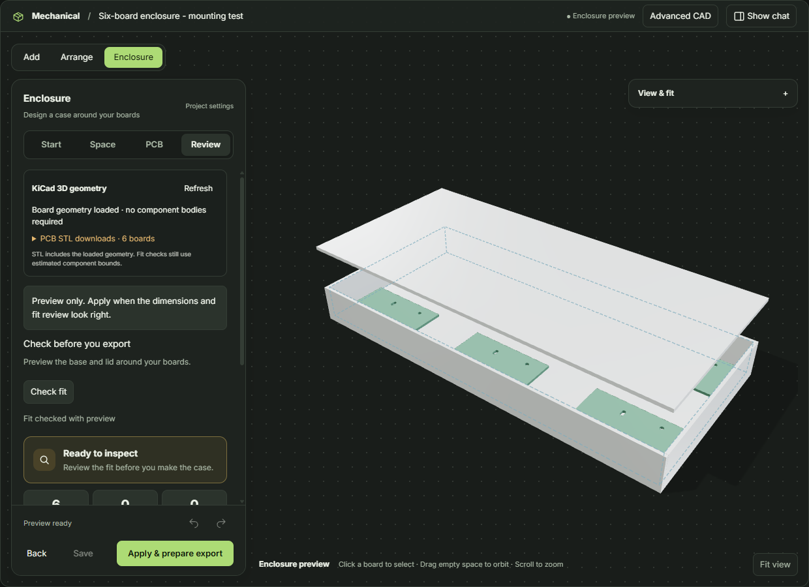

## Real VAIO board collection test — 30 October

Using local `vaio_p_modding` snapshot `ac0fdf7`, eleven distinct board families (478 parsed component envelopes) were copied unchanged into a shared FabDesk project. Older revisions and unrelated demos were excluded. Alternative power boards and bench adapters are included as a collection stress test, not a validated electrical assembly. The main CM5 carrier and non-PCB hardware are outside this source set.

The generated interior is 200 × 305 × 24 mm with twelve measured-hole posts; the base mesh measures 204 × 309 × 26 mm and the lid 204 × 309 × 2.6 mm including its lip. The coordinated ZIP contains all eleven original PCB sources with verified manifest hashes. Loaded native geometry exposed underestimated underside clearance on the Sony escape and LVDS boards; raising their placements and linked posts resolves the measured bounding-box clearance. All ten available native models now have at least 1 mm cavity clearance.

**This is an enclosure study, not a print-ready VAIO chassis.** Seven boards need holders or another reviewed retention method. Connector routing/openings, hardware, cooling and cable reach remain unresolved. A2 uses KiCad 10.99/11 format, which installed KiCad 10.0.5 cannot render; its conservative reference remains visible. Across the other ten boards, 295/374 component bodies load; missing entries include bare pads/jumpers and unresolved physical component models. There are 36 actionable fit-review items plus the general coverage note, despite zero blocking estimated-envelope conflicts.

This test fixed a warning gap: each PCB without an aligned supporting post now gets its own retention review, even when another PCB has posts. Thirty focused tests / 117 assertions and the KiCad package typecheck pass. Real-board overlap, floor-intersection and shifted-post checks all report blockers. Base/lid STL parse successfully; exact solid collision, union/manifoldness and physical fit remain unverified.

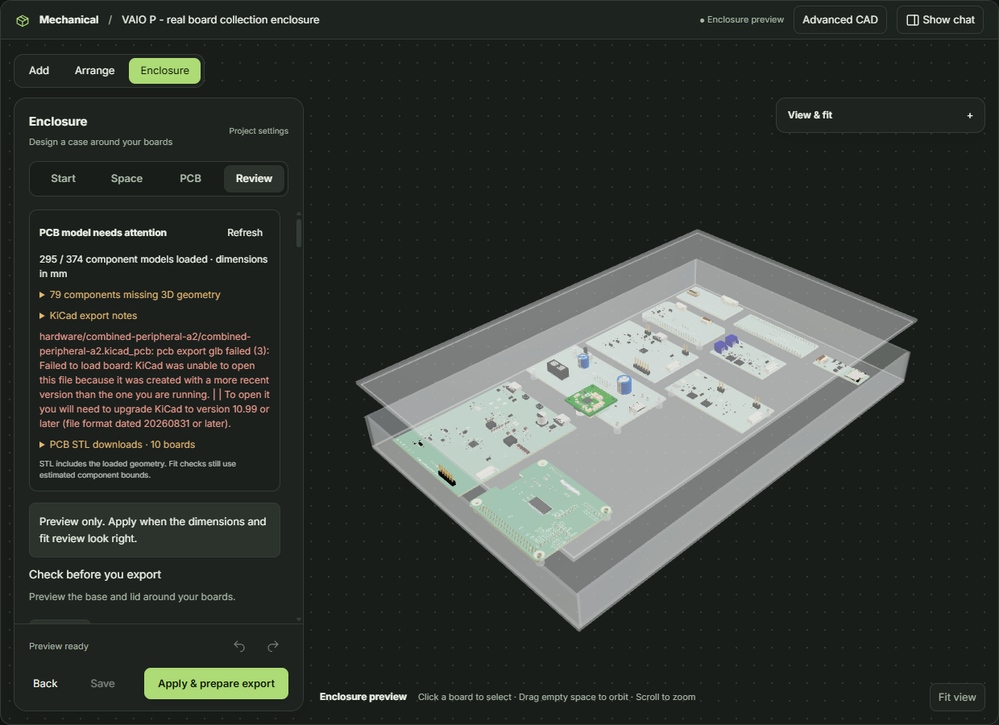

## Port-aware VAIO layout and viewer optimization — 30 October

This supersedes the earlier manual 200 × 305 mm layout. **PCB → Find a better layout** searches board rotations and positions, prioritizes external ports at their facing walls, then minimizes the candidate case footprint. Review external/internal connector choices, inspect the proposal, and choose **Use this layout**. Undo/redo restores the complete placement, openings and linked posts. Imported interiors, obstacles and manual openings keep the case dimensions fixed. No PCB source is rewritten.

The eleven-board VAIO collection now fits a **325 × 130 × 20 mm** interior: 30.7% less footprint, six external ports at walls, six matching wall openings, and twelve repositioned posts. Exported STL intersection probes confirm all six openings are empty and the wall below each is solid. All ten available native-model bounding boxes remain within the cavity clearance; source PCB bytes and export hashes are unchanged. The live workflow passed proposal acceptance, Undo/Redo, preview, save and coordinated export. Three panel sizes (1240 × 900, 780 × 600, 600 × 500) retain visible footer controls without horizontal overflow.

The viewer batches opaque surfaces and same-material coplanar translucent PCB patches, retains separate curved transparent geometry, caches up to twenty models within a 160 MiB budget, avoids duplicate parsing, and refreshes shadows only when geometry/transforms change. The real native models drop from **39,981 to 539 mesh objects** with all **559,274 triangles** retained; maximum measured world-bound difference is 0.0000031 mm. A short local synchronous rendering sample measured about **14.4 ms/frame** after planar batching versus 60–75 ms during the first optimization pass, with 967 versus 5,036 draw calls. This is a local sample, not a guaranteed frame rate across hardware. See Three.js [object batching guidance](https://threejs.org/manual/pages/optimize-lots-of-objects.html).

The search is a bounded heuristic, not proof of a globally optimal layout. Connector classification and facing edges are inferred from footprints; mating plugs, cables, cooling, exact component heights and manufacturing tolerances need review. Seven boards still need retention; A2 requires newer KiCad and is explicitly shown as amber estimated bounds. The remaining ten load 295/374 component models. This collection contains alternative boards and is not a validated complete VAIO electrical assembly.

Validation: **10 focused tests / 65 assertions**, all five changed package typechecks, and desktop build pass (zero packaged source maps). Broad package runs total **1,052 pass / 2 skip / 14 fail**; all fourteen failure names recur in the earlier baseline. The whole suite is not green. Automated geometry/export checks do not establish manifoldness or physical fit.

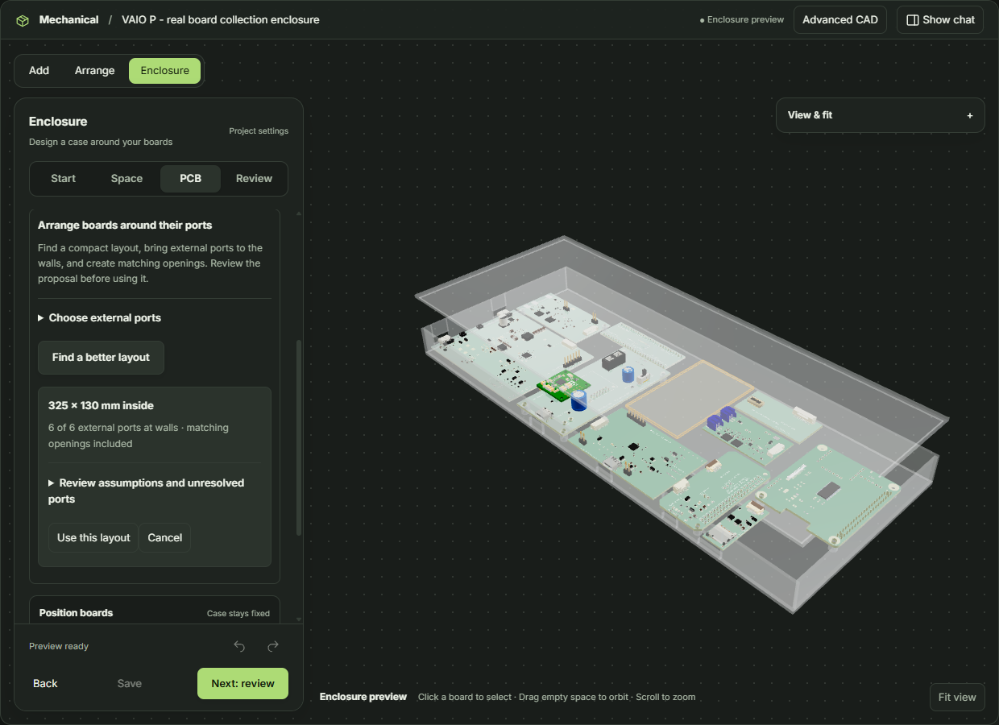

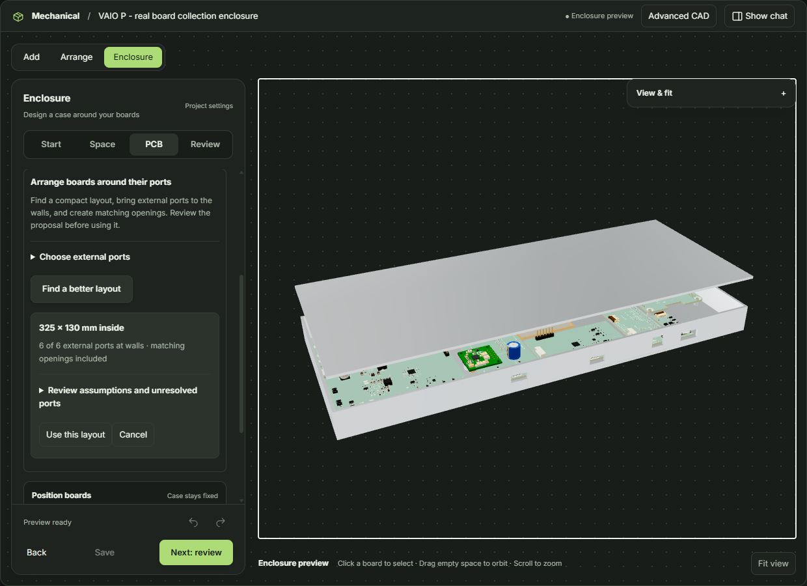

## Assembly constraints and layout choices — 30 October

**PCB → Plan your assembly → Compare layouts** replaces the single layout proposal. Compact prioritizes footprint; Assembly space leaves at least 8 mm between board envelopes; Ports together prioritizes fewer exterior walls. Each card shows interior dimensions, accessible ports, wall count, spacing and assumptions. Accepting a choice remains undoable. These are bounded search objectives, not guaranteed global optima or assembly-access certification.

Optional board locks preserve position, height and rotation and keep the case dimensions fixed. Port controls distinguish internal connectors from external ports, override inferred PCB-facing edges, select a preferred case wall, and record rectangular opening and mating-plug dimensions. Opening clearance is independent of board clearance. Plug reach includes the board-to-wall gap and wall thickness; overlapping plug envelopes produce blockers. Starting measurements are explicitly estimates requiring verification.

Cable connections store connector endpoints, usable length and a bend/slack allowance. The planner rejects candidates whose direct 3D endpoint distance plus allowance exceeds cable length. The backend blocks missing endpoints, short cables, insufficient plug reach and plug collisions during build/export. Optional cyan plug envelopes and dashed connector guides make the assumptions visible. Dashed lines are distances, not routed cables; bend paths, connector pin compatibility and real cable availability are not inferred.

The desktop review now supplements estimated component checks with revision-matched loaded native-model bounds against all cavity faces. A native clearance blocker disables Apply/export in the desktop. This supplemental check is currently client-side; direct `cad_fit` calls still use estimated component geometry. It is bounding-box containment, not exact solid collision, and missing models remain visible limitations.

### Validation

- Real eleven-board VAIO collection: Compact **325 × 130 × 20 mm**, six ports on two walls, 3 mm board spacing; Assembly space **225 × 195 × 20 mm**, six ports on three walls, 8 mm spacing. Ports together returns the same dimensions as Compact for this collection. No invented VAIO cable measurements were added.
- Live choice acceptance, Undo and Redo restore exact designs. Locking a board disables movement. Panels at 1240 × 900, 780 × 600 and 600 × 500 retain their footer and have no horizontal overflow.
- A separate fixture uses two unchanged copies of a real SV test board and **example** plug/cable measurements, not a validated VAIO wiring plan. Backend exports reject short cable, insufficient plug reach and overlapping plugs. Valid profiles/connections survive coordinated export with manifest hashes verified.
- Loaded native geometry revealed only **0.27 mm** lid clearance in that fixture's 14 mm interior, despite passing estimated checks. The desktop blocks Apply. Changing the interior to **16 mm** clears the blocker and exports successfully, preserving the board lock and constraints.
- **21 focused tests / 107 assertions pass**. All five changed packages typecheck; desktop production build passes with zero packaged source maps. Latest client-core/UI runs pass **203 + 226 tests**. Combined with the other package runs: **1,061 pass / 2 skip / 15 fail**. Every failure name occurs in the prior audit, including an intermittent MCP adapter failure; the full suite is not green.

The VAIO collection still contains alternatives and adapters, excludes the main carrier/non-PCB hardware, has seven boards needing retention, and loads 295/374 component models on ten boards; A2 needs newer KiCad. No manufacturing-ready or perfect-fit claim is made. Exact solid collisions, routed cable geometry, shaped connector apertures, closure/retention design and manufacturing profiles remain separate work.

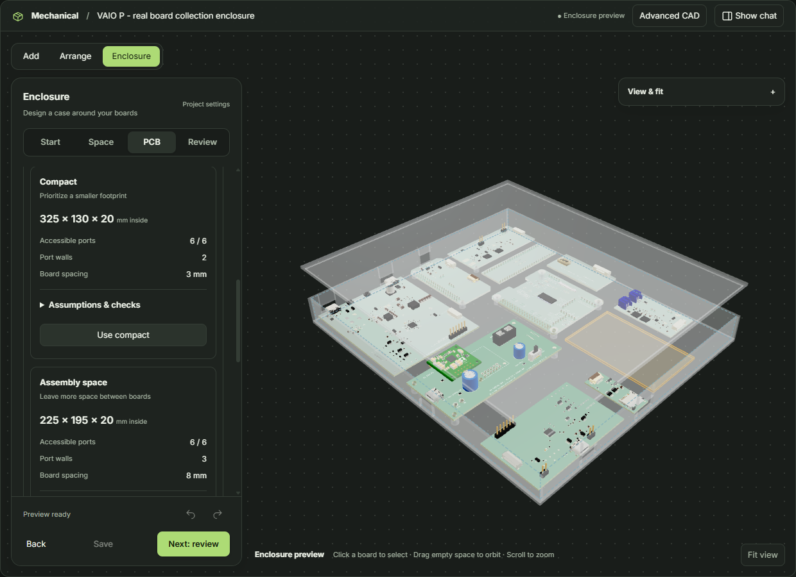

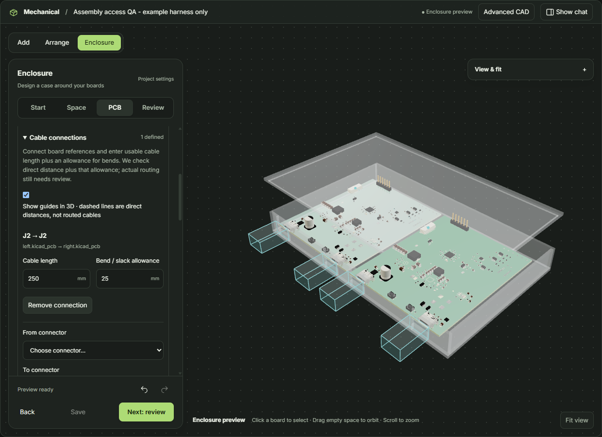

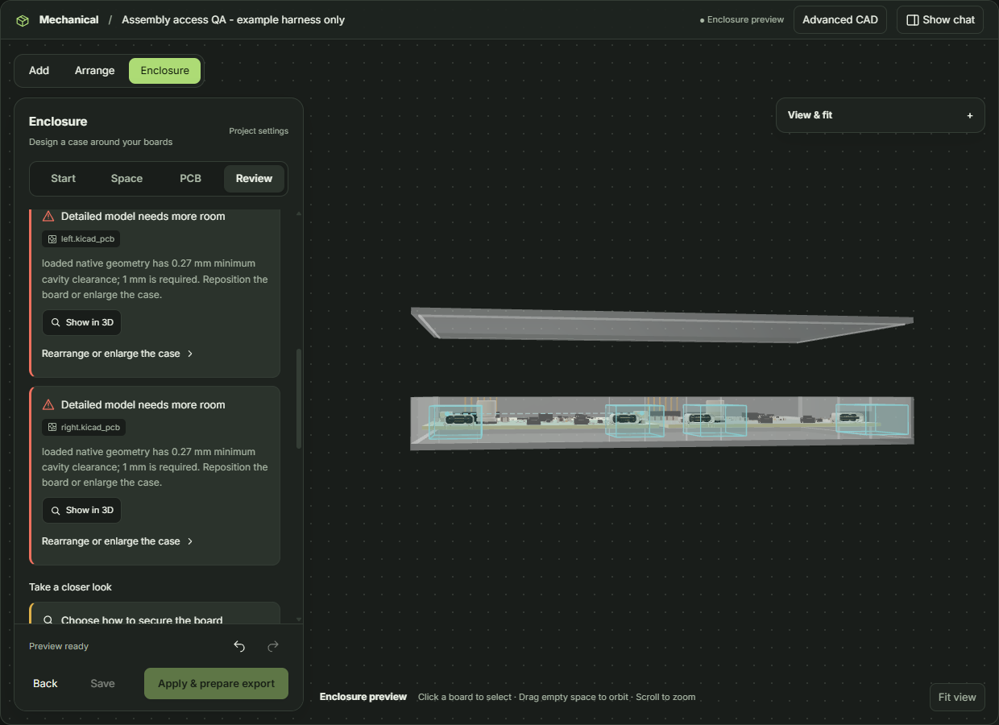

## Simple default workflow — 30 October

The current interface replaces **Start / Space / PCB / Review** with **Boards / Case / Preview**. New generated cases need no number entry:

- **Boards:** check the boards to include. Their dimensions come from the files. Search and selection counts replace the long file dropdown; generated export copies are excluded. Selection is limited to twenty boards. Removing a board also removes its linked posts, openings, port profiles and cable endpoints, with Undo available.
- **Case:** choose New case, then Small case or More room, and click **Make preview**. The app arranges the boards, sizes the case, updates linked features, saves the draft and renders the preview. Saved designs initially use **Keep my layout** so opening a project does not rearrange prior work. The advanced comparison still offers the Ports together objective.
- **Preview:** **See inside** and **Fit view** are directly available. Blocking errors remain expanded and disable saving design files; secondary checks and printing guidance are expandable. Clearance/overlap errors offer **Try a roomier layout**, which still respects locks and other constraints and can report that no solution was found. Save design files prepares the coordinated ZIP; Download files retrieves it.

Dimensions, manual board movement, fixed parts, screws, port/cable settings and native PCB edits remain available under named disclosures. Imported cases still require their usable interior dimensions and confirmation; the app does not invent measurements or silently confirm them. Detailed-model limitations remain visible in the compact model-status disclosure. The presentation follows [progressive disclosure](https://www.nngroup.com/articles/progressive-disclosure/): keep the usual task small and reveal specialist options when needed. This has not been usability-tested with children.

Validation: **434 affected-package tests pass** (207 client-core, 227 UI), both package typechecks pass, and the desktop production build passes with zero packaged source maps. Tests cover automatic sizing with native bounds, preserving imported-case confirmation, keeping existing layouts, source-file filtering, linked-setting removal and keeping blockers outside collapsed notes. Live first-use testing selected two unchanged VAIO-source boards and produced a **120 × 80 × 15 mm** case with three port openings, without entering numbers. Export manifest hashes and unchanged source bytes are verified. The existing eleven-board VAIO design also previews through the simplified flow.

All three screens at 1240 × 900, 780 × 600 and 600 × 500 have zero visible numeric inputs on the default generated-case path, no horizontal overflow, and visible footer actions. Clearing selection disables the next action; Undo restores it. Existing-case mode exposes the three required dimensions and keeps preview disabled until its requirements are met. Broader suite failures documented above were not reclassified as resolved; exact collisions, manufacturing and physical fit remain unverified.

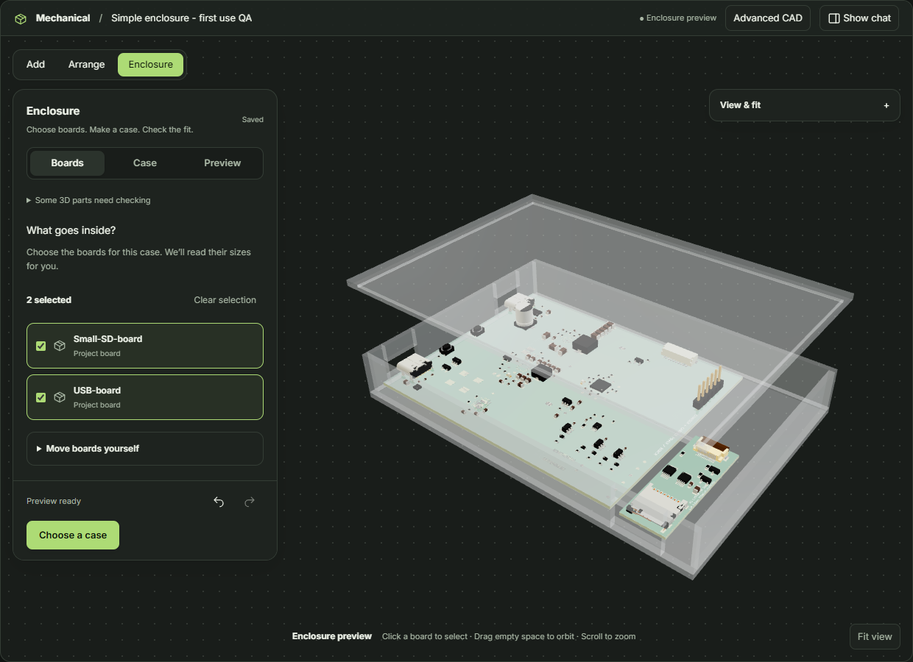

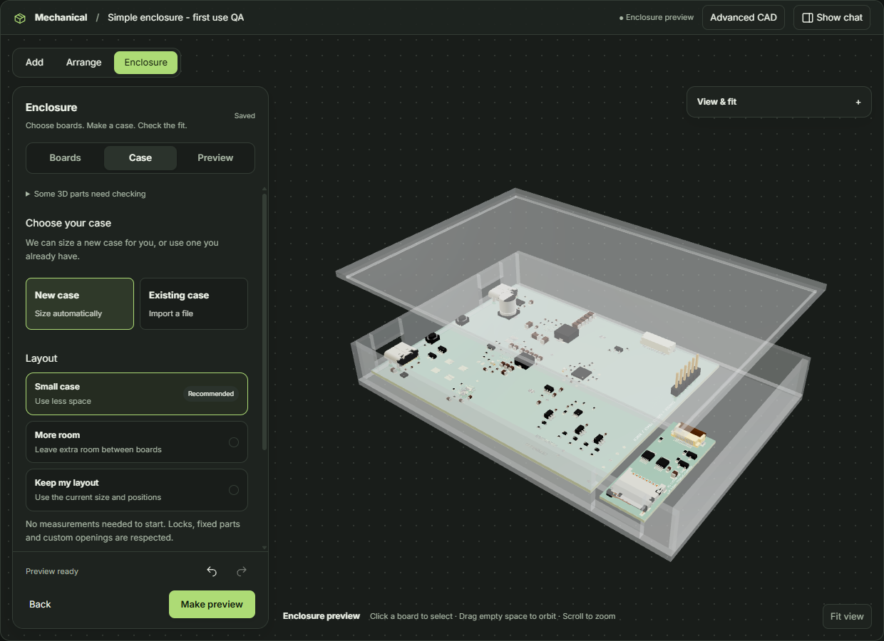

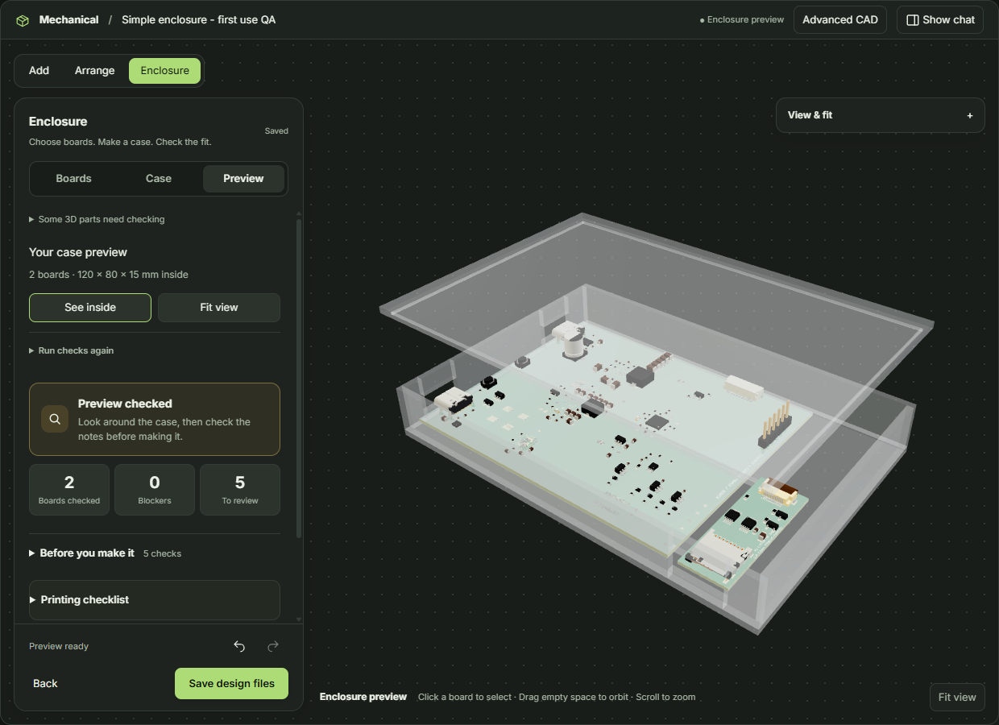
