# Enclosure design and PCB fit

Open **CAD → Enclosure**. The guided workspace has four tabs: **Start**, **Space**, **PCB**, and **Review**. The primary action stays in the footer: Continue → Preview → Apply → Download. Dimensions and units are explicit, secondary controls are collapsed, and a changed dimension invalidates the confirmation and previous preview.

The Review tab separates required fixes from visual checks using labelled status cards, icons, board/blocker counts and contextual navigation. Raw diagnostic text remains under **Technical details**. **Check before printing** is a short checklist rather than a log paragraph. No status claims the design is certified for manufacture.

Fit checks run automatically after edits pause. Located blockers highlight affected parts/obstacles in red, including insufficient clearance, board-to-board conflicts, overflow, mounting-post problems and out-of-bounds openings. **Show in 3D** isolates and frames a finding; **Show all issues** restores the overview. The dashed outline shows the usable interior. Both overlays can be toggled. Red is an estimated risk envelope, not an exact mesh intersection; imported-shell collisions are still outside the automatic checks.

Back and destination-labelled Next actions make navigation explicit. Board placement fields describe left/right, front/back, height and rotation. Old check responses are discarded after edits, and changing the design clears the previous preview and highlights while the new check runs. All known board sources are displayed in the shared coordinate frame.

## Workflows

- **New enclosure:** dimensions start from the project PCB. Adjust the rectangular interior, wall/floor/lid thickness, clearance, mounting posts and connector openings. Additional project PCBs can be positioned in the same coordinate frame. Preview the generated base and lid before applying.
- **Existing case:** import/select a closed STL or solid STEP. Confirm the units, position and usable interior. STL is displayed immediately. Through the native FabPlane CAD bridge, the tool carves the requested cavity, preserves material inside protected obstacle volumes, adds bored mounting posts and cuts openings through the original walls. The original file is never overwritten. Oversized cavities and invalid solids are rejected.

Imported solid modification requires a **native FreeCAD bridge**, not the mock server. A regular FreeCAD installation alone does not establish that connection. STEP geometry appears after a successful native preview.

## Actual PCB editing

The PCB tab separates enclosure placement from **Edit actual project PCB**. The latter writes `board.kicad_pcb` through the existing recoverable native transaction:

- Resize a rectangular outer boundary, retaining circular cutouts. Ambiguous curves/internal contours are refused for manual editing rather than silently removed.
- Move a selected component while preserving its rotation and connectivity.
- Add a circular Edge.Cuts mounting cutout. Existing holes, component envelopes and board-edge bounds are checked before the edit.

Edits require confirmed dimensions, a matching saved PCB revision and the FabPlane PCB bridge. They preserve existing copper; rerouting and electrical DRC are separate required checks. The enclosure controls edit the canonical project PCB; additional imported PCBs remain source references.

## Fit coverage

Checks include transformed PCB bounding boxes, all populated component envelopes (including short and bottom-side parts), interior/obstacle clearance, board-to-board envelope overlaps, mounting-hole alignment and connector-opening coverage. Obstacles are shown in amber. Blocking issues prevent Apply/export but still permit a visual preview.

The result is **review required**, never a claim of manufacturing certification. Component heights are estimates, rotated/irregular outlines use conservative boxes, and imported-shell triangle collisions, cables, tolerances, fastener access and electrical DRC are not certified by these checks. Model translation in **Arrange** is separate from the explicit PCB-coordinate placements in this workflow.

## Saved data and coordinated exports

`cad/enclosure-design.json` is the versioned, validated settings file. Save rejects an out-of-date settings revision. Preview does not replace designs or export files. Apply checks the preview fingerprint against the settings, PCB bytes and imported source, including a recheck after generation.

Each export is an immutable `exports/mechanical-<revision>-<id>.zip`, containing:

- case STL and STEP, plus lid STL for a new enclosure;
- exact source PCB files and their enclosure placements;
- design settings, fit-review results and a SHA-256 manifest.

All mechanical values use millimetres, PCB XY coordinates and Z up. Exported CAD files use those coordinates; use the included board placements when assembling PCB models. Export is a coordinated design snapshot, not a Gerber/fabrication release.

## Validation on Windows, 2026-10-29

- Root typecheck and desktop production build pass; no source maps in desktop output.
- Latest focused run: **51 CAD/kernel/fit/scene tests pass**, including transformed risk regions, clearance-only and board-to-board conflicts, clearing resolved risks, batched overlay geometry, stale-preview refusal, collision gating, immutable ZIP hashes, path/schema checks, native transaction delegation and outline/cutout preservation. Native bridge behavior in these automated tests uses mocks.
- Full root run: **1,875 pass / 35 fail**. The failure names match the pre-change `mechanical-full-tests.log` baseline exactly. Root tests are not green.
- Live VAIO A5 copy: preview and ZIP export pass; dimensions invalidate preview; a deliberately overlapping obstacle disables Apply; the original VAIO bottom-cover STL displays in the existing-case flow.
- Real FreeCAD 1.1 geometry test: the generated modification script produced a valid solid/STEP/STL; point-containment assertions verified the cavity, through-opening, bored mounting post and protected obstacle. The source solid remained unchanged. This verifies the solid operation, not the desktop bridge integration.
- Live native PCB editing could not complete: the PCB bridge was unavailable. The failed edit restored the isolated test copy. Downloading the matching Windows backend was blocked by disk space; the incomplete archive was removed. Native imported-case modification also still needs an active FabPlane CAD bridge in the app.

## Running-app evidence

### Select and position boards in the enclosure

Click a PCB in the 3D view or choose it under **Position boards**. Use **Move** arrows/plane handles or the **Rotate** ring; the case stays fixed. Rotation pivots around the board centre while saved/exported placements retain the native PCB coordinate frame. **Undo move** (Ctrl/Cmd+Z outside inputs) restores the last placement change. These controls change enclosure placement, not PCB source bytes.

**Top view**, **Focus board** (F), **Hide case** and **Fit view** make occluded or displaced boards easier to reach. Escape clears selection. **Center in usable space** uses confirmed interior dimensions and preserves mounting height/rotation; it does not certify fit. View controls collapse automatically in narrower workspaces and can also be hidden manually.

The VAIO screenshot exposes a remaining limitation: a board can cross the actual imported wall while staying inside the user-defined rectangular interior. The view now explicitly warns that imported case surfaces are not checked automatically. Red marks identify detected envelope/interior conflicts, not exact shell intersections.

| Select and move; case fixed | Top view for alignment |
| --- | --- |
| 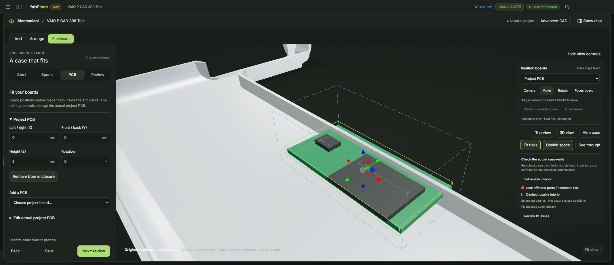 | 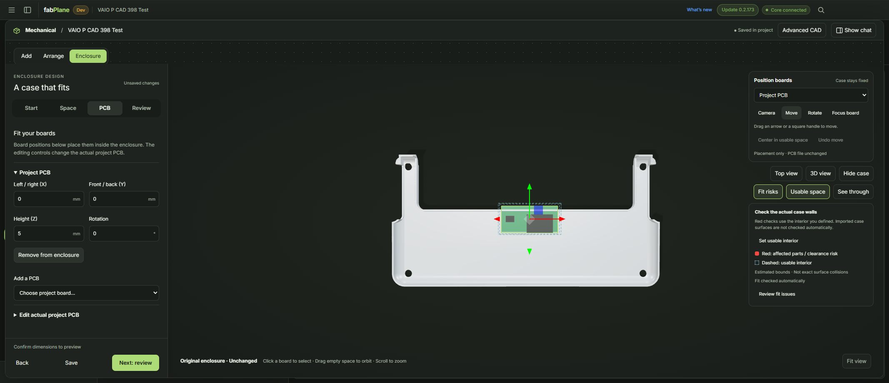 |

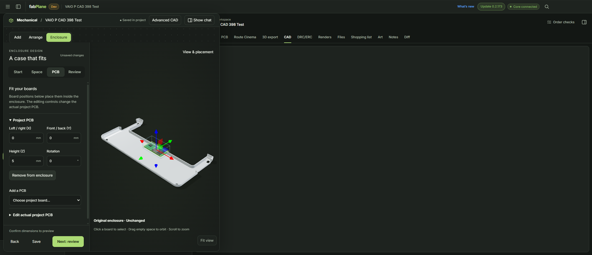

Live checks: native mouse selection, arrow drag, centre rotation, button/keyboard undo, list selection, hide/show case, top/3D views, focus/fit, centering and compact-control expansion pass. Test movements were restored to X=0/Y=0/Z=5/rotation=0; the A5 PCB SHA-256 stayed unchanged. Root typecheck and final UI typecheck pass; desktop build passes with no output source maps. **60 focused tests pass** across placement helpers, scene geometry, mechanical constraints and CAD tools (native service paths remain mocked). The full-suite baseline and native bridge limitations above remain unresolved.

### Visual fit review

| Red collision / clearance risks | Displaced board outside the usable space |
| --- | --- |
| 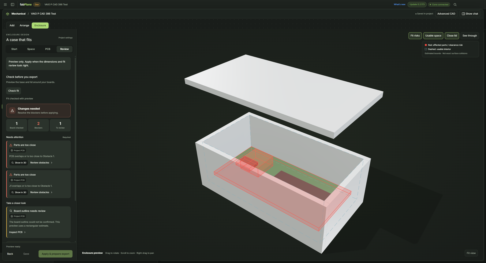 | 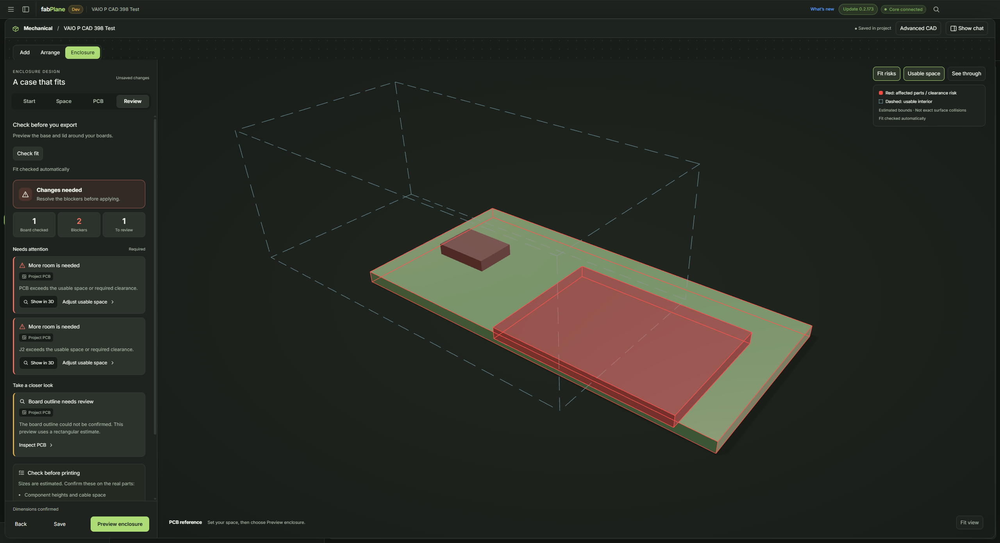 |

Live follow-up: automatic rechecks, stale-response rejection after rapid edits, issue focus/reset, overlay toggles, collision-blocked Apply and cleared highlights after restoring a board all pass. A 778 px workspace has no inspector/footer overflow or toolbar/legend overlap. Two batched drawing objects handle 2,000 distinct test regions; the scene remains demand-rendered.

| Review notes | Blocking collisions |
| --- | --- |
| 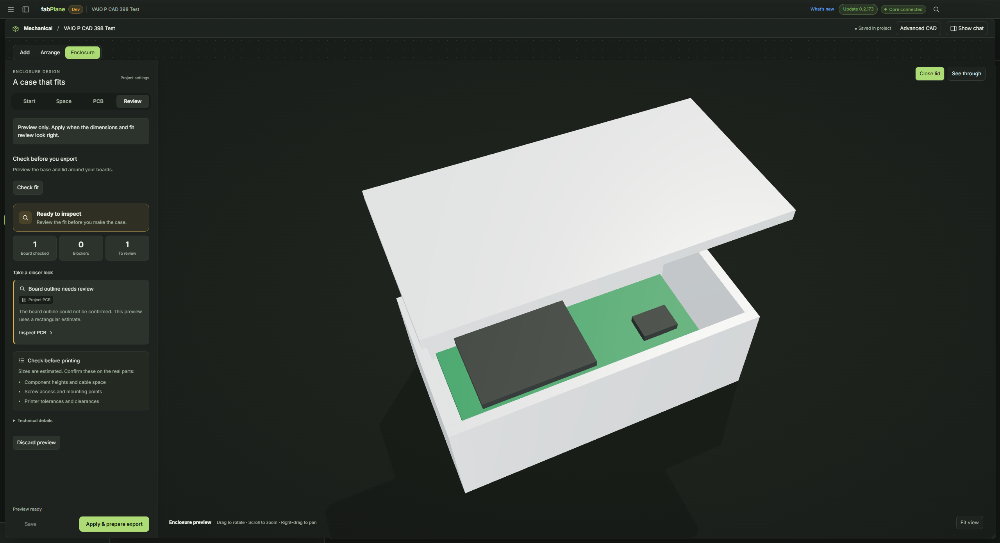 | 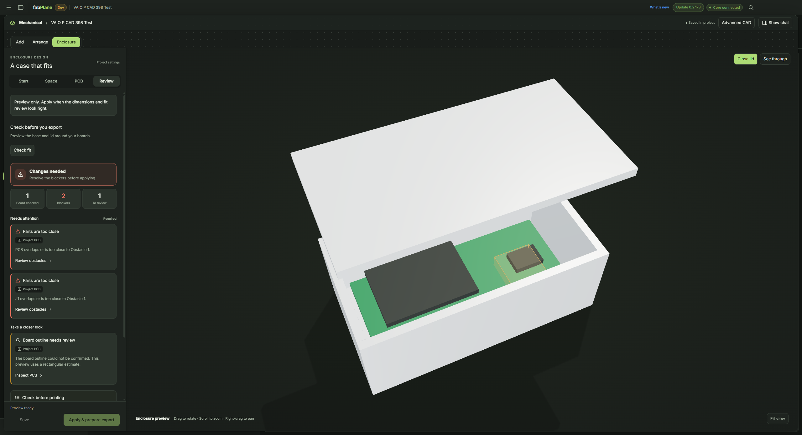 |

Follow-up checks: UI typecheck and desktop build pass; live navigation to PCB, expandable original diagnostics and collision-disabled Apply work. Dark/light layouts and a 310 px inspector were checked with no horizontal overflow.

These screenshots use the VAIO P project's A5 board copy and original bottom-cover STL. The board components are estimated envelopes. The source-cover screenshot shows import/display, not a completed native modification.

| Simple start | Preview and apply |
| --- | --- |
| 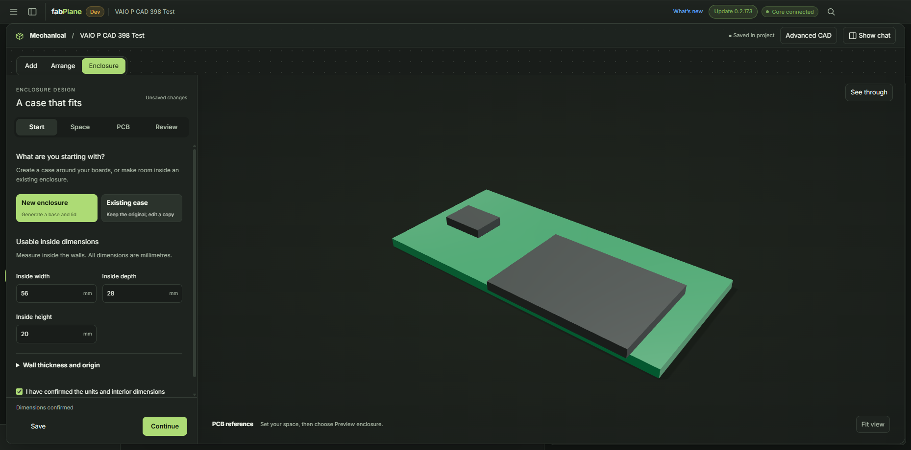 |  |

| Collision blocks Apply | Original VAIO case |
| --- | --- |
| 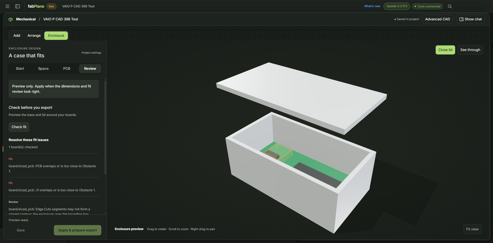 | 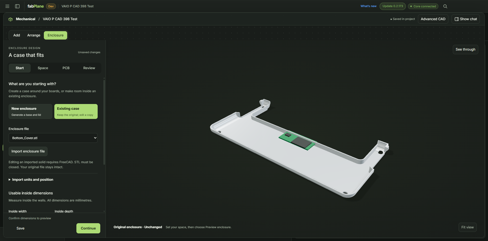 |

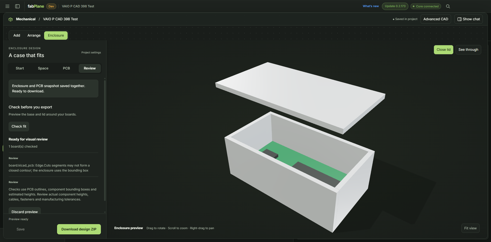

## UX references

The layout follows [progressive disclosure](https://www.nngroup.com/articles/progressive-disclosure/), [visible system status](https://www.nngroup.com/articles/visibility-system-status/) and [recognition rather than recall](https://www.nngroup.com/articles/recognition-and-recall/): a short task sequence, one changing primary action, visible preview/save states and secondary geometry controls shown when needed.
