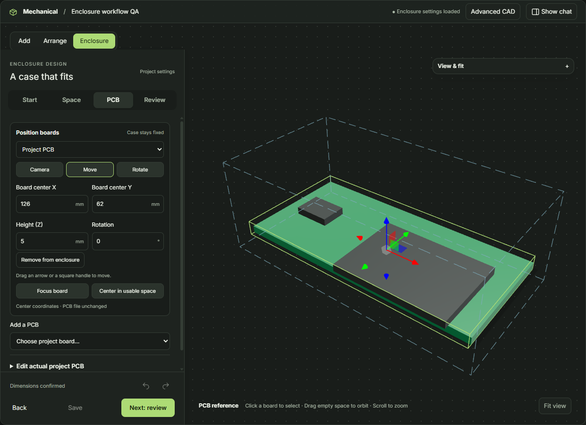
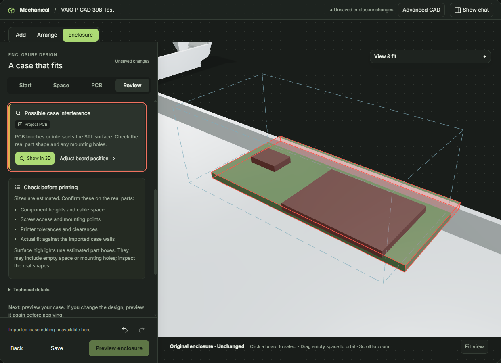

# Enclosure design and PCB fit

Open **CAD → Enclosure**. Work through **Start → Space → PCB → Review**. Related editing controls stay in the left inspector; **View & fit** contains camera and visibility controls. The footer keeps the next action, Save and undo/redo in consistent positions.

## Start with boards or an existing case

- **New enclosure:** generate a rectangular base and lid around project PCBs. Initial dimensions include estimated component overhangs and underside parts; suggested posts and openings remain editable. Holes belonging to components are not automatically turned into screw posts.
- **Existing case:** import a closed STL or solid STEP, confirm units and define usable interior space. STL displays immediately. Modification uses the native FabPlane CAD bridge to carve the cavity, preserve protected obstacle volumes, add bored posts and cut connector openings. It writes a copy and preserves the original.

Import accepts one STL/STEP at a time, up to 50 MB. Dropping a file into Enclosure imports it into this workflow. Invalid or empty STL files are rejected before copying. STEP display requires a native preview; the UI explains this and offers STL for immediate positioning.

The app shows backend readiness where the dependent action appears. The bundled CAD runtime currently reports Windows and Linux as unsupported; generating a new enclosure works locally. A regular FreeCAD installation alone does not establish the FabPlane CAD bridge connection.

## Controls where they belong

| Location                      | Controls                                                                                    |
| ----------------------------- | ------------------------------------------------------------------------------------------- |
| Start                         | New/existing case, source import, dimensions and confirmation                               |
| Space                         | Clearance, obstacles, mounting posts and connector openings                                 |
| PCB → Position boards         | Board selection, Camera/Move/Rotate, center X/Y, height, rotation, focus, center and remove |
| PCB → Edit actual project PCB | Separate Outline, Component and Hole choices with only the relevant fields                  |
| Review                        | Fit findings, Show in 3D, Preview, Apply and matched export                                 |
| View & fit                    | Standard views, transparency, hide case, interior/risk overlays                             |
| Footer                        | Save, next/back, undo and redo                                                              |

Choose a board from the list or click it in 3D. Move uses axis/plane handles; Rotate and the numeric rotation field both pivot around its center. X/Y fields describe that center in enclosure coordinates. Saved placements retain native PCB offsets. Placement does not change PCB source files.

**Focus board**, **Top view**, **Hide case**, **Fit view** and **Center in usable space** help reach occluded or displaced boards. Centering is a positioning aid, not a fit guarantee. Camera controls collapse at narrower widths; inspectors scroll independently. Arrange has a searchable parts list and explicit empty-search feedback.

Moving or undoing a board position reuses its cached geometry instead of rebuilding it. A changed PCB revision refreshes the geometry; the live edit/undo check dropped from four decodes to zero, while a changed-and-restored board thickness produced the two expected refreshes.

The viewport shares the dotted workspace background. Guidance text permits camera gestures; native text/image dragging is suppressed. Cancelled pointers, lost capture and window focus loss release camera/part controls and discard unfinished moves. Model fitting reserves space for the inspector and expanded view tools.

## Recoverable editing

- Whole-design undo/redo covers placement, dimensions, imports and removed constraints, retaining up to 50 edits.
- Numeric input commits on blur or Enter; Escape cancels the input draft. Invalid values retain the previous value and explain the allowed range.
- Outside text inputs, Ctrl/Cmd+Z undoes; Ctrl/Cmd+Shift+Z or Ctrl+Y redoes. F focuses the selected board or fits the view; Escape clears selection.
- Unsaved settings survive Add/Arrange switches. A local recovery copy can be restored after reopening the workspace or restarting the daemon/app. Recovery is offered explicitly and never silently replaces project settings.
- If saved project settings changed since the draft, restoring it requires dimensions to be confirmed again. Corrupt/unavailable browser storage shows a warning; Save remains the durable project record. Recovery is browser-local and does not synchronize across devices.
- Settings edits invalidate the previous fit report, preview and export. Stale fit responses are ignored. Changed imported-file bytes invalidate the displayed source cache.

## Fit review and red highlights

Checks cover transformed PCB/component envelopes, underside parts, interior and obstacle clearance, board-to-board overlap, post/component conflicts, mounting-hole alignment and connector-opening coverage. Blocking findings prevent Apply/export while still allowing a visual preview.

Imported STL triangle surfaces are checked against estimated PCB/component boxes and their clearance margins. This catches a board crossing a real wall even when its rectangular interior settings would otherwise miss the wall. Located findings highlight red; **Show in 3D** focuses the affected area.

Surface findings are **review warnings**, not exact solid-collision proof: boxes may contain empty space or mounting holes. Checks do not establish containment inside a closed solid, watertightness, exact component geometry, cables, fastener access, manufacturing tolerances or electrical DRC. Large meshes/complex checks have explicit limits and report incomplete coverage rather than claim success. STEP surface review becomes available from the modified STL after a native preview.

For modified imported cases, preview/build/export review the **resulting case mesh**, not the original shell. The exported fit report describes that result. Connected outline segments are recognized regardless of order/direction; arc bounds include exact cardinal extrema. Irregular outlines retain an explicit bounding-box limitation.

## Actual PCB editing

The **Edit actual project PCB** section changes canonical `board.kicad_pcb` through the existing recoverable native transaction:

- Resize a rectangular outer boundary while retaining circular cutouts. Ambiguous curves/internal contours are refused for manual editing.
- Move a selected component while preserving its rotation and connectivity.
- Add a circular Edge.Cuts mounting cutout after checking board edges, existing holes and component envelopes. This guided hole edit requires a known closed rectangular board boundary.

Edits require confirmed dimensions, a matching saved PCB revision and the FabPlane PCB bridge. Outline changes require an unrotated enclosure placement; component/hole editing uses native PCB coordinates and supports rotated placements. Preflight checks reject proposed component/outline collisions, off-board component anchors, same-board component overlap and overlapping new holes. Separate edit types prevent one operation bypassing another's checks.

Existing copper is preserved; rerouting and electrical DRC remain separate required checks. Additional imported PCBs are source references. Arrange transforms and enclosure placements remain independent.

## Preview and coordinated export

`cad/enclosure-design.json` stores the validated settings. Save rejects a stale settings revision. Apply checks the preview fingerprint against settings, PCB bytes and imported source, including another check after generation.

An immutable `exports/mechanical-<revision>-<id>.zip` contains:

- case STL and STEP, plus lid STL for a new enclosure;
- exact source PCB files and their enclosure placements;
- settings, fit-review results and a SHA-256 manifest.

All values use millimetres, PCB XY coordinates and Z up. Use the included placements when assembling exported PCB models. The ZIP is a coordinated design snapshot, not a Gerber/fabrication release.

## Validation — 2026-10-29

- **Root typecheck and desktop production build pass.** No `.map` files in desktop output.
- **65 focused tests pass / 987 assertions** across history, recovery, input/import planning, center rotation, defaults, PCB geometry, mechanical checks, STL surface checks, CAD tool contracts, scene geometry and camera fitting. Native service contracts in automated tests use mocks.
- **Full root suite: 1,919 pass / 41 skip / 34 fail.** The 34 failure names are unchanged from the earlier run in this audit. Root tests are not green; failures include Windows process/symlink/CLI behavior, fixtures, speech cleanup and media encoding. The root script stops before its final scripts/test phase when workspace tests fail.
- Background app checks: placement field and keyboard undo/redo, recovery after daemon restart, stale/corrupt recovery handling, input validation, import drop routing, source-byte reload, search/clear, generated preview and matched ZIP pass.
- Four panel sizes checked: 2108×860, 1100×700, 778×600 and 600×500. No horizontal overflow, tool/inspector collision or footer overlap; compact tools remain scrollable.
- Live VAIO copy: imported wall crossing appears red and can be focused. Cached surface checking of the 23,534-triangle bottom cover took approximately 7.4 ms in the measured run. Source PCB and original shell hashes are unchanged.
- Additional audit: 31 main VAIO PCB files parse, produce schema-valid defaults with no default fit blockers, and generate readable base/lid STL and STEP output; this is not proof that all fit the original VAIO case. Independent checks match Three.js for 20,000 triangle/box cases and 1,000 source transforms. A live 20-edit/20-undo run preserves geometry/texture counts and restores the original placement.
- ZIP verification: every manifest entry matches its file hash; included PCB bytes match the project source.
- Earlier real FreeCAD 1.1 fixture generated valid STL/STEP and verified cavity, through-opening, bored post and protected obstacle. That verifies the solid operation, not desktop bridge integration.

**Remaining integration gate:** actual PCB writes and imported-case modification still need successful live desktop tests with compatible native bridges. The Windows test environment could not supply those bridges. Generated exports contain primitive shells/solids; review their unions and manifoldness in a CAD tool or slicer before printing. No claim of complete VAIO fit or manufacturing certification is made.

## Further work

Prioritize native bridge end-to-end validation, transferable Arrange/Enclosure placements, exact solid containment/collision checks and richer real component geometry. These are distinct from the implemented conservative fit review.

The interface uses [progressive disclosure](https://www.nngroup.com/articles/progressive-disclosure/), [visible system status](https://www.nngroup.com/articles/visibility-system-status/) and [recognition rather than recall](https://www.nngroup.com/articles/recognition-and-recall/): a short task sequence, visible states and secondary controls shown when needed.
