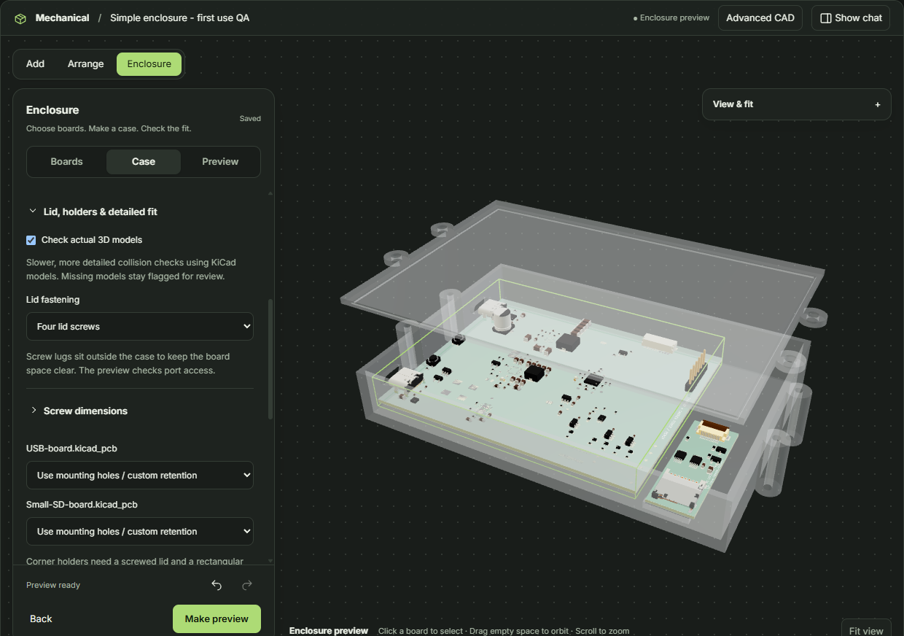
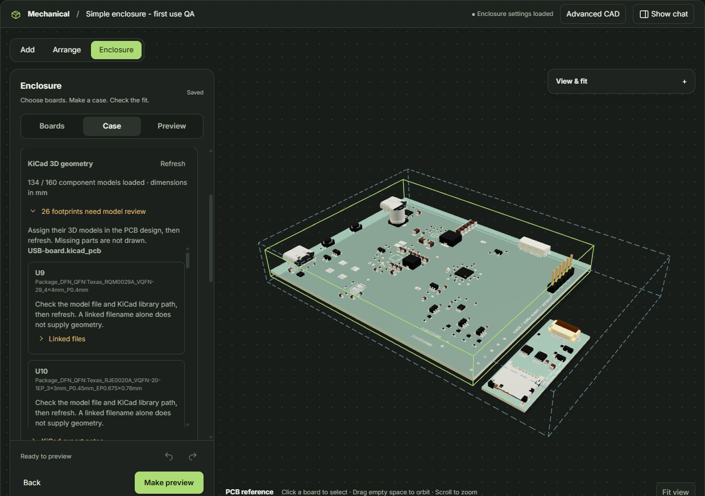

# Enclosure software validation — 30 October 2026

PR #398 adds a guarded prototype enclosure workflow. Software checks and slicing are evidence for review; they do not certify a manufactured assembly.

## New behavior

- Generated case and lid are boolean-joined separately with Manifold 3.5.4. Export rejects open, empty, non-positive or disconnected parts. STL and faceted STEP use the same joined boundary. Imported results must also pass a closed-solid audit.
- Optional four-screw closure searches 18 placements along both wall pairs to avoid ports, plugs, boards and obstacles. Screw bore, wall thickness and engagement are checked. Rectangular PCBs without holes can use corner feet/fences and lid capture pegs; unsafe corners and overlaps block export. Automatic placement reserves room for these holders.
- Footprint `Height` / `Height (mm)` properties supply measured component heights. Existing exact USB4105 / DM3D-SF profiles remain. Measured plug access now includes removal travel.
- Optional fresh native KiCad GLB checks intersect closed bodies with the case, lid, other boards and reserved obstacles. Independent board/obstacle gaps are checked. Collision regions are shown in red. Missing, open and oversized model coverage stays visible; conservative checks still run.
- Export adds `lid-print.stl` with the outside face at Z=0, `geometry-validation.json`, physical-check instructions and printable connector/pilot-hole samples. The manifest hashes all outputs. Original PCB files remain untouched.

## Verification

- **125 affected tests / 801 assertions pass.** Includes bores, holder retention/collisions, automatic lug alternatives, disconnected/open rejection, flipped lid, rounded samples, native collision/clearance rejection, failed model coverage, imported broken results and source preservation.
- Root typecheck, compiled Windows daemon and desktop production build pass. The compiled WASM export smoke succeeds. No source maps in build outputs.
- **12 independent Bambu Studio slices succeed with empty warning messages and nonzero extrusion.** Cases/lids: tiny 20×12 mm dongle, 120×24 mm hub, 180×120 mm controller, screw/holder fixture, real two-board VAIO-derived assembly; plus connector and pilot samples. These are slicer checks, not physical prints. See [machine-readable results](enclosure-v1-validation.json).
- Independent OpenCascade STEP imports of four fixture assemblies succeed, with one case and one lid mesh each.
- Two unchanged VAIO-derived PCB copies: 138 closed native bodies checked in approximately 8.4 seconds; eight open surfaces explicitly excluded. Missing component models and unmeasured mating dimensions remain review items. A lug/USB clash was detected, then eliminated by the bounded lug search. The final preview has zero blockers and ten review notes. Coordinated ZIP hashes match.
- Live UI: lid selection and detailed-check toggle persist through preview; blocked geometry disables export; corrected layout enables it. Checked checkbox alignment and captured actual app screenshots.
- Full Windows workspace suite: **35 failures**, all 35 reproduced by an isolated unchanged `265bcaf7` checkout with its own dependencies/submodules. No failure unique to this patch. This is not a claim that the entire suite passes. CI must be checked separately at the pushed revision.

## Physical validation still required

Print the small fit samples first with the intended printer/material. Fit actual screws, plugs/cards and boards. Check board restraint, lid closure, underside solder joints, insertion/removal, cable bends and cooling. Record results before calling any assembly production-ready. No physical print or assembly was performed in this software session.

## Remaining limits

Corner holders support only clear rectangular boards at quarter-turn rotations, and require a screwed lid. Arbitrary PCB shapes require mounting holes or custom restraint. The automated lug search is bounded, not a global mechanical optimizer. Generated shells are rectangular cavities. Imported models require the native CAD bridge; imported automatic lid hardware is not implemented.

Detailed checks use tessellated closed solids, with a 0.01 mm³ intersection threshold and bounded model sizes (250k triangles per board / 500k assembly). They do not prove load strength or all support-contact tolerances. Cable lengths/slack and reserved spaces are checked; full flexible cable routing and bend-radius optimization are not implemented. Missing component models cannot be checked accurately. Arbitrary connector contours are not inferred from 3D models; users must measure unknown parts. Slicer settings and material shrinkage are printer-specific.

## Follow-up model coverage audit

The 30 October follow-up fixes a false-complete case: a footprint with only hidden models no longer counts as loaded. Model review now distinguishes unassigned, hidden, failed and partially loaded models, lists the linked files, and places failed model loads before bare pads. The fit-review export retains every affected reference and repair reason.

Native planar surfaces close to a PCB face are reported separately from broken component solids. Named component models are never excluded by that classification. The eight VAIO surfaces are planar layers near the board faces; they remain excluded from solid intersections, with solder/surface-contact review explicitly required.

- 10 focused regression tests / 45 assertions pass, including hidden-model coverage, missing paths, component-versus-layer classification and the rendered repair actions/order.
- Root typecheck and desktop production build pass.
- Fresh two-board native check: 138 closed bodies, zero blockers, approximately 7.6 seconds. No source PCB edits.
- Actual app inspection: repair cards wrap within the panel and prioritize U9/U10/U8 over unassigned test pads.

**Still unresolved in the supplied VAIO design:** U8, U9 and U10 have linked models that did not load; C17/C18 have no assigned model. The other unassigned footprints are test pads and solder jumpers and require solder/access review. The USB and card openings still need actual mating-plug/card measurements. These findings cannot be resolved by declaring the missing geometry accurate. Physical print/assembly results are still absent.

A follow-up corner-holder trial on the same actual boards was **blocked**, correctly: the holders collide with USB-board TP1 and the small board's J1/J2 connectors, and obstruct card access. The accepted zero-blocker preview has no validated board-retention method. It must not be described as an assembly-ready VAIO case. See the local report for the complete rejected candidate; no candidate was saved to the project or exported for printing.
