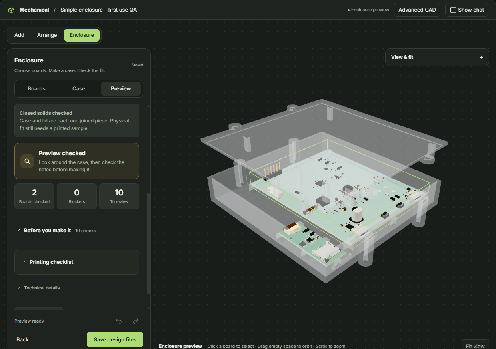
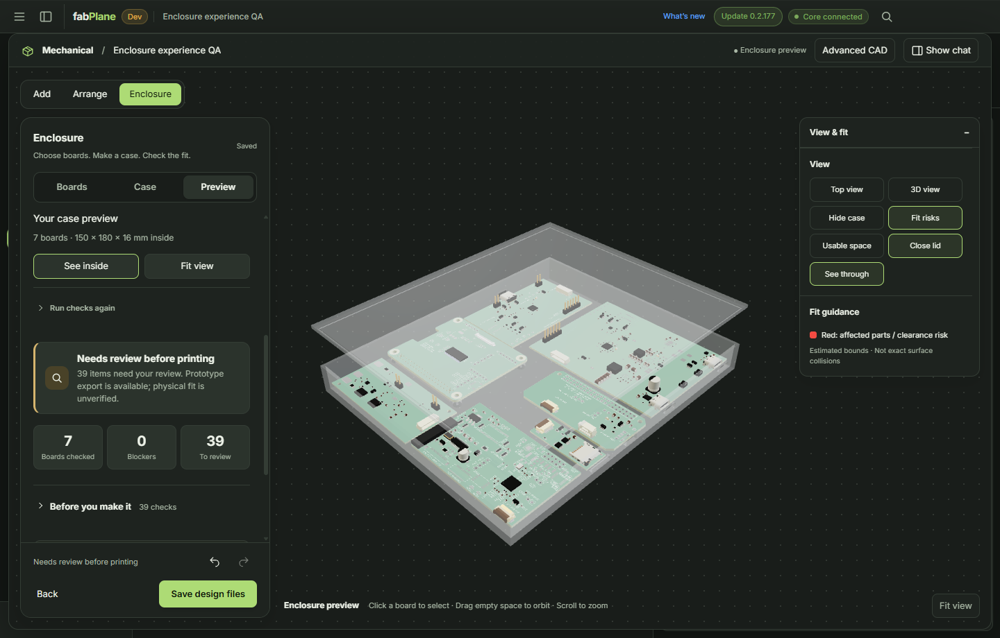
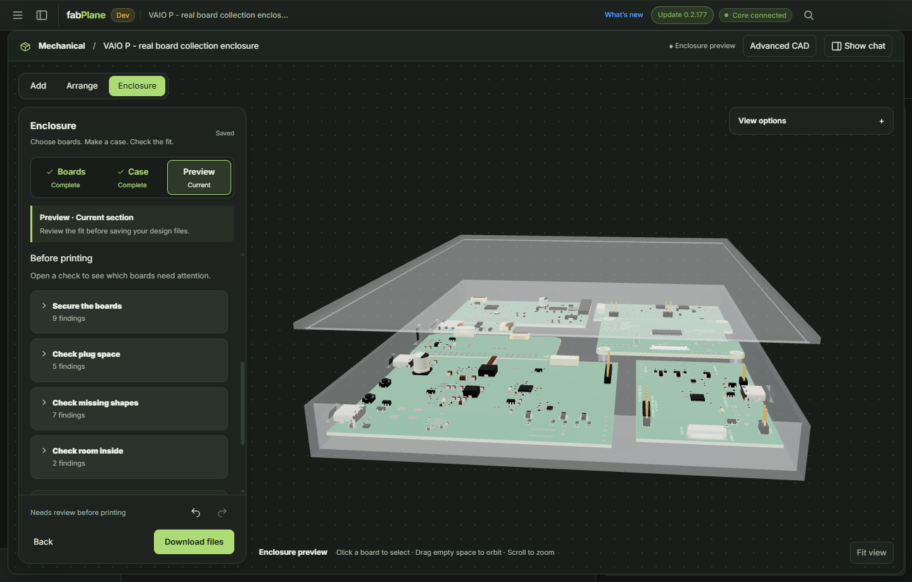

# Enclosure software validation

PR #398 adds a guarded prototype enclosure workflow. Software checks and slicing are evidence for review; they do not certify a manufactured assembly.

## Current status — 3 November 2026

| Requirement | Current evidence | Remaining boundary |
| --- | --- | --- |
| Few-click setup and clear controls | Boards → Case → Preview gates; Create case performs arrangement, sizing and preview; dimensions and move/rotate controls remain accessible. Navigation tests and live warning-link checks pass. | Advanced hardware and measured plug settings remain optional manual inputs. |
| Automatic sizing, spacing and fit | 256 affected tests pass, including ports, board screws, holders, fixed obstacles, printer limits and exported geometry. Real VAIO previews complete with no detected blockers. | Search and geometric checks are bounded; absent physical dimensions cannot be inferred accurately. |
| Reliable native board geometry | Isolated native export directories pass 21 real-board exports with unchanged measured geometry. Two original-project previews check 199 closed bodies without unavailable checks. | Missing component files, including the exact J1 Micro-USB model, remain explicit review items. |
| Printable, coordinated outputs | Latest seven-board export: 29 archive hashes verified, matching design/report, closed case/lid meshes, independent STEP import and two warning-free slicer runs. | Actual printer/material strength, retention and assembled cable fit have not been physically verified. |
| Branch and PR delivery | Feature branch targets PR #398 with a concise before/after comparison and three selected screenshots. | PR remains draft. CI, mobile and board-regression verification fail authenticating checkout of private `fabPlane/fab_pcb`, before feature tests run. |

The latest live summary comes first; earlier evidence follows chronologically. Newer entries supersede older measurements and resolved limitations; earlier test counts describe their respective snapshots, not the current full suite.

## Latest live seven-board check — 3 November 2026

- Tested the actual desktop app in a separate QA project containing seven real VAIO-repository PCB files. All seven detailed board models remained visible. Native mouse orbit, wheel zoom, board selection, movement and rotation worked; locking disabled movement. Undo restored the exact draft after rotation, movement and locking.
- Compact arrangement generated a **164.4 × 210 × 19 mm** case with five port openings. The completed preview reports **0 blockers and 41 review findings**. Deliberately moving the microSD board outside the case produced a red highlight and an `outside-space` blocker; editing invalidated the old preview.
- Saved a fresh coordinated export through the app. All **29 manifest hashes** verified; all seven source PCBs stayed unchanged. Exported design and fit report exactly match the live preview. Independent STL checks found a closed, single-component case, lid and print-oriented lid with positive volumes. OpenCascade imported both STEP parts. Fresh Bambu Studio case/lid slices completed without warnings and produced nonempty G-code/3MF.
- The collection includes test/debug and alternative board revisions, not a verified final electrical assembly. Missing component models, plug dimensions, board retention, screwdriver access and physical fit remain review items. No physical print was performed.

Screenshots: [finished seven-board enclosure](screenshots/mechanical-workspace/74-live-seven-board-case.png), [deliberate outside-space warning](screenshots/mechanical-workspace/75-live-board-fit-warning.png). The PR's before image is an earlier PR iteration with a demo board, not current `main` or the same seven-board scene.

## Multi-board follow-up — 2 November 2026

- Layout search now tries up to 12 deterministic orders, connection-priority orders and positions beside fixed obstacles. Optional print-area limits include the case body walls. Comparison runs in a dedicated worker without repeating native intersections; the built-app eleven-board comparison produced three choices in 1.1 seconds (55 timer ticks, 36.5 ms longest interval, background timer throttling disabled for automation).
- Optional cable planning searches conservative three-dimensional orthogonal corridors around substrate/component boxes, mounts, obstacles and previously planned cables. It reserves bend radius and cross-section, checks routed length plus slack, and blocks an unsuccessful requested route. Straight guides remain clearly distinguished from planned corridors. Endpoint connector exit direction, exact holder/lug geometry, ribbon twist and physical cable dimensions still require review. Planning is bounded and sequential, not globally optimal.
- Assembly review now highlights obstructed assumed screwdriver corridors. The assumed diameter is 6 mm or the larger entered screw head; this does not establish actual tool access or retention strength.
- Native checking skips non-solid planar artwork before conversion and releases intermediate solids per board. Limits are 500,000 triangles per board and 1,500,000 per assembly; a failed board no longer exhausts later boards' budget or inflates checked coverage.
- Six real boards: unrestricted cavity changes from 215 × 120 to 255 × 100 mm (1.2% less area). Eleven real boards: unrestricted 325 × 130 mm unchanged. With a 250 × 250 mm case-body limit, the eleven-board result is 190 × 225 × 20 mm inside, with all six inferred external ports at their walls. The case and lid pass independent slicing with no warnings; STEP reads as two solids and ZIP hashes match.
- Eleven-board native coverage improves from 307 to 314 closed bodies. All ten exporter-compatible boards are considered; the combined peripheral A2 file still requires KiCad 10.99 or newer. No known native collision blockers; 132 sampled assembly positions clear for loaded bodies. Missing models, seven unsupported boards, screw dimensions, five screwdriver-access concerns and unmeasured ports remain explicit review items.
- **118 focused tests / 735 assertions pass**, as do root typecheck and core/desktop builds. Broader Windows packages: 732 pass, five existing failures (four CLI-probe shims and a CRLF-sensitive stencil fixture), also present in earlier baseline-compared logs. Protocol, client-core and UI packages pass. The prior PR CI failure was an outdated aperture fixture missing evidence records; it now checks both unknown and documented dimensions correctly.

These are mechanical stress collections, including alternative revisions, not a validated electrical VAIO system. No verified cable map was supplied for this collection, and no custom harness was created. Cooling, mass distribution, material strength, screw pullout and physical assembly remain unverified. Original VAIO PCB hashes were checked and source files left unchanged. See [multi-board evidence](enclosure-multiboard-validation.json) and the [actual app preview](screenshots/mechanical-workspace/60-eleven-board-preview.png).

## New behavior

- Generated case and lid are boolean-joined separately with Manifold 3.5.4. Export rejects open, empty, non-positive or disconnected parts. STL and faceted STEP use the same joined boundary. Imported results must also pass a closed-solid audit.
- Optional four-screw closure searches 18 placements along both wall pairs to avoid ports, plugs, boards and obstacles. Screw bore, wall thickness and engagement are checked. Rectangular PCBs without holes can use corner feet/fences and lid capture pegs; unsafe corners and overlaps block export. Automatic placement reserves room for these holders.
- Footprint `Height` / `Height (mm)` properties supply measured component heights. Existing exact USB4105 / DM3D-SF profiles remain. Measured plug access now includes removal travel.
- Optional fresh native KiCad GLB checks intersect closed bodies with the case, lid, other boards and reserved obstacles. Independent board/obstacle gaps are checked. Collision regions are shown in red. Missing, open and oversized model coverage stays visible; conservative checks still run.
- Export adds `lid-print.stl` with the outside face at Z=0, `geometry-validation.json`, physical-check instructions and printable connector/pilot-hole samples. The manifest hashes all outputs. Original PCB files remain untouched.

## Verification

- **125 affected tests / 801 assertions pass.** Includes bores, holder retention/collisions, automatic lug alternatives, disconnected/open rejection, flipped lid, rounded samples, native collision/clearance rejection, failed model coverage, imported broken results and source preservation.
- Root typecheck, compiled Windows daemon and desktop production build pass. The compiled WASM export smoke succeeds. No source maps in build outputs.
- **12 independent Bambu Studio slices succeed with empty warning messages and nonzero extrusion.** Cases/lids: tiny 20×12 mm dongle, 120×24 mm hub, 180×120 mm controller, screw/holder fixture, real two-board VAIO-derived assembly; plus connector and pilot samples. These are slicer checks, not physical prints. See [machine-readable results](enclosure-v1-validation.json).
- Independent OpenCascade STEP imports of four fixture assemblies succeed, with one case and one lid mesh each.
- Two unchanged VAIO-derived PCB copies: 138 closed native bodies checked in approximately 8.4 seconds; eight open surfaces explicitly excluded. Missing component models and unmeasured mating dimensions remain review items. A lug/USB clash was detected, then eliminated by the bounded lug search. The final preview has zero blockers and ten review notes. Coordinated ZIP hashes match.
- Live UI: lid selection and detailed-check toggle persist through preview; blocked geometry disables export; corrected layout enables it. Checked checkbox alignment and captured actual app screenshots.
- Full Windows workspace suite: **35 failures**, all 35 reproduced by an isolated unchanged `265bcaf7` checkout with its own dependencies/submodules. No failure unique to this patch. This is not a claim that the entire suite passes. CI must be checked separately at the pushed revision.

## Physical validation still required

Print the small fit samples first with the intended printer/material. Fit actual screws, plugs/cards and boards. Check board restraint, lid closure, underside solder joints, insertion/removal, cable bends and cooling. Record results before calling any assembly production-ready. No physical print or assembly was performed in this software session.

## Remaining limits

Corner holders support only clear rectangular boards at quarter-turn rotations, and require a screwed lid. Arbitrary PCB shapes require mounting holes or custom restraint. The automated lug search is bounded, not a global mechanical optimizer. Generated shells are rectangular cavities. Imported models require the native CAD bridge; imported automatic lid hardware is not implemented.

Detailed checks use tessellated closed solids, with a 0.01 mm³ intersection threshold and bounded model sizes (250k triangles per board / 500k assembly). They do not prove load strength or all support-contact tolerances. Cable lengths/slack and reserved spaces are checked; full flexible cable routing and bend-radius optimization are not implemented. Missing component models cannot be checked accurately. Arbitrary connector contours are not inferred from 3D models; users must measure unknown parts. Slicer settings and material shrinkage are printer-specific.

## Follow-up model coverage audit

The 30 October follow-up fixes a false-complete case: a footprint with only hidden models no longer counts as loaded. Model review now distinguishes unassigned, hidden, failed and partially loaded models, lists the linked files, and places failed model loads before bare pads. The fit-review export retains every affected reference and repair reason.

Native planar surfaces close to a PCB face are reported separately from broken component solids. Named component models are never excluded by that classification. The eight VAIO surfaces are planar layers near the board faces; they remain excluded from solid intersections, with solder/surface-contact review explicitly required.

- 10 focused regression tests / 45 assertions pass, including hidden-model coverage, missing paths, component-versus-layer classification and the rendered repair actions/order.
- Root typecheck and desktop production build pass.
- Fresh two-board native check: 138 closed bodies, zero blockers, approximately 7.6 seconds. No source PCB edits.
- Actual app inspection: repair cards wrap within the panel and prioritize U9/U10/U8 over unassigned test pads.

**Still unresolved in the supplied VAIO design:** U8, U9 and U10 have linked models that did not load; C17/C18 have no assigned model. The other unassigned footprints are test pads and solder jumpers and require solder/access review. The USB and card openings still need actual mating-plug/card measurements. These findings cannot be resolved by declaring the missing geometry accurate. Physical print/assembly results are still absent.

A follow-up corner-holder trial on the same actual boards was **blocked**, correctly: the holders collide with USB-board TP1 and the small board's J1/J2 connectors, and obstruct card access. The accepted zero-blocker preview has no validated board-retention method. It must not be described as an assembly-ready VAIO case. See the local report for the complete rejected candidate; no candidate was saved to the project or exported for printing.

## Adaptive edge retention follow-up

`Find clear edges` adds four distributed underside supports, outside-anchored lid captures and two low end stops. It searches both edge pairs and 65 positions per edge, retaining component, drill, obstacle, mounting-post, opening and plug keepouts. If no supported layout fits, export is blocked. This is a bounded search for rectangular boards, not a universal restraint or a strength certification.

The same two VAIO-derived boards that failed the corner-holder trial now have a candidate with edge retention and no known solid collisions. A fresh native check covers 138 closed bodies, with the same missing-model and physical-review limitations. Both chosen holder settings persist in the app. The original board sources still match their hashes.

Each edge holder uses a 2 × 4 mm underside support and a 0.5 mm capture lip, with 0.25 mm nominal engagement at maximum lateral play. End stops retain at least 0.2 mm engagement after vertical play. These are prototype dimensions: print and load-test the real assembly before relying on them. Board-specific fit gauges accompany the export. An initial gauge orientation produced a slicer floating-region warning; printing on the extrusion end face resolves it.

Recessed linked openings now use actual mating-reach checks rather than incorrectly labeling an aligned opening as missing. Unknown plug measurements remain review items; short measured plugs still block export.

Validation:
- 37 focused geometry/access tests / 240 assertions pass, including four board rotations, occupied corners, underside components, drill keepouts, blocked end stops, thin boards, lid requirements, joined exports, gauges and recessed plug reach.
- Root typecheck, Windows daemon compilation and desktop production build pass; no source maps in outputs.
- Full Windows suite: 34 failures, all present in the unchanged `265bcaf7` baseline's 35 failures. One prior MCP failure did not recur; no new failure was found.
- Current VAIO case, lid and both board-thickness gauges slice with positive extrusion and no warnings. OpenCascade imports the current STEP as two solid meshes. ZIP hashes match. See [current slicing results](enclosure-edge-validation.json).

**Current remaining evidence:** physical printing/assembly and retention-load tests; actual plugs/cards and manufacturing tolerances; U8/U9/U10 linked model failures, unassigned C17/C18 models, and solder/jumper/pad access. The earlier statement that the accepted preview has no retention method applies to the previous corner-holder trial, not this new candidate. The new candidate has software-checked retention geometry, but no proven physical fit.

## Portable models and manufacturer-model follow-up

A separate VAIO QA copy now links U8/U9/U10 to official TI STEP models: [TPS25730 / REF0038A](https://webench.ti.com/cad/cad.cgi?partno=TPS25730), [BQ25798 / RQM0029A](https://webench.ti.com/cad/cad.cgi?partno=BQ25798), and [TPS568230 / RJE0020A](https://webench.ti.com/cad/cad.cgi?partno=TPS568230). The board's saved part numbers match these packages. Independent STEP measurements are 6 × 4 × 0.8, 4 × 4 × 1 and 3 × 3 × 1 mm respectively. Only three model-path tokens changed; the original VAIO sources and earlier test project were preserved.

This test exposed and fixed an export bug: PCB files previously left their local model dependencies behind. Coordinated exports now include project-owned model files and portable links, retain exact original PCBs under `source-boards/` when links need rewriting, and hash all packaged content. `model-dependencies.json` lists packaged, missing, unresolved and external references. System libraries remain explicit dependencies. Project jail checks also cover symlink targets. Local model content participates in the preview revision; changes before or during export reject stale results.

Verification:
- 19 tool/export tests / 88 assertions pass, including extraction, nested and absolute board paths, unchanged circuit content, STEP substitutions, model edits, external paths and symlinks.
- Root typecheck and Windows daemon build pass.
- Fresh native enclosure check: 141 closed bodies and zero known collision blockers. KiCad reopened the extracted PCB with all three official IC models present at their expected positions and heights.
- Case, print lid and both holder gauges are byte-identical to the four successfully sliced outputs above. ZIP hashes and original PCB snapshots match.

[Machine-readable manufacturer and export evidence](enclosure-model-validation.json).

The remaining capacitor part was identified from the source order notes as Murata ECASD41E336M040KA0 (C17/C18), also listed in [Murata's reference specification](https://search.murata.co.jp/Ceramy/image/img/A01X/G101/ENG/JECPY1-9012C-01%28ECAS%29%20S.pdf). No exact capacitor model was assigned. The missing-IC limitation above applies to the untouched earlier fixture; the new fixture repairs those three references. Solder/jumper/pad access, actual plugs/cards, manufacturing tolerances, printing and physical retention testing remain unresolved. No hardware testing or physical-fit claim has been made.

## Capacitor clearance and current readiness

The repaired QA copy now also stores `Height = 2.0 mm` and its provenance for C17/C18. This replaces a 1.6 mm generic estimate with the D4 catalog body-height allowance (1.9 ± 0.1 mm) from [Murata C90E, page 2](https://www.murata.com/~/media/webrenewal/support/library/catalog/products/capacitor/polymer/c90e.ashx). It excludes unmeasured solder height, does not assign an exact 3D model, and does not certify physical fit. The catalog identifies its figures as typical specifications. Only height/provenance properties changed in the QA PCB; original repository sources remain untouched.

An isolated test with 1.8 mm available above the PCB previously missed both capacitor bodies; it now reports both collisions. The complete enclosure still reports zero known blockers across 141 closed modeled bodies, while both missing capacitor models remain flagged. Native export accepts the saved properties. Archive hashes match, and the case, print lid and two gauges remain byte-identical to the four previously sliced outputs. See [capacitor clearance evidence](enclosure-capacitor-validation.json).

| Requirement | Verified | Outstanding |
| --- | --- | --- |
| Printable exports | Joined/audited solids, coordinated portable files, slicer toolpaths | Actual print with intended material/settings |
| Lid and retention | Screws, edge holders, gauges and known-geometry checks | Closure, engagement and retention under load |
| Connector access | USB-C/microSD profiles and plug-reach/removal checks | Actual plugs, cards, handling space and tolerances |
| Detailed fit | 141 closed modeled bodies and explicit missing-model/height-envelope review | Exact capacitor models, solder/contact geometry and flexible cables |
| Physical validation | Prototype files and fit samples prepared | Real printing and board/screw/card/cable assembly; no trial recorded |

The full objective remains incomplete. Passing geometry checks or slicing is insufficient to claim a perfect physical fit.

## Dimensional allowance and digital assembly checks — 2 November 2026

- Fixed a zero-clearance locating rim in the guided generated lid. Its nominal gap is now 0.25 mm; optional per-surface allowance increases it by twice that allowance without thinning the rim.
- Optional “Allow for small sizing differences” adds opposing-surface error to cavity, independent-board, obstacle, plug-reach and hardware checks. Newly arranged openings include it; existing openings remain visible for review/resizing. It is a planning assumption, not printer calibration.
- Edge-holder play and capture scale together, preserving 0.25 mm calculated engagement under the assumed error. Search tries 4 mm then 3 mm contact strips without relaxing keepouts. Thin boards or unsafe legacy corner holders block export. Fit samples use the same cross-section.
- Screw checks account for hole/outer diameter and axial variation. The VAIO example uses 10 mm M3-sized screws, a 0.10 mm per-surface assumption, 0.45 mm holder play and 0.90 mm capture. These are checked design inputs, not tested hardware strength.
- Real VAIO QA copy: raised both boards 0.20 mm and moved the small microSD board 1.50 mm away from the wall to clear its end stop. USB supports use 2 × 4 mm contact strips; microSD uses 2 × 3 mm. Existing openings expanded 0.20 mm per edge. Original PCB geometry remains untouched.
- **80 tests / 524 assertions pass**, root typecheck and Windows core/desktop builds pass. Tests cover nominal-fit failures, rim gap/thickness, joined solids, sample consistency, thin boards, dense support strips and opening layout.
- Native validation checks **141 closed bodies**, with **zero known collision blockers**. Case, print-oriented lid and two holder samples each slice with nonzero extrusion and no warnings. Independent OpenCascade reads the case and lid from STEP; coordinated ZIP hashes match.
- Connector scenarios: assumed USB-C plug bodies 12 × 6 × 20 mm, 8 mm reach and 15 mm removal travel; assumed card envelope 11 × 1 × 15 mm, 12 mm reach/travel. These clear the tested layout. Negative controls with 2 mm reach or 80 mm-wide overlapping plug bodies are rejected. These assumptions were **not** saved as verified hardware dimensions.
- Live UI: raising allowance to 0.20 mm exposes three blockers and disables export; restoring 0.10 mm clears them and enables export. Saved settings restore correctly.

[Machine-readable evidence](enclosure-tolerance-validation.json). C17/C18 retain their documented 2.0 mm maximum body-height envelope plus the selected fit clearance. No exact manufacturer capacitor model or assembled solder-height measurement was obtained. Physical fit/strength is still unverified; this remains a prototype workflow.

## Assembly paths and dimension evidence — 2 November 2026

- Optional **Check straight-down assembly** samples rigid removal in +Z (reverse of downward installation). Each loaded board and the lid are checked at 12 positions against the case, other installed boards and reserved obstacles. An observed intersection produces a review card and 3D region. Clear samples are not a continuous-motion proof; assembly order, angled insertion, cables, tools and strength remain outside the check.
- The VAIO assembly had no obstruction at 36 sampled positions across its two boards and lid. Native preview took approximately 12 seconds; final-position collision blockers remain zero. Missing component models remain explicit.
- Opening and plug dimensions now carry separate source records: assumed, manufacturer drawing, or measured hardware. A nonblank reference is required to remove the assumed-dimensions review. Changing a dimension or opening shape resets its evidence to assumed. Existing designs are never silently treated as measured.
- An explicitly specified aperture without a fitting opening now blocks export. Merely inferred openings retain review status. Custom entries are labelled “Custom dimensions,” and per-side clearance is displayed to two decimal places.
- **103 focused tests / 681 assertions pass** across ten files. Includes an obstructed assembly path despite a clear final pose, unobstructed samples, cancellation, evidence persistence, empty references and undersized apertures. Root typecheck and Windows core/desktop builds pass. Live UI confirms stale evidence is reset after a numeric edit; temporary QA references were discarded.
- Case, print lid and both holder samples match the previously sliced files byte for byte. Export manifest hashes verify. No additional slicing was needed for unchanged geometry.
- Further capacitor research did not obtain a verified exact downloadable 3D file. The manufacturer D4 drawing still supports the retained 2.0 mm maximum body-height envelope; neither that drawing nor entered evidence proves assembled solder height or physical strength.

[Machine-readable assembly and evidence results](enclosure-assembly-validation.json).

## 2026-11-02 — board controls and port-wall regression

- Selecting a board exposes Camera, Move, Rotate, Turn 90°, and Lock/Unlock in every enclosure step. Position editing no longer depends on opening a disclosure on the Boards step. Moving or rotating invalidates the old preview; ports and fit must be checked again.
- Walls with openings now use continuous polygon profiles. The former rectangular subtraction discarded strips under 0.05 mm; a regression with two nearly aligned openings reproduced a slit above the ports. The same test now passes for the joined solid, and wall-vent tests inspect actual mesh openings instead of counting box pieces.
- Fit review warns about thin material beside an edge or between opening envelopes. This is a conservative spacing check, not a strength certification.
- Validation: 82 focused tests / 420 assertions pass; root typecheck and Windows core/desktop builds pass. Built-app mouse dragging moved a board center from X 48.18 to 77.2484 mm; the rotation ring changed 90° to 157.1033°. Turn 90°, Undo, and lock gating were exercised. The user's seven-board imported-case draft was restored exactly after testing.
- A separately regenerated six-board VAIO case passed native preview with no detected blockers. The new wall was visually inspected in the actual 3D renderer. The isolated-wall screenshot shows the generated geometry; it does not certify the connector dimensions.
- Still unresolved: the CM5 I/O board's J1 is `USB_Micro-B_Molex-105017-0001`, currently using a generic 7 mm connector-height estimate (7.8 mm opening with default clearance). The [Molex drawing](https://www.molex.com/content/dam/molex/molex-dot-com/products/automated/en-us/salesdrawingpdf/105/105017/1050170001_sd.pdf) was located but its dimensional callouts could not be verified in this environment. Do not treat that opening as exact. Recorded connector/plug evidence and physical validation remain required.
- Existing imported STL geometry is preserved; rebuilding a generated case does not repair previously imported files. Imported-solid editing remains dependent on the CAD bridge, unavailable locally on Windows.

### 2026-11-02 — Intermittent outline-only boards

- Fixed progressive PCB model refresh: loading one board no longer removes other valid models. A failed refresh retains the loaded model only for the same project and PCB revision. Successful same-revision cache entries survive failed refreshes; tab/selection changes reuse loaded geometry instead of forcing another export after Refresh.
- Changed PCB revisions and other projects still discard stale models. Cancellation stops obsolete loads from publishing into the next view.
- Unavailable selected boards now explain that the amber shape is estimated bounds, with model details and retry below.
- Reproduced in the running desktop with six real VAIO models and controlled delayed responses: before the fix, visible detailed models dropped from six to one, then ended at five after one refresh failed. After the fix, all six remained throughout the same test. The real exporter was restored after fault injection.
- Three full Add → Arrange → Enclosure and Case → Preview → Boards cycles retained all six models without WebGL context loss. Compared the recovered draft with the pre-reload draft: unchanged. A hidden-window timing test hit the automation timeout; the visible-window repeat passed.
- Validation: 16 targeted model loading/decoding/batching tests, 63 assertions; root typecheck and desktop production build passed.
- Separate compatibility limitation: `combined-peripheral-a2` requires KiCad 10.99 or newer and cannot be exported by this installation. Its amber bounds are intentional fallback, not recovered detailed geometry. No source PCB files were converted or changed.

### 2026-11-02 — One-click Auto arrange

- A visible Auto arrange button is available at the top of every enclosure step. It runs the existing compact, port-aware deterministic search in a Web Worker and applies the result as one undoable draft edit, with automatic framing and a fit-review reminder. Advanced comparison remains available.
- Uses matching native model bounds where available; preserves locks, obstacles, imported-case dimensions and configured case-size limits. Imported interiors must be confirmed first. Empty selections and all-locked boards explain why arrangement is disabled. Failed searches leave the design unchanged.
- Real seven-board VAIO test: the configured 245 × 120 mm limit rejected the search without modifying the draft. Temporarily removing the limit produced a 150 × 180 × 16 mm interior and five detected external openings. Undo restored the exact previous poses, then the original size limit. No project save, PCB edit or export was performed by Auto arrange.
- The combined peripheral board remains an estimated envelope because the installed KiCad cannot export its newer file format; the screenshot makes this visible. Auto arrangement still requires Preview and fit review, and is not a proof of printability or a globally optimal solution.
- Checks: 20 layout/setup/history tests, 99 assertions; root typecheck and desktop build passed. Final UI typecheck passed after clearer size-limit/loading messages. Screenshot: `screenshots/mechanical-workspace/63-auto-arrange.png`.

### 2026-11-02 — Resize case to fit

- A generated case with a size limit now offers **Resize case to fit** beside Auto arrange. This explicit one-click action removes the cap, sizes the enclosure around the selected boards and applies their placement in one Undo step. The success message shows outside dimensions; subsequent automatic placement is labelled **Auto arrange & size**.
- The original Auto arrange action retains a configured cap. Imported cases and fixed wall constraints are never silently resized. Locked boards, obstacles and manual openings require review before removing the boundary constraint.
- Tests cover a too-small cap becoming a valid clearance-safe generated case, unchanged input, and rejection of imported/fixed cases. Layout/setup/history: 22 tests, 108 assertions. Root typecheck and desktop build passed.
- Live seven-board test: Resize case to fit produced a 150 × 180 × 16 mm interior / 154 × 184 × 20 mm exterior with five detected external openings. Undo exactly restored the starting poses and 245 × 120 mm cap; Redo exactly restored the resized design. Left the resized draft open, unsaved, with Undo available. Detailed geometry for the newer-format combined board remains unavailable; fit/preview review is still required.

## 2026-11-02 — combined peripheral model and camera depth

- The lower-right amber rectangle was the combined-peripheral-a2 board: its source requires KiCad 10.99+, while this machine used 10.0. Installed the signed official 10.99 nightly alongside 10.0 and selected its CLI in local FabDesk settings. This is a local prerequisite change, not a bundled KiCad upgrade.
- All seven selected VAIO boards now load real GLB geometry, including the combined board (7,248,448 bytes). Its PCB SHA-256 remains `4bad50642edb8d0b5ddbe0771f41c4e974b34e3b379114ce47bda7d3ad687dd0`; no source board was rewritten. The previous unavailable-board notes above describe earlier checks.
- The newer exports exposed depth-buffer interference between closely spaced PCB surfaces. Camera clipping now follows the assembly bounds, view and zoom instead of spanning almost zero to tens of thousands of millimetres. Cached assembly bounds avoid traversing all meshes during ordinary orbiting.
- Validation: 12 rendering/camera tests, 767 assertions; root typecheck and desktop build pass. The regression checks 0.01 mm layer separation and visible bounds at different distances/orientations. Reloaded the built app, checked top/3D views and zoom with seven actual models and no lost graphics context. Restored the exact draft values and Undo history.
- Component coverage remains incomplete: combined board has 61/104 footprint models loaded. Missing/unassigned entries include foreign absolute paths, unavailable custom parts and bare pads; no guessed replacements were added. Preview/fit checks and physical verification are still required.

## 2026-11-02 — guided setup, fit actions and recovery

- Added a visible board-loading card with loaded/selected counts, an explanation of amber placeholders and retry/setup actions. A read-only preflight compares the PCB saving version with the local exporter. It offers an already installed newer exporter when available; only the user's button changes the app setting. Saving-version comparison is advisory, and actual export remains the compatibility check. The flow does not download KiCad or guess missing component models.
- **Arrange & fit case** now places boards, sizes a generated case within existing constraints, aligns detected external openings and creates the checked preview in one action. A separate Placement only disclosure retains the lightweight layout action. Explicit Resize case to fit releases a generated-case cap. Existing/fixed cases and locked parts retain their constraints; Undo restores the prior design.
- Fit warning actions highlight the relevant region and select the affected board with Move controls, or open the specific model/settings section. Two-board collision messages identify the first affected board as well as single-board boundary warnings.
- A single readiness card distinguishes a missing preview, blocked export, prototype export with review items, and prototype export without known blockers. Detailed geometry/printing notes stay in the checklist rather than repeating status cards. No state certifies physical fit.
- Same-revision unsaved drafts restore automatically; changed saved revisions still require a recovery choice. Equivalent objects with reordered JSON properties no longer create phantom edits. The enclosure step, selection and camera survive tab changes/reload within the session. Background assembly loading no longer resets an already opened enclosure panel, and an unframed camera cannot overwrite a remembered view.
- Existing camera/board tool separation, Fit view, simple defaults and Advanced disclosures remain in place. Model refresh still retains only geometry matching the same PCB revision, avoiding stale models being mistaken for the current design.

### Verification

- 45 focused tests / 904 assertions pass: readiness response envelopes, version comparison, path containment, recovery conflicts, corrupted camera preferences, revision-safe model retention, history, setup, export gates and rendering. Root typecheck and desktop production build pass; no source maps in the built app.
- Separate seven-board VAIO QA project; original project PCB files were not edited. With KiCad 10.0 selected deliberately, the actual failure remained visible and the new installed-version button selected 10.99 and reloaded all seven models. A synchronous tool-response handling issue found during this exercise was fixed and regression-tested.
- One-click placement completed with a joined case/lid preview, zero known blockers and 39 review items. Undo restored the original QA draft. A board moved outside the case produced red highlighting; its warning action selected the board and enabled Move. Automatic recovery retained the edited draft and selection; camera coordinates after reload/tab changes matched within 0.000001 mm.
- Missing component models, assumed dimensions, cable/assembly limits and physical printing remain review work. These UI changes do not resolve those engineering uncertainties.

Measured final Arrange & fit case run: 24.8 seconds from click to completed seven-board preview. Original/QA copies match for all 11 source PCBs. [Machine-readable evidence](enclosure-experience-validation.json).

## Faster, simpler enclosure workflow (2026-11-02)

- Replaced competing arrange/placement/preview buttons with one footer action and a compact board-layout selector. Measurements appear when a board is selected (or on Boards); advanced hardware follows the basic choices. View options start collapsed and stay collapsed when the panel grows.
- Generated cases show joined shell geometry before detailed model checks finish. The early result is explicitly unverified, contains no export revision, and cannot unlock export. Checks continue automatically with fresh native exports, exact intersections, clearance and assembly-path sampling enabled.
- Native export concurrency is bounded at two. Failed boards remain explicit findings; cancellation drains running exports before scratch cleanup. Conservative bounding-box separation prunes only solid operations that cannot affect the result.
- Real seven-board comparison: native detailed checks fell from 24.2 to 16.2 seconds with identical issue messages. In the built app, the joined case appeared after 1.6 seconds; full checking finished in 18.1–19.5 seconds across two runs versus the previous 24.8-second run. The live result retained 0 blockers and 39 review items. These are local observations, not guaranteed timings on other machines.
- 45 targeted tests / 211 assertions pass, including bounded concurrency, cancellation, failures, exact collision preservation, unverified-preview export rejection and pending-check presentation. Root typecheck and desktop build pass; no source maps in output. The full monorepo suite was not rerun for this change.
- Built-app failure recovery: a deliberately interrupted full check kept export disabled and offered Preview case again. Retry completed successfully. The final panel has one primary footer action and no horizontal overflow. Original VAIO draft and Undo history were preserved.

## Guided enclosure steps (2026-11-02)

- Boards → Case → Preview now unlock in order. Loaded board dimensions plus explicit Continue to case confirm the selection. Preview unlocks only after the current case shape exists; export still waits for full fit checks.
- Completed steps show a check, unavailable steps show a lock, and each step explains the next action. Going back preserves choices. Changing selected boards or case settings invalidates the dependent step. Draft recovery conflicts and unreadable/empty selections cannot bypass the gate; confirmation is remembered within the session.
- Built-app seven-board QA: a changed selection locked Case and Preview, clicking the disabled Case tab did nothing, Continue unlocked Case, Undo to a different selection relocked it, and confirmation survived reload. A generated preview unlocked Preview; changing the layout locked it again. The unchanged full fit check returned 0 blockers / 39 review items.
- 20 focused workflow, readiness, recovery and setup tests / 77 assertions pass. Root typecheck and desktop build pass. No source maps in output.

## Plain-language fit review (2026-11-02)

- Review findings are grouped into tasks: secure boards, check plug space, check missing shapes and check room inside. Unknown findings remain under Other checks. Blocking errors stay expanded above the optional tasks.
- Common repeated warnings use short explanations, with exact findings expandable. The full report retains every original message, including check limitations and sampled assembly results. No fit rules or export gates changed.
- The print checklist asks whether everything fits, boards stay in place and plugs can be inserted. It still explicitly requires a test print; geometry is not presented as proof of physical fit.
- 10 focused tests / 48 assertions, root typecheck and desktop build pass. Live presentation check reused the user's existing seven-board preview: four task categories, all 40 original findings preserved, working disclosures and no horizontal overflow. The original board draft and Undo history were preserved. Geometry was not regenerated for this presentation change.

## Opening size, placement and quick setup (2026-11-03)

- Traced the nearly square VAIO opening to J1 on the CM5 USB/SDIO HAT, footprint `USB_Micro-B_Molex-105017-0001`. Generic USB height was 7 mm, producing an 8.3 × 7.8 mm cutout. The exact-part profile now uses the conservative 2.94 mm maximum height in [Molex publication 9876505191, page 16](https://cevikltd.com.tr/filestore/pdfs/MolexTabletPCConnectorSystems9876505191.pdf), yielding 8.3 × 3.74 mm with the default clearance. This is a catalog body envelope, not a measured mating aperture or an exact model.
- Initial and arranged cases share physical-face sizing, opening shapes and opening clearance. PCB/courtyard clearance no longer inflates a default port opening. Physical connector bounds determine distance to the wall; protrusion reduces mating distance and an explicit plug reach can permit a recessed connector.
- New automatic openings follow board translation, quarter-turn rotation, height and top/bottom mounting when previewing retained positions. Internal connectors lose their automatic opening. Custom edits remain fixed and anchor their associated board during auto arrange. Old saved openings remain unchanged until explicitly refreshed with **Match opening to port**, or regenerated by auto arrange. Oblique orientations and missing connector data produce an error instead of preserving a misleading automatic opening.
- Compact layout searches include tight rows/columns and exact size limits, avoiding unnecessary square cases for slim boards. New generated cases offer **Create case** from board selection, while **Case options** keeps manual setup available. Existing-case measurements, preview checking and export gates remain required.
- **114 focused tests / 681 assertions pass**, including STL surface probes for three connector types, all four quarter-turns and both PCB sides; stale openings, custom edits, small boards, exact printer limits, recessed ports and plug reach. Root typecheck and desktop build pass. The broader KiCad/client run had 273 passes, 2 skips and 5 failures; all five were reproduced with unchanged HEAD source (four Windows fake-executable tests, one CRLF-sensitive laser-stencil fixture). The full monorepo suite was not rerun.
- Built-app QA: Create case generated a seven-board preview without dimension entry. A reproduced 7.8 mm J1 opening was corrected to 3.74 mm by **Match opening to port**; preview saved `followBoard: true` and retained the board positions. The resulting 146 × 206 × 16 mm interior had 0 known blockers and 37 findings in four review groups. The panel had no horizontal overflow. Test actions used the Enclosure experience QA copy; source PCB files were not edited.
- **Still unresolved:** the J1 connector model is absent from the native 3D export, so the board remains visible through its opening. Missing/unclosed component models and incomplete assembly checks remain explicit findings. This change does not establish exact aperture contours, physical cable fit, or print qualification. A separate read-only seven-board layout audit (without native model bounds) found a 125 × 216 × 15 mm case with no estimated blockers; this is not a native-geometry or physical validation.

## Whole-case dimensions and wasted height (2026-11-03)

- Print-area limits and displayed outside dimensions now include projecting lid screw mounts. The hardware generator tries both mounting axes within the limit; an impossible limit retains the requested hardware and blocks export. Manual posts also count toward the reported bounds.
- Automatic arrangement lowers unlocked boards to their minimum supported height while preserving underside component clearance. Locked boards retain their elevation. Case height reserves the specified lid screw length and dimensional allowance.
- **148 focused tests / 828 assertions pass** across 19 files. Tests compare actual joined STL bounds with the report, check fractional print limits and both mounting axes, preserve hardware when the limit is impossible, and reject oversized exports without writing files. Root typecheck and desktop build pass; built output contains no source maps. The full monorepo suite was not rerun; the previously documented Windows baseline failures remain outside this check.
- Read-only seven-board VAIO audit with revision-matched native model bounds: 146 × 206 × 15 mm interior; 150 × 210 × 19 mm outside with a lift-off lid, or 164.4 × 210 × 19 mm with screw mounts. Both arrangements had zero estimated blockers and zero native-envelope clearance findings. These are envelope checks with incomplete component models, not exact-solid or physical validation.
- Built-app QA regenerated the retained-position seven-board design and displayed 150 × 210 × 20 mm outside / 146 × 206 × 16 mm inside, with zero known blockers and 39 review findings. Source PCB files were not edited. Retaining positions intentionally preserves the existing case height.
- Setting the QA print area to 149 × 209 mm produced one blocking issue and disabled Save design files. Review size limit opened the Case section's print-area controls without horizontal overflow. The original QA settings were restored afterward.

## Footprint envelope accuracy (2026-11-03)

- Reproduced and fixed three geometry-reading errors: ignored pad rotation, ignored arcs in fabrication/courtyard outlines, and discarded body outlines when no courtyard existed. Fallback bounds now combine the fabrication body with pad geometry. Rounded pads keep their rounded bounds, copper offsets follow pad orientation, and drill anchors remain unchanged.
- Native KiCad 10.99.0 SVG export independently confirms the rotated rectangle, offset rectangle and diagonal oval dimensions. The synthetic board and native SVG are checked in under `packages/kicad/test/fixtures/enclosure`; its README gives the reproduction command. A fit regression now rejects a body crossing a wall even though its pads fit, and automatic sizing accommodates the complete body.
- **31 focused tests / 135 assertions pass.** The broader KiCad/client enclosure run had **291 passes, 2 skips, and the same 5 documented Windows baseline failures** (four fake executables and one CRLF-sensitive fixture). Root typecheck and desktop build pass; output has no source maps. The full monorepo suite was not rerun.
- Audited all 414 populated footprints across the seven-board VAIO QA assembly. Bounds changed for Koyomi IC1 and combined-peripheral IC201: the old estimate was 0.7 mm too wide and 0.7 mm too short. The revision-matched native-envelope layout audit retains the 146 × 206 × 15 mm interior, with no estimated blockers, unresolved external ports or native-envelope clearance findings. This remains an approximate clearance check; the missing J1 model and other missing components remain unresolved.
- Restarted the core and regenerated the retained-position design in the app: all seven boards remain visible, the preview has zero known blockers and 37 review findings, and prototype export is available. The existing 150 × 210 × 20 mm outside size is unchanged. No original PCB files were edited.

## Automatic layout includes lid hardware (2026-11-03)

- Reproduced a false "no layout" result for a 5 × 5 mm board with four lid screws. The search now includes the minimum span required by those screws, trying either wall pair without unnecessarily enlarging both axes. Fixed cases and print-area limits still cannot be silently enlarged.
- Reproduced a compact USB layout whose opening was blocked by a screw lug. The layout search and hardware exporter now share the same lug-selection rule. The search tests centered board positions and additional spans that leave room for the opening and configured plug width. Unsafe candidates are rejected during arrangement instead of first appearing as a blocked preview.
- A constrained 10 × 8 mm synthetic USB board now generates a 30.4 × 26.8 mm outside case with its opening between the lugs. A surface probe through the joined STL confirms an unobstructed opening; the base and lid each remain a single closed component. An insufficient print limit is rejected. A wider configured plug is checked independently of the opening width.
- A separate missing check now blocks an isolated mounting post extending through the lid, with guidance to shorten the post or increase case height.
- **204 tests / 1,434 assertions pass** across 23 enclosure, mechanical and backend files. Root typecheck and desktop build pass; no source maps in output. The full monorepo suite was not rerun.
- Real seven-board audit: screw-case layout search took 260 ms locally versus 57 ms for the lift-off configuration. Both have zero estimated blockers, unresolved ports and native-envelope clearance findings. This measures arrangement only, not the full preview/export process.
- Built-app one-click Arrange & fit case with the seven-board VAIO QA project and a screwed lid completed at **164.4 × 210 × 19 mm outside**, with **0 known blockers / 40 review findings**. All seven boards remain visible. Missing component models, actual cable dimensions, physical retention and printed assembly are still review items. Original PCB files were not edited.

## Openings participate in automatic case sizing (2026-11-03)

- Reproduced automatic layouts that cropped tall custom apertures through the floor/top edge and wide off-center apertures through a wall end. Free generated cases now reserve wall material around those openings, including dimensional allowance. Board elevation accounts for underside ports and case height accounts for aperture height. Fixed cases and locked placements remain constrained; an opening that cannot fit is rejected.
- Opening span affects wall clearance separately from physical board packing. An auxiliary PCB can occupy otherwise unused interior beside a large opening; the opening is not treated as an oversized solid component. Fabrication-face bounds can also supply plug checks when courtyard bounds are absent.
- The search retests the current case dimensions. This prevents an already usable fractional size from growing merely because it falls between search candidates, and preserves the existing VAIO case footprint. Repeated arrangement of the fractional regression fixture is stable.
- **208 tests / 1,475 assertions pass** across 23 enclosure, mechanical and backend files. New checks cover both PCB sides, all four wall orientations, tall and off-center openings, fixed-case rejection, and space sharing with a second board. STL surface probes confirm the aperture is open and wall material remains above and below it. Root typecheck and desktop build pass; no source maps in output. The full monorepo suite was not rerun.
- Revision-matched seven-board VAIO audit retains **164.4 × 210 × 19 mm outside** with screws, with no estimated blockers, unresolved external ports or native-envelope clearance findings. The five generated openings retain their dimensions and have at least 3.6 mm nominal material to the nearest wall edge. These geometric checks do not establish physical strength or compensate for missing models.
- Rebuilt-app one-click validation completed with all seven QA boards visible, **164.4 × 210 × 19 mm outside**, **0 known blockers / 40 review findings**, and prototype export available. Missing component models and physical verification remain review items.

## Board screw clearance and older component summaries (2026-11-03)

- Reproduced an automatic layout that placed a board screw head against the wall/lid and left its shaft longer than the supporting post. Automatic placement now reserves the supplied head diameter and height, and raises an unlocked board enough to accommodate the supplied screw length plus dimensional allowance. Linked posts follow that height. Screw dimensions are preserved; locked boards are not moved. A screw too short to reach through the PCB, or too long for a locked board's post, gets a direct explanation.
- Reproduced a case that ignored connector overhang and a 28 mm capacitor when an older board summary omitted the full component list. Default sizing and automatic layout now use the available connector/tall-part bodies, matching the backend fit fallback. A present populated-component list remains authoritative, including side information. This does not infer absent dimensions or missing native models.
- **210 tests / 1,491 assertions pass** across 23 files. The new regression compares the proposed case against the full parsed PCB, verifies head/lid clearance and unchanged input, checks locked/short-screw rejection, and probes the actual STL post surface, clear bore and closed bore floor. Root typecheck and desktop build pass; no source maps in output. One parallel validation attempt exceeded a fake-process test's 5-second timeout during the build; the complete targeted suite passed when rerun after the build. The full monorepo suite was not rerun.
- The read-only seven-board VAIO audit retains **150 × 210 × 19 mm** outside with a lift-off lid or **164.4 × 210 × 19 mm** with lid screws, with no estimated blockers, unresolved ports or native-envelope clearance findings. Its existing board retention still requires review; these results do not certify actual screw choice or physical strength.
- Rebuilt-app Arrange & fit case completed with seven boards visible and the same **164.4 × 210 × 19 mm** outside size. It reported **0 known blockers / 35 review findings**. This run also exposed intermittent invalid GLB data in three detailed board checks; those checks remain explicitly incomplete. The reduced finding count is not evidence of improved model coverage or complete solid validation. Export integrity is under investigation.

## Native model export integrity (2026-11-03)

- Captured a real CM5 HAT export containing 4,205,784 bytes while its GLB header declared 2,646,828. The previous measurement reader ignored the extra bytes. Separate app runs also reported invalid headers/JSON during detailed checks. The native producer's intermittent failure is not claimed to be fully diagnosed.
- The reader now validates the declared file length, chunk boundaries/order, JSON and binary-data boundaries using the [Khronos GLB specification](https://registry.khronos.org/glTF/specs/2.0/glTF-2.0.html#glb-file-format). Vertex/index access cannot spill into later extension chunks. Unknown extension chunks remain supported.
- Display/detailed-fit exports write to fresh temporary paths and publish only after framing validation. A missing or malformed export gets one fresh unfused retry; repeated failure stays explicit. Failed or cancelled attempts preserve any previous destination file and remove their scratch outputs. A valid export with missing part models remains partial, with its original KiCad warnings; it is not rejected merely for a nonzero exit code.
- **238 tests pass** across 29 enclosure, mechanical, display and tool files. Tests cover truncated/appended bytes, malformed JSON, nonzero buffer offsets, extension chunks, bounded retry, cancellation, destination preservation and partial-model warnings. The seven integrity tests also pass after strengthening the existing-file replacement check. Root typecheck and desktop build pass; the final KiCad package typecheck also passes. The full monorepo suite was not rerun.
- Repeated the real seven-board export once with two workers and once serially: **14/14 files passed framing and geometry parsing**. All seven serial results have identical node names, origins, vertex counts and bounds to the earlier valid native exports. This verifies the guard on these runs; missing models and physical validation remain unresolved.
- Two consecutive full previews in the restarted app completed with **313 closed native bodies checked**, **0 detected blockers**, **0 unavailable detailed checks**, and **41 review findings**. The case remains **164.4 × 210 × 19 mm outside** and prototype export is available. Both runs still report missing models and one open Koyomi model surface; the stable result does not certify unmodeled parts or physical assembly. A development watcher/supervisor restart conflict was cleared by relaunching the local app before these runs.

## Final fit and warning-navigation checks (2026-11-03)

- Auto arrange now tests obstacle height as well as its footprint. A board can occupy usable space beneath a raised display; its underside parts, native model envelope, posts and screw heads still exclude colliding placements. Holder envelopes remain conservative. Regression fixtures cover overhead and lower obstacles without moving fixed parts or enlarging their case.
- A specified board screw now blocks export when its blind post bore is too wide to engage the shaft, including the chosen dimensional allowance. Entered dimensions are preserved. A smaller bore passing this check does not establish thread strength or a suitable fastener pilot size; the actual material and fastener still need validation.
- Fit warnings now open the relevant nested controls: lid screws, board posts, cables, model checks or placement. Keyboard focus moves to those controls. Navigation runs after rendering and the section scroll reset, including when the app is in the background, rather than waiting for an animation frame.
- **255 tests / 1,725 assertions pass** across 34 enclosure, mechanical, export and UI files. Root typecheck and desktop build pass. UI types and the desktop build were rerun after the background-navigation correction. The full monorepo suite was not rerun.
- The original VAIO project's displayed J1 opening was inspected directly in the rendered scene: it uses the corrected **8.3 × 3.74 mm** rectangle. Its empty appearance is separate: the stock footprint links `USB_Micro-B_Molex-105017-0001.step`, which is absent from both local KiCad libraries and the supplied VAIO project. Native output explicitly reports J1's missing model. No different connector model was substituted and no further opening shrink was applied to hide the missing geometry.
- Built-app validation opened and focused all five tested warning destinations (lid screws, model checks, cables, mounting posts and model coverage), with no containing disclosure left closed, including in a hidden window. The seven-board QA preview retained **164.4 × 210 × 19 mm outside**, **0 detected blockers / 41 review findings**. These include known missing models and retention/physical review needs.
- Returning to the original seven-board project preserved its layout and 119 × 244 × 24 mm outside size. This preview exposed another native export failure for the battery-interface board: both guarded attempts had a GLB length/header mismatch. The invalid output was rejected and detailed/assembly checks remain explicitly incomplete (37 findings, including the two unavailable-check findings). The export guard works, but intermittent native producer failures remain unresolved; the original-project result is not a fully checked assembly.

## Concurrent native exports isolated (2026-11-03)

- Diagnosed the preceding intermittent failure: [KiCad's GLB writer](https://docs.kicad.org/doxygen/step__pcb__model_8cpp_source.html#l04112) writes a fixed `$tempfile$.glb` inside the output directory before renaming it. Separate final filenames did not prevent parallel exports from overwriting that intermediate file. A seven-board reproduction using a shared directory failed for two boards; isolated-directory and serial controls both passed all seven.
- Each export attempt now gets a fresh private sibling directory. Native intermediate files stay separate while parallel loading is retained. The result is validated before atomic publication to the requested destination. Success, cancellation and failure clean up the created directory; previous valid destination files remain protected.
- After the fix, **21/21 real-board exports passed** across shared-destination parallel, separate-destination parallel and serial runs. All 21 retained the corresponding baseline serial export's exact measured node names, bounds, origins and vertex counts. A regression simulates overlapping native fixed-name writes with distinct 10 mm and 20 mm geometry and verifies neither board is substituted, plus scratch cleanup on cancellation.
- **256 tests / 1,735 assertions pass** across 34 files. Root typecheck and the Windows core build pass; no source maps in the output. The existing desktop UI is unchanged by this fix. The full monorepo suite was not rerun.
- The original VAIO project was refreshed twice in the running app, with the isolated directories observed during actual export. Both previews completed with **199 closed native bodies checked**, **0 detected blockers**, **0 unavailable checks**, and **38 review findings**, preserving the original **119 × 244 × 24 mm outside** case and board arrangement. Missing source models and physical fit remain explicit review items; this resolves the reproduced concurrency corruption, not those absent inputs.
- Current PR CI was inspected separately: [verify run 41609783186](https://github.com/TensorFleet/fabdesk/actions/runs/41609783186/job/125828626017) failed while fetching the pinned private `fabPlane/fab_pcb` workspace (`could not read Username`), before verification commands ran. This is a checkout-authentication failure, not passing CI or a test failure attributable to the enclosure code. Other verification jobs were still queued when inspected.

## Warning guidance preserved across sections (2026-11-03)

- The final workflow audit found that the section-change effect cleared placement and printer-limit instructions immediately after a warning navigated from Preview to Case. Guidance now appears after that reset, alongside the revealed control.
- Live built-app checks confirm both instructions remain visible after navigation, with the Case section selected. **15 focused workflow/navigation/review tests and 103 assertions pass**; UI typecheck and desktop build pass. The earlier 256-test run covers the unchanged geometry/export implementation. No PCB or enclosure dimensions changed during this UI check.
- At pushed revision `0877ee6c`, [verification again failed before tests](https://github.com/TensorFleet/fabdesk/actions/runs/41610982176/job/125832536659) on private dependency authentication. The configured `FAB_PCB_RELEASE_TOKEN` secret exists, but the runner cannot authenticate its checkout; its contents were not retrieved or replaced. An authorized repository administrator must repair its access before CI can validate the PR.
