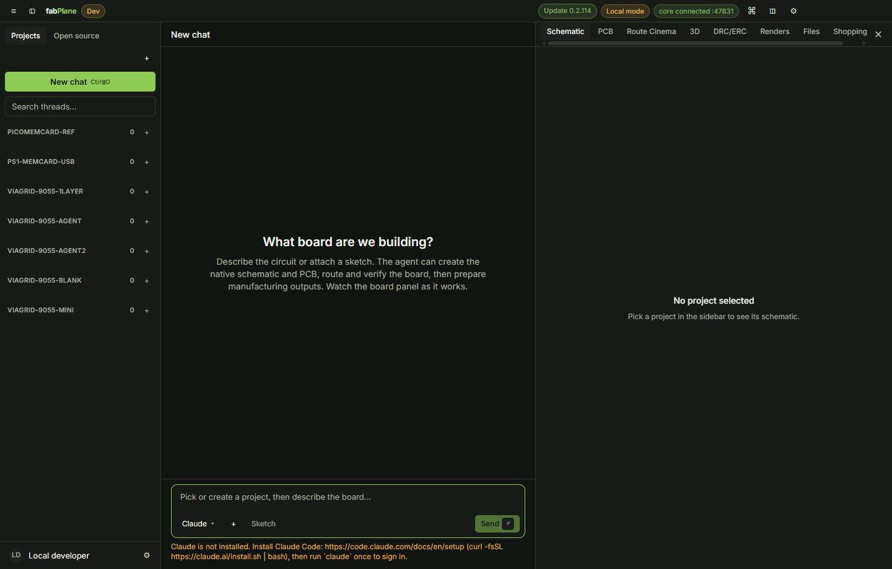
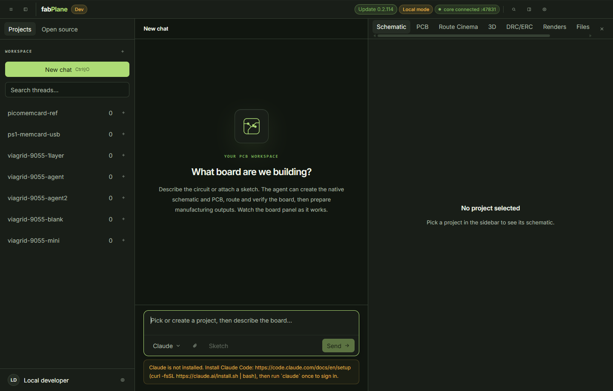
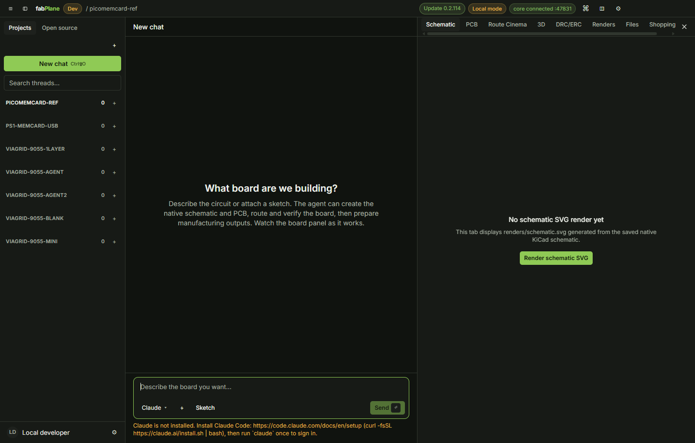
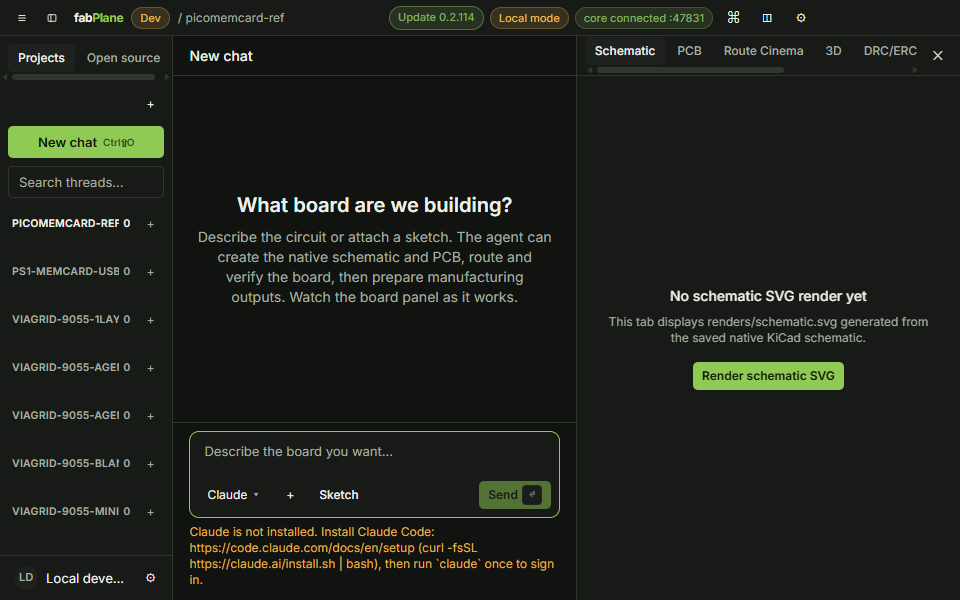
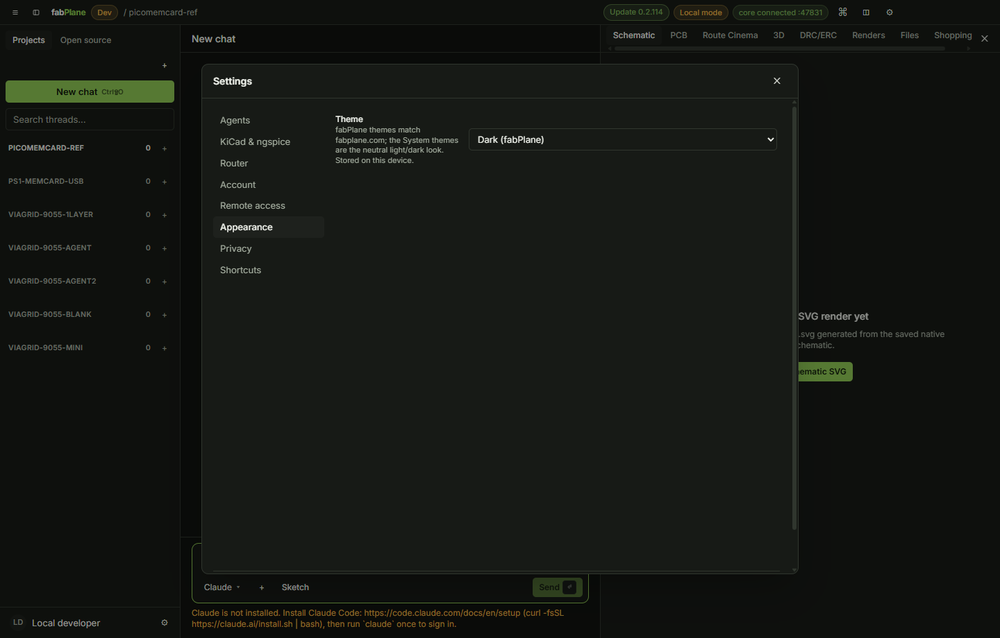
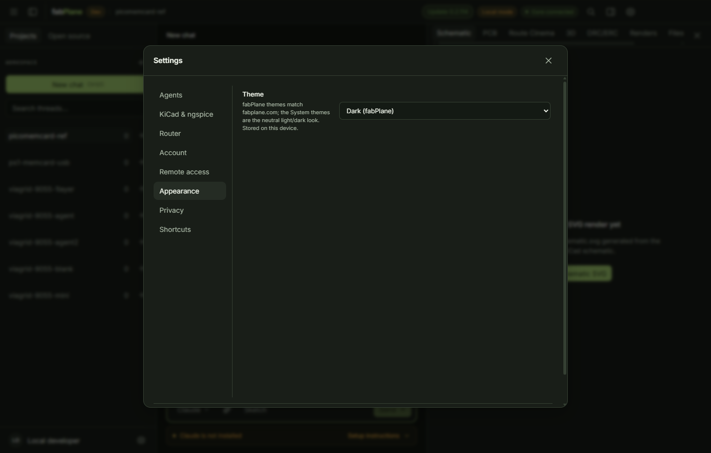

# FabPlane desktop GUI review

**Base:** `main` at `33d68bc109150789c45f7ad334c079931e39d353`

**GUI implementation:** `gui-improvements` at `8092e511ced9455bba51b893c42065e6e372db68`

**Responsive icon and composer refinement:** `38a59b561994a1f7ec4d7b58bac3eb6bc7cada7c`

**Empty-state icon cleanup:** `2f1f2d187eb1eaa39eb108a0d57edcc95ce91cbd`

All pairs use the same local FabPlane Dev profile, projects, dark FabPlane theme, display scaling, and selected state. The full-size captures are 1440 × 920. The narrow board pair is the app minimum, 960 × 600. The selected project is `PICOMEMCARD-REF`, with its empty Schematic view. The Claude installation warning reflects this machine's unchanged local setup.

## New chat · 1440 × 920

| `main` | `gui-improvements` |
| --- | --- |
|  |  |

The workspace and project list have more readable sizing and clearer selection. The board illustration now sits directly on the page, without an enclosing tile. The chat has a quieter, stronger composer. The top bar uses 20 px icons in 36 px targets, with separate controls and restrained status chips. The missing-agent notice keeps the issue visible while its full setup instructions open on demand.

## Selected project and board · 1440 × 920

| `main` | `gui-improvements` |
| --- | --- |
|  |  |

The selected project is easier to locate. Board tabs, empty-state text, and the render action have clearer spacing and hierarchy. The three-pane workflow and board action remain the same.

## Narrow board pane · 960 × 600

| `main` | `gui-improvements` |
| --- | --- |
|  |  |

The old tab strip hid later views behind horizontal scrolling. The labeled **View** menu now exposes all eight board views and shows the active one, including each shortcut. Project names truncate cleanly, the connection badge becomes a status dot with a detailed tooltip, and the compact setup notice leaves room for the composer.

## Settings · 1440 × 920

| `main` | `gui-improvements` |
| --- | --- |
|  |  |

The dialog uses the same surfaces, type, row spacing, and selected-state treatment as the shell. Theme choice and settings navigation stay in their existing places.

## Design references

- [Linear design refresh](https://linear.app/now/behind-the-latest-design-refresh): quieter navigation chrome, deliberate spacing, and surface hierarchy.
- [Figma UI3 redesign](https://www.figma.com/blog/behind-our-redesign-ui3/): protect canvas area while preserving familiar resizable controls.
- [Codex app](https://openai.com/index/introducing-the-codex-app/): project-organized agent workspace and clear conversation hierarchy.
- [Official OpenAI documentation on projects and chats](https://learn.chatgpt.com/docs/projects): quick navigation and shortcuts around project work.
- [OpenAI's Codex workflow guide](https://developers.openai.com/blog/mastering-codex-remote-for-engineering): keep workspace decisions legible and expose secondary detail when needed.
- [Cursor 3](https://cursor.com/blog/cursor-3): keep agent activity central and detail available on demand.
- [Raycast refresh](https://www.raycast.com/blog/a-fresh-look-and-feel): consistent icon treatment and visible shortcuts.

These informed the FabPlane-specific implementation; no third-party visual assets were copied.

## Verification

- Root `bun run typecheck`: passed.
- UI package tests: 71 passed.
- Script tests: 69 passed, 2 skipped.
- Root `bun run test`: reaches 264 passing core tests, then exits on 8 core failures. These tests are outside the changed UI package; at least the packaged KiCad cases assert POSIX paths (`/project`, `/work/board`) but receive Windows paths (`C:\\project`, `C:\\work\\board`). The root command therefore does not reach the script tests; those were run directly.
- Manually checked all four themes at 960 × 600, project selection, new chat, Settings, visible keyboard focus, command palette (`Ctrl+K`), all eight board views (`Ctrl+1`–`Ctrl+8`), the narrow View menu, and title-bar controls at both capture sizes. No control was clipped or stranded in the reviewed states.
