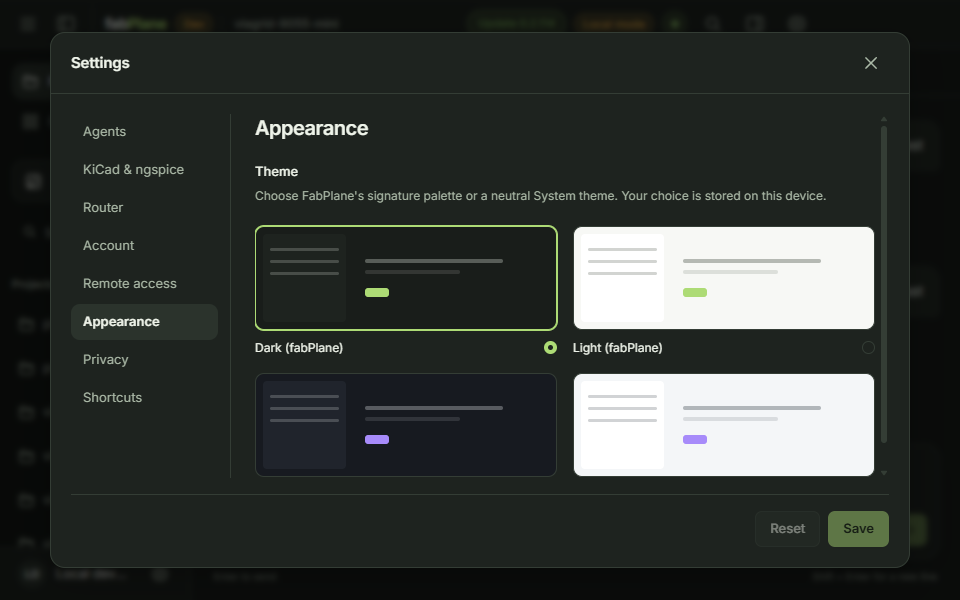
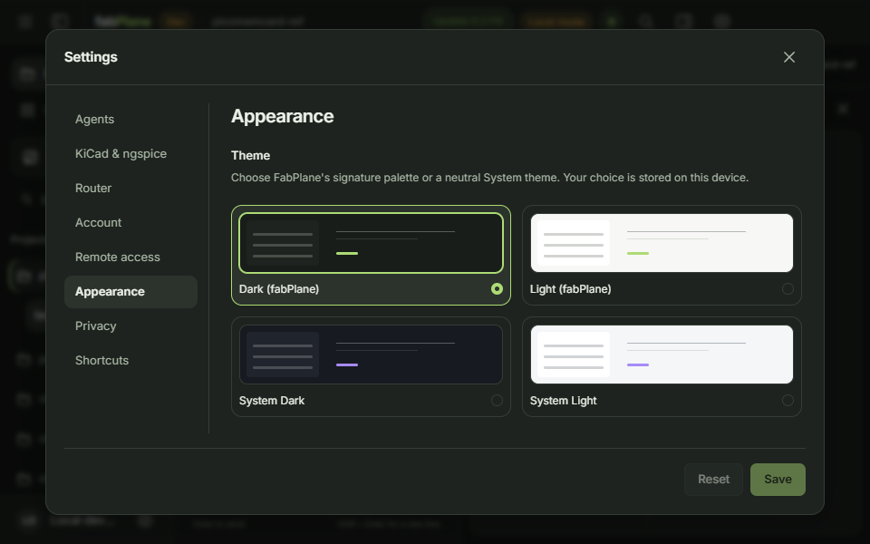
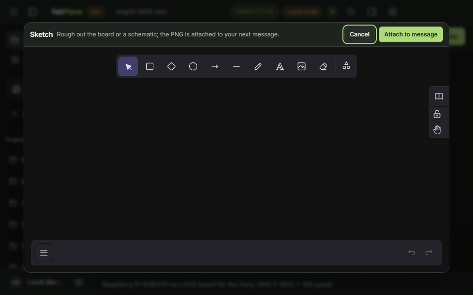
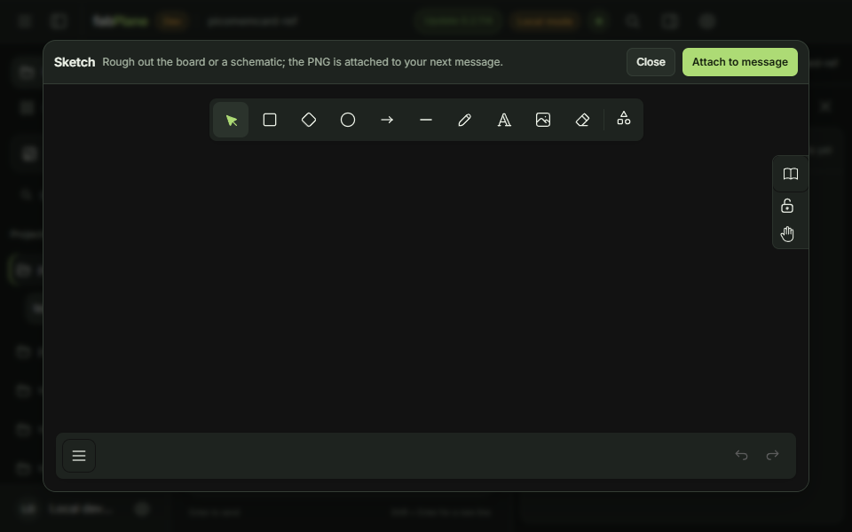
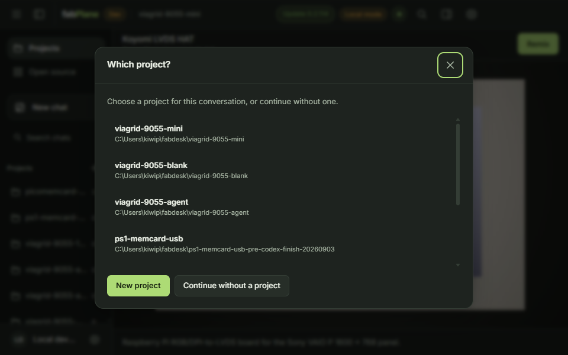
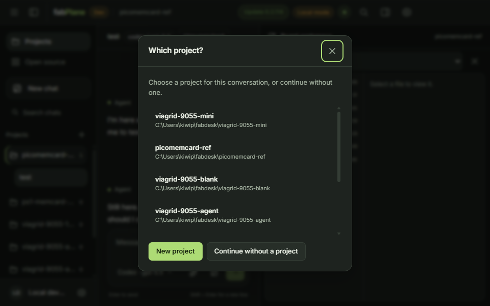
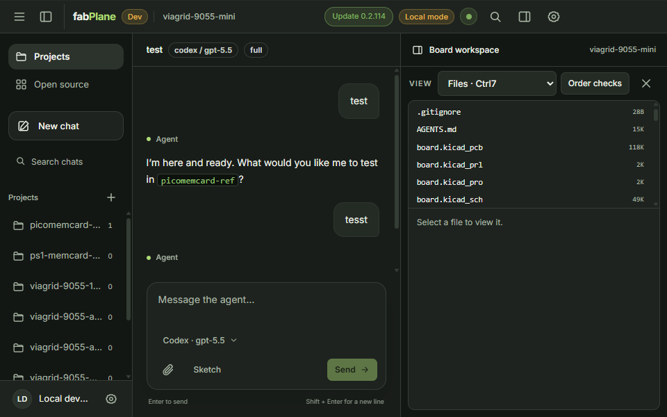
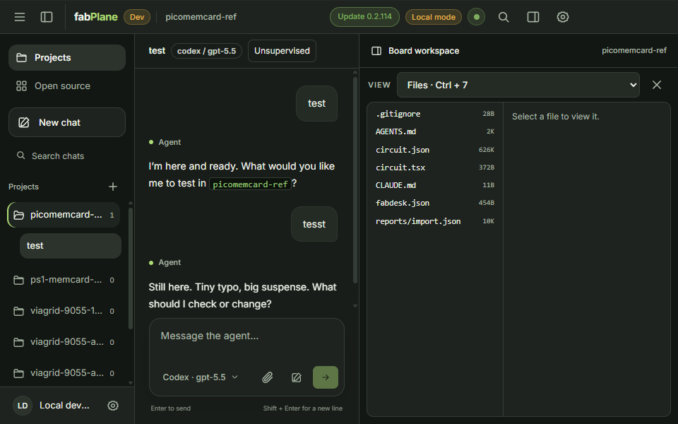

# GUI audit fixes

Audit baseline: `412953e8a61711830051842f882a2a04876b14f3` on `gui-improvements`. The implementation is the commit introducing this report; its full SHA is recorded in PR #200. Original main comparison remains in the parent report and PR description.

## Changes

- Project switching clears stale chat context; opening a chat restores its project. Opening a different chat expands its project once, without preventing subsequent manual collapse. Search reveals matching chats in collapsed projects.
- Pinned chats contribute to project counts, with an explanation when all chats appear in Pinned. Titles use the available row width; pin/menu space is reserved on hover or keyboard focus. Removed duplicate persistent pin actions.
- Compact composer keeps agent, attachment, sketch and send controls on one row. Icon-only actions retain accessible labels and tooltips. Sidebar section spacing is more consistent.
- Runtime mode is a readable toggle with a pressed state. User-facing chat terminology and separated shortcut keys are consistent across the changed controls.
- Board preview, Files, Renders and 3D export expose load errors and retries. Invalid DRC/ERC JSON and failed loads cannot display a clean result; check rerun buttons remain available. Narrow DRC descriptions span the row.
- SVG Fit calculates dimensions from the drawing and available viewport, and responds to pane resizing. The 3D tab explicitly describes its existing GLB export capability.
- Ordering uses the full content area. Open-source list spacing, radius, text sizing and search align with the sidebar.
- Settings protects unsaved edits on Escape, backdrop and close. Reset/discard restores the theme preview. Background query refreshes no longer overwrite a draft. All four theme labels fit at 960×600.
- Explicit dialog widths take precedence over the default 640px width. Project picker shows loading and retry states.
- Agent setup separates documentation, selectable commands and login steps.
- Sketch drafts survive closing/reopening per project during the current app session. Sketch controls inherit all four theme palettes. Drafts are not persisted across app restart.
- Command palette searches the full returned chat list, removing the first-50 cap. Tabs support arrows/Home/End; account menu supports focus entry, arrows/Home/End and Escape focus restoration.

## Visual comparisons

Same Windows development profile and FabPlane dark theme, 960×600. Before images were captured during the preceding audit. These are incremental comparisons against the audit baseline, not new main captures.

| Before | After |
| --- | --- |
|  |  |
|  |  |
|  |  |

Appearance: all labels visible and grouped with previews. Sketch: theme-matched chrome. Project picker: requested 420px dialog width, with actions wrapping as needed. Project ordering and background selection differ in the picker captures because the audit exercised project selection.

Board screenshots are additional evidence, not a controlled visual pair: the earlier audit exposed a chat under the wrong project. The corrected screenshot shows the chat's actual project and uses a narrower chat pane (317px). Compare composer height, mode control, shortcut spacing and project context; do not compare file content.

| Earlier context bug | Correct context and compact composer |
| --- | --- |
|  |  |

Additional captures: all four themes at 960×600, board and new chat at 1440×920, setup instructions, and the unsaved Settings prompt in `after/`.

## Verification

- Root `bun run typecheck`: passed.
- Root `bun run test`: UI 73 passed, 0 failed; client-core 94 passed, 0 failed. Full command fails outside UI: auth-client 3, agents 7, desktop 5, tools 4, KiCad 8, core 8. Windows toolchain/path/symlink and existing integration fixtures remain limitations; the overall suite is not green.
- Electron: all eight board views reached at 960×600, with no document horizontal overflow. Inspected four themes, compact composer, dialog widths and labels. Resized panes down to approximately 260px board and 300px chat; checked wide tabs and arrow navigation at 1440×920.
- Verified Settings theme reset/discard and Escape confirmation; account End/Escape navigation and focus restoration; switching project clears chat and opening chat restores project.
- Temporary renderer-only fixtures verified SVG Fit (2000×1000 drawing fit within 361×395 viewport), malformed DRC JSON error with rerun actions, and sketch element surviving close/reopen. Fixtures were restored; no board files or agent runs were created for these checks.
- Native macOS, authenticated ordering/inventory, live agent approvals and native title-bar button behavior were not re-tested in this pass. Shared CSS and platform shortcut code apply to macOS, but this is not a claim of native Mac verification.

## Design references

Continues the existing direction: [Linear](https://linear.app/now/behind-the-latest-design-refresh), [Figma UI3](https://www.figma.com/blog/behind-our-redesign-ui3/), [Codex](https://openai.com/index/introducing-the-codex-app/), [Cursor](https://cursor.com/blog/cursor-3), and [Raycast](https://www.raycast.com/blog/a-fresh-look-and-feel). This pass addresses the observed audit defects rather than adding a new visual direction.
