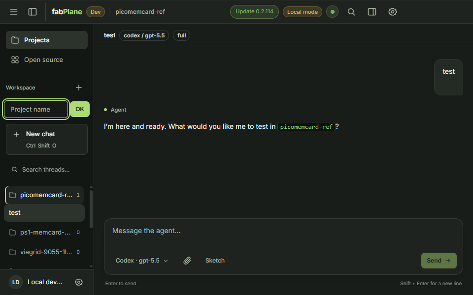
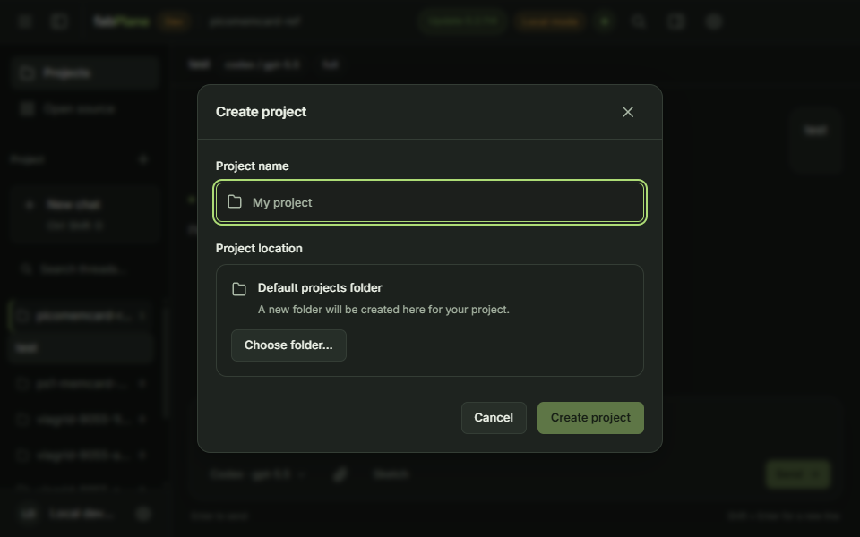

# Create project dialog

Replaces the sidebar inline name field with a shared Create project dialog, also used by the new-chat project picker. Sidebar heading is now **Project**.

The user-supplied Codex screenshot informed the name field, location panel and footer actions. The location picker uses Electron's native directory dialog on Windows/macOS. The selected folder is a parent: creation makes a fresh project subfolder inside it. Canceling the picker keeps the previous location; Use default restores existing behavior. Native local paths are not offered for remote connections.

This request adds optional `parentDirectory` to project creation, a client argument and an optional desktop host directory picker. Existing name-only callers retain default-folder behavior. The store reserves directories atomically, avoids overwriting existing files and keeps project slugs unique across locations. No database migration is required.

Before base: 3f3a4f4. Captures use the same dev profile, theme, project/chat and 960×600 window.

| Before | After |
| --- | --- |
|  |  |

## Verification

- Root `bun run typecheck`: passed.
- Custom-location regression: passed (9 assertions), including restart persistence, concurrent creation in the same/different parents, no overwrite, default behavior and invalid paths.
- Root `bun run test`: failed. UI 71/0 and client-core 94/0 passed. Failing suites: auth-client 3, agents 7, desktop 5, tools 3, KiCad 8, core 8. Includes platform/toolchain failures and a Windows EPERM symlink failure in the existing project resolution test. No claim that the full suite is green.
- Dialog inspected at 960×600 in the Windows dev app. Native OS folder-picker interaction and native macOS remain unverified.
