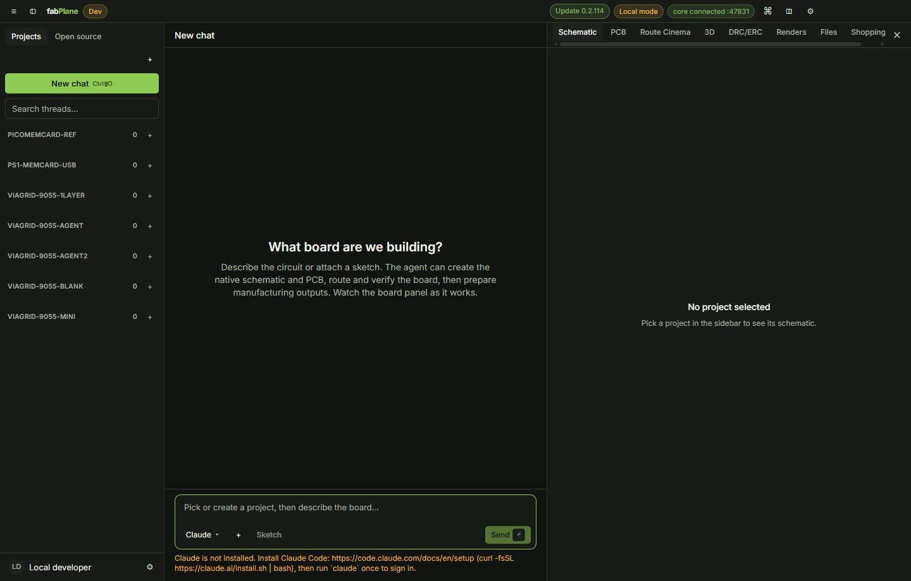
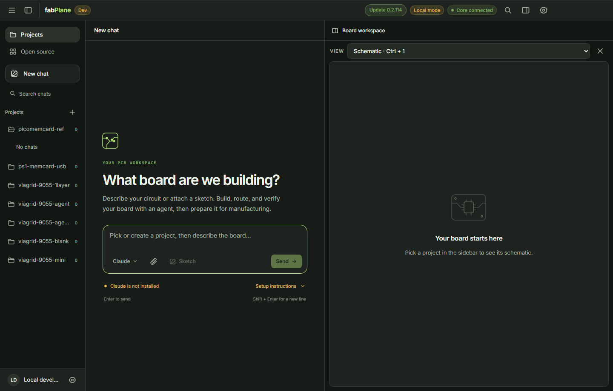
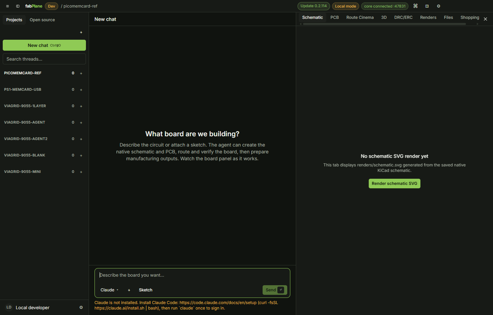
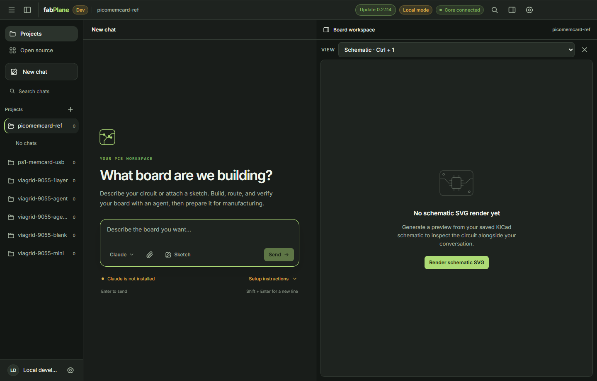
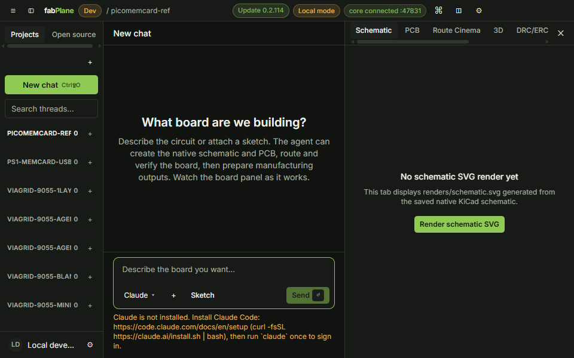
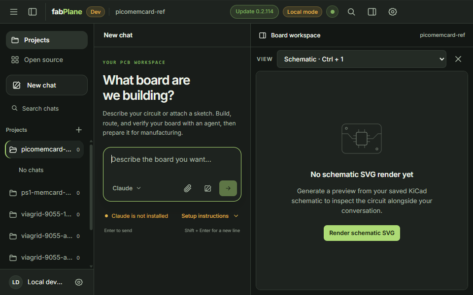
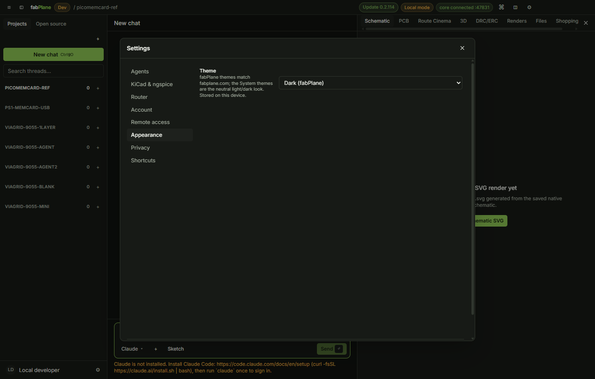
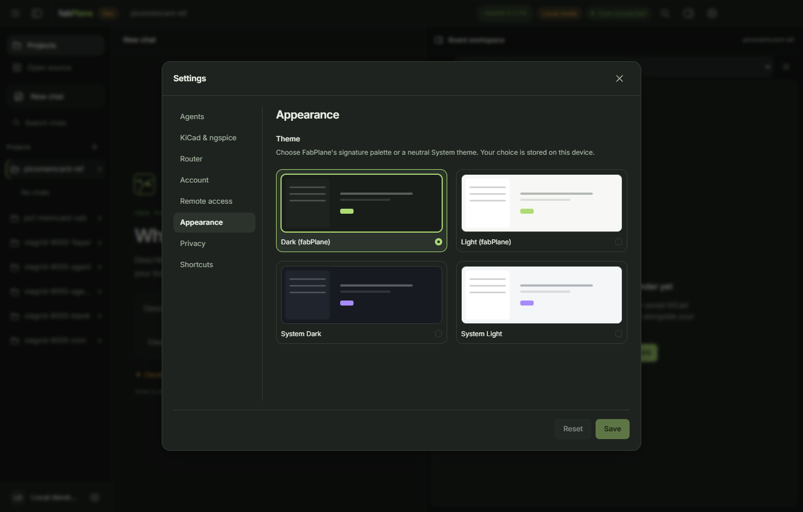

# Main versus current GUI

Main baseline: `33d68bc109150789c45f7ad334c079931e39d353` (original pre-refresh main).
Current GUI implementation: `ecfad8314853280c1067342f5a3d92b3f80f0607`.

The left images are the original main captures in `../before/`; the right images were freshly captured from the current GUI. Windows FabPlane Dev, FabPlane dark theme, Claude selected, empty composer, same local projects, Schematic view. The new-chat capture has no project selected; the other captures select picomemcard-ref. Sizes match each pair. Divider positions reflect the current responsive layout and differ from main. The chat-list cache was temporarily set to the original empty state, then restored; no saved chats were deleted.

| Screen | Main | Now |
| --- | --- | --- |
| New chat, 1440×920 |  |  |
| Project and board, 1440×920 |  |  |
| Minimum window, 960×600 |  |  |
| Appearance, 1440×920 |  |  |

These are the current comparison images for PR #200. Earlier iteration and audit captures remain historical evidence only.