# Workspace refinement · second visual review

## Revision and capture conditions

- Original `main`: `33d68bc109150789c45f7ad334c079931e39d353`.
- Previous GUI baseline: `edb2e81` (includes icon cleanup `2f1f2d187eb1eaa39eb108a0d57edcc95ce91cbd`).
- New implementation: `8b0f68dc0f5077f856657819375b7ac086d08b8a` on `gui-improvements`.
- Same FabPlane Dev profile and existing project data; FabPlane Dark, Schematic, `picomemcard-ref`. Captures are 1440 × 920 or 960 × 600 at DPR 1. New-chat captures have no selected project. Pane proportions differ intentionally: the new shell uses pixel-based minimums and a narrower navigation pane instead of the old percentage minimum.
- The local Claude installation warning is real and remains visible. The separate conversation images below use an explicitly labeled, temporary renderer fixture; they are not evidence of an actual agent run.

## Research translated into changes

| Reference | Relevant approach | FabPlane implementation |
| --- | --- | --- |
| [Flux: AI-first PCB UI](https://www.flux.ai/p/blog/less-clicking-more-building-the-new-ai-first-ui) | Closest workflow: conversational engineering beside the board; clear user/assistant separation and secondary tool detail | Group the start prompt with its composer; neutral user bubbles, full-width assistant text, quieter expandable tool activity, distinct board workspace |
| [Cursor 3](https://cursor.com/blog/cursor-3) | Agent work is central; inspect details when needed | Strong conversation hierarchy, compact agent/status controls, docked composer during conversations, setup instructions disclosed on demand |
| [Linear design refresh](https://linear.app/now/behind-the-latest-design-refresh) | Dimmer sidebar, quieter chrome, consistent headers and content priority | Darker navigation, compact project rows, aligned pane headings, less green across large surfaces, consistent type and spacing |
| [v0 Design Mode](https://v0.app/docs/design-mode) | Keep conversation and the resulting work close together | Preserve the resizable chat/board relationship, retain all board actions, make the active view explicit when the pane narrows |

The earlier [Codex, Figma UI3, and Raycast references](../README.md#design-references) still inform the workspace. This implementation uses FabPlane's own components and SVGs, not copied product assets.

## Original main versus current implementation

### New chat · 1440 × 920

| Original main | Current branch |
| --- | --- |
| 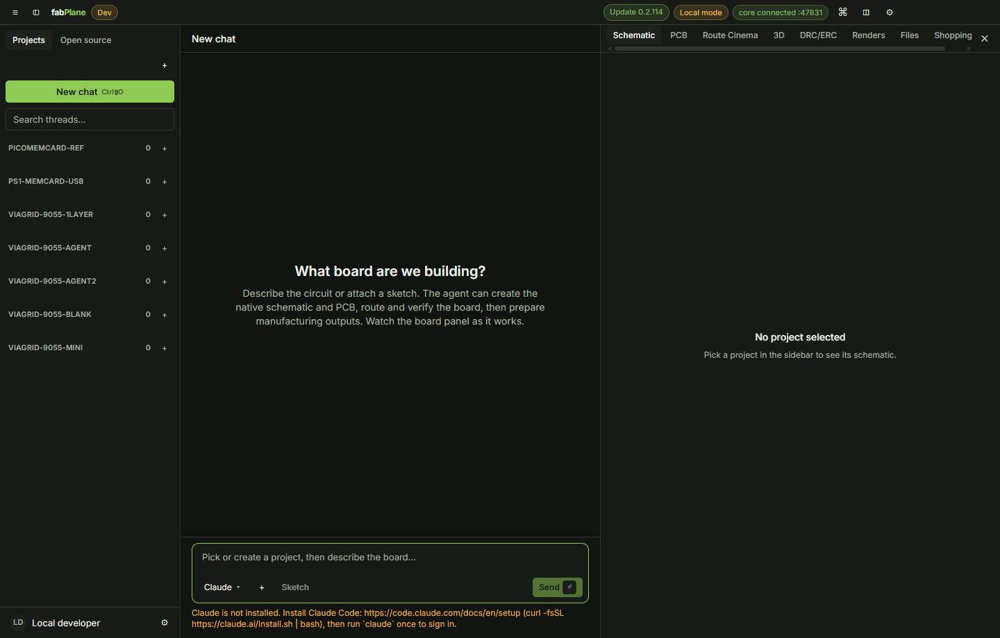 | 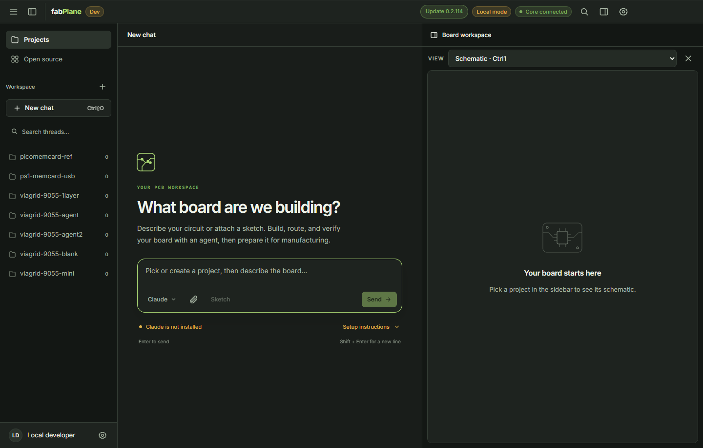 |

The introductory prompt and composer form one starting point. The sidebar is denser, with readable project labels and clear selection. Top-bar controls remain independent. The logo has no outer tile.

### Project and board · 1440 × 920

| Original main | Current branch |
| --- | --- |
| 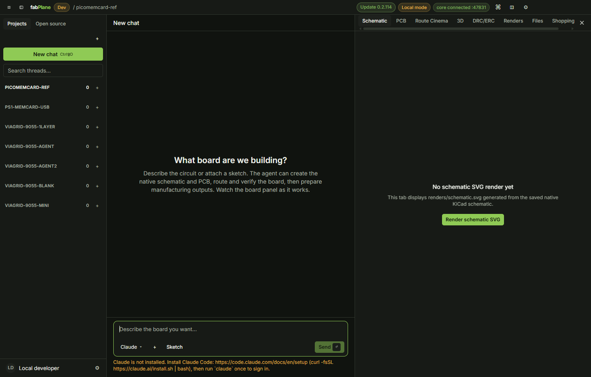 | 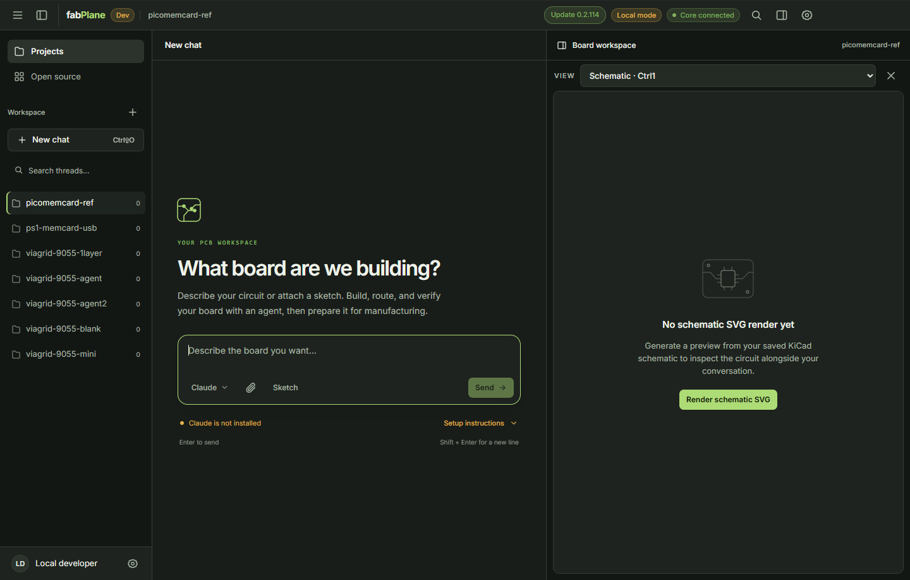 |

The board has a dedicated heading, active-view selector, inset canvas, and an explanatory empty state. All eight views remain in the same order. Wide panes show tabs; narrower panes show the complete View menu. The render action is unchanged.

### Minimum window · 960 × 600

| Original main | Current branch |
| --- | --- |
| 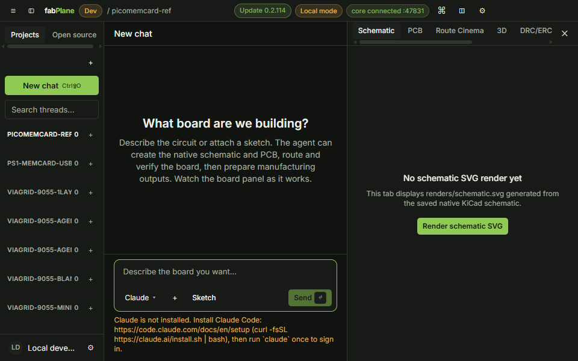 | 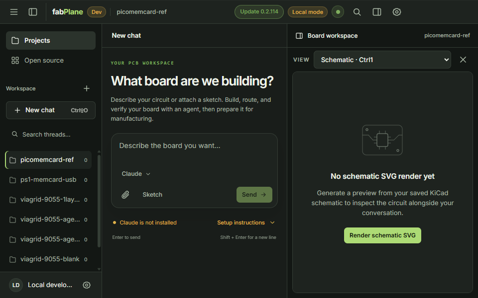 |

The composer toolbar wraps based on its pane width. Agent selection, attachment, sketch, and send remain reachable. The shell respects approximately 190 px navigation, 300 px chat, and 260 px board minimums. Long labels truncate with existing tooltips; secondary project actions appear on hover or keyboard focus.

### Settings · 1440 × 920

| Original main | Current branch |
| --- | --- |
| 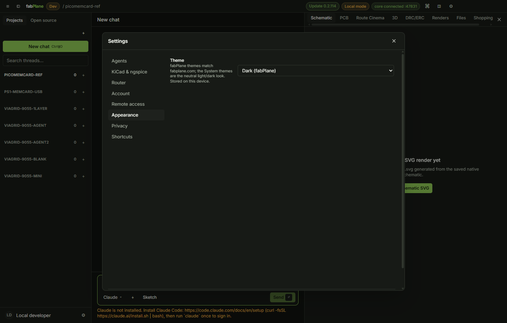 | 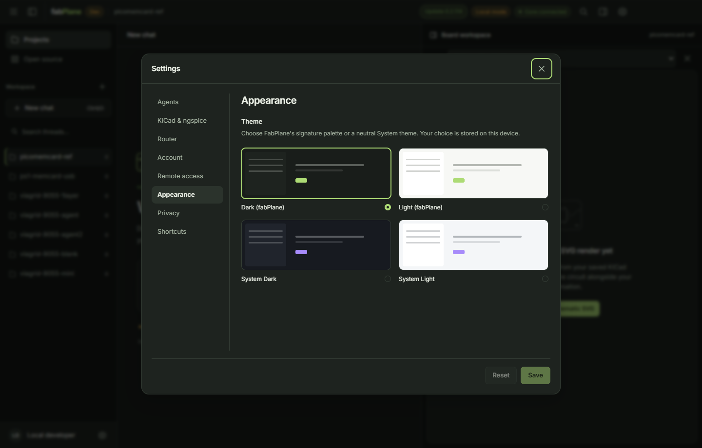 |

Theme choices now show visual previews with native radio controls. Sections have clear headings; the scrolling content and fixed Save/Reset footer have separate space. Dialog focus moves inside, wraps with Tab, and returns to its previous control on close.

## Difference from the previous GUI pass

| Previous GUI pass | This iteration |
| --- | --- |
| 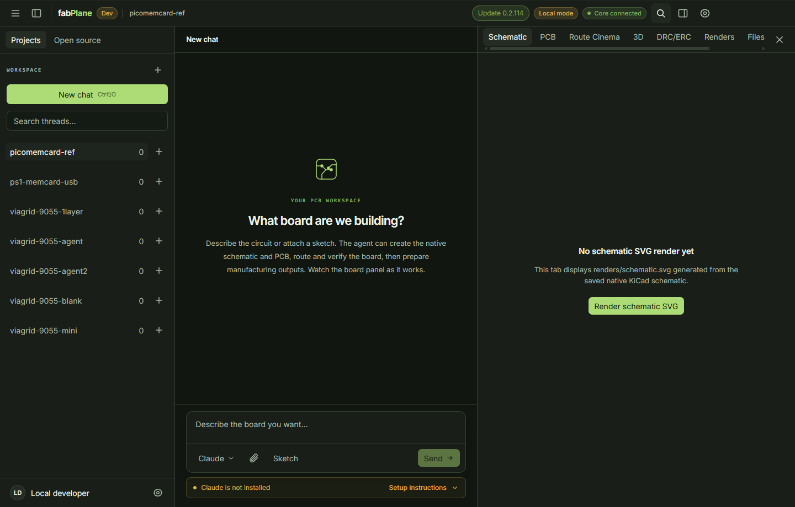 |  |
| 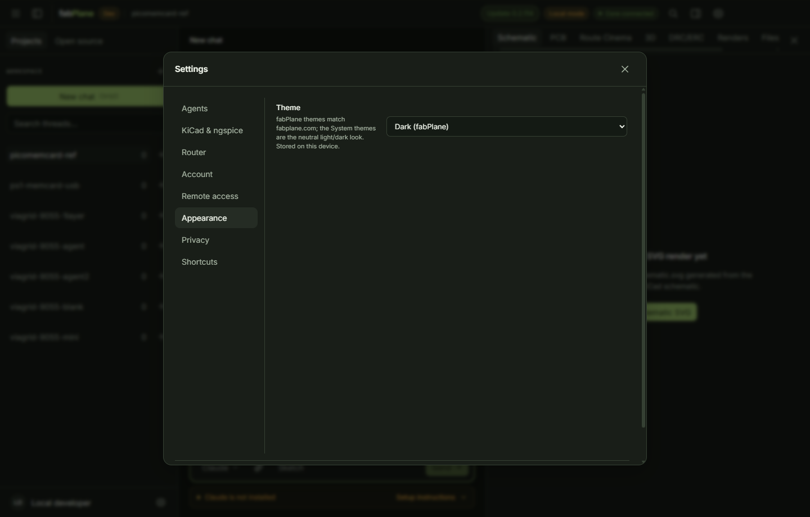 |  |

This iteration changes composition and density as well as colors: vertical navigation, a compact project list, a grouped start screen, distinct board surfaces, and visual theme selection. It also removes a global `font: inherit` rule that was overriding control type sizes and weights.

## Additional responsive evidence

### Conversation fixture

These images exercise a long thread title, supervised badge, user and assistant messages, markdown, collapsed tool activity, and the docked composer. Messages were injected only into the dev renderer's client methods for a temporary fixture ID. Reloading removed the fixture; no agent request, conversation record, or project edit was made. Tool execution, approval submission, streaming, and actual sends were not end-to-end tested in this pass.

| 1440 × 920 | 960 × 600 |
| --- | --- |
| 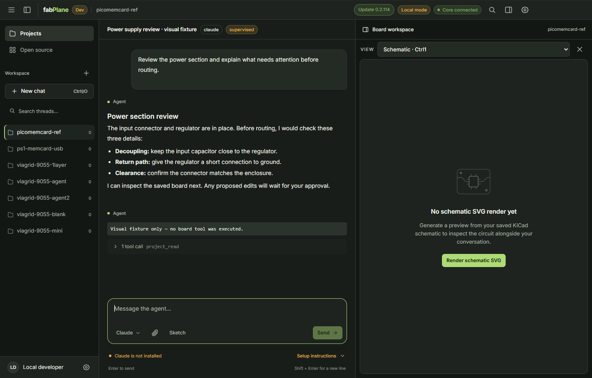 | 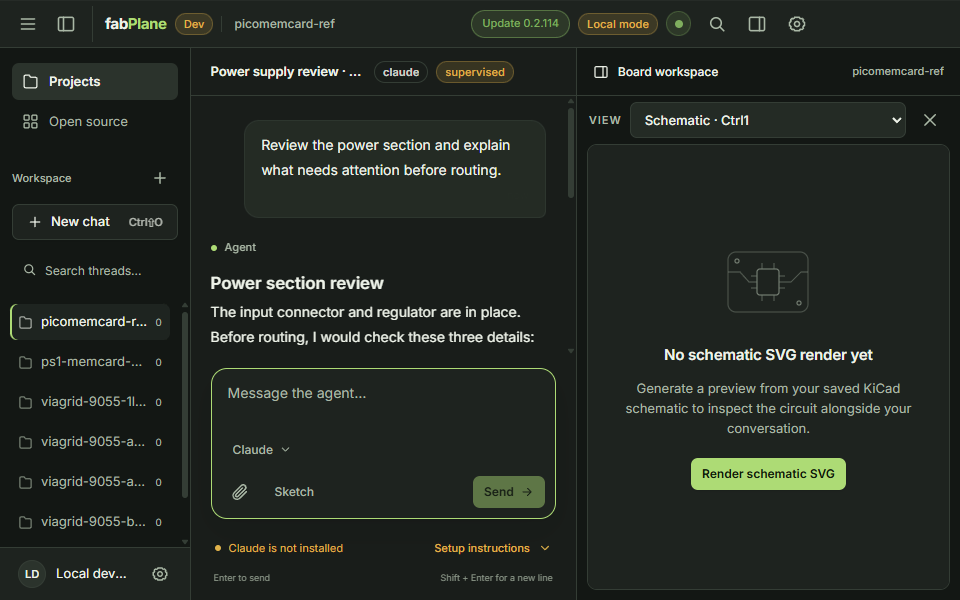 |

### All four themes at minimum size

| FabPlane Dark | FabPlane Light |
| --- | --- |
|  | 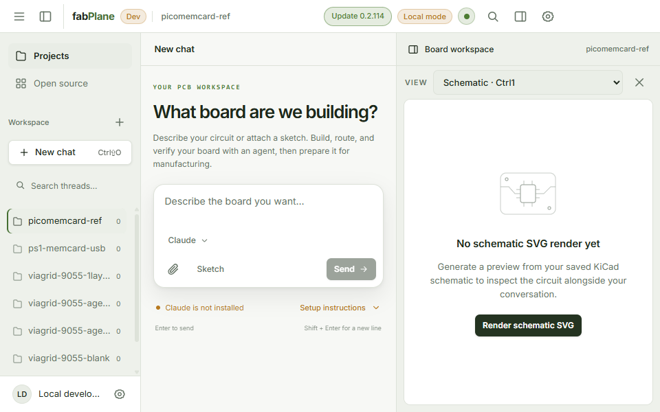 |

| System Dark | System Light |
| --- | --- |
| 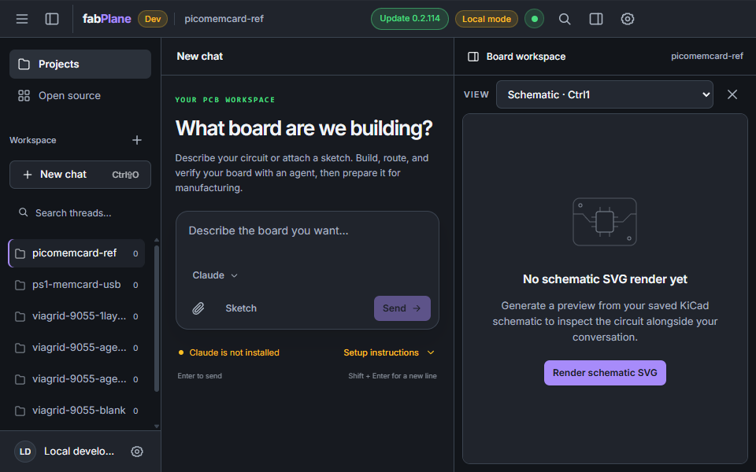 | 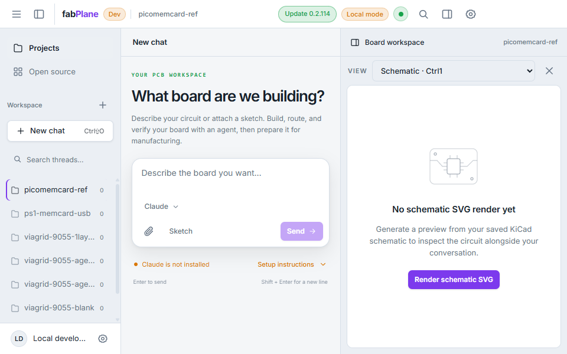 |

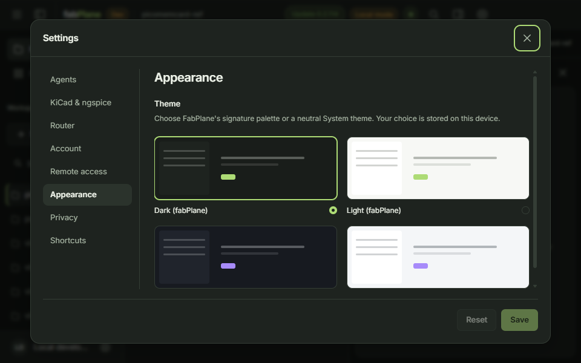

## Verification and limitations

- Root `bun run typecheck`: passed after final edits.
- UI tests: 71 passed, zero failures.
- Script tests: 69 passed, two skipped; run separately because the root test command exits before this stage.
- Root `bun run test`: failed outside the UI package. Core reports 264 passed, 11 skipped, eight failures. Tools reports 96 passed and four failures. KiCad mechanical tests also fail, including a cancelled-export timeout and a fixture requiring KiCad 10.99 or later. Observed failures include Windows/POSIX path assertions and Windows symlink permission errors. These files were not changed; the full suite is not green.
- Electron checks: project selection, new chat, all eight `Ctrl+1`–`Ctrl+8` view shortcuts, `Ctrl+K` palette, Settings/Escape, theme switching, dialog Tab wrap, and keyboard pane resizing through minimum/maximum limits.
- Reviewed actual 1440 × 920 and 960 × 600 images, all themes, truncated project/thread labels, empty board, and missing-agent notice. Settings content scrolls at minimum size while its footer remains visible. Conversation content scrolls independently above the composer.
- Existing workflows and backend/protocol/data code are unchanged. Commerce screens and live agent execution have not received a fresh end-to-end walkthrough in this iteration. Native Windows title-bar behavior was retained; this pass did not add custom window controls.
