# Desktop responsiveness and consistency audit

Implementation: `95be0f4adf38e939b691e6ff321d6a5dd85fc10e`, following `13bfecaacecebb9114db61a630171afefc76be31` on `gui-improvements`.

## Fixed issues

- **Files:** the fixed 224 px navigation list consumed nearly the entire narrow board pane. It now stacks above the preview below 440 px, with independent scrolling. File text wraps at word boundaries; long tokens can still break. File loading errors are visible.
- **Agent menu:** the absolute-positioned popup could be clipped by the new-chat scroll area. It now renders in a viewport-positioned portal, chooses space above or below its anchor, scrolls when necessary, and supports arrow/Home/End navigation and focus return.
- **Context menus:** clamp inside the viewport, support arrow navigation, restore keyboard focus, and close on window resize. A synthetic bottom-right opening at (950, 590) in a 960 × 600 window settled at (776, 434), ending at (952, 592).
- **Command palette:** the search field shrank under pressure from the results list. Its 48 px height is now protected.
- **Shopping:** item controls and the add form wrap; empty-state actions wrap; editable controls use consistent 32 px heights.
- **Inventory:** the toolbar wraps; columns have deliberate widths and a horizontally scrollable table; long names retain tooltips. Quantity controls use shared SVGs.
- **Board tools:** SVG and DRC toolbars wrap; Renders columns follow pane width, not window width; Cinema no longer forces a 320 px canvas minimum. Zoom and playback controls use shared SVGs. DRC findings can be selected with Enter/Space.
- **Settings:** remote fields use the same responsive rows; long paths wrap; checkbox rows give their explanations enough width and align the control at the end. Dialog Tab wrapping respects the selected native radio button.
- **Other surfaces:** ordering cards become one column in narrow panes; catalog descriptions scroll instead of squeezing the preview; Sketch controls wrap; login/startup/first-install/computers screens can scroll vertically; project-picker actions and approval controls wrap. Long message tokens and markdown tables remain contained. Thread hover buttons no longer overlap due to conflicting utility sizes.
- **Native chrome:** Windows overlay height was 36 px while the header was 48 px. Both now use 48 px. macOS traffic-light position changed from y=10 to y=17 to align with the taller header; existing 80 px left reservation is retained.

## Coverage and limits

| Screen or component | Review performed |
| --- | --- |
| Shell, sidebar, new chat, existing conversation | Windows renderer at 960 × 600 and 1440 × 920; long labels, resizing, focus, separate top-bar icons |
| Schematic, PCB, 3D, DRC/ERC, Renders, Route Cinema | Windows empty states at minimum size; populated toolbars/canvas and report layouts inspected in source. This pass did not run routing or rendering jobs |
| Files | Real project file list and selected text at both sizes |
| Shopping | Real signed-out state; temporary populated renderer fixture at minimum size; no purchase or mutation submitted |
| Inventory | Real signed-out state; temporary populated fixture and add form at minimum size; no item added or quantity changed |
| Ordering | Real blocked-order screen at minimum size; no vendor submission |
| Open-source catalog | Real list and selected Koyomi LVDS HAT preview at minimum size; no remix |
| Settings | All eight sections at minimum size, including remote access; all four themes checked on checkbox layout; no privacy or remote setting changed |
| Agent/context menus, palette, Sketch | Windows renderer captures; popup bounds, arrow navigation, Escape, palette input height |
| Project picker, approval/question/tool cards | Source/layout audit and shared-control fixes; approval/answer submissions not exercised |
| Login, first-install privacy, core status, computers, pairing | Source/layout audit; their live authentication, consent, reconnect, and pairing flows were not exercised |
| macOS | Source audit plus temporary `darwin` host-adapter simulation of header spacing and shortcut labels. These are **Windows-rendered simulations**, not native macOS screenshots or a native shortcut test |
| Windows native controls | Restarted the dev app. `navigator.windowControlsOverlay.getTitlebarAreaRect()` reports x=0, y=0, width=823, height=48 at 960 px; the header also measures 48 px. Native screenshot capture hit a computer-use approval timeout, so OS-control appearance and click behavior remain unverified |

The available host is Windows; native macOS testing remains required. This is a broad screen audit with stated coverage, not certification of every live backend state. Temporary cloud fixtures changed only renderer client methods/query data and were removed by reloading. They did not alter authentication or stored cloud/project data.

## Visual evidence

### Files adapts to the pane

| 1440 × 920 | 960 × 600 |
| --- | --- |
| 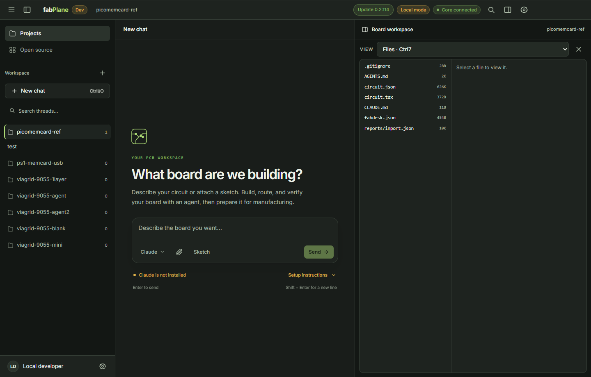 | 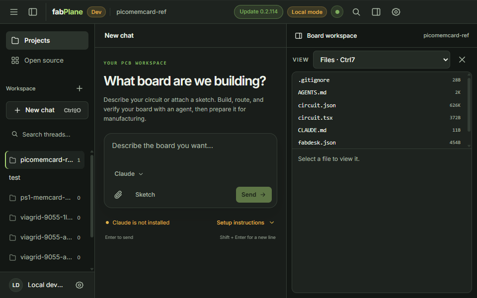 |

### Shared interactions at 960 × 600

| Agent menu | Command palette |
| --- | --- |
| 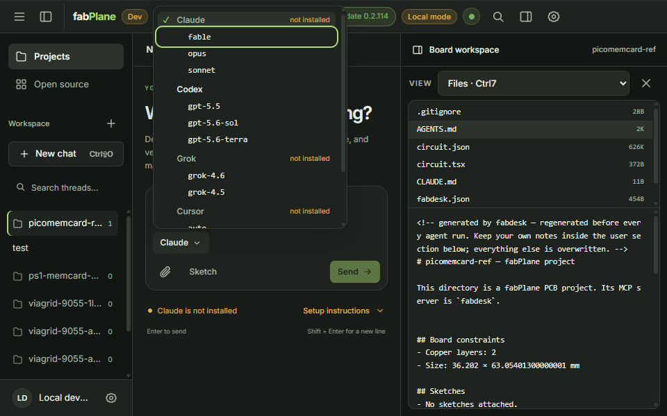 | 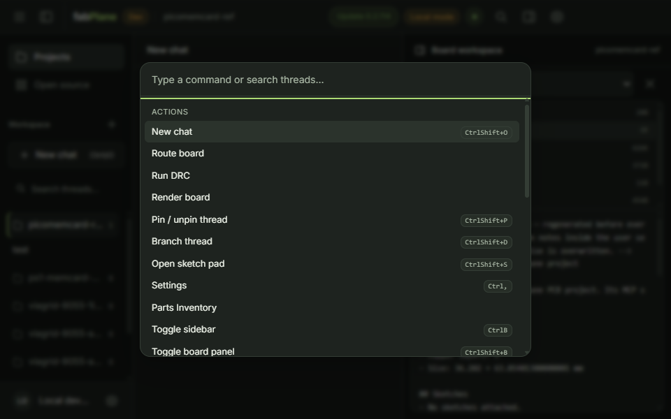 |

| Settings checkbox alignment | Context menu at the viewport edge |
| --- | --- |
| 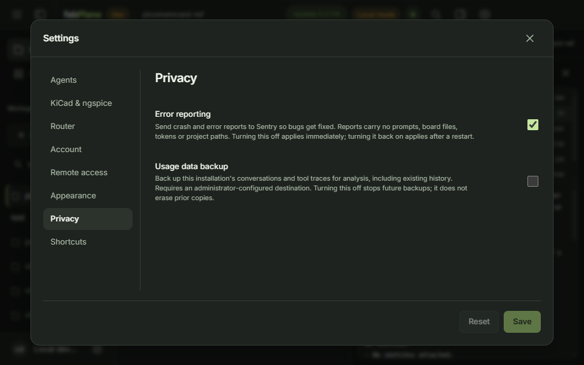 | 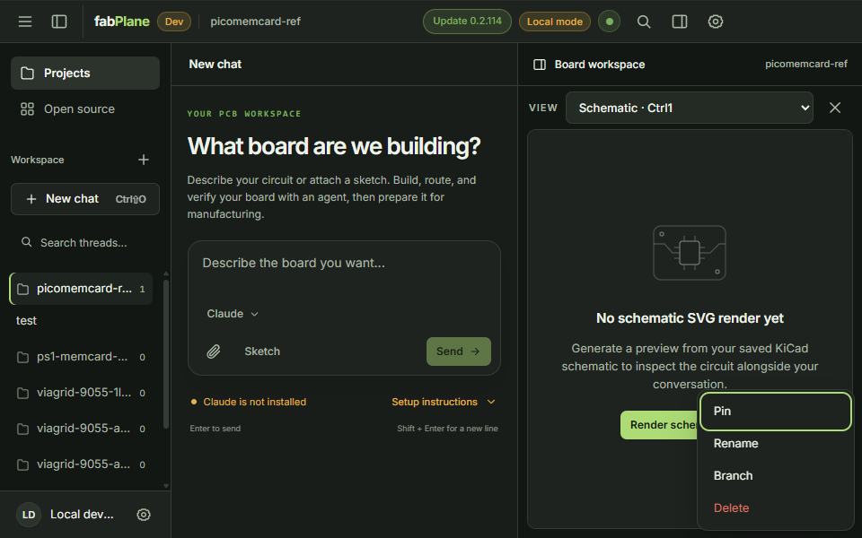 |

### Secondary screens

| Shopping — visual fixture | Inventory — visual fixture |
| --- | --- |
| 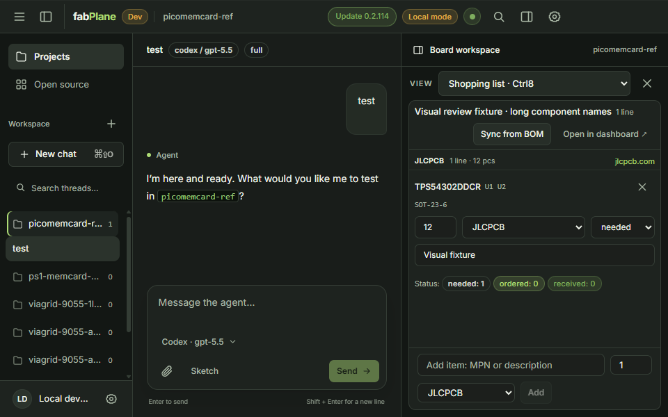 | 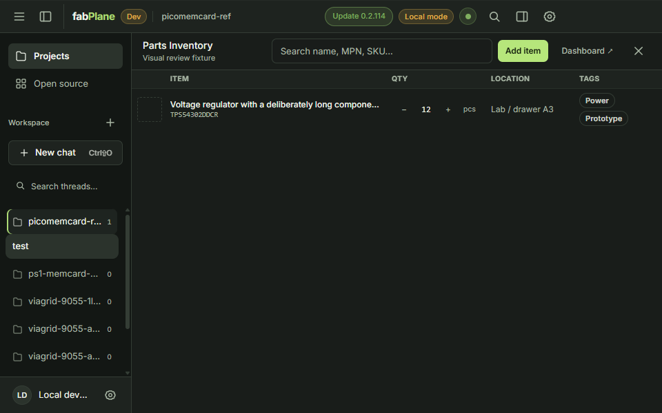 |

| Blocked ordering | Open-source preview |
| --- | --- |
| 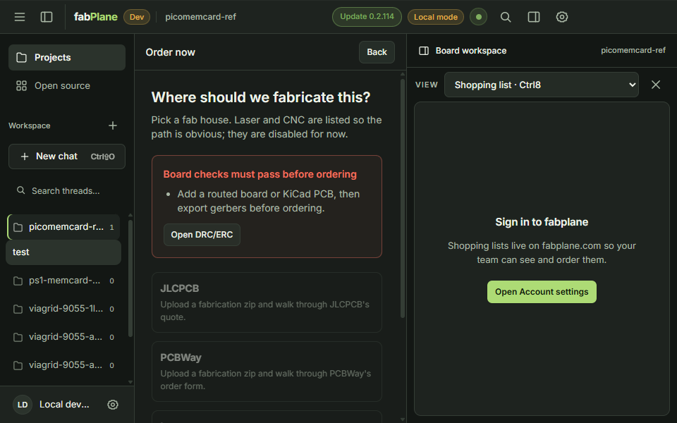 | 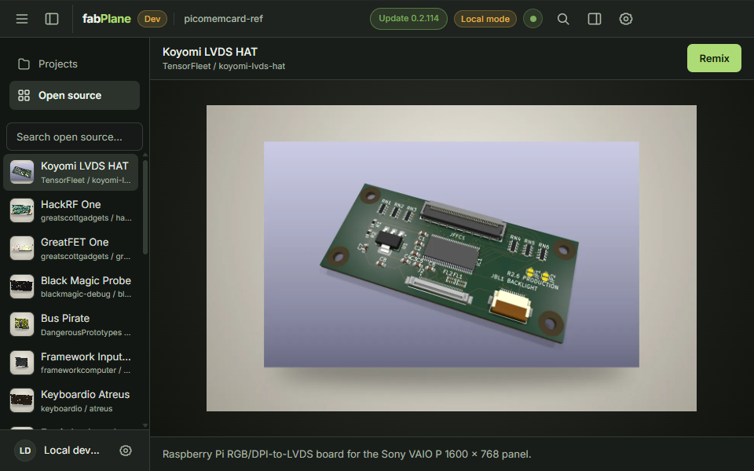 |

| Remote access | Sketch |
| --- | --- |
| 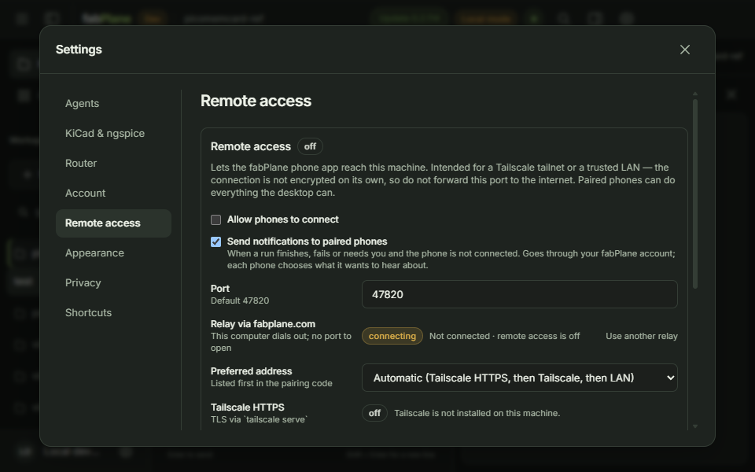 | 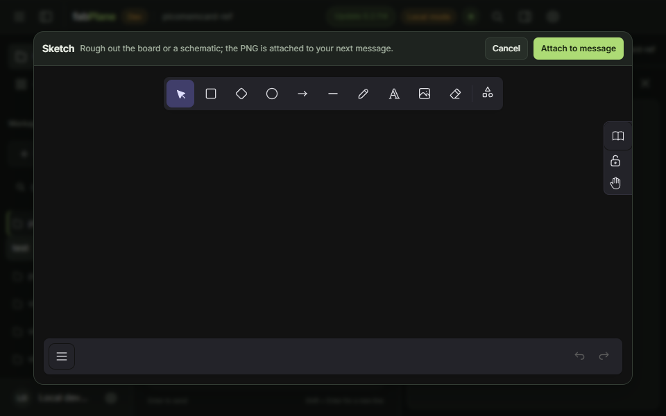 |

### macOS-specific renderer simulation — not native macOS

| Header reservation | Shortcut labels |
| --- | --- |
| 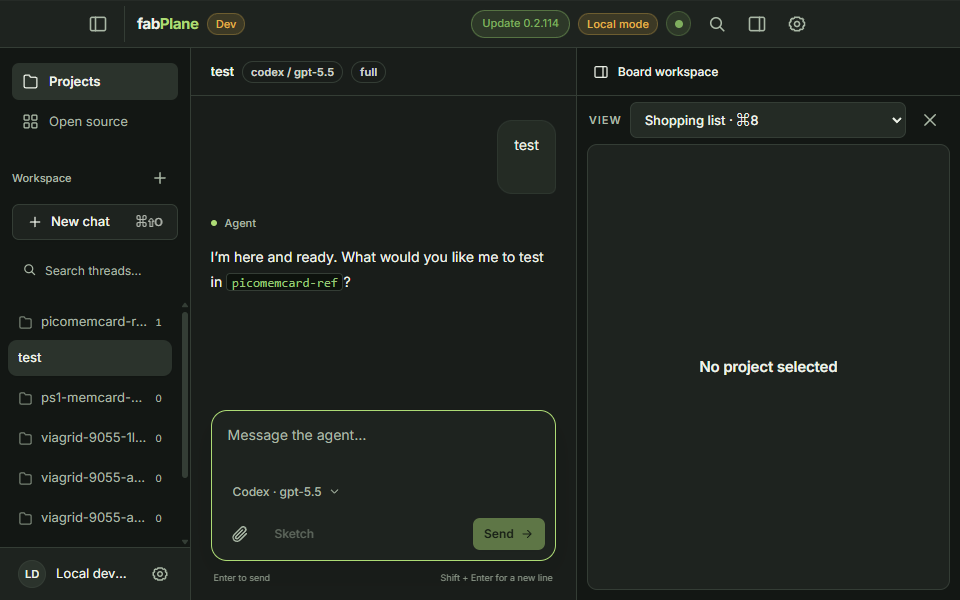 | 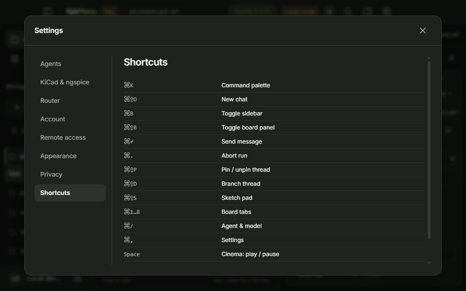 |

## Tests

- Root `bun run typecheck`: passed.
- UI tests: 71 passed, zero failures.
- Desktop tests: 87 passed, five failed. Failures are in unchanged platform path/identity and packaged KiCad path tests: the two `paths` cases, two `applyDesktopIdentity` cases, and `packagedKicadEnv`. The desktop suite is not green.
- The earlier full-suite core/tools/KiCad failures remain documented in the preceding review; they were not addressed by this UI audit.
- No native Mac runtime is available. Native macOS verification, live cloud mutations, and populated routing/rendering workflows remain follow-up verification items.
