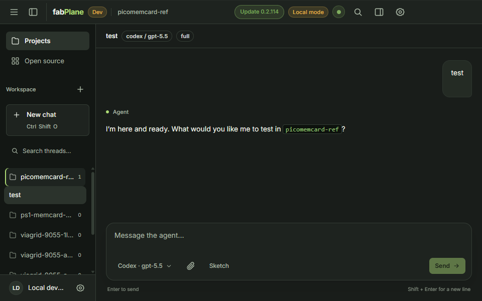
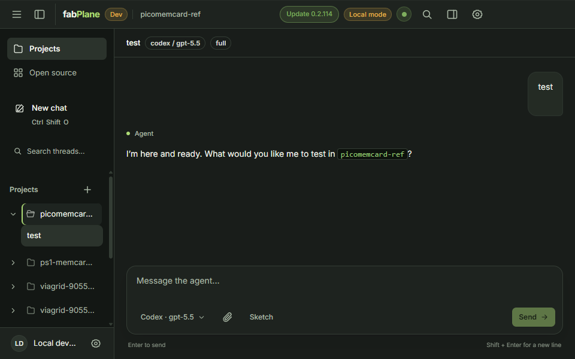
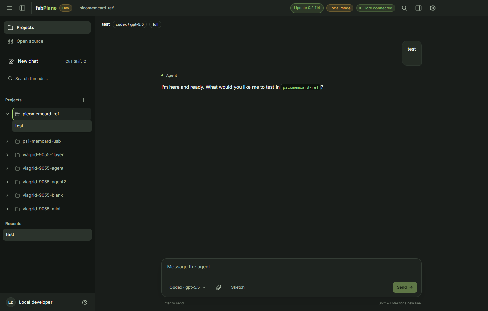

# Expandable sidebar

Reference: the user-provided Codex sidebar screenshot. Projects and Open source navigation remain in place.

- Flat New chat action with a compose icon.
- Explicit, keyboard-operable project disclosure buttons with expanded state and controlled-panel labels.
- Nested chat rows and No chats state; selected project starts expanded.
- Recents sorted by update time; pinned chats retain their existing group.
- Existing project selection, new project, per-project chat, search and chat menus remain available.
- Rename is scoped to the chosen row when a chat appears both inside a project and in Recents.

Before: fc77cef (previous GUI iteration). Both 960×600 captures use the same dev profile, selected project/chat and theme. Also checked at 1440×920. Mouse collapse and keyboard Space expansion verified in the Windows dev app. Native macOS was not available; controls share the same renderer implementation.

UI typecheck passed; existing UI suite: 71 passed, 0 failed.

| Before | After |
| --- | --- |
|  |  |

