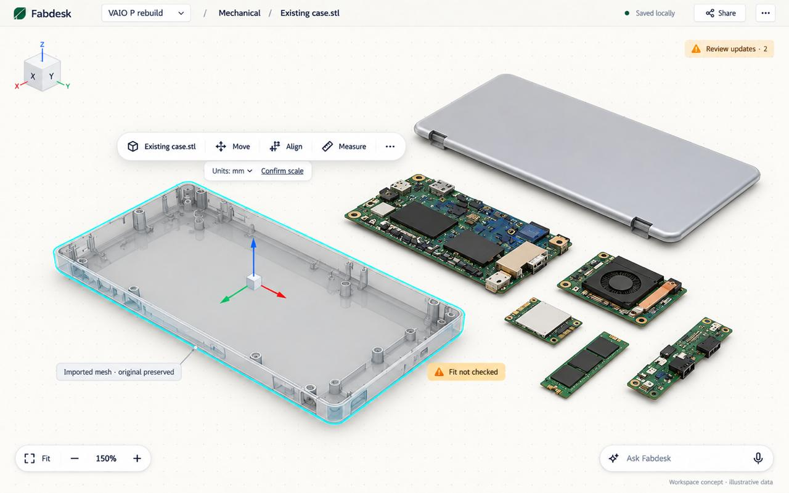
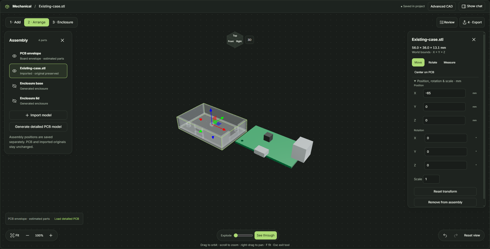
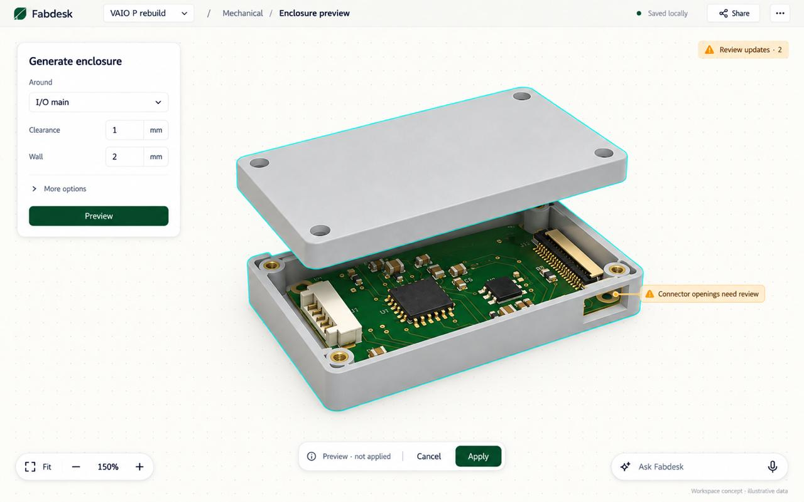
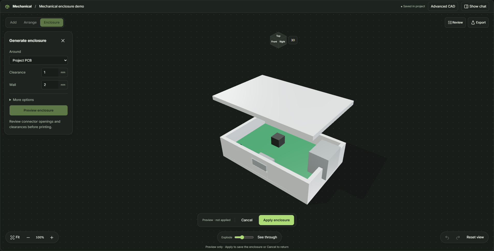
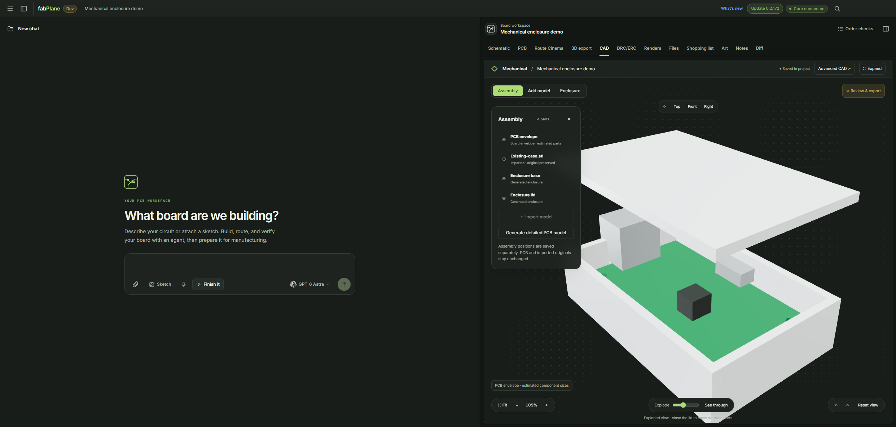
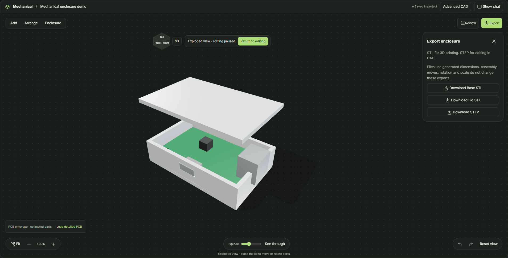

# Mechanical workspace

Open a project and choose **CAD** in the board workspace. CAD starts in focus mode; **Show chat** restores the split workspace and **Focus CAD** expands it again. This preference is remembered on this device. The existing FreeCAD screen and kernel tree are under **Advanced CAD**.

**Enclosure now opens the guided Start → Space → PCB → Review workflow.** See [enclosure design and PCB fit](enclosure-design.md) for the current controls, coordinated export, native bridge requirements and validation. The original viewer screenshots below document the assembly controls; the latest enclosure screenshots are in that guide.

## Reference-driven layout

These are captures of the running desktop app, using the repository's enclosure regression fixture. The block-shaped components are explicitly labelled estimates, not replacement artwork for detailed PCB models. A generated `renders/board.glb` supplies the actual KiCad geometry and materials when available.

| Requested reference | Implemented interaction |
| --- | --- |
| Assembly canvas with a floating import/generate card | Dotted canvas, theme colours, remembered focus mode, docked/collapsible panels, project save status and an Add → Arrange → Enclosure → Export workflow. |
| Selected imported case with movement tools | STL/OBJ/GLB import, selection, XYZ movement/rotation handles, precise values, uniform scale, centre-on-PCB and surface measurement. |
| Enclosure form and exploded preview with Apply/Cancel | Actual generated base/lid meshes, clearance/wall/options, explode slider, transparency, non-writing preview and explicit Apply. |

### Visual comparisons

The left column contains the supplied design concepts; the right column shows the implemented app. The screenshots use a small regression fixture, so component detail and enclosure shape differ from the illustrative laptop assets. The app retains its existing theme.

| Supplied design concept | Running FabDesk |
| --- | --- |
|  |  |
|  |  |
|  |  |

### Usability refinement

Panels reserve space beside the 3D render surface, so Fit no longer frames models underneath controls. Narrow layouts show one inspector at a time. Existing assemblies open with the Parts list. The inspector groups X/Y/Z into rows, labels units once per group, explains uniform scale, and separates Move/Rotate/Measure from secondary actions. Save status remains visible beside chat. Labels and buttons are larger, and SVG icons share the app's stroke style.

| Previous layout | Refined layout |
| --- | --- |
|  |  |

### Light theme

## Controls and persistence

- Drag empty canvas to orbit, scroll to zoom, right-drag to pan. Fit and a clickable top/front/right view cube plus isometric view are available. **F** fits the visible assembly; **Esc** leaves the active tool/selection. **Ctrl/Cmd+Z** undoes and **Ctrl/Cmd+Shift+Z** redoes assembly edits. Text fields keep their normal editing shortcuts.
- Select a model, then Move or Rotate to use the 3D handles. The inspector shows world-space X × Y × Z dimensions in millimetres and **Position, rotation & scale** fields for exact edits. Numeric edits commit on Enter or blur, with one undo step per edit.
- Measure picks two surface points and reports millimetres. It does not snap to vertices or certify fit.
- Assembly visibility, transforms and imported-file references persist in `cad/assembly-layout.json`. Undo/redo lasts for the current workspace session. Original PCB and imported files remain unchanged. Removing a part only removes its assembly reference.
- Imports accept STL/OBJ in millimetres and self-contained GLB in metres, converted to millimetres. Use scale 25.4 for an inch-based STL/OBJ. Limit: 50 MiB per file, six million vertices per model, 100 assembly entries. Unsupported compression or external GLB resources are rejected.
- The guided enclosure preview does not replace design/export files. Generated cases use the local geometry generator; modifying an imported case requires the native CAD bridge. Apply rejects stale previews and saves a coordinated ZIP. Its explicit PCB-coordinate placements are separate from Arrange's assembly poses.
- Exploded view has a visible **Return to editing** action; Fit includes the exploded lid. Hover gives a model highlight, with subtle ground shadows and no idle rendering.
- **Review** shows actual warnings in amber. The separate **Export** panel provides generated base STL, lid STL and STEP downloads. Downloads retain generated dimensions; assembly transforms do not bake into export files.

## Scope and limits

Assembly import supports STL, OBJ and GLB. The guided enclosure workflow also accepts STEP through the native CAD bridge and adds conservative fit checks, constrained PCB edits and imported-case cavity/post/opening operations. It does not add connection authoring, exact imported-mesh collision checking, arbitrary solid editing or transformed-assembly export. Enclosures retain the generator's printability limits.

The board fallback is an outline bounding envelope with estimated component sizes. Use **Load detailed PCB** on the envelope label or generate a detailed PCB model from Arrange for actual KiCad geometry; that requires an installed KiCad CLI compatible with the project's PCB version. The new imported-case script passed a real FreeCAD 1.1 solid test; the app's native bridge integration remains unverified locally.

## Validation (Windows, Bun 1.4.0)

- Rechecked on 2026-10-29: root typecheck and desktop production build pass; no `.map` files in desktop build output.
- All 217 UI tests and all 172 client-core tests pass. Focused mechanical/CAD coverage: 22 tests (5 persistence/pose/import-policy, 4 mesh decoding/coordinate-frame, 13 CAD tools).
- Latest full root suite: 1,875 passed, 35 failed. Failure names match the earlier mechanical-workspace baseline exactly. This is not an all-green root run. The new enclosure checks and native-runtime limitations are recorded in the enclosure guide.
- Live app: native mouse orbit, move handle, rotation ring, scroll zoom and two-point measurement; exact negative/decimal coordinates; STL/OBJ/GLB imports; malformed mesh rejection; original-file preservation; undo/redo; remove/undo; scale persistence after reopening; preview/cancel preserving existing files; Apply creating STL/STEP; moved/rotated board-case alignment; compact explode controls; dark/light rendering; Advanced CAD dialog.
- Readability follow-up: 217 UI tests, UI typecheck and desktop build pass; live verification of default Parts view, aligned/non-overlapping XYZ fields, negative decimal editing with undo, and visible scale/save status in a 767px-wide chat layout.
- Usability follow-up: persisted focus/chat preference across project reopen; no canvas/inspector overlap at 646px workspace width; scale dimensions, keyboard undo/redo and text-field guards; F/Esc; view-cube keyboard activation; exploded-view return; separate review/export; valid base/lid STL and STEP blobs through the download buttons; OBJ import while Export is open closes Export and selects the import; import undo. Idle WebGL draw calls: **0** over 500ms, with drawing resuming on camera input. Preview/cancel again preserved all six checked PCB/layout/spec/export files.
- Detailed GLB export was exercised with `mechanical/runtime-board.kicad_pcb` and KiCad 10.0.5. The separate enclosure fixture supplies the screenshots above.

The viewer loads lazily and renders only when controls, geometry, camera, theme or size change. It has no continuous animation loop. Graphics resources and listeners are disposed on unmount.
