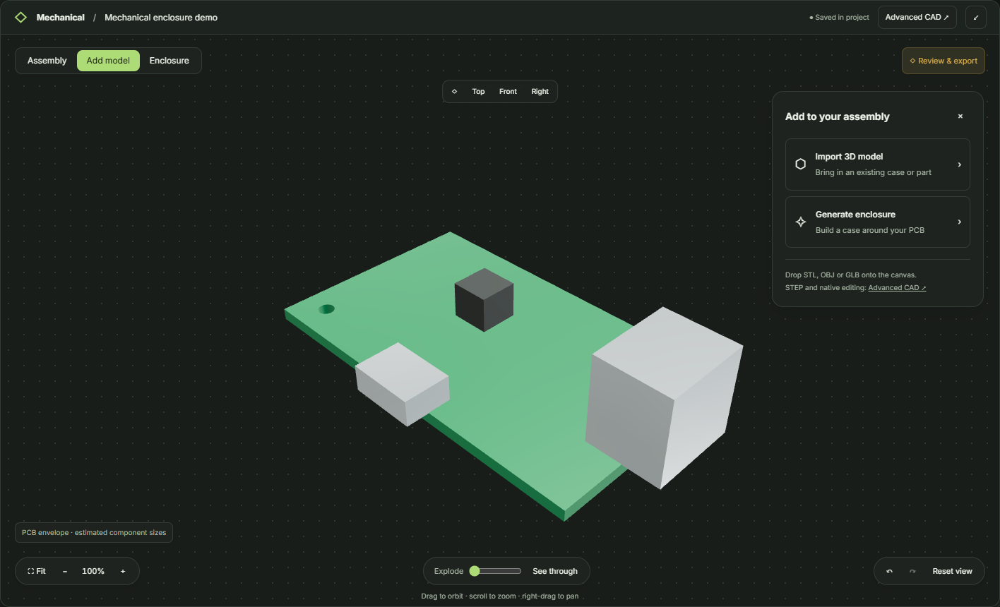
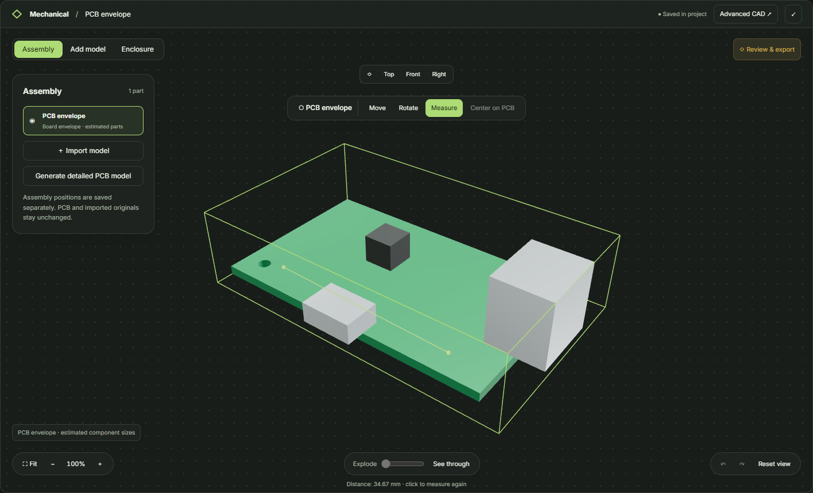
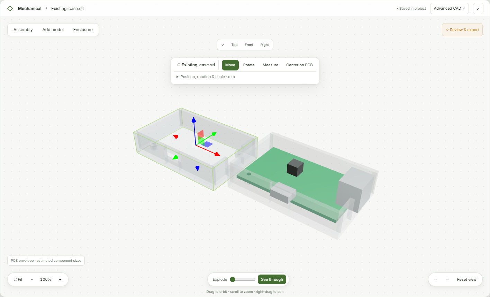

# Mechanical workspace

Open a project, choose **CAD** in the board workspace, then **Expand** for a full canvas. The existing FreeCAD screen and kernel tree are under **Advanced CAD**.

## Reference-driven layout

These are captures of the running desktop app, using the repository's enclosure regression fixture. The block-shaped components are explicitly labelled estimates, not replacement artwork for detailed PCB models. A generated `renders/board.glb` supplies the actual KiCad geometry and materials when available.

| Requested reference | Implemented interaction |
| --- | --- |
| Assembly canvas with a floating import/generate card | Dotted canvas, theme colours, collapsible panels, project save status and full-workspace expansion. |
| Selected imported case with movement tools | STL/OBJ/GLB import, selection, XYZ movement/rotation handles, precise values, uniform scale, centre-on-PCB and surface measurement. |
| Enclosure form and exploded preview with Apply/Cancel | Actual generated base/lid meshes, clearance/wall/options, explode slider, transparency, non-writing preview and explicit Apply. |

### Add a model

### Position and inspect a case

### Preview before applying

### Measurement and light theme

## Controls and persistence

- Drag empty canvas to orbit, scroll to zoom, right-drag to pan. Fit and top/front/right/isometric views are available.
- Select a model, then Move or Rotate to use the 3D handles. Expand **Position, rotation & scale** for exact edits. Numeric edits commit on Enter or blur, with one undo step per edit.
- Measure picks two surface points and reports millimetres. It does not snap to vertices or certify fit.
- Assembly visibility, transforms and imported-file references persist in `cad/assembly-layout.json`. Undo/redo lasts for the current workspace session. Original PCB and imported files remain unchanged. Removing a part only removes its assembly reference.
- Imports accept STL/OBJ in millimetres and self-contained GLB in metres, converted to millimetres. Use scale 25.4 for an inch-based STL/OBJ. Limit: 50 MiB per file, six million vertices per model, 100 assembly entries. Unsupported compression or external GLB resources are rejected.
- Preview does not write enclosure files or invoke FreeCAD. Apply writes the existing enclosure generator's STL/STEP/spec outputs, and rejects a PCB revision that changed since preview. Cases inherit the board's assembly pose, including rotation and scale.
- **Review & export** provides generated base STL, lid STL and STEP downloads. Downloads retain generated dimensions; assembly transforms do not bake into export files.

## Scope and limits

Direct import in this canvas supports STL, OBJ and GLB. STEP/native solid editing remains in the optional FreeCAD workflow; this change does not provide a STEP tessellator. It also does not add connection authoring, automatic collision checking, surface alignment constraints, arbitrary solid editing, transformed-assembly export, or the illustrative laptop assets shown in the design references. Enclosures continue to use the existing generator's geometry and printability limits.

The board fallback is an outline bounding envelope with estimated component sizes. Generate a detailed PCB model from Assembly for actual KiCad geometry; that requires an installed KiCad CLI compatible with the project's PCB version. Native FreeCAD editing itself was not exercised during this change because the optional runtime is not installed locally.

## Validation (Windows, Bun 1.4.0)

- Root typecheck and desktop production build pass; no `.map` files in desktop build output.
- All 217 UI tests and all 172 client-core tests pass. Focused mechanical/CAD coverage: 22 tests (5 persistence/pose/import-policy, 4 mesh decoding/coordinate-frame, 13 CAD tools).
- Full root suite: 1,863 passed, 35 failed. Failures match the earlier main baseline (34 in the full baseline log plus the separately reproduced MCP progress-timing failure). These include Windows process/symlink/platform assumptions, router/runtime checks and unrelated existing assertions; this is not an all-green root run.
- Live app: native mouse orbit, move handle, rotation ring, scroll zoom and two-point measurement; exact negative/decimal coordinates; STL/OBJ/GLB imports; malformed mesh rejection; original-file preservation; undo/redo; remove/undo; scale persistence after reopening; preview/cancel preserving existing files; Apply creating STL/STEP; moved/rotated board-case alignment; compact explode controls; dark/light rendering; Advanced CAD dialog.
- Detailed GLB export was exercised with `mechanical/runtime-board.kicad_pcb` and KiCad 10.0.5. The separate enclosure fixture supplies the screenshots above.

The viewer loads lazily and renders only when controls, geometry, camera, theme or size change. It has no continuous animation loop. Graphics resources and listeners are disposed on unmount.
