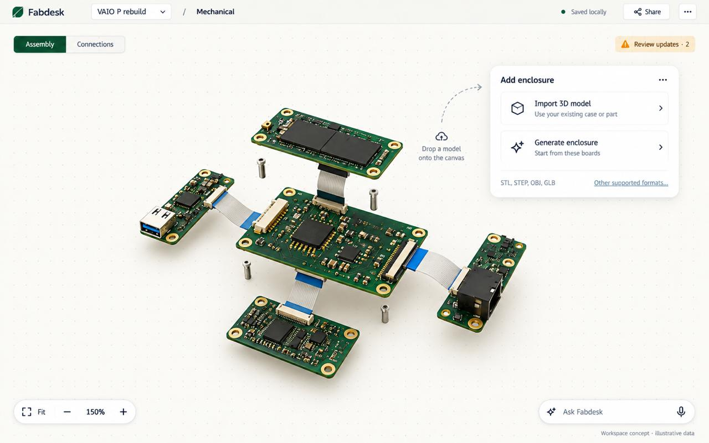
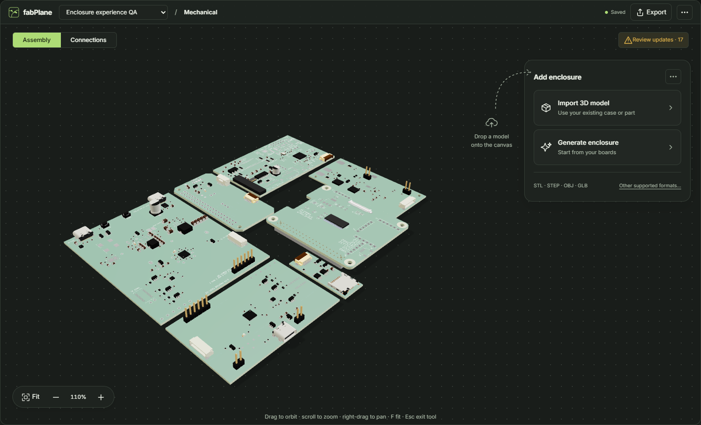
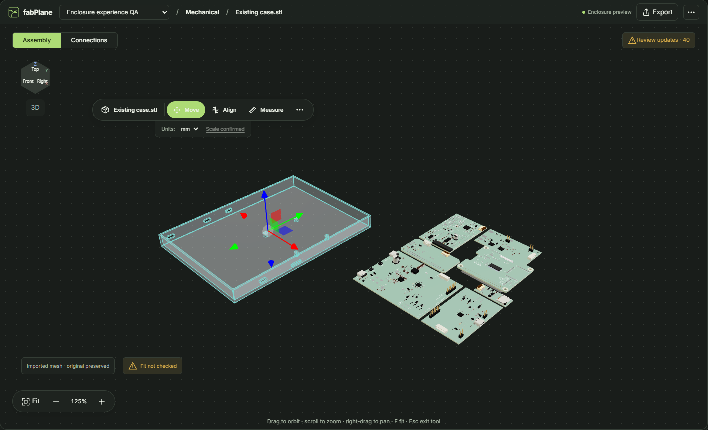
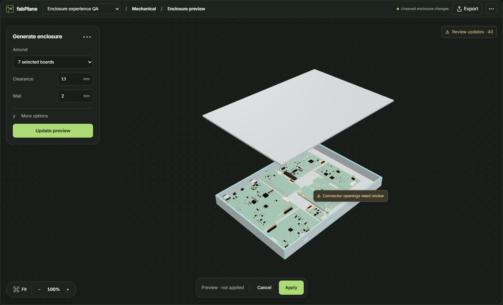
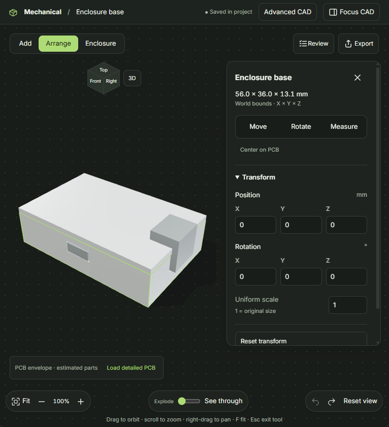

# Mechanical workspace

Open a project and choose **CAD** in the board workspace. CAD starts in focus mode; **Show chat** in the overflow menu restores the split workspace and **Focus CAD** expands it again. The existing FreeCAD screen and kernel tree are under **Advanced CAD** in the same menu.

**Assembly → Generate enclosure** opens a compact Around / Clearance / Wall card. Preview keeps changes temporary; Cancel restores the starting layout, and Apply saves the matched design. Detailed settings are under More options. The bottom-right Ask FabDesk input from the concepts is deliberately omitted.

## Reference-driven layout

The latest captures use seven actual VAIO project boards and their native KiCad models. Layout and controls follow the supplied concepts in the existing app theme; the physical parts are the project geometry, not the illustrative laptop models.

| Requested reference | Implemented interaction |
| --- | --- |
| Assembly canvas with a floating import/generate card | Shared native boards remain visible, project breadcrumbs, Assembly/Connections, drop hint, review badge and a compact upper-right Add enclosure card. |
| Selected imported case with movement tools | Cyan mesh outline, Move / Align / Measure toolbar, unit confirmation, rotation and precise transforms in overflow, live orientation cube and original-file preservation. |
| Enclosure form and exploded preview with Apply/Cancel | Floating compact form, full canvas, automatically separated lid, spatial fit callout, actual zoom percentage and bottom-centre Preview / Cancel / Apply. |

### Visual comparisons

The left column contains the supplied concepts; the right column shows the running app with real project boards. Export provides actual downloadable files in place of an unimplemented sharing service.

| Supplied design concept | Running FabDesk |
| --- | --- |
|  |  |
|  |  |
|  |  |

### Current validation — 2026-11-04

- Root typecheck and desktop production build pass; no source maps in the desktop output.
- 248 UI tests, 24 client lifecycle tests and 20 CAD tool tests pass.
- Live seven-board checks: Assembly/Connections/generator transitions, connection creation and undo, shared board movement and undo after deselection, true 100/120% zoom, native orbit/Move gestures, surface measurement, absolute mm/cm conversion, board-centre alignment, source-preserving import handoff, Preview/Cancel and Apply/export.
- STEP conversion ran in native FreeCAD 1.1.3: 2,814 triangles, 150 × 210 × 19 mm, exact matching bounds and unchanged source/model files. The app's FreeCAD bridge is disconnected locally; its unavailable/retry UI and isolated bridge contract are tested, but a complete live bridge import is still unverified.
- Screenshots show actual computed review findings. Physical assembly, cable dimensions, missing component models and material strength remain review items; these UI tests do not certify manufacture.

### Earlier layout history

Panels reserve space beside the 3D render surface, so Fit no longer frames models underneath controls. Narrow layouts show one inspector at a time. Existing assemblies open with the Parts list. The inspector groups X/Y/Z into rows, labels units once per group, explains uniform scale, and separates Move/Rotate/Measure from secondary actions. Save status remains visible beside chat. Labels and buttons are larger, and SVG icons share the app's stroke style.

| Previous layout | Refined layout |
| --- | --- |
|  |  |

### Light theme

## Controls and persistence

- Drag empty canvas to orbit, scroll to zoom, right-drag to pan. Fit shows 100%; the live cube supports all six faces and isometric view. **F** fits the visible assembly; **Esc** leaves the active tool/selection. **Ctrl/Cmd+Z** undoes and **Ctrl/Cmd+Shift+Z** redoes assembly edits. Text fields keep their normal editing shortcuts.
- Select a model, then Move or Rotate to use the 3D handles. The inspector shows world-space X × Y × Z dimensions in millimetres and **Position, rotation & scale** fields for exact edits. Numeric edits commit on Enter or blur, with one undo step per edit.
- Measure picks two surface points and reports millimetres. It does not snap to vertices or certify fit.
- Assembly visibility, transforms and imported-file references persist in `cad/assembly-layout.json`. Undo/redo lasts for the current workspace session. Original PCB and imported files remain unchanged. Removing a part only removes its assembly reference.
- Imports accept STL, OBJ, self-contained GLB and STEP. STEP uses an isolated native CAD bridge conversion and stores a separate display mesh; failures retain the original and offer Retry STEP. GLB metres are converted to millimetres once. Unit confirmation applies absolute mm/cm/in scale, never cumulative multiplication. Limits: 50 MiB per file, six million vertices per model, 100 assembly entries.
- Enclosure preview does not replace design/export files. Generated cases use the local geometry generator; modifying an imported case requires the native CAD bridge. Apply rejects stale previews and saves a coordinated ZIP. Shared PCB positions use the same enclosure design in both views, with planar rotation and lock guards.
- Exploded view has a visible **Return to editing** action; Fit includes the exploded lid. Hover gives a model highlight, with subtle ground shadows and no idle rendering.
- **Review** shows actual warnings in amber. The separate **Export** panel provides generated base STL, lid STL and STEP downloads. Downloads retain generated dimensions; assembly transforms do not bake into export files.

## Scope and limits

Connections explicitly link selected board ports and reserve cable length/space; electrical wiring is not inferred. Use as enclosure bakes an imported model's displayed units, pivot and pose into a separate STL copy. Original assets remain unchanged. Conservative fit checks and the generator's physical-validation limits still apply; this is not unrestricted solid editing or an exact cable simulation.

The board fallback is an outline bounding envelope with estimated component sizes. Use **Load detailed PCB** on the envelope label or generate a detailed PCB model from Arrange for actual KiCad geometry; that requires an installed KiCad CLI compatible with the project's PCB version. The new imported-case script passed a real FreeCAD 1.1 solid test; the app's native bridge integration remains unverified locally.

## Validation (Windows, Bun 1.4.0)

- Rechecked on 2026-10-29: root typecheck and desktop production build pass; no `.map` files in desktop build output.
- All 217 UI tests and all 172 client-core tests pass. Focused mechanical/CAD coverage: 22 tests (5 persistence/pose/import-policy, 4 mesh decoding/coordinate-frame, 13 CAD tools).
- Latest full root suite: 1,875 passed, 35 failed. Failure names match the earlier mechanical-workspace baseline exactly. This is not an all-green root run. The new enclosure checks and native-runtime limitations are recorded in the enclosure guide.
- Live app: native mouse orbit, move handle, rotation ring, scroll zoom and two-point measurement; exact negative/decimal coordinates; STL/OBJ/GLB imports; malformed mesh rejection; original-file preservation; undo/redo; remove/undo; scale persistence after reopening; preview/cancel preserving existing files; Apply creating STL/STEP; moved/rotated board-case alignment; compact explode controls; dark/light rendering; Advanced CAD dialog.
- Readability follow-up: 217 UI tests, UI typecheck and desktop build pass; live verification of default Parts view, aligned/non-overlapping XYZ fields, negative decimal editing with undo, and visible scale/save status in a 767px-wide chat layout.
- Usability follow-up: persisted focus/chat preference across project reopen; no canvas/inspector overlap at 646px workspace width; scale dimensions, keyboard undo/redo and text-field guards; F/Esc; view-cube keyboard activation; exploded-view return; separate review/export; valid base/lid STL and STEP blobs through the download buttons; OBJ import while Export is open closes Export and selects the import; import undo. Idle WebGL draw calls: **0** over 500ms, with drawing resuming on camera input. Preview/cancel again preserved all six checked PCB/layout/spec/export files.
- Detailed GLB export was exercised with `mechanical/runtime-board.kicad_pcb` and KiCad 10.0.5. The separate enclosure fixture supplies the screenshots above.

The viewer loads lazily and renders only when controls, geometry, camera, theme or size change. It has no continuous animation loop. Graphics resources and listeners are disposed on unmount.
