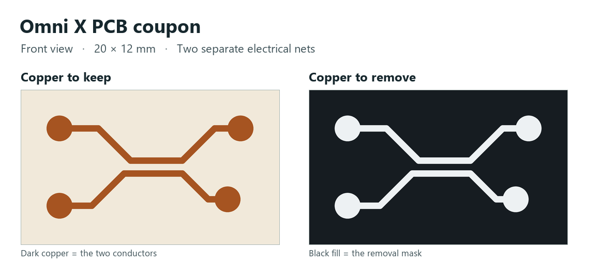

# KiCad copper isolation on the ComMarker Omni X 6W

The first FabDesk job should make two electrically separate nets on a pre-cut piece of single-sided copper-clad board. A successful job leaves conductive traces and probe pads. It can be scored with a multimeter before committing a whole design. The Omni X 6W uses a 355 nm UV source. ComMarker shows copper and PCB applications, but its published 18 and 35 µm copper example used a **12 W** UV laser. The usable settings, minimum gap, and effect on the laminate still need measuring on the actual 6 W machine and lens. [Omni X specifications](https://commarker.com/omni-x-uv-laser-engraver/spec) · [ComMarker PCB experiments](https://blog.commarker.com/archives/59265)

## From the board to the job

1. Use the saved `.kicad_pcb`. Have KiCad check the filled zones and plot `F.Cu` and `Edge.Cuts` on a shared origin, at 1:1 scale in millimetres. The front copper plot describes everything that must survive, including tracks, pads, vias and filled zones. FabDesk already has Gerber and drill exporters. Its laser stencil tool reads `F.Paste` or `B.Paste` and has a different purpose. [FabDesk exporters](../packages/tools/src/tools/export.ts) · [KiCad CLI](https://docs.kicad.org/10.0/en/cli/cli.html)
2. For a full-clear job, subtract the union of the retained copper from the closed board region, excluding internal cutouts. Export the resulting **filled removal regions**. Preview retained copper and removal in distinct colors. Leave the board perimeter and drill map as references on pre-cut stock. An open outline or unsupported Gerber construct should prevent handoff. FabDesk's release checker already compares independently rendered Gerber and KiCad plots. [CAM checks](../packages/board-workflow/src/release/gerbcheck.ts)
3. Add **Prepare for ComMarker Studio** to the existing board **Outputs** panel. Reuse its selected-board and revision checks. Generate a revision-specific copper-removal SVG, display its dimensions and use the very same file for the preview and handoff. If the board changes, regenerate the artwork. The desktop should save the file locally even when the FabDesk daemon runs elsewhere. Copy the resulting path and launch the configured Studio installation. If Studio is unavailable, keep the file available with a copy-path action. Opening the SVG in its default desktop application can open a browser. [Board exports](../packages/ui/src/board/FilesTab.tsx) · [Desktop clipboard and path handling](../apps/desktop/src/main/ipc.ts)
4. In a fresh Studio workspace, choose **Vector**, paste the path and import. Compare the imported dimensions and the filled removal regions with FabDesk, then use Studio to frame the stock and start the job. ComMarker distributes Studio free and documents vector import. Its published instructions do not establish that another application can load a specific SVG by command line. Report the file as *prepared* until an import can be confirmed. [ComMarker software](https://blog.commarker.com/archives/54619) · [Omni X operation tutorial](https://commarker.com/dist/js/uploads/Machines/OmniSeries/OmniX/Manual/OmniXOperationTutorial.pdf)

## Optional LightBurn handoff

For operators who already own LightBurn Pro 2.2, send the same artwork to the selected Omni X over LightBurn's local REST API. Verify the device and workspace, set the placement anchor and wait for the import result before reporting success. A device-specific REST port avoids following the most recently active window. Its separate UDP start command operates on the currently open job. Keep the operator's frame and start controls in LightBurn unless the intended job, machine and galvo confirmation behavior can be verified. [REST setup](https://docs.lightburnsoftware.com/latest/Reference/RestAPI/) · [Upload and placement](https://github.com/LightBurnSoftware/LightBurn-REST/blob/main/docs/uploading.md) · [UDP commands](https://docs.lightburnsoftware.com/latest/Guides/AutomationWithUDP/) · [Galvo framing](https://docs.lightburnsoftware.com/latest/Reference/DeviceSettings/GalvoBasicSettings/)

LightBurn 2.2 can also import Gerbers, drills and Gerber job files. This is useful for checking the manufacturing artwork. Simply applying a fill to the positive copper artwork would remove the intended conductors. For a product requirement to drive the laser directly from FabDesk, ComMarker documents a separate Omni-series SDK customization with a replacement USB controller, a US$1,000 fee per machine, and loss of features including autofocus. The stock-machine handoff avoids that hardware change. [LightBurn PCB formats](https://docs.lightburnsoftware.com/latest/Reference/FileManagement/) · [ComMarker SDK terms](https://support.commarker.com/hc/en-us/articles/63061519589401-ComMarker-SDK-Integration-Services-FAQ)

## First physical acceptance test

For the offline proof, KiCad plotted the front copper and board outline. Their geometry produced the [1:1 removal SVG](examples/omni-x-copper-coupon-remove.svg). Its black area is copper to remove. Both 0.50 mm tracks and all four 2 mm pads are holes in that fill. The closest gap between nets is 0.50 mm. An independent KiCad copper plot at 100 pixels/mm agreed on every interior pixel. Antialiasing accounted for the differences at the edges. This example contains no machine parameters.

The [20 × 12 mm two-net coupon](examples/omni-x-copper-coupon.kicad_pcb) has four probe pads. KiCad's electrical design-rule check reported zero errors and zero unconnected items. On the bench, record the stock, copper thickness, lens and measured dimensions. Use stock of known composition suitable for the machine and its extraction system. Check the enclosure interlock and exhaust before the material test. Inspect the cleared areas for residual copper or substrate damage.

Measure continuity from TP1 to TP2 and from TP3 to TP4, then check for an open circuit from TP1 to TP3. Record the readings before selecting a material preset or attempting a finer design. Bottom-side registration, through-holes and board profiling are separate experiments. [Omni X manual](https://commarker.com/dist/js/uploads/Machines/OmniSeries/OmniX/Manual/OmniXUserManual.pdf) · [ComMarker PCB process guidance](https://blog.commarker.com/archives/59265)
