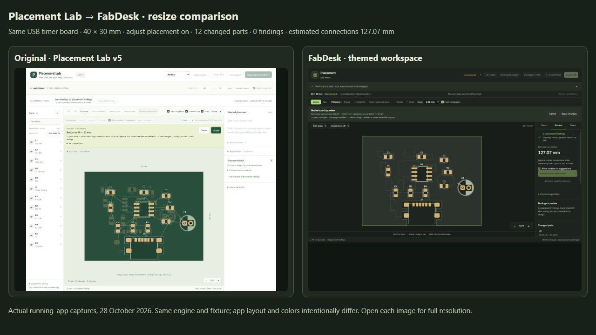
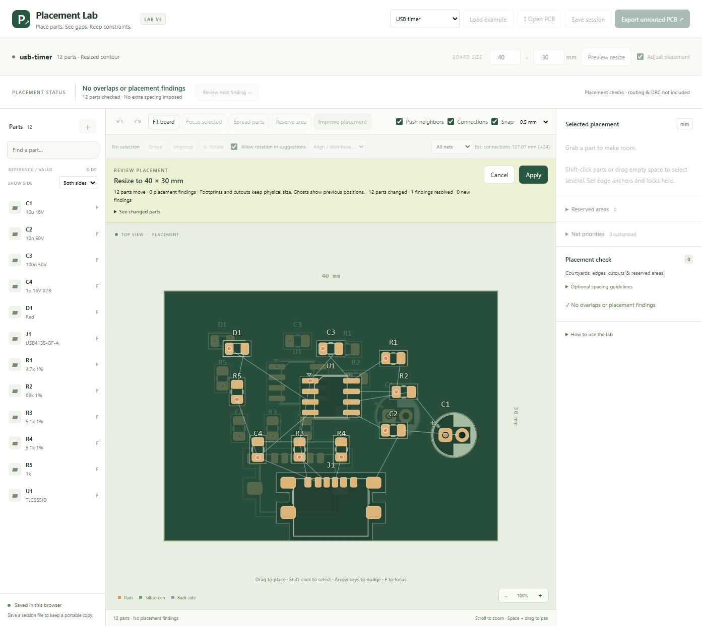
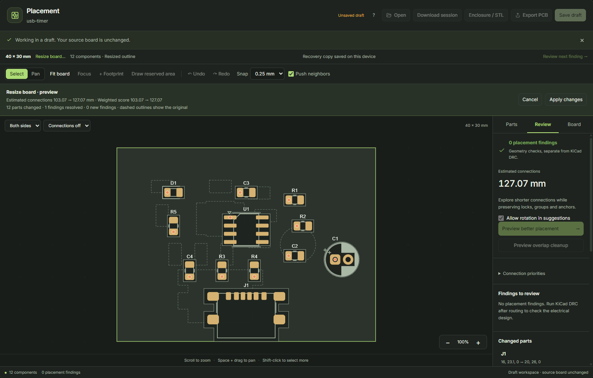
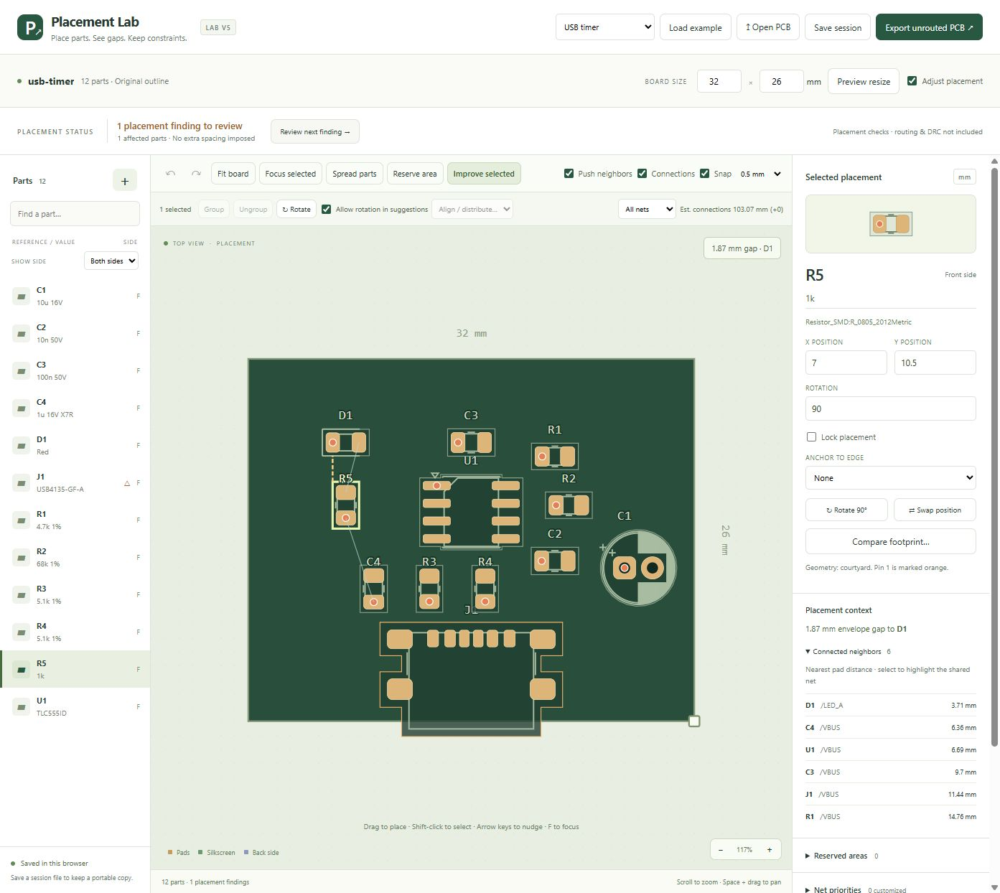
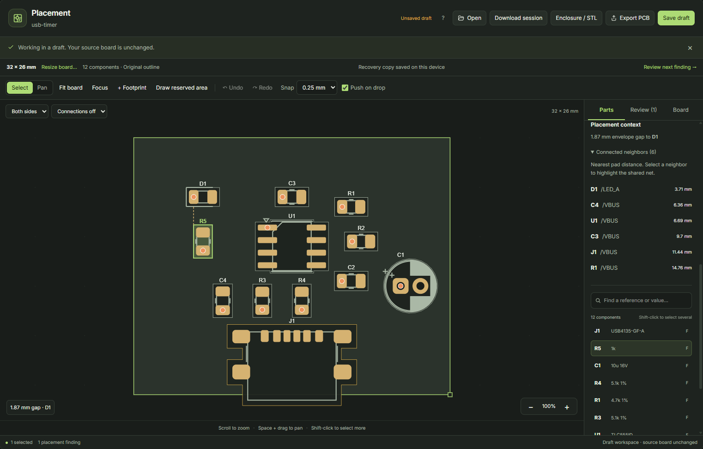
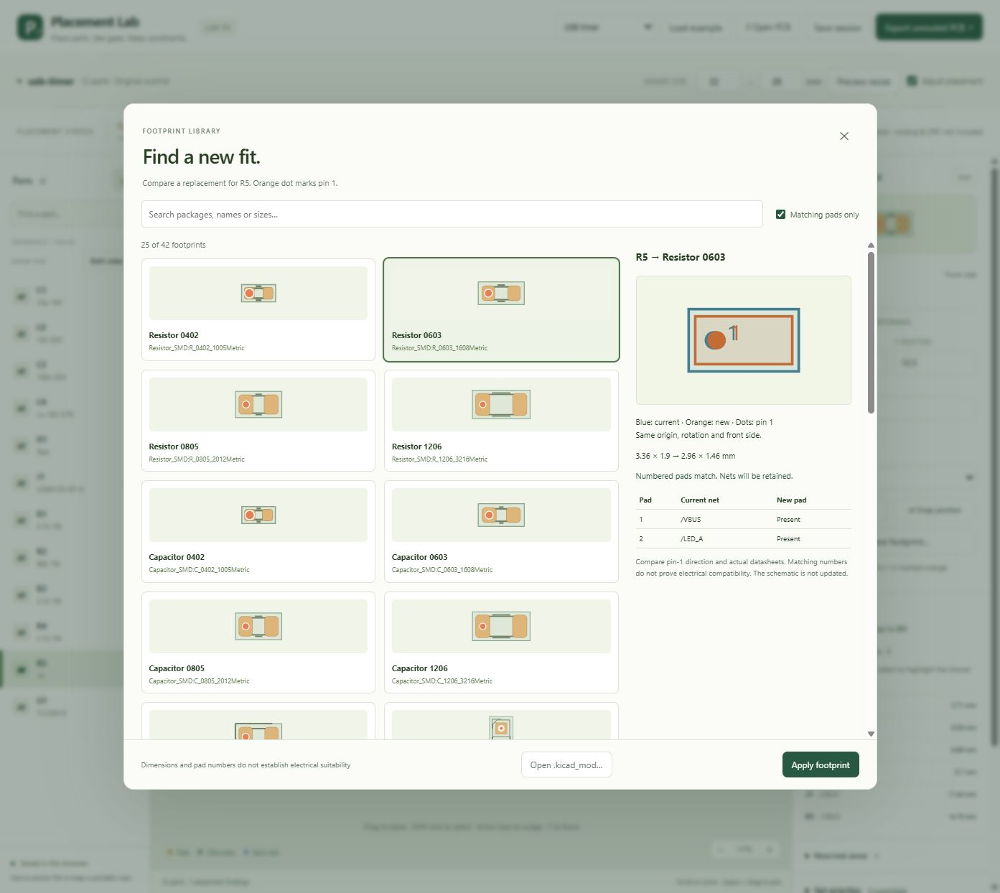
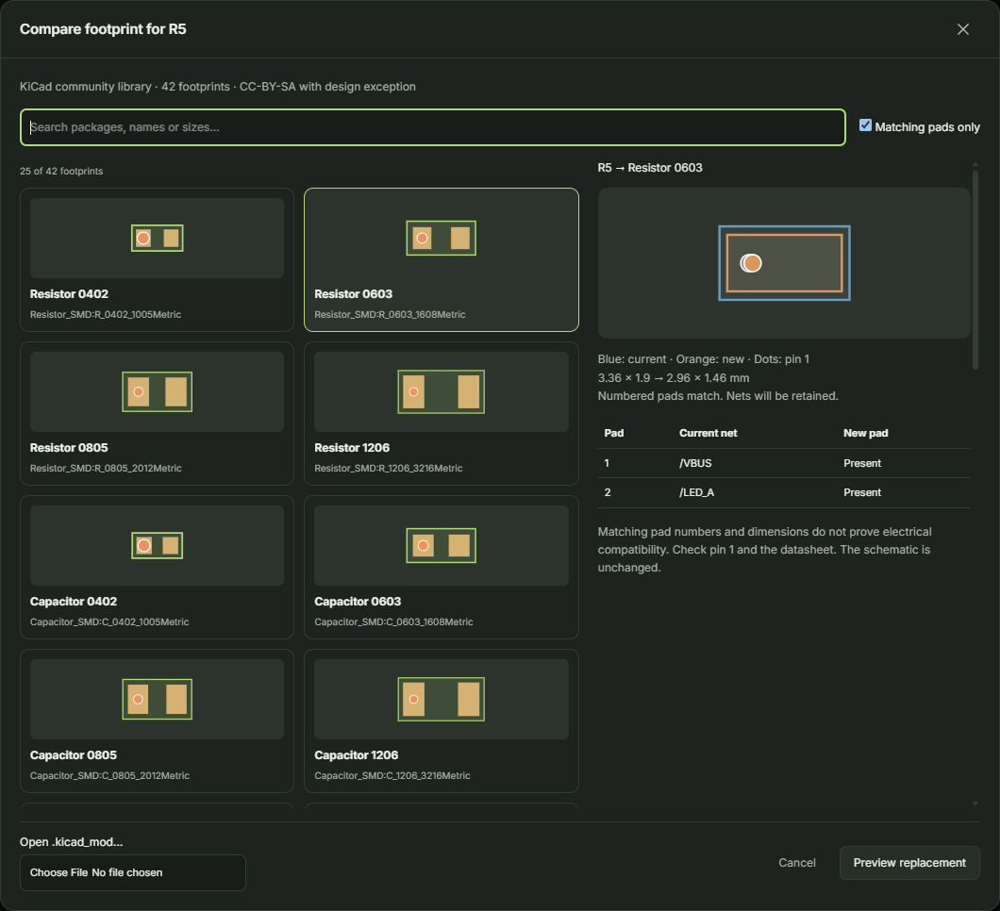
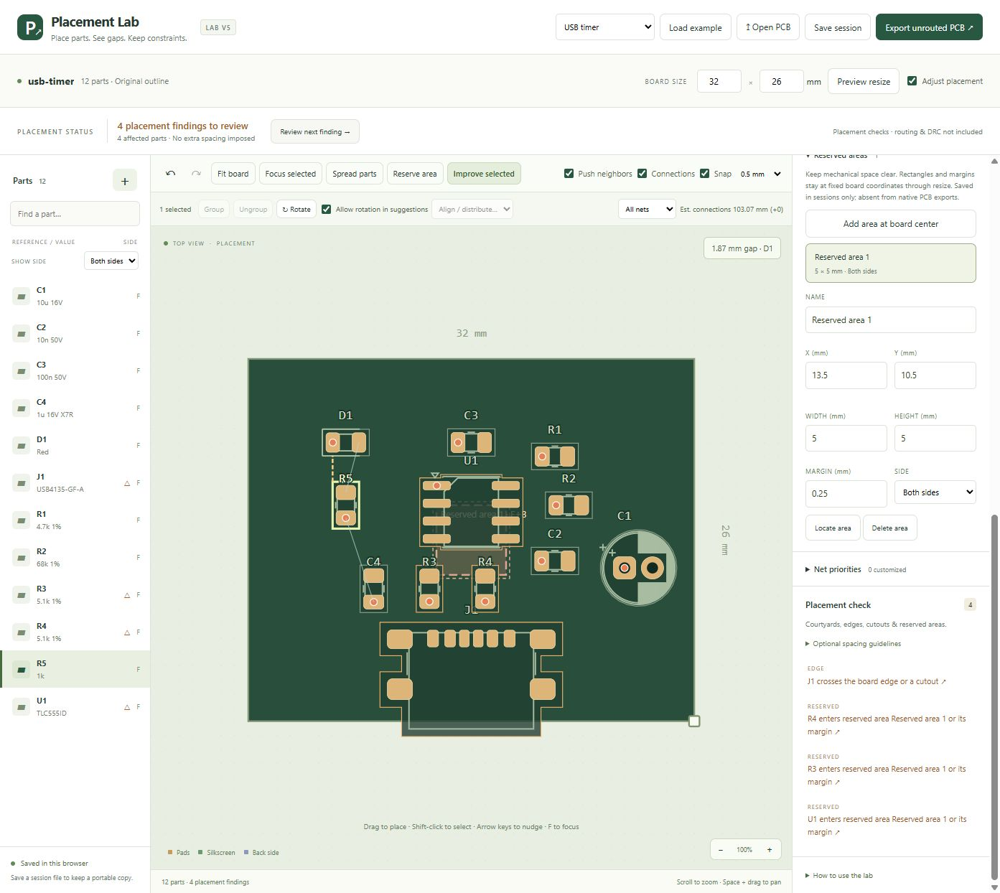
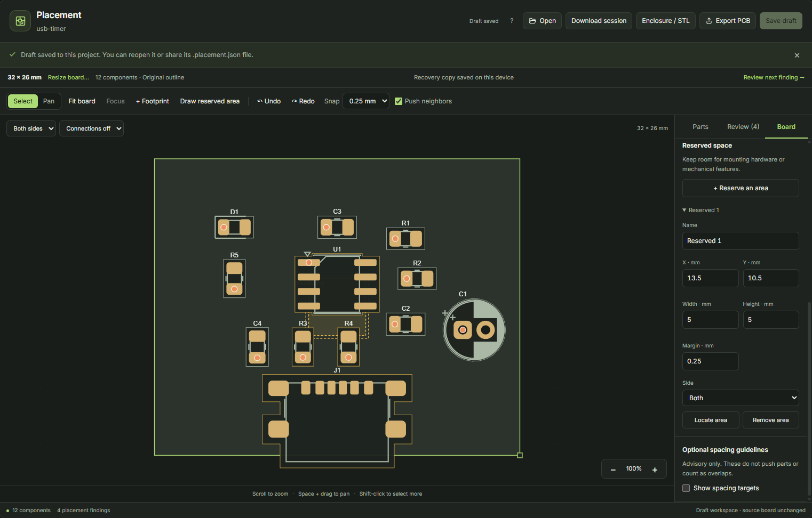
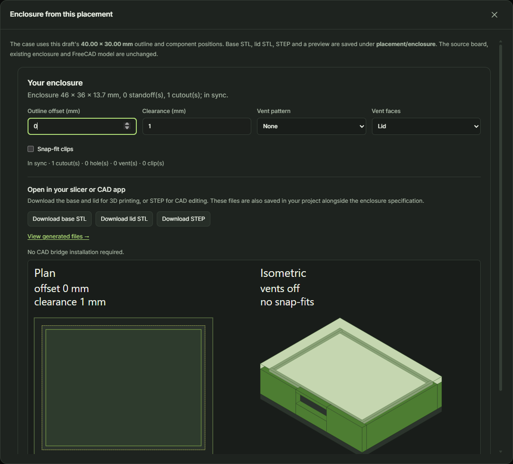

# Placement Lab parity check

Compared on 2026-10-28 with the running **Placement Lab v5** app at commit `51cd33385d4c350cd0f08e15e141715ac48004f9`. The reference was run locally from its repository; these are real captures, not mockups. FabDesk keeps its own theme and Parts / Review / Board layout while using the same placement engine and fixture data.

## Feature coverage

| Reference capability | FabDesk location / behavior | Verification |
| --- | --- | --- |
| Open/drop native PCB or session; both examples | Open / canvas drop; Board → Try an example; example buttons on empty workspace | Native round trips and session migration tests; USB timer and 10-part connectors/cutout example opened live; opening an example is undoable |
| Browser recovery, compressed/IndexedDB fallback, portable session | Project-scoped device recovery; Download session; explicit Save draft in project | Compression round-trip test; recovery saved after edits; project draft readback; original storage implementation retained |
| Drag / shove; multiselection, groups, locks | Canvas, Shift/box/Ctrl+A, Parts inspector; Push neighbors during drag and on release | Pointer manipulation checks and constraint/history tests; bounded shove on boards up to 200 parts |
| Exact position, value, angle, rotation, swap | Parts inspector | Live value edit, 45° typed angle, swap, anchor offset and undo checks; identity/net-preservation tests |
| Alignment, distribution, exact envelope gap | Parts inspector when multiple parts are selected | Imported engine regression suite; preview/apply/cancel and constraint tests |
| Edge anchors, offset, intentional overhang | Parts inspector; anchored axis is disabled | Live offset/undo check; engine constraints tests; Fit includes overhanging geometry |
| Numeric and drag-handle resizing; adjust-placement toggle | Board dimensions or bottom-right canvas handle | Both apps: 40 × 30 mm, 12 changed parts, 0 findings, 127.07 mm connection length; native pointer resize also checked; adjust-off preserves all poses |
| Preserve physical footprint and cutout size | Same upstream resize engine | Constructed connectors/cutout fixture and exported dimensions covered by tests |
| Named nets, connected neighbors, nearest same-side gap | Connection menu; Parts → Placement context; canvas gap line | Both apps: R5 has 6 neighbors, nearest envelope gap to D1 1.87 mm, nearest connected-pad distance 3.71 mm |
| Better placement, overlap cleanup; allow-rotation toggle | Review → preview controls | Live apply/cancel/undo; rotation-off retains all angles; estimated and weighted before/after scores shown, with search-budget notice |
| Net-weight list, highlighted-net-only, reset | Review → Connection priorities | Live highlighted /VBUS-only and reset; zero-weight score regression test |
| Draw/add/edit/delete reserved rectangles; side/margin/name; Locate | Draw reserved area; Board → Reserved space | Native pointer draw and undo; locate/fitting checked; identical 5 × 5 mm center area, 0.25 mm margin, same 4 findings in both apps |
| Findings cycle and click-to-focus; separate advisory spacing | Review next finding; Review list; Board → Optional spacing guidelines | Existing geometric/constraint suite; guidelines stay advisory and do not change overlap findings |
| 42-footprint library, search and matching-pad filter | + Footprint; Parts → Compare replacement footprint | Exact upstream catalog; R5 has 25/42 matching choices in both apps |
| Compare geometry, dimensions, pin 1, numbered pads/nets | Library comparison panel | Both apps: R5 0805 → 0603 envelope 3.36 × 1.90 → 2.96 × 1.46 mm; /VBUS and /LED_A retained |
| Add unconnected parts; drop onto a part to replace; local .kicad_mod | Library cards and canvas drop; local-file control | Add/replace preview, apply and undo verified in Electron; native browser drags using the actual canvas/library components separately verified addition and replacement of R5, with its 25 compatible choices and original nets retained |
| Wheel zoom, zoom buttons/percentage, pan, Fit/Focus, shortcuts | Canvas and toolbar | Pointer wheel/pan checks; fit includes overhang; resize-preview layout checked at full canvas size |
| Silkscreen/Fab, pads/pin 1, sides, finding outlines | Theme-aware canvas | Real comparison captures, same source geometry; view colors/layout intentionally follow FabDesk |
| Undo/redo whole edits | Toolbar and keyboard | Model tests and live add/replace/resize/swap/area undo; up to 60 snapshots within memory budget |
| Unrouted PCB export with original identities/nets | Export PCB → Export unrouted copy | Round-trip tests and live source-preservation checks; tracks, vias and zones removed; a new project file is written |

## Real screenshot comparisons

Open the images for full resolution. The layouts differ intentionally; the matched inputs and numeric outcomes are the comparison criteria.

| Scenario | Original Placement Lab | FabDesk |
| --- | --- | --- |
| 40 × 30 mm resize: 12 moved parts, 0 findings, 127.07 mm |  |  |
| R5 context: 1.87 mm gap, 6 connected neighbors |  |  |
| R5 → 0603: identical dimensions and net mapping |  |  |
| Center reserved area: 5 × 5 mm, 0.25 mm margin, 4 findings |  |  |

## Enclosure export: an addition beyond this reference

The inspected Placement Lab version has **no enclosure export or 3D interference model**. FabDesk connects its existing enclosure generator to the current placement snapshot through **Enclosure / STL**. It produces a base STL, lid STL, STEP, SVG preview and enclosure specification, with outline offset, clearance, vents, snap-fit controls and alignment checking.

The live 40 × 30 mm placement generated a 46 × 36 × 13.7 mm enclosure with one connector cutout: base STL 96 facets (12,561 bytes), lid STL 60 facets (7,915 bytes), and valid STEP header (56,234 bytes). The original PCB text was unchanged. The focused backend test also verifies that the original enclosure specification and FreeCAD model are untouched and out-of-project paths are rejected.

The snapshot is `placement/enclosure-source.kicad_pcb`; generated models are under `placement/enclosure/`, with the specification in `placement/enclosure.json`. Dimensions/heights are inferred from board data; this does not add 3D collision detection or certify print fit.

## Intentional integration differences and remaining limits

- FabDesk requires a project and offers an explicit shared project draft in addition to local recovery. Exports go to unique project files rather than replacing source files. Larger operations run in cancellable workers with preview/apply/cancel.
- Input cap: 20 MiB / 1,500 parts; local footprints: 1 MiB. Live shove and live gap computation are bounded to 200 parts; larger boards can use worker overlap cleanup. Maximum-size boards have not been benchmarked.
- Undo is capped at 60 snapshots and roughly 16 MiB of serialized past snapshots, retaining at least one. Undo history is not persisted across a fresh renderer load, matching the reference's reload behavior.
- The schematic is not updated. No routing, native KiCad DRC, electrical compatibility proof, or 3D interference model is implied by placement findings or a matching footprint pad count.

## Validation

- Repository typecheck: passed.
- Desktop production build: passed; no `.map` files in desktop output.
- Client-core: 180 passing tests; UI: 208; focused CAD/enclosure tests: 13. Total: **401 passing focused tests**.
- The previous full workspace run had 34 failure names identical to unchanged `main` on this Windows machine (product-video 1, desktop 2, agents 8, kicad 5, tools 9, core 9). It is not represented as a fully green local root suite.
