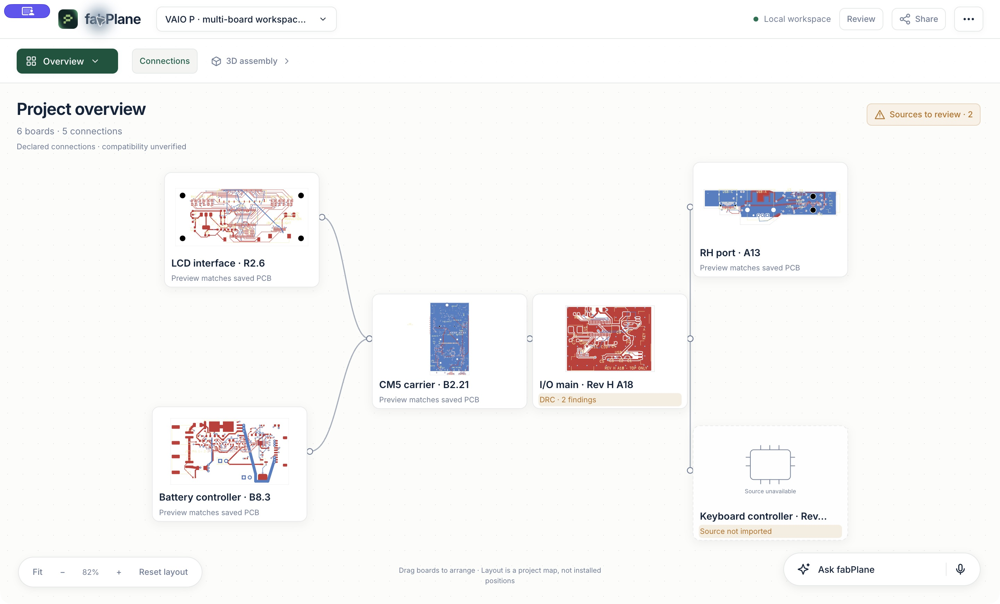
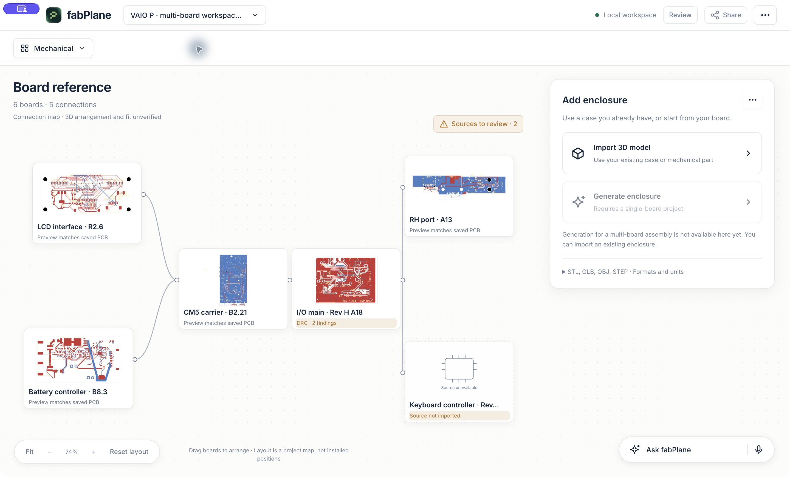
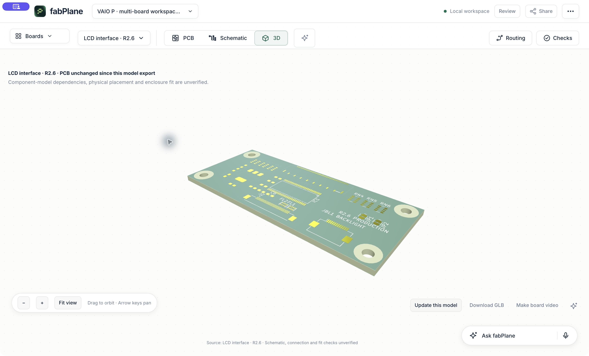

# Assembly navigation correction · October 30

The user clarified that the project’s 3D entry means the whole-device Assembly/Mechanical concept, not the individual board model/export studio. This supersedes the previous direct-Outputs choice in `ac1bf94` and its screenshot captions; original evidence is preserved.

- Overview now has a **3D assembly →** navigation action into Mechanical, with an explicit accessible destination. It no longer appears as a local “3D models” tab that unexpectedly opens Outputs.
- Mechanical’s embedded board map is labeled **Board reference**, without a second copy of project navigation overlapping its heading. Its connection map does not claim a 3D arrangement or fit result.
- A board’s **3D** view still loads that individual source’s actual GLB. Outputs remains the deliberate destination for videos, renders and export controls.
- The full assembly scene/enclosure workflow from the approved concept remains teammate-owned in PR398. No duplicate scene engine, enclosure-generation change, invented positions or native-source edits are included.

Native clicks verified Overview → Mechanical, logo → Overview, LCD board → More → 3D → actual model → Overview. UI typecheck passed; 245 UI tests /970 assertions /0 failures. All 42 protected VAIO/root-study files remain byte-exact. Captures below are actual native app screenshots; earlier iterations are unchanged.

