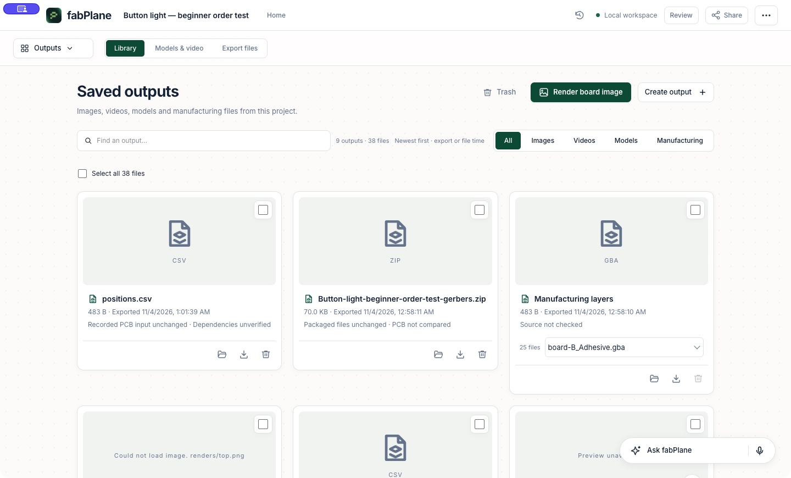
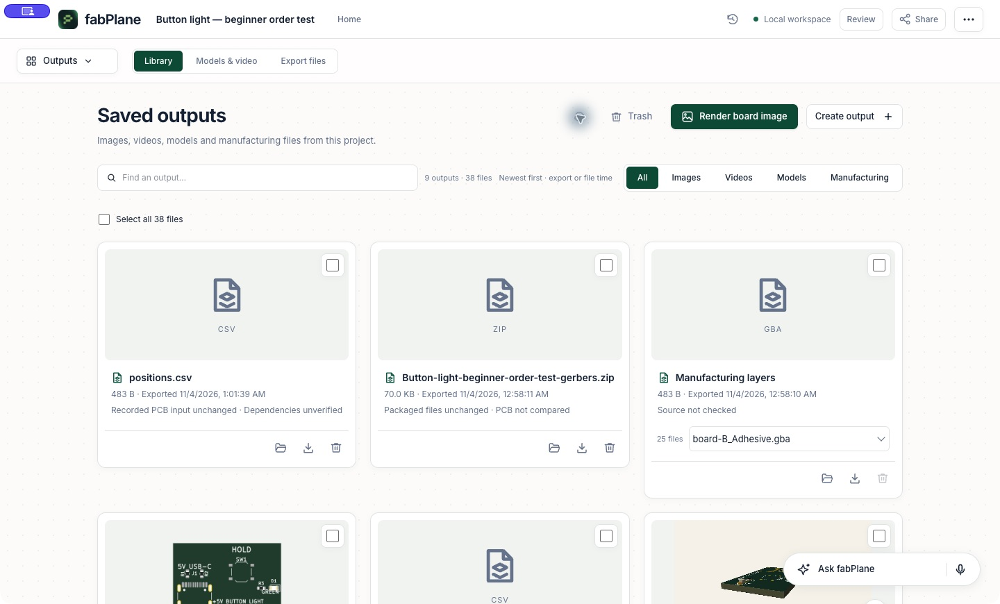
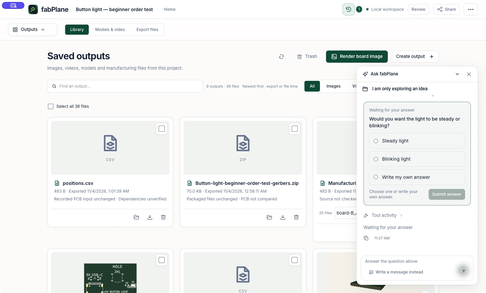
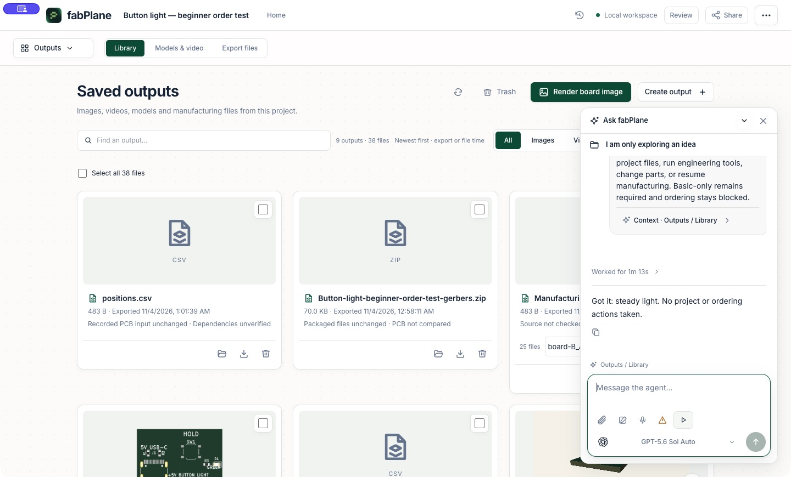
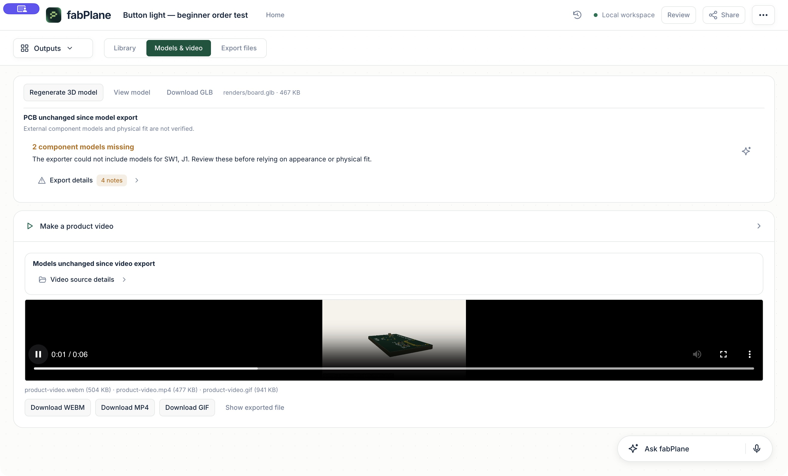
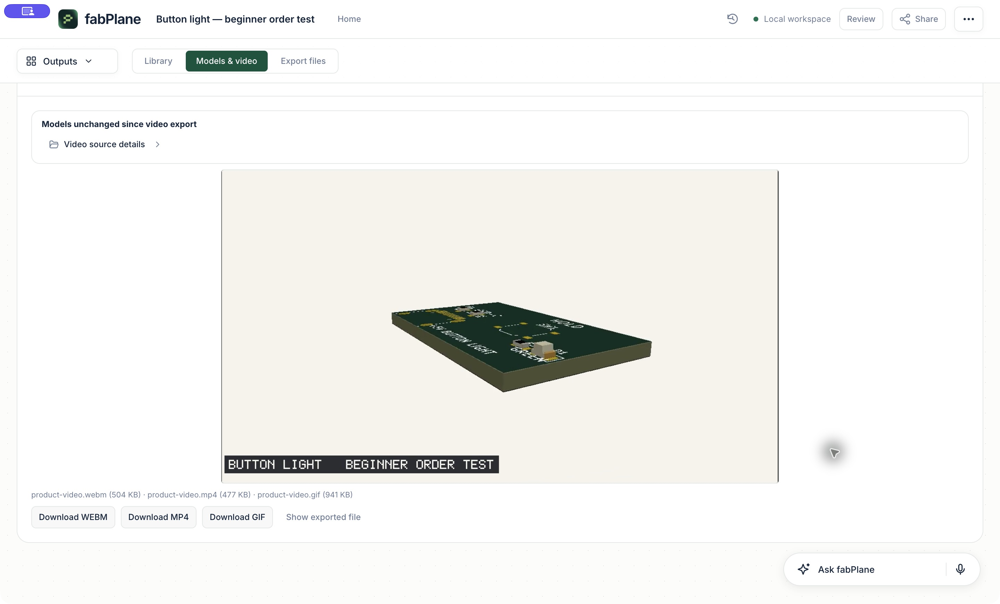
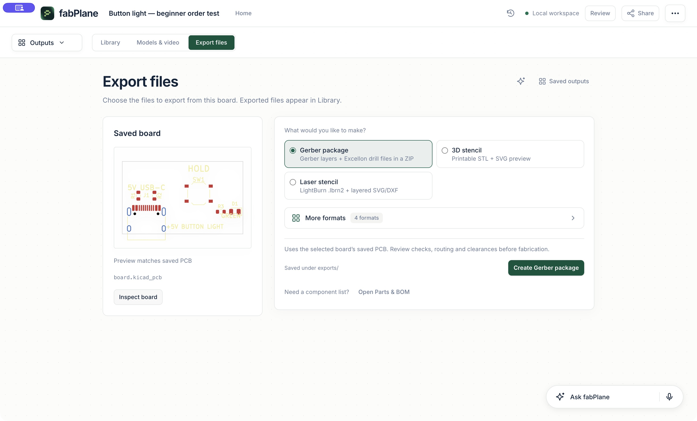
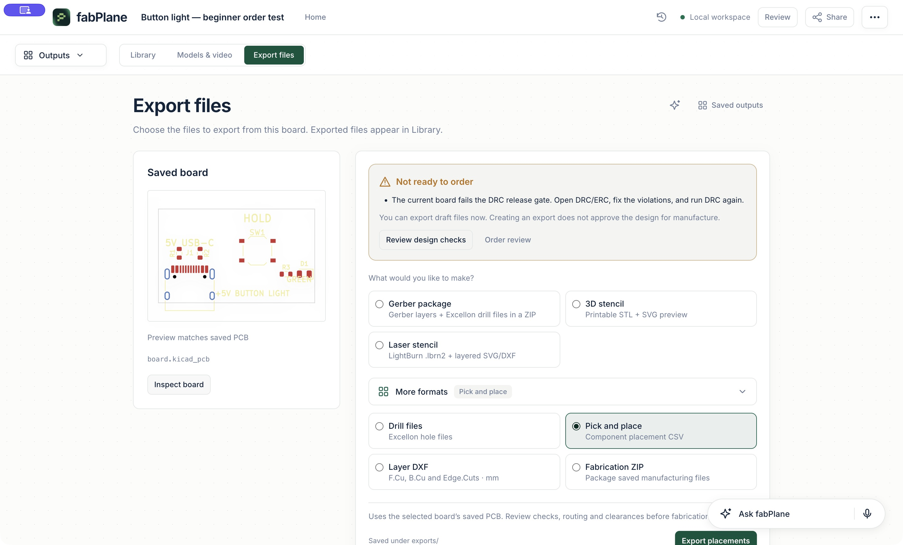

# Beginner idea-to-order human test · November 3–4

Tested actual fabPlane Dev through visible clicks, scrolling and normal typing, starting at Home with no project open. No direct routes, APIs or database edits were used to advance the journey. Read-only transcript/source/artifact checks are diagnostics, not UI acceptance. Existing user drafts/projects were preserved. The isolated new project is **Button light — beginner order test**: a 5V USB-powered green LED that lights while a push button is held, five assembled boards, no purchasing.

**Outcome: the app reaches circuit/PCB, schematic, 3D, image/video and draft manufacturing exports. It has not produced an order-ready board.** C165948 is Extended and needs the explicit owner exception required by workspace sourcing rules; the owner has now declined it and requested Basic-only with ordering blocked. Routing was deliberately paused. The saved PCB has16unroutedconnections; the current DRC has23findings,16errors/7warnings. No manufacturer upload, quote or purchase occurred.

## Resumed UI recovery and owner decision · November 4

The owner explicitly chose **Keep Basic-only; leave ordering blocked.** C165948 is declined. Earlier pending-approval wording in historical checkpoints is superseded; no repeat exception request or engineering continuation.

B10: returning to the actual app after idle showed image fetch errors and an unavailable video thumbnail, while opening the same saved top.png displayed correctly. Added a consistent **Refresh outputs** action to retry this project’s listing and active binary previews at the same core endpoint. It does not regenerate files, alter engineering or refresh another project/core. Query integration regression proves failed-preview recovery, endpoint/project/query-kind isolation and error propagation.

Native limitation: the development reload cleared the original failed thumbnails before the new button was clicked. The button was then exercised successfully with healthy thumbnails; a fresh induced network-failure→click recovery was not demonstrated natively. The query test covers that path; the before/after captures do not establish the button alone caused recovery.

A fresh discussion-only assistant conversation now proves the previously missing live question path: an actual MCP question stayed answerable beyond one minute, Steady light → explicit Submit produced acknowledgment, and the run completed in1m13s. No engineering/file action was requested; all five protected native/project hashes stayed unchanged. Original unsent batch/order-review draft was restored through Project conversations and left intact. This demonstrates one successful live question/answer, not universal prevention of every agent early exit.

Code c99c655: affected UI/client types pass; query/blob tests6pass/23assertions; full UI297pass/1278assertions; production desktop build1m20s pass, zero packaged source maps. Initial client typecheck caught an optional Map lookup in the new test; fixed before commit. No fresh full-root or hosted-CI pass is claimed; earlier reproduced default timeouts remain.

| Initial idle Library failure | Library with refresh action |
| --- | --- |
|  |  |

| Live waiting question | Explicit answer acknowledged |
| --- | --- |
|  |  |

## Human journey and fixes

| Path | Observed friction → resulting behavior | Human retest / limit |
| --- | --- | --- |
| Home → idea → project | Activity omitted the working assistant; empty PCB offered a second Generate action | Verified owned conversation now appears separately in Activity; neutral working state links to it. Setup carried requirements and chat into the named project |
| Connector question | Blocking question closed after a yielded tool wrapper; card had no usable answer | Answer in chat prepares a reviewable unsent reply and preserves existing draft/attachments. Explicit Send received continuation. Fresh isolated question/answer now passed; no universal prevention claim |
| Schematic / PCB | Saved native circuit and PCB are discoverable | Schematic renders and Fit works. Drawings are not parity approval |
| Board 3D / Outputs | Missing J1/SW1 models appeared only as four technical warnings | Concise two-component summary, bounded original details and contextual Ask. Orbit works; exact STEP assets still absent |
| Parts | Six components looked like the total for a five-board order | Per-build counts and batch planner:6×5=30, resistor line2×5=10; invalid0 clearly rejected. Saved part IDs visible. Design CSV remains per-build, not a JLC upload format |
| Checks | Seven silkscreen warnings buried sixteen connection errors | Stable errors-first display retains original report indexes. First error opens the matching SW1 pad at22,9.875mm on PCB; warning filter retains total error count |
| Models & video | Flex shrinking squeezed landscape video into a shallow strip | Viewport-bounded16:9 preview, scrolling setup/downloads. Actual6s MP4 plays; native saved1280×720 H.264 verified |
| Render image | Top render available through clear Library action | Native render saved/opened; missing component models remain a visible limitation |
| Export files | Gerber success obscured the unfinished design and assembly file requirements | Existing release evidence now surfaces Not ready to order beside export, with checks/order review. Guide distinguishes bare PCB Gerber+drill from BOM/CPL and manufacturer mapping |
| Order review | Old sparse Order now page did not explain preparation | Consistent review layout, design/files/parts steps, contextual unsent Ask and working return links. Existing vendor gates unchanged and blocked |
| Saved outputs | Reopening video and CSV must produce usable previews | Library modal plays advancing MP4 frames; positions CSV opens in Files and downloads byte-exact |

Eight code commits74136c6,efbc0b7,06b7031,d1fe1c9,0479169,1573061,9e6c65f,d3782e6. The preceding authorized9545e2d agent-switch/compact-error fix is also included in this publication; see [that report](AGENT-SWITCH-20261103.md).

## Artifacts actually verified

- Design BOM: five lines, quantities1/1/2/1/1, total6 per build; native download equals saved export. Batch planning does not mutate source quantities.
- MP4:1280×720 H.264,6.000seconds,488206bytes; native Save preserved an existing file by cancelling collision and choosing a new name. Models & video and Library modal playback both demonstrated.
- Gerber/drill ZIP:71723bytes,26entries, CRCclean; copper/mask/paste/silk/outline and board.drl present. No BOM/CPL inside. Draft package only.
- Placement CSV:483bytes, six fitted references, native KiCad columns; native download byte-exact. Actual Save filename has a duplicate .csv suffix, recorded locally. Manufacturer BOM/CPL mapping, rotations and final stock remain unverified.

Final saved-state retest: Close project explicitly kept one unsent draft; Home retained both this new project and the original user idea. Reopen restored Outputs. Corner Ask initially showed New chat; selecting the original Project conversation restored both unsent review paragraphs. This extra selection is recorded as friction, not hidden. Nothing was resent; assistant closed afterward.

## Checks and limits

At code d3782e6: root typecheck, core production build and desktop production build pass; zero packaged source maps. Full default workspace run: **2,417passed /36skipped /8failed**. UI297, client-core394, desktop149, tools449 and relay29 pass. Agent detection passed alone6/0; isolated KiCad tests retained4default5s timeouts (23pass plus3 dependent errors). Telemetry stress retained its explicit30s timeout with permitted loopback (9pass/1fail). Scripts were run separately:93pass/1npm fixture timeout; the isolated fixture also timed out at5s. **Full suite is not green.** No test budgets, native gates or timeout configuration changed. Hosted CI for the new head has not been evaluated; the prior remote head's private dependency checkout failure is historical, not a diagnosis of a new run.

Native ERC completed but full saved-source freshness/parity was not independently established. No universal electrical/assembly-fit success; missing model bodies remain. Mobile, packaged-installer, cross-platform, crash/network fault and manufacturer-side upload/purchase are not newly accepted. Enclosure, teammate replacement/resize integration and Board Art polish remain deferred.

## Resume checklist

- [x] First Home → plain-language idea → named project using visible UI.
- [x] Observed UX issues captured before edits; eight coherent fixes locally committed and human retested.
- [x] Schematic, PCB, 3D orbit, top image and video previews.
- [x] Parts per-build/batch counts and saved design CSV.
- [x] Fresh DRC, prioritized findings and exact PCB location.
- [x] Draft Gerber/drill ZIP and placement export/download.
- [x] Existing vendor gates prevent this unfinished board proceeding.
- [x] Owner decision: Basic-only; C165948 exception declined; ordering remains blocked. A compliant alternative has not been selected.
- [ ] Fresh immediate assembly stock for all parts×five; then final routing, zero DRC errors and reviewed warnings.
- [ ] Final ERC, source comparison and manufacturer-specific BOM/CPL mapping/polarity/rotation.
- [ ] Exact missing component model assets, then fit review where applicable.
- [ ] Final regenerated package and manufacturer preview; purchase requires separate user action.
- [x] Fresh live blocking question remained answerable beyond one minute; explicit answer acknowledged. Broader agent interruption paths remain unproven.
- [ ] Reproduced KiCad/telemetry/npm-fixture performance failures need separate diagnosis; no false green result.

## Selected actual native evidence

All originals are retained locally under work/overnight-run/20261103-beginner-order (32PNG captures with SHA256SUMS and detailed REPORT.md). These four selected captures are unaltered; their manifest is [here](beginner-order-20261104/SHA256SUMS).

| Video before | Video after |
| --- | --- |
|  |  |

| Export before | Export after |
| --- | --- |
|  |  |
