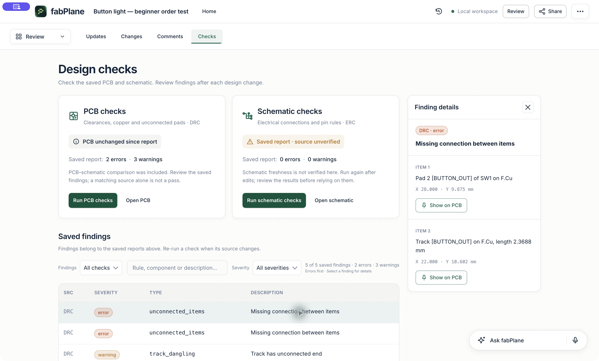
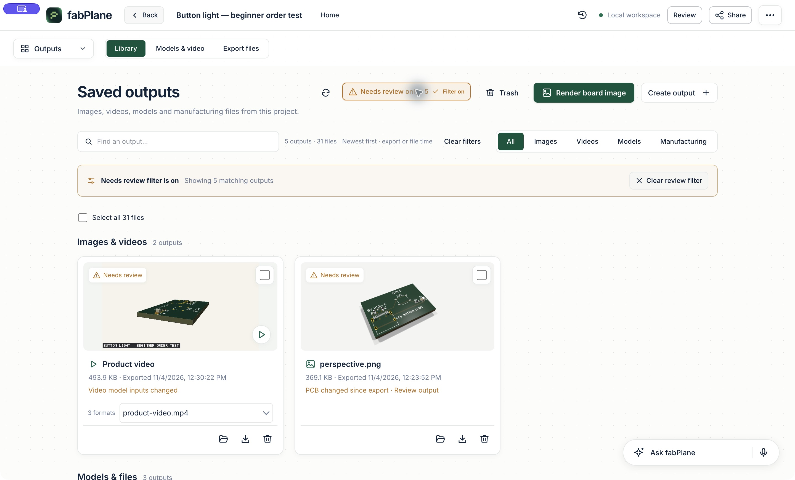
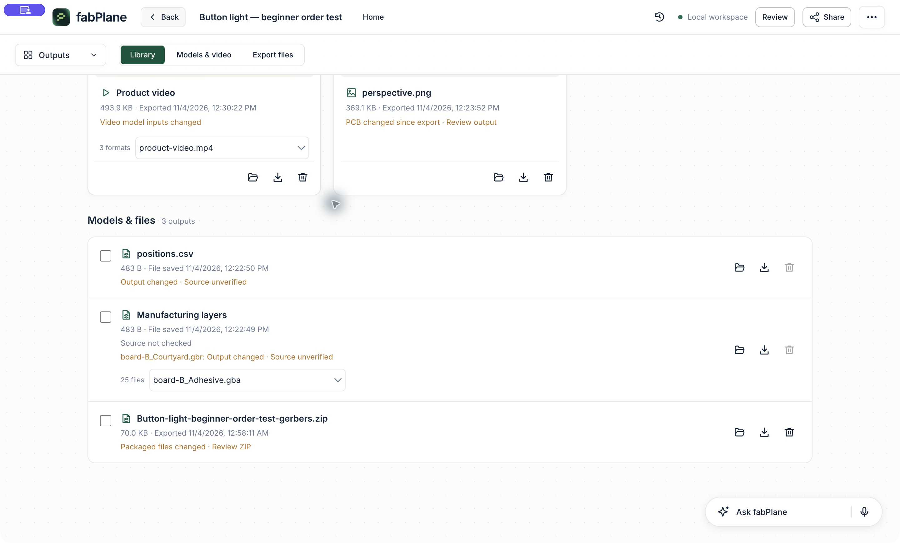
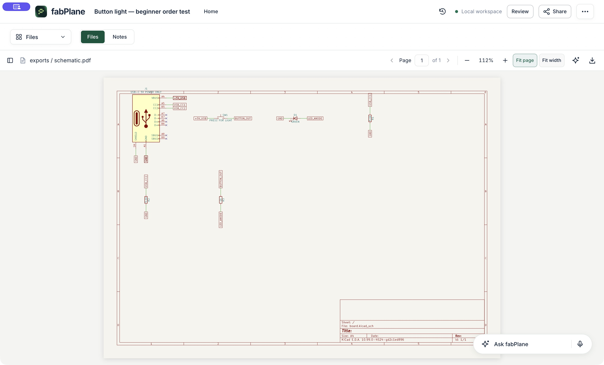

# Files, navigation and output review — November 4

This completes the requested UI follow-ups to checkpoint 654607a. It does not certify the board for ordering or mark the entire engineering roadmap complete.

## Changes

- Added a visible Back button for workspace page navigation. It remembers the prior project view, selected assembly board and selected file; same-click area/tab changes count as one navigation. History stays in the current app session and clears on Home, project or server change. Returning never replays edits or checks.
- Needs review is explicitly a filter: its warning button includes Filter / Filter on, the active state names the matching output count, and Clear review filter restores other outputs without clearing unrelated filters.
- Saved outputs separates Images & videos from compact Models & files rows. Image/video cards have equal heights and aligned action footers; ZIPs, CSVs, PDFs and model files no longer consume large empty thumbnails. Existing preview, selection, source status and deletion guards remain in use.
- Finding details has an accessible bordered close icon, source/severity badge and separate affected-item sections. Each item shows its description, muted coordinates and the same outlined pin + Show on PCB action. Closing restores focus to the finding row; Escape within details also closes it.
- Board Checks retains the in-context popup and adds Full results to open Review → Checks for the current board. Completion of a check does not automatically move the user to another page. Back returns from full results to the board.
- Project files now previews PDFs with a bundled PDF.js reader, authenticated saved-file bytes, page/zoom controls and Fit page / Fit width. No document scripts or links are activated. Failures offer retry/download; saved bytes are not rewritten.
- Moved Project files and its explicit file count into the narrower sidebar. Combined the selected path, PDF controls and actions into one toolbar; Hide file list gives the reader more room. Filtered counts read, for example, 1 of 104 files.
- Fixed the tall image rows: an image-preview CSS selector was also applying margins to image-type SVG file icons. Preview rules now target actual img/video elements, and all tree rows stay compact.

## Human walkthrough

Starting state: existing **Button light — beginner order test** in the native **fabPlane Dev** app, preserved `work/fresh-user-flow-20261030/profile`. This was a focused continuation, not a new-user Home/import test. Used visible native UI clicks and normal typing. Source inspection and unit/build checks were separate diagnostics.

| Journey | Observed result |
| --- | --- |
| Files → schematic.pdf | Actual saved one-page 52.9 KB PDF renders; page count and accessible extracted text match the sheet. |
| PDF zoom / fit / hide sidebar | Zoom, Fit width, default Fit page and Hide file list work; file selection remains. |
| File search and mixed file types | Explicit total/filter counts; PNG, GIF, video, JSON and source rows have consistent compact height. |
| Outputs → Show schematic.pdf in Files → Outputs → Back | Returns to Files with schematic.pdf selected and rendered. |
| Finding → Show on PCB → Back | Exact saved finding marker at X28 / Y9.875 mm; Back returns to Review/Checks and focuses its row. |
| Finding details → close | Details closes and restores row focus. Both item locate buttons have consistent outlined presentation. |
| Board → Checks → Full results → Back | Opens full Review/Checks, then returns to PCB. Current source and saved finding context remain. |
| Needs review → clear | Visible Filter on state, 5 matching output groups / 31 files; clear restores 17 groups / 46 files in this test project. |
| Library media and file sections | Equal visual card footers; compact file rows retain reason/status, variants and guarded actions. |
| Compact Board model row → preview → close | Saved GLB renders in the existing model dialog; missing SW1/J1 model warnings remain explicit. |

No check/export/generation, design edit, delete or agent message was initiated by this walkthrough. The user ran PCB checks during the session; the observed saved report is **2 errors / 3 warnings**. That is not a pass. Existing source/dependency warnings remain visible.

## Verification and limits

- UI and client-core typechecks passed.
- UI: **299 tests passed**, 1,297 assertions.
- Client-core: **397 tests passed**, 1,853 assertions with local-server access. The initial restricted sandbox run failed two loopback-server fixtures; the unrestricted rerun passed. No implementation failure is hidden by that distinction.
- Production desktop build passed; output contains **zero `.map` files**. `git diff --check` passed.
- One-page PDF was exercised natively. Multiple-page transitions, encrypted/corrupt PDFs and retry/error recovery are implemented but were not newly exercised in the native app.
- Back restores page/source/file context; it does not preserve every local search/filter/scroll position or provide undo.
- Native checks above cover the root-board study; assembly-specific detail controls share the component and typecheck, but were not newly walked through.
- No new order readiness, electrical parity, compatibility or dependency-freshness claim. Enclosure, replacement and resize integrations remain teammate-owned. No merge or deployment.

## Unaltered native evidence

Original captures remain in `work/pdf-preview-20261104` and `work/navigation-output-checks-20261104`, including intermediate iterations. Selected copies below are unaltered.

