# Home → idea draft → project: implementation and human test

November 3, 2026. Code: `fd5968c` (draft lifecycle and planning boundary), `cdb9fa9` (Home/draft/setup UI). The approved concepts now have a working native flow. This report covers that flow; it does not close the broader engineering/app roadmap.

## Result and starting point

Home starts with “What would you like to make?”, a composer, Draw a sketch, Upload an image and Import from GitHub. Projects is a secondary destination. The first message or saved sketch creates a durable **idea draft**, with explicit Draft status and sketch/conversation views. Engineering requests open project setup; the user names the project and chooses a folder. Setup promotes the same workspace ID, retains files and conversations, and continues the pending request in its original chat. Keep exploring cancels setup without losing the idea.

The walkthrough used the actual native fabPlane Dev app, starting at Home with no open project and 11 existing workspaces. It used visible clicks, scrolling, normal typing and native file pickers; no direct routes, APIs or database mutations were used to complete UI steps. Idle development-core reloads loaded the new server code through the existing supervisor; these are disclosed development setup, not user outcomes. Existing workspaces were preserved. Four synthetic workspaces were added during testing (including the original failed chat-first attempt); one was promoted rather than duplicated. Final state: Home, no open project, no test agent run left active.

## Human walkthrough

| Visible journey | Result | Evidence and friction |
| --- | --- | --- |
| Home → Projects → Home | Passed | Existing work remained searchable; no project forced open. |
| Home → Draw → rectangle → Save and attach | Passed with friction | Durable draft and attachment. First label entry was not observed before finishing typing; separate retest below succeeded. |
| Draft → Create a project → Keep exploring | Passed | Same sketch and unsent attachment retained; name and location form clear. |
| Home → recent draft → reopen | Passed | Saved reference and unsent attachment restored. |
| Draft → Codex planning conversation → Conversation tab | Passed with friction | Real planning reply retained sketch context and wrote no engineering files. First reply took 2m37s. |
| Ask to build → project setup | Passed after fix | Initial native profile omitted the new setup tool; native retest auto-opened setup with the agreed request. A recovered invalid tool argument remains honestly visible in activity. |
| Setup → name → native folder picker → Create project & generate | Passed with friction | Same ID/thread/sketch at chosen folder; pending request sent once and real engineering run started. Pending copy initially falsely implied a send failure; corrected to “Starting your request…”. |
| Generated project → Home → Projects → reopen → Schematic/PCB → original conversation | Passed with friction | Native files and drawings visible; agent completed after 10m58s. Cosmetic schematic rewrites repeatedly timed out and were rolled back, so presentation remains label-based. |
| Home → GitHub import → Cancel | Passed, entry/cancel only | Correct existing URL/name/location form; no new repository import claimed. |
| Home → Upload → native picker → synthetic PNG → Save and attach | Passed | Image-first draft visible, source saved unchanged, unsent attachment retained on close. |
| Home composer → Send | Passed after fix | Original attempt saved ownership but failed because message context still had the Home null project ID. Corrected flow sends once before navigating and retains the prepared thread for retry. |
| Chat-first → clickable Green/Red question → Green → Submit | Passed with friction | Real run-bound question worked; agent acknowledged Green and no engineering writes. At 960px desktop width, reading and submitting needed scrolling. |
| Chat-first → Sketch → Text → type → observe → click outside → Save | Passed | “Green status light” visible in saved preview; normal text entry works when delivery is observed before finishing. Small images now stay at natural size instead of becoming blurry full-canvas enlargements. |
| Draft → setup with blank name → Keep exploring | Passed | Friendly name placeholder, Create disabled until named; cancelled draft unchanged. |
| Home and Conversation at smaller native window | Passed with friction | Tested approximately 960×662 CSS and 1440×870 CSS. No horizontal clipping; Home recent cards remain reachable by scrolling. No mobile-width acceptance claim. |

## UX/UI changes and follow-up plan

| Finding | Change/result | Retest criterion or remaining action |
| --- | --- | --- |
| HD-01: Home context said Boards/PCB | Fixed; New idea label and regression coverage | First Home message carries the correct workspace owner after draft creation. |
| HD-02/03/05: bottom layout, board-control flash, Close project wording | Fixed; corner assistant on saved sketch, stable Draft navigation, Close idea | Save/reopen preserves the sketch, attachments and explicit draft stage. |
| HD-04: initial text not present | Retest passed; no drawing-library rewrite | Observe typed text before clicking outside/Save. Initial input-delivery uncertainty stays recorded. |
| HD-06/08: question/setup tools unavailable | Fixed restricted planning MCP profile | Actual clickable answer and automatic setup demonstrated. |
| HD-07: truncated chat title proposed as project name | Fixed; require deliberate name | Blank field with example, disabled Create until named. |
| HD-09: false failed-send copy during continuation | Fixed | Pending state explicitly says starting; actual failure keeps request in composer and never recreates the project. No induced native network-failure test claimed. |
| HD-10: Home first Send rejected | Fixed and native retest passed | One click creates ownership and sends once, without mismatched context or silent failed-send navigation. |
| HD-11: draft tabs/title overlap and wrong selected tab | Fixed and screenshot retested | Conversation selected without a sketch; title below toolbar. |
| HD-12: tiny sketch enlarged to blurry canvas | Fixed and native retest passed | Small raster remains at natural size; large references still fit available space. |
| HD-13: several Untitled drafts hard to distinguish | Fixed and native retested | Actual saved sketch previews, icon fallback, visible Rename idea, searchable displayed conversation title, and restored latest saved conversation. |
| HD-14 (P2): repeated native cosmetic schematic edit timeouts | Fixed targeted setup prerequisite; actual native retests passed | Cosmetic changes skip unrelated library setup. Two saved text edits passed; cold library symbol add/remove also passed and restored all five protected files exactly. |
| HD-15 (P3): pending question below fold on short Conversation view | Fixed and native retested | Live question receives focus; empty composer collapses with explicit alternate-message action. Compact native question, USB choice, Submit and real acknowledgment passed. Long/custom questions may still require normal scrolling. |

## Independent verification

Artifact verification, separate from UI testing: same project ID and thread owner after promotion, all 22 original non-manifest files byte-identical, original messages unchanged, old draft folder absent, all 11 original project records unchanged. Draft planning and a restart/chosen-folder promotion are covered in focused tests. Ordinary same-filesystem promotion was exercised on macOS; cross-volume/Windows moves and crash-recovery journaling were not accepted by this walkthrough.

Saved reports from the synthetic generated board show ERC 0 errors/0 warnings, DRC 0 errors/0 warnings/0 unconnected with schematic parity checked. These counts use the project's configured ignored checks; they are not universal electrical, fabrication or physical-fit approval. The separate schematic presentation review still reports global-label overuse. No such engineering claims are inferred from a successful setup or a matching preview.

- Root typecheck passed; affected UI typecheck also passed after the final TypeScript changes.
- HTTP integration: 13 tests, 224 assertions, zero failures.
- Focused lifecycle/run/adapter/sketch suites: 56 tests, 280 assertions, zero failures.
- UI: 261 tests, 1,101 assertions, zero failures.
- Final production desktop build passed; renderer 35.85s, zero packaged source maps. Native walkthrough ran the development app, not the packaged build.
- Earlier sandbox HTTP listen failures and stale session/count assertions were diagnosed and corrected; the final suite passed with local loopback networking available. No fresh full-root test-suite or hosted-CI success is claimed.

## Scope and limits

Tested: chat/sketch/image draft entry, cancellation, retained references and conversation, name/location setup, same-ID promotion, real generation continuation, reopening generated sources, import entry/cancel, desktop layout.

Not tested in this change: another full GitHub clone, model/video/manufacturing delivery, mobile layout, hosted/remote promotion, provider account/capacity failures, induced post-promotion network failure, cross-volume moves, crash interruption. Existing earlier delivery walkthroughs remain separate evidence. Enclosure/assembly, replacement/resize and Board Art polish remain excluded/teammate-owned. Comparison visuals #411 and member/multi-sheet focus #412 remain outstanding.

## Actual native captures

The screenshots below are unaltered app captures. The earlier generated concepts remain separate. Hashes and original filenames are in `HOME-DRAFT-20261103-SCREENSHOTS.json`.

| Before: project-list Home | After: idea-first Home |
| --- | --- |
| 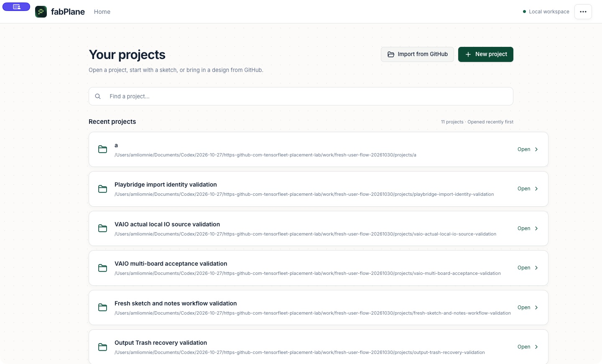 | 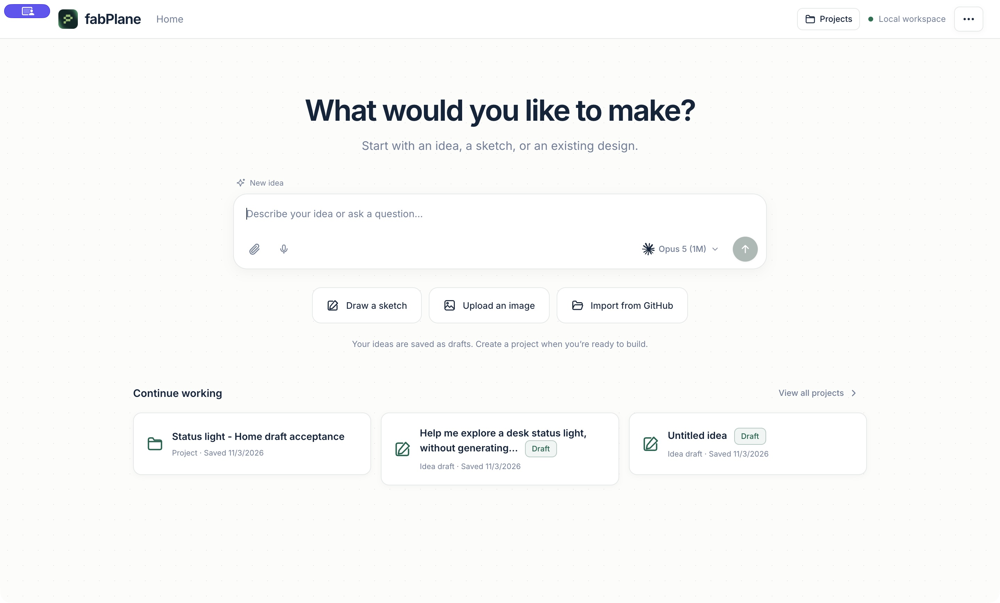 |

| Saved draft and corner assistant | Name/location setup |
| --- | --- |
| 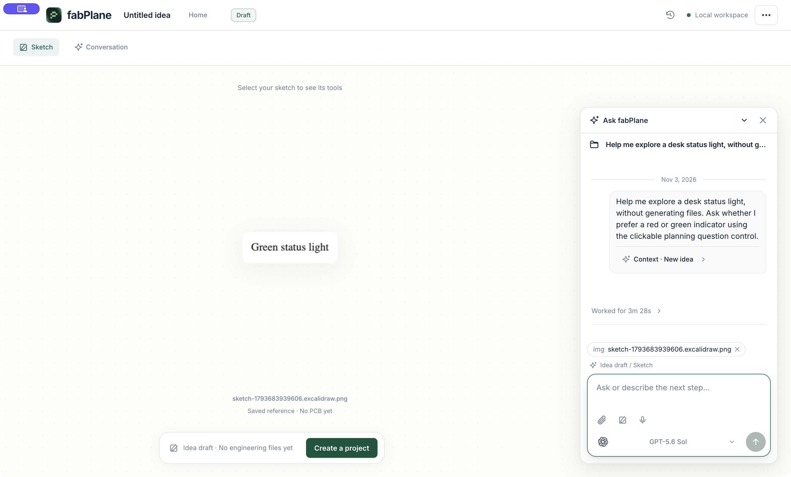 | 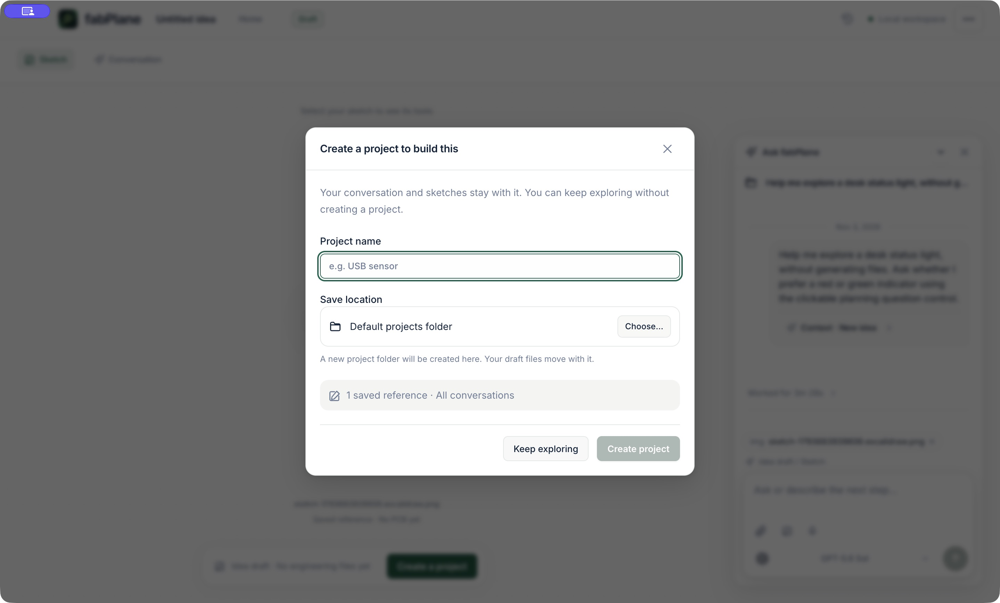 |

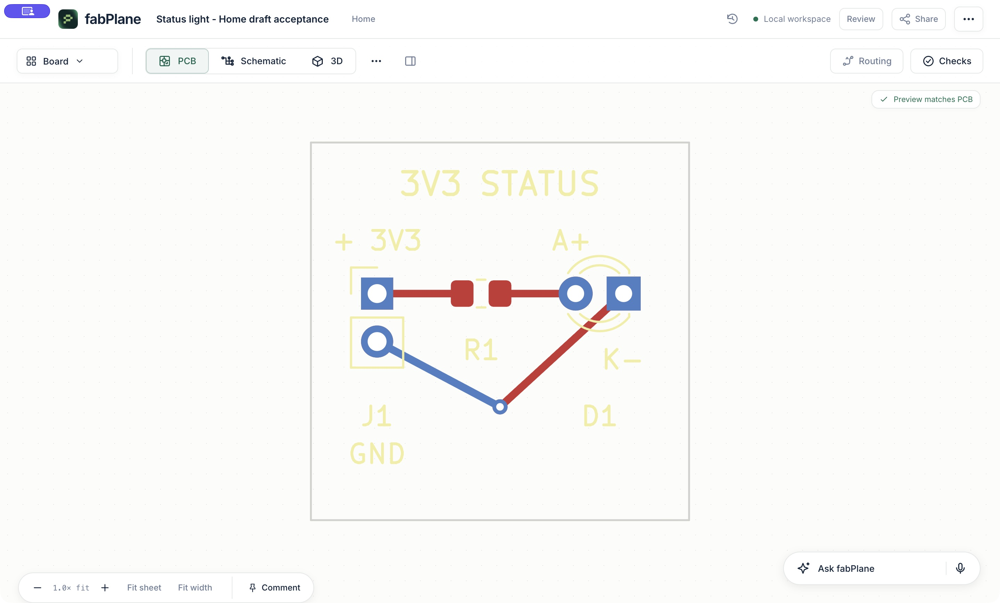

## Follow-up: separate starting and reopening work

At the user's request, the saved-work section now has a pale green surface, an accent divider and the explicit heading “Open a project or draft”, separate from the idea composer. Native Home → View all projects → Home navigation passed; affected UI typecheck and diff checks passed. This small visual follow-up does not rerun or replace the broader acceptance above.

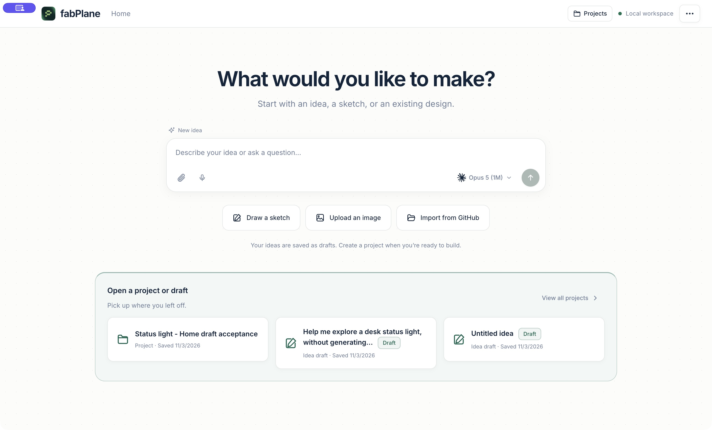

## Remaining-finding follow-up · November 3

HD-13 and HD-15 are now addressed locally. Existing idea drafts show their actual saved sketch/image previews with an icon fallback and a separate Rename idea control. Rename does not promote or move a draft. Native walkthrough renamed both the chat/sketch draft and image-only draft, searched the latter, reopened it and retained its reference. Reopening the chat draft restores its saved conversation; Conversation no longer opens an empty New chat while the saved conversation is hidden in a menu. Search now includes the same conversation title shown on the card.

A real Codex planning-only request produced a clickable USB/Battery question. At the supported compact window, the question, all options and Submit were visible together. The empty composer used a compact “Answer the question above” footer; Write a message instead restored normal entry. Selecting USB and clicking Submit produced an actual USB acknowledgment. No new engineering work was requested. The initial model response took about 95 seconds; model latency is separate from question layout. Actual captures26–29 retained locally, three selected captures included here.

Checks: root typecheck PASS; UI261/1101 PASS; client-core380/1801 PASS with loopback-server access. The sandboxed client suite initially could not bind its temporary server; the transport subset8/41 and full suite subsequently passed with that access. No remote publication attempted. Native timeout investigation remains in progress separately; no claim that passing UI tests fixes native edits.

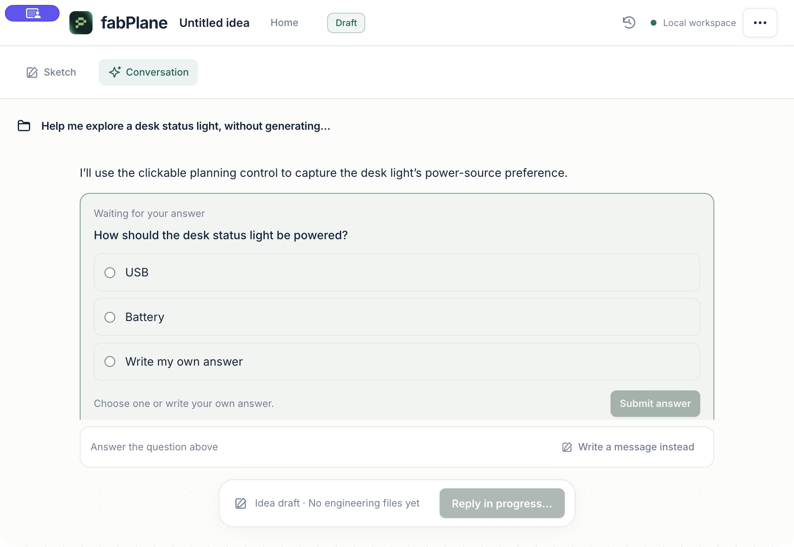
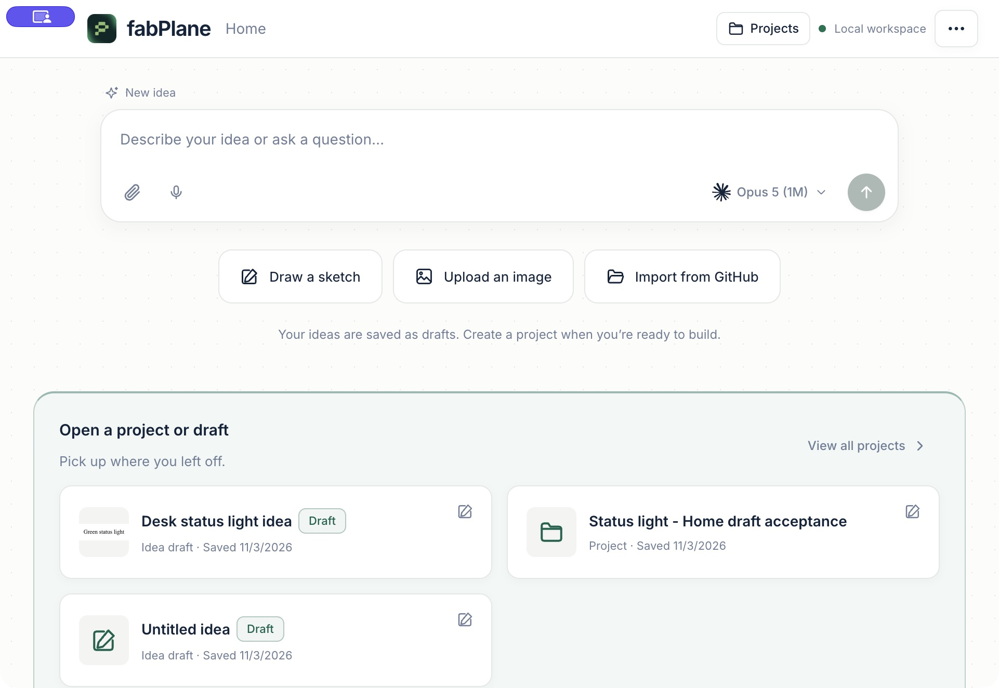
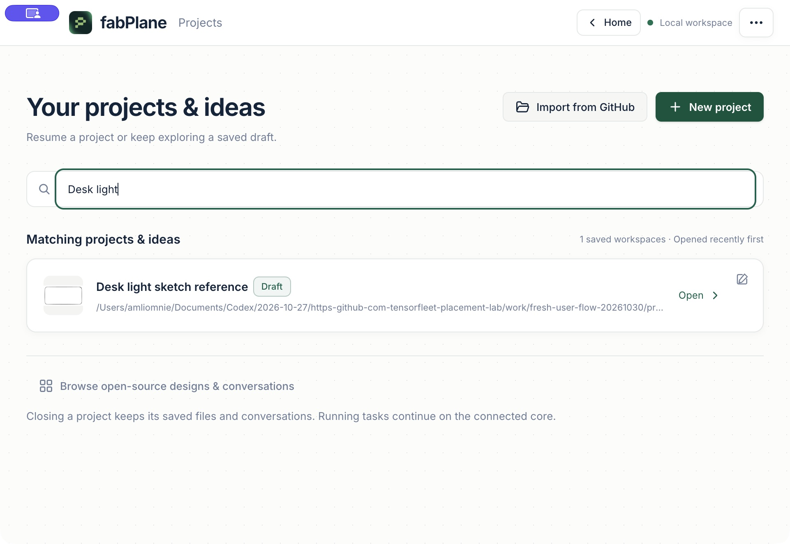

## Native editor and restart acceptance · November 3

The repeated native cosmetic failures were traced to registerBundledLibraries, before schematic editing. Caching alone did not resolve the first cold call: the initial follow-up failed in49s and preserved all native file hashes. The final change avoids registration for schematic edits that add no new library symbols, shares successful setup for unchanged project/library tables, invalidates setup on changed tables or replacement sessions, and never caches failed setup. New symbols still require library setup. Its one-time bounded budget is90s; ordinary bridge JSON calls keep their existing15s budget. No automatic edit retries or vendor changes were added.

Native human retest: two saved cosmetic edits succeeded in a48s agent run, adding then replacing one note in unused sheet margin. Actual tool receipts and saved drawing were checked. Comparison with a retained checkpoint matching the baseline SHA256 shows only the added non-electrical text block; PCB, project settings and both library tables were byte-identical. The existing schematic presentation warning about label layout was not rewritten as part of this app fix. Source freshness and electrical checks remain separate.

Cold setup acceptance: the first agent query incorrectly filtered for intentionally absent R99 and stopped on the strict unknown-reference error, with no edits. A corrected visible request inspected the full sheet, added a temporary native Device:R resistor, saved, deleted exactly its returned object ID, and saved again. Both edits succeeded. Independent SHA256 verification confirms all five protected files returned exactly to their state before that temporary test. This demonstrates this library/setup path on the actual synthetic project, not every component library or project type.

The controlled core restarts also exposed HD-16: Home recency used a temporary listening port. It now uses the stable daemon identity, with endpoint fallback for older/unavailable health information. Native Home kept Status light first after port59563→59798. All15 workspaces and old recency records are retained; no deletion, permanent power/security change or teammate integration occurred.

Final native state: Home, no project open, original window size, no active test agent run or job. Actual captures30–33 and before/after hashes/diff are retained locally. No new remote publication or PR edit.

Verification: root typechecks passed after correcting a nullable-state error caught in the final question-scope refinement; native session/design58tests173assertions and bridge11tests27assertions passed. Final UI261tests1101assertions and client-core380tests1801assertions passed. Desktop production renderer build passed in2m19s; no packaged source maps found. Native acceptance used the development app. No freshfullroot-suite or hostedCI claim.

Still untested, rather than observed blockers: induced ambiguous network loss after accepted generation handoff, cross-volume promotion, Windows folder behavior, crash recovery. Previous teammate398/393, BoardArt polish and broader411/412 dependencies remain separate. The remaining observed Home/draft findings HD-13/14/15 and newly observed recency HD-16 are addressed; this is not a declaration that every app capability is complete.

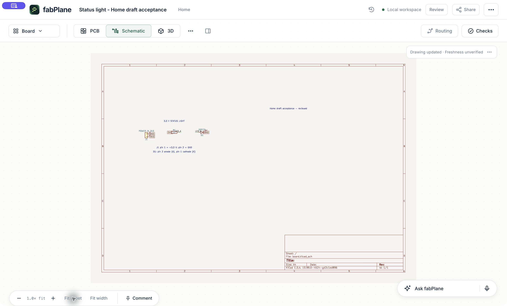
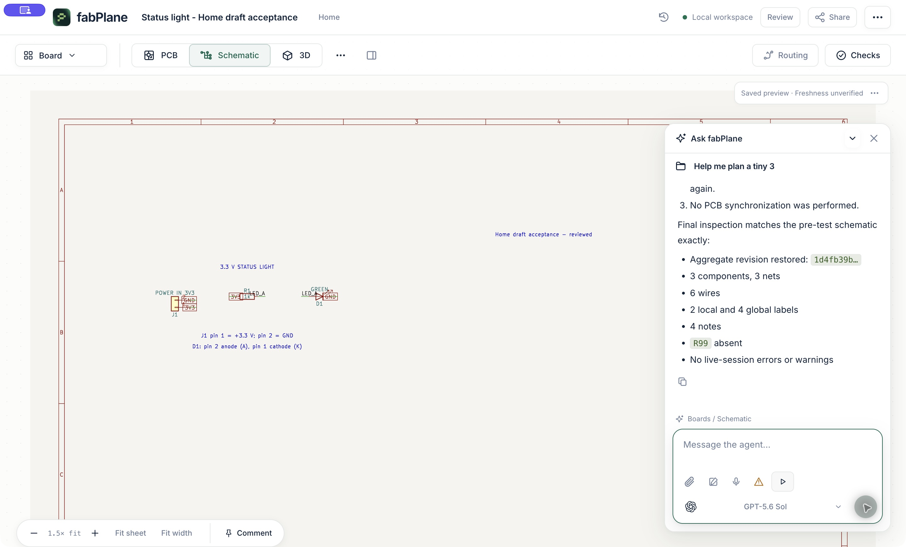
