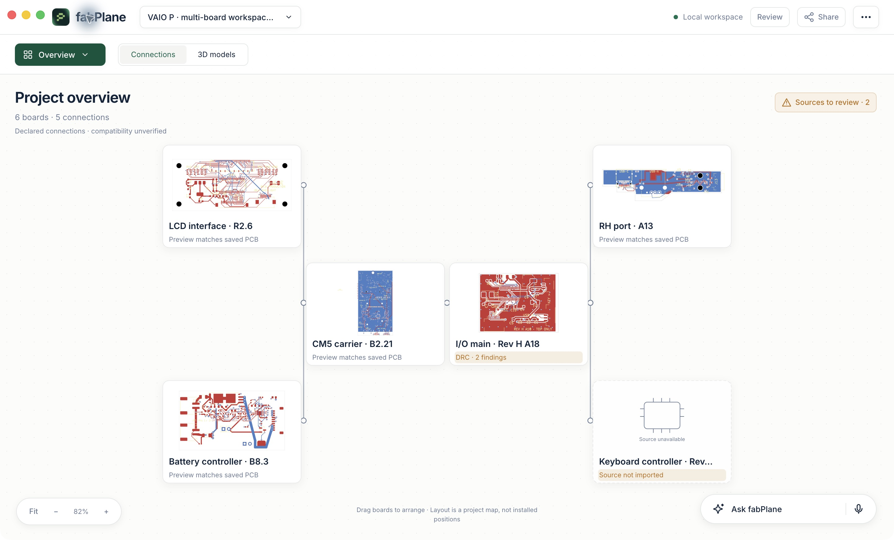
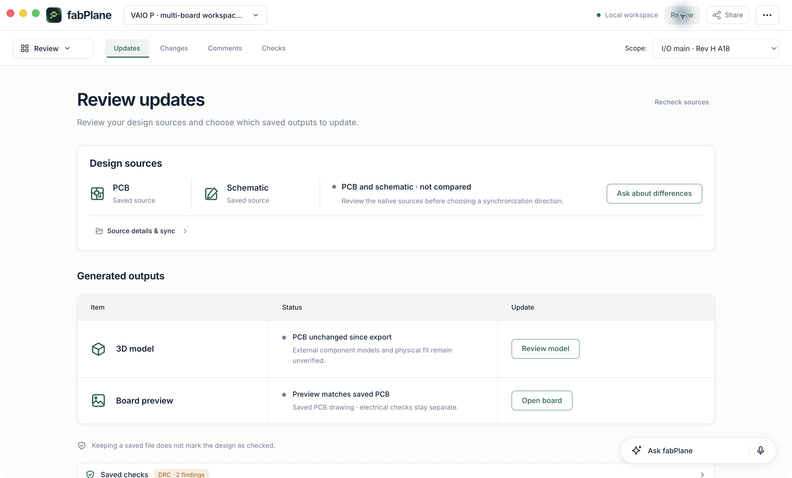
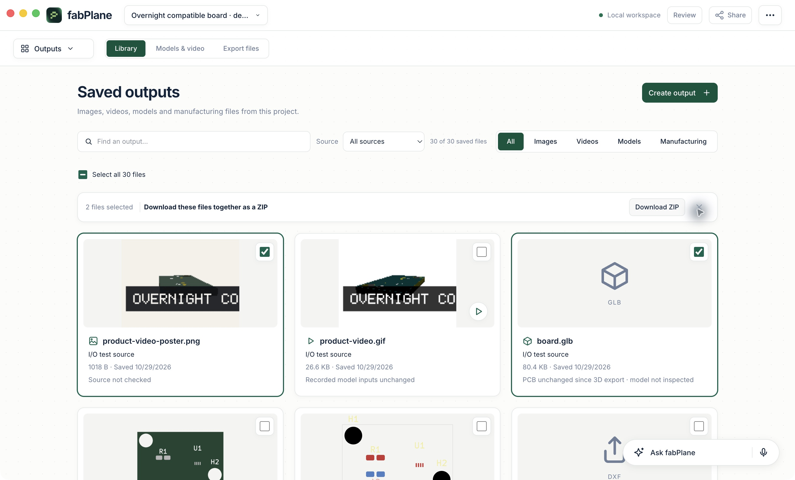
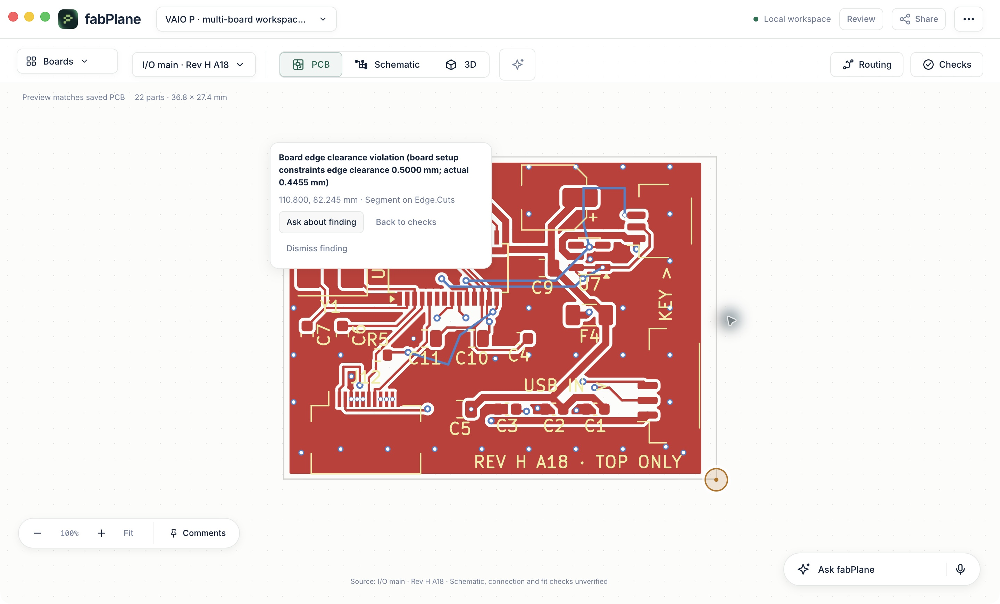

> Current follow-up: [whole-app workflow acceptance](WHOLE-APP-20261030.md), code `72cd7f1`, supersedes historical implementation/check/runtime status below. Teammate integration notices and exact remaining limits are included there.

# Overnight non-enclosure workflow acceptance · October 30

This pass completes the requested non-enclosure canvas user journeys on `feat/sketch-first-drafts`, from run start `1169366` through code `ac1bf94`. The draft remains an integration review: Mechanical/enclosure is teammate-owned in #398, the new placement/resize/replacement/general Undo workspace is #393, and Board Art Apply/polish remains deferred. No merge or deployment is included. Future engineering capabilities below are not claimed complete.

## Working flows

| Journey | Implemented and exercised | Practical limit |
| --- | --- | --- |
| Create/open | Fresh sketch/image/idea/import, project picker independent of chat history, real earlier Codex-generated native PCB and schematic, normal preview handoff | Optional later live-context send was approval-review rejected before execution; not retried |
| Modify/review | Existing guarded native proposal → discard/apply → stale checks/outputs → actual finding → source-qualified comparison → deliverables | Native fixture retains 12 DRC findings; no ERC/parity or manufacturing pass |
| Multi-board | VAIO connections/endpoints, actual board sources, missing Keyboard recovery, scoped tools, return to overview; shared physical-instance return | Declared links are not verified compatibility or installed coordinates |
| Changes/comments | Root and member history/checkpoints, source-local pins, readable unsent Ask, snapshot labels and current native drawing shortcut | Structured comparison is not a full native drawing or automatic schematic↔PCB reconciliation |
| Outputs | Real checkboxes/multiselect/filter/Select all, native ZIP, shared GLB/image/video dialog, source-specific creation, compact manufacturing export | Existing receipts distinguish known inputs; model dependencies/fit and universal output freshness are not certified |
| Parts/shopping | Immutable native schematic BOM, exclusions/DNP, physical quantities, source coverage, hardware, reviewed CSV and auth recovery | Unknown sources remain incomplete; no purchase/live cart mutation |
| Notes/files/share | Safe native source destinations, Markdown save/reopen/draft navigation and explicit discard, local review ZIP with file groups | Local download is not a hosted share link; repository actions prepare explicit reviews |
| Routing | Existing Freerouting, scoped snapshots/history/frames, explicit candidate review/Apply, useful failure recovery | Successful fixture remains partial (2 unrouted nets/3 connections); endpoint-collision failure retained |

Contextual help captures the current project, board/source, page/dialog and selected artifact/finding per message. Questions stay readable and unsent until the user chooses Send. Navigation and historical snapshots do not grant native-edit authority.

## Native evidence and visual review

Actual native captures were reviewed at 1440×870 and 960×700 CSS pixels. One main canvas, v6 task rows, green active tools, folded secondary sections, contextual inspectors and corner assistant are consistent across the exercised pages. Actual saved board drawings are retained instead of substituting illustrative green boards. Overview prefers real source-owned top renders, then other known previews, then a default icon. The final 3D models entry opens the selected board’s working model viewer.

The 22 unchanged PNG captures and their SHA-256 hashes are indexed in [acceptance JSON](overnight-20261030-acceptance.json). All original concepts and prior screenshot iterations remain preserved. The local output gallery places actual pages alongside the approved v6 references. Its resource links were filesystem-validated; the HTML itself was not browser-render-verified.

Native Save dialogs were exercised, not merely API downloads. The two-file Library ZIP matched selected bytes. The local review archive contained 38 entries, with all 37 selected project files byte-exact; sources were excluded as selected. One Save-panel typing attempt inserted into the suggested filename; the original is retained and its friendly evidence copy is byte-identical.

The actual root edit moved only R1 from 7 to 7.1mm in the PCB. KiCad also appended missing top-level-sheet metadata to that isolated fixture’s `.kicad_pro`; the evidence records this companion-file change. Outline preview/discard did not change the saved PCB. Routing Apply matched its captured candidate; other source/declaration files were unchanged. Notes and preview controls preserved the fixture’s native PCB/project bytes.

All **42 protected VAIO/root-study files** matched their baseline SHA-256 after the final walkthrough. Writes and generator jobs were restricted to agent-owned isolated fixtures; original design files, saved artifacts and concepts were preserved.

## Verification

- Root `bun run typecheck`: passed at `324c498`; latest affected UI typecheck passed at `ac1bf94`.
- Sequential repository package suites: **2,271 passed / 36 skipped / 0 failed** at `324c498`.
- Exact scripts suite: **94 passed / 318 assertions / 0 failed**.
- Latest UI suite: **245 passed / 970 assertions / 0 failed**, after final code changes.
- Final production desktop build at `ac1bf94`: **passed**, 12.38s; no `.map` files in desktop output.
- This run’s diff whitespace check passed. The complete older branch includes pre-run Markdown hard breaks/extra EOF formatting; those historical warnings were not silently rewritten.

Earlier failures remain in the local run log: a default-parallel mechanical timeout, a mistakenly broad script filter entering vendor modules, and sandbox-denied localhost fixtures. The exact scripts, permitted isolated tests and sequential package run passed. These results do not claim a fresh hosted CI pass or native execution for skipped cases.

Native format recovery used a checksum-verified task-local KiCad nightly with existing installed stock libraries and pinned Freerouting/Java. The old installed CLI rejected newer source format. No global tool defaults, credentials, lock/security or permanent power settings were changed.

## Integration boundaries

- #398: Mechanical/enclosure stays teammate-owned; preserve current entry and internals.
- #393: new placement/resize/replacement/general Undo remains a separate integration; existing guarded edits are retained.
- Board Art source-preserving Apply and further polish remain deferred by the user.
- Full inter-board compatibility, installed assembly fit, complete model-dependency freshness and automatic native reconciliation remain engineering follow-ups, with no successful status fabricated.
- Shopping and optional live-agent checks require their respective authorized/authenticated environment. Local context and auth-recovery paths were exercised; no credential changes or indirect retries.

The non-enclosure workflow acceptance queue is complete. Final publication consists of one normal push to the existing branch and a refreshed draft PR #389; no merge/deploy or competing feature branch.

## Teammate integration preparation

Read-only inspection on October30: #398 is open/unmerged at `8caa173608e10df8c5c22664acfa12b8a3063ea0`; #393 is open/unmerged at `222f574fff26e2e0c65e8e065ab462f18ddd6c1e`. Their reported tests are separate from this branch’s results. No teammate code was merged or rewritten.

For #398, retain the existing `cad` destination and replace the current canvas `MechanicalWorkspace` adapter with its lazy `board/mechanical/MechanicalWorkspace` and advanced-CAD slot when integration is authorized. Avoid mounting both the old `EnclosurePanel` and the new designer. Its Start/Space/PCB/Review workflow owns enclosure positioning/fit/export; Outputs should expose the produced artifacts without a second enclosure workflow. Teammate native writes/imported-case modification remain unverified in that PR’s stated Windows environment.

For #393, retain one lazy `placement` destination and PCB → Edit placement entry. Merge its BoardTab/store additions with this branch’s per-project task state and grouped navigation; do not replace the current store wholesale. Preserve the selected source/physical instance when entering and leaving placement. Its current `PlacementTab` reads the active project, so member-board routing into it needs a verified source adapter before being exposed. Its draft/undo and isolated `placement/` exports must remain separate from guarded canonical Apply; its export deliberately removes routing. Coordinate its enclosure entry with #398 rather than duplicating CAD or fit claims. Shared merge hotspots include BoardPanel, SvgTab, ui store, client-core exports and CAD tool registrations.
