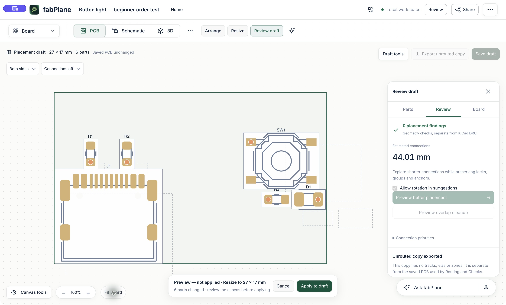
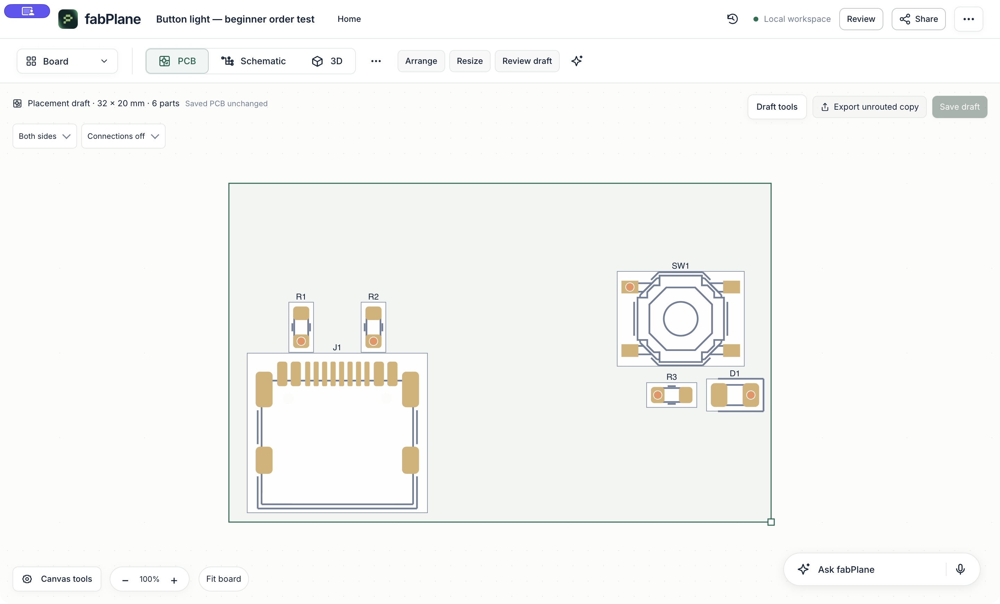
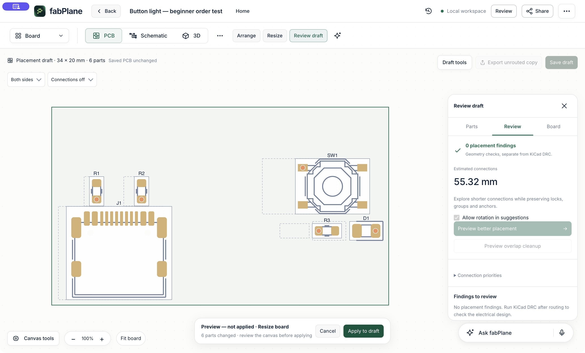
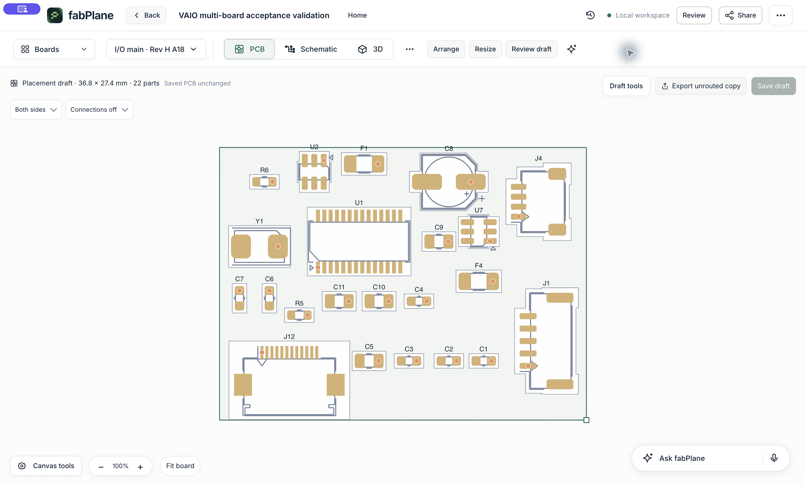
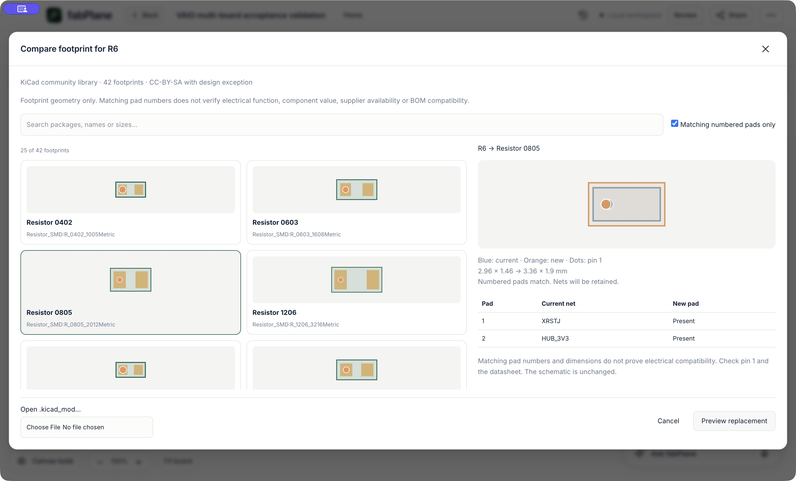
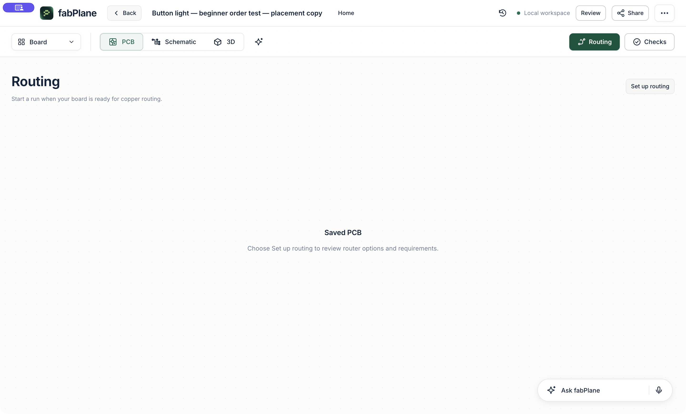
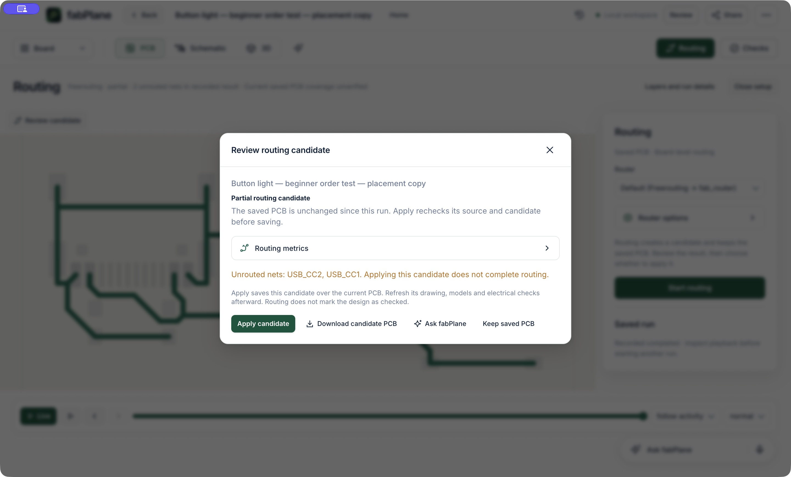
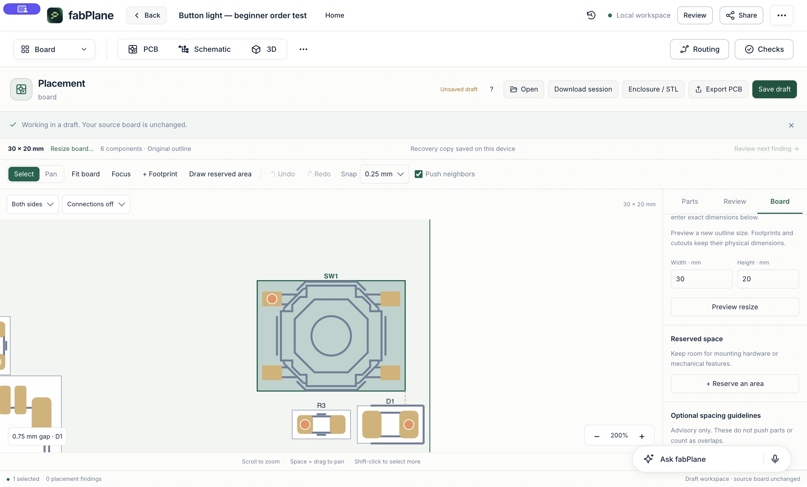

# Placement integration — November 4

## Background style follow-up

Applied the approved preview background: off-white `#fbfcfa`, subtle sage-gray dots `#d6dfdc`, radius0.7px on a20px screen-space grid. Home and workspace share the same tokens; dark mode has a matching low-contrast color. Placement uses that shared CSS grid rather than painting a second zoom-dependent background. Native placement/Fit redraw visually checked; no source changes. UI types and desktop production build pass (2m21s), zero packaged source maps.

## Implemented canvas integration

The approved proposal is now implemented for source-bound placement drafts. The analysis and simulated HTML below are retained as the **earlier baseline/proposal**, not the current implementation status. PR393's engine/worker/catalog are reused; no backend, vendor or Mechanical implementation was rebuilt.

- Board → PCB → **Edit placement** (or Board tools → Placement draft) keeps PCB selected. Arrange, Resize, Review draft and contextual Ask share the task row. One canvas remains; the inspector starts closed, collapses and resets its scroll for a new task. Parts selection retains zoom; Focus is explicit.
- Draft, cache and device recovery bind to core endpoint, project, exact PCB path, source ID and SHA-256. Saved draft envelopes include the source receipt; revision-specific paths preserve earlier drafts. Assembly members require an explicit available, owned project source. Unbound legacy drafts remain preserved, never silently adopted.
- Resize and footprint comparison retain worker preview/cancel/apply and undo. The common preview strip says **Preview — not applied / Apply to draft**. Clean source opening is not an unsaved edit. Save persists the editable draft; original native files stay unchanged.
- Footprint review names the actual old/new package and shows numbered-pad/net geometry. Matching pads do not establish function, value, supplier/BOM compatibility or electrical safety. No footprint change was applied in the native walkthrough.
- Contextual Ask attaches source path/hash, selected refs, dimensions, draft revision/save state, unapplied preview and geometric analysis. It prepares an unsent question and preserves existing text; no agent message was sent in this test.
- Export creates a separate unrouted PCB and records its hash/revision/dimensions. **Continue in a working copy** creates a separate project, copies native source hierarchy/local assets, installs the exported PCB at its source path and opens Routing for that project. Original files remain read-only. Generated renders/reports/exports and old job data are excluded, so inherited checks cannot be presented as fresh evidence. A provenance receipt is saved in `placement/working-copy.json`.
- Copy preflight verifies source/candidate hashes and bounded source size; copying rechecks files and source membership before activation. A failed partial copy stays inspectable and is not activated. External libraries outside the project remain unverified.
- Existing guarded saved-PCB position editing stays available with its original semantics. Resize/compare entries clearly open a separate draft. Mechanical/enclosure remains teammate-owned and unchanged.

### Native human-test result

Testing used visible clicks and normal typing in fabPlane Dev, the existing preserved profile, the six-part Button light project and the declared VAIO assembly. File-hash diagnostics and code tests below are separate evidence.

| Journey | Outcome / evidence |
| --- | --- |
| PCB → Edit placement; Resize 30→34 mm → Cancel | **Passed.** Preview was separate; Cancel returned to 30 mm. Compact controls and collapsing inspector remained usable. |
| Resize → Apply to draft → Save → tab/project revisit | **Passed.** Draft dimensions restored; final root draft is 32×20 mm. The original saved PCB remains 30×20 mm. A later renderer remount reported saved-draft restoration. |
| Export and Inspect exported copy | **Passed.** Exact separate PCB opens in Files; Back returns to the task. A Save/Export refetch initially reset the editor and hid its result; stable source-query identity fixed this, and repeat export retained the handoff controls. |
| VAIO I/O → Arrange → R6 X78.5→78.75 mm → RH → I/O → Save | **Passed.** I/O is 36.8×27.4 mm /22 parts; RH is 67×17.7 mm /11 parts. RH did not inherit the edit; I/O retained and saved it. All original member files stayed exact. |
| R6 → Compare footprint → Preview → Cancel | **Passed.** 0805 old/new dimensions and pad/net geometry shown; change list names the footprint delta. No replacement applied. |
| Ask about placement draft | **Passed.** Unsent prompt and expanded attachment identify the exact I/O source/hash and draft. Existing conversation drafts were retained; no Send. |
| Export 32×20 mm → Continue in working copy → Create copy & open routing | **Passed.** New Button light placement-copy project received the exact exported PCB and local sources; original evidence was not inherited. |
| Working copy → Start routing → Review candidate → Keep saved PCB | **Passed with engineering limitation.** Actual Freerouting result is **partial**, with `USB_CC2` and `USB_CC1` unrouted. Review states this explicitly. Candidate was left unapplied; working PCB still matches the exported unrouted copy. This is not a clean routing/check/manufacturing result. |

Source preservation after the entire walkthrough: **54 protected root files and 137 original VAIO files unchanged**. The copy's canonical PCB SHA-256 equals its exported candidate receipt. Native captures are original/unmodified; screenshot hashes and the read-only preservation result are included beside this report. Temporary developmental draft/export iterations remain preserved locally.

### Current checks and resume checklist

- UI/client-core typechecks passed. UI suite **299 pass /1,299 assertions**; unrestricted client suite **427 pass /1,967 assertions** before the final copy-race regression. Final focused ownership/copy tests **8 pass /41 assertions**, including the new race rejection. Initial restricted client run could not bind loopback fixture servers; the unrestricted rerun passed. No failure is represented as a pass.
- Final desktop production build passed in **1m21s**, with **zero packaged source maps**. `git diff --check` passed. No new full-root/mobile/installer/hosted-CI success is claimed.
- [x] Source identity/revision isolation, root and explicit member drafts.
- [x] One canvas/task row, collapsed contextual inspector and shared preview actions.
- [x] Native resize cancel/apply/save, source/member switching and footprint preview/cancel.
- [x] Contextual unsent Ask; separate export and explicit working-copy routing handoff.
- [x] Actual copy routing review, partial outcome disclosed, original sources preserved.
- [ ] Full cold process restart: **not independently verified**. View → Reload attempts retained runtime UI state in this development session; do not treat those as a cold restart pass. Saved-file restoration after remount/member/project switching and scoped recovery tests passed.
- [ ] Native full assembly-copy creation, saved-PCB resize/compare side-entry clicks, narrow viewport and copy failure/size-limit UI are not newly exercised. Assembly source-tree preservation and concurrent/stale-copy failure have unit coverage.
- [ ] Fresh candidate DRC/ERC, image/model/video/Gerber/order sequence is not newly completed here. The copy intentionally starts without inherited evidence; its routing currently has two unrouted nets. Existing beginner release acceptance applies to the original 30×20 mm source checkpoint only.
- [ ] Mechanical/enclosure remains deferred to its owner. Full app/engineering roadmap is not declared complete.

---

## Historical analysis and proposal

## Merge result and scope

PR [#393](https://github.com/TensorFleet/fabdesk/pull/393) was merged into main as **052b3986** on November 4. Our canvas branch was based on earlier main **7a943f2**. This update merges current main into `feat/sketch-first-drafts`; it does not merge PR389 into main or deploy anything.

There were two conflicted files:

- `BoardPanel.tsx`: retain canvas/contextual Checks arguments and all existing destinations; add the lazy Placement destination from main.
- `stores/ui.ts`: retain idea-draft helpers, navigation history, comments/updates and existing shortcut indices; append Placement to the tab registry.

Additional integration glue registers Placement in shared workspace navigation/search and adds a Board tools → Placement draft entry. This makes tab restoration, Back and basic assistant page identification recognize the new view. The editor is still the upstream PR393 layout; the proposed compact design below has **not** been implemented in the app.

A source guard prevents the project-wide editor from guessing an assembly member while member-scoped drafts are not connected. The canvas currently routes assembly boards through ProjectOverview, so assembly placement is not newly exposed. Classic/direct Placement entry also refuses assembly mode. All incoming placement engine/catalog/license files and screenshots are preserved. Current-main CI changes from PR414 are included unchanged.

## What PR393 actually provides

| Capability | Reuse from PR393 | Boundary |
| --- | --- | --- |
| Drag/push, exact X/Y/angle, multiselect, locks/groups, anchors, align/spacing | PlacementCanvas, engine and worker actions | Draft footprint geometry; not connected-track repair on the saved PCB |
| Board resize and reserved regions | Numeric/pointer resize, adjust-placement toggle, area tools | Preview/apply to a placement session; geometry findings are separate from DRC |
| Footprint comparison and additions | 42-item KiCad library, local .kicad_mod, pin 1 and numbered-pad/net comparison | Matching pad numbers are not electrical equivalence. Added parts are unconnected. No supplier/BOM validation |
| Better placement / overlap cleanup | Existing worker suggestion/review/Apply/Cancel | Estimated connection length is a heuristic; not routed length or an electrical pass |
| Recovery, undo/redo, saved session | Existing history and project/device recovery | One draft/cache key per project today; no per-member/source or core-identity namespace |
| Native PCB export | Existing separate uniquely named placement/*-unrouted.kicad_pcb | Intentionally strips tracks/vias/zones. Does not activate the copy as the app’s canonical board |
| Placement enclosure export | Incoming isolated placement/ snapshot and case output code | Preserve it; avoid expanding or duplicating teammate Mechanical work in this pass |

## Focused human-test result

Start: native fabPlane Dev, existing **Button light — beginner order test**, preserved `fresh-user-flow-20261030/profile`, source PCB 30×20 mm / 6 footprints. Code inspection was separate from UI observations.

| Visible path | Result | Friction |
| --- | --- | --- |
| PCB → Edit placement | Passed with friction | Editor loads the actual board and states that the source is unchanged, but none of PCB/Schematic/3D remains selected. Mode is unclear. |
| Parts list → SW1 | Passed with friction | Geometry, X/Y/angle and neighbors appear. Selection auto-focuses at 200%; board context is partly off-screen. |
| Compare replacement footprint | Passed with friction | Library opens, 25/42 pad-number-matching footprints visible. It includes resistors/capacitors for a switch: matching pads cannot imply same function. No replacement applied. |
| Close comparison → Resize board | Passed with friction | Board inspector exposes dimensions, adjust-placement and preview. Inspector retains its scroll position and can open midway down the content. No resize applied. |
| Back from Placement | Passed | Returns to the saved PCB tab without saving or applying the draft. |

Actual captures are in this document’s sibling folder and the original local `work/placement-integration-20261104`. No source edit, Save draft, preview Apply, export, new check job or agent message was performed. Opening the existing editor writes its device recovery copy; the initial source import is labeled Unsaved draft even before a user edit.

### Observed UX issues to address

1. **P1 — too much permanent chrome.** Main navigation plus Placement header, notice, overview, tool strip, view strip, hint and footer reduce canvas space. Keep one task row; move options into contextual tools and one inspector.
2. **P1 — competing saved-PCB and draft tools.** Existing NativePartTools provides guarded position edits; PR393 edits a separate draft. Do not put indistinguishable Apply actions for both on one canvas. The active mode and destination of every save must be explicit.
3. **P1 — source/board context.** Automatic load prefers device recovery → shared project draft → first PCB in sorted file list. Session schema has board geometry/name but no source identity/hash receipt. Do not enable this for assembly members or silently assume the imported/selected version is its source.
4. **P1 — incomplete next step.** Export creates a separate unrouted file. Existing Routing still targets the canonical saved board. A new user needs an explicit candidate selection/handoff before routing/checks/outputs, rather than a misleading Continue button.
5. **P1 — replacement language.** Use Compare footprint. Display pad-number matching separately from function, pin mapping, BOM/stock and manufacturing compatibility. Keep explicit preview/apply.
6. **P2 — styles and density.** Replace raw select/input/checkbox controls with shared styled components; common icons, focus/disabled states and collapsible panels. Reset inspector scroll when opening a different tool. Avoid auto-zoom unless requested; preserve Fit/selection.
7. **P2 — assistant context.** Shared navigation currently identifies Board/Placement, but the editor does not attach selected references, source path/hash, dimensions, current preview, draft revision or geometric findings. Its Ask must describe the draft, not assert that the saved PCB changed.
8. **P2 — misleading initial state.** Distinguish No edits yet / recovered draft / unsaved edits / saved draft. Avoid warning about unsaved changes simply because a native source was opened.

## Proposed canvas integration

Open [the clickable UI proposal](placement-integration-20261104/proposal.html). It uses geometry parsed from the actual six-part test board. **All actions in this HTML are simulated**; it cannot save, resize, replace, validate or export project data. The browser tool refused local file URLs, so this prototype was not visually browser-verified in this pass; its embedded script passes a syntax check. Actual app captures below are separate evidence.

**Entry:** Board → PCB → Placement. PCB stays selected; Placement is a task mode alongside Routing, not a new top-level workspace. The existing Board selector remains the sole source selector. Show a small Placement draft / Source unchanged status on the canvas. Back exits the task and restores the previous view.

**Default canvas:** no permanent inspector. Click a footprint to open its contextual tools; one selected part has no redundant selector. Keep fit/pan/undo/redo in a compact bottom-left strip. Move snap, sides, nets, pushing and reserved-region tools into a styled options menu. Board outline selection or Resize opens board dimensions. A selected part opens X/Y/rotation/lock and Compare footprint. Multi-selection reveals group/align/spacing. Each panel collapses without losing draft or selection.

**Preview:** resize, footprint replacement and optimization share a bottom-center Preview — not applied strip with Cancel and Apply to draft. Before/after geometry, moved parts and actual geometric findings are shown; do not invent a success count. Retain PR393’s worker cancellation and undo. No Apply is described as updating the source PCB.

**Save and continue:** Save draft persists editable work. Export unrouted copy remains a separate action with its removal warning. Then show the exact candidate path and allow an explicit Use candidate / Open for routing flow only once the app can bind routing, DRC, models, outputs and order checks to that candidate. Every generated artifact records the candidate hash. No automatic source overwrite or claim that old outputs are current.

**Footprints:** reuse the existing comparison dialog and catalog. Show the target reference once, current/candidate shape and dimensions, numbered-pad/net mapping and pin-1. Describe unrelated package matches honestly. Put saved-board native edits behind an explicit advanced action until the single draft workflow can replace them safely; never run both editing semantics implicitly.

**Ask:** keep the existing corner assistant. Add a bounded surface containing core/project/source identity, original PCB hash, draft revision, selected refs, board dimensions, unapplied preview and relevant geometric findings. Prepare a useful unsent prompt such as “Review this resize preview and affected parts. Explain conflicts before applying.” Clear stale context on source/project changes. The prototype illustrates this.

**Other pages:** show placement sessions/unrouted candidates under Outputs → Models & files, with the actual source relationship. Surface draft changes in Review only after there is a real persisted comparison. Geometric placement findings belong to the draft; Review → Checks remains electrical DRC/ERC on an explicit saved source. Keep enclosure controls in the teammate Mechanical integration; preserve PR393’s isolated generator without creating a second top-level enclosure UI.

## Implementation order / acceptance

1. **Source adapter first.** Key draft/cache/recovery by core + project + stable source ID; record PCB path/hash and draft revision. Migrate project-wide drafts explicitly; do not silently attach one to a new board. Test project/core/member switching, missing sources, source changes and corrupt recovery.
2. **Canvas shell.** Extract/reuse PlacementCanvas, inspector sections and worker jobs. Consolidate navigation and legacy entry points; styled controls and collapsed tools. Retest root and member navigation, one/many parts, fit, collapse, Back and unsent Ask.
3. **Draft actions.** Wire resize/replacement/optimization preview→cancel/apply→undo/save/reopen with source-preservation checks and original net/UUID assertions. Distinguish pad matches from functional compatibility.
4. **Candidate handoff.** Explicit unrouted-copy activation bound to source selection; route→DRC/ERC→3D/image/video→Gerbers/order uses that exact candidate. Failures retain prior source/output bytes. Test the complete beginner journey before calling this integrated.
5. **Mechanical last.** Reconcile PR393’s placement enclosure exports with PR398 once its owner’s integration is ready; do not duplicate or promise fit checks.

## Merge verification

- Client-core **420 pass / 1,929 assertions**, including incoming placement/recovery tests; local-server fixtures allowed.
- UI **299 pass / 1,299 assertions**. First run caught an old “Updates must be last” assertion; updated it to check Updates at its unchanged index and Placement appended, preserving existing shortcuts. Rerun passed.
- Tools CAD/enclosure **13 pass / 72 assertions**, including incoming isolation tests. This is unit coverage, not a new native enclosure test.
- UI, client-core and tools typechecks passed.
- Production desktop build passed in 1m48s on the final rerun, zero `.map` files. `git diff --check` passed; no unresolved conflict entries.
- Full monorepo/mobile/packaged-installer acceptance and new mutation/export walkthroughs were not run. Do not substitute PR393’s historical validation for new UI acceptance.

