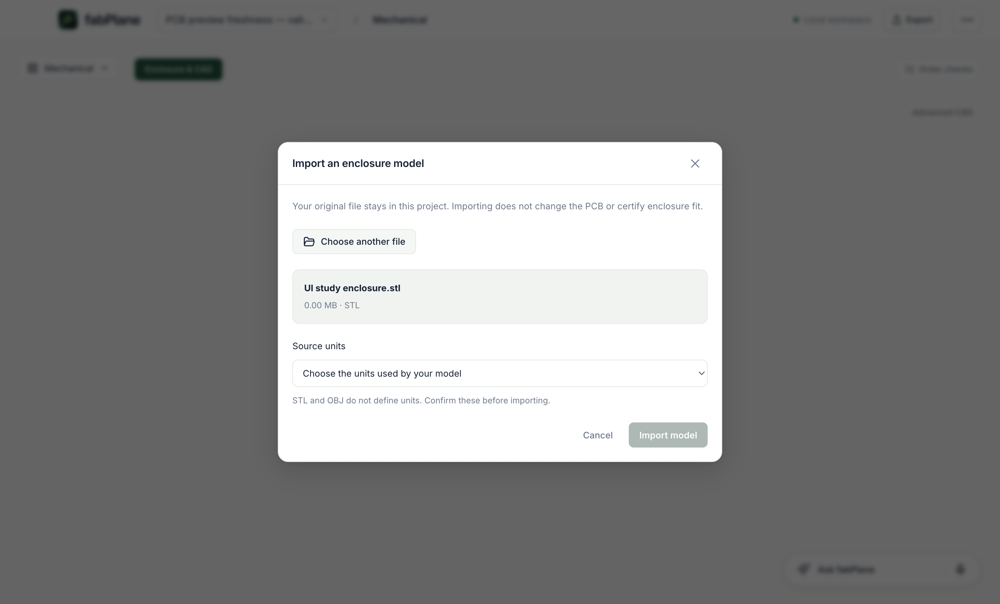
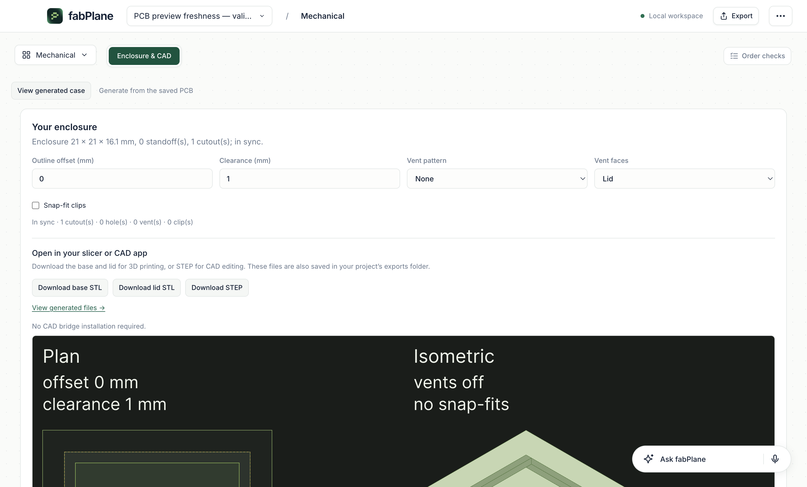

# Canvas workspace implementation milestone

Design roadmap: [#388](https://github.com/TensorFleet/fabdesk/pull/388). Implementation continues in [#389](https://github.com/TensorFleet/fabdesk/pull/389).

Current implementation includes: a primary canvas and corner assistant; project/task navigation; fresh sketch/idea/artboard entry; actual board overview; shared Review comments; PCB SVG byte provenance and explicit updates; interactive board model viewing; grouped model/video outputs; original enclosure imports with units/provenance; case generation and live source-change warnings. Native resize/replacement, multi-board assembly, schematic reconciliation and remaining artifact dependencies are still unfinished. Latest validation: UI218, client181, protocol86, tools392; root typecheck plus affected follow-up checks pass. Desktop149 passed at the shell milestone. See evidence sections below for scope and limits.

## Implemented

- One primary canvas with the assistant and project/chat drawer closed by default. Project selection lives in the header. The previous shell remains available through the workspace menu.
- Task navigation groups Overview, Board, Mechanical, Parts, Outputs, Review, and Files. Existing PCB, schematic, 3D, routing, artwork, CAD, BOM, renders, files, notes, diff and checks remain reachable. Local tabs stay available within a task.
- Board SVG preview keeps its camera across source refreshes. Selecting a location reveals Ask about this and Pin comment; keyboard selection works too. These are location tools, not native footprint selection or editing.
- A project overview uses real saved files, previews and readiness responses. It currently represents the canonical single board. Saved previews may be older than source; this milestone does not certify their freshness.
- Centered fresh start offers idea, sketch/image, GitHub design import and a new artboard project. First sending creates project ownership; sketch upload preserves original image bytes and project-scoped drafts.
- A single mounted conversation/composer survives the transition into the assistant dock, including a failed initial send. Project switching restores the saved task, clears unrelated conversation context and reveals the canvas.
- Official desktop icon and fabPlane wordmark in the new header. User-facing privacy/import copy uses fabPlane.

## Evidence

Native Electron development app, isolated profile/core/projects; existing project sources were copied into the study project without changing the original. The board preview and saved render are separate existing artifacts and visibly differ. No new board, compatibility or freshness claim is inferred from these images.

Root typecheck passes. UI tests: 217 pass. Client-core tests: 170 pass; desktop tests: 149 pass with local HTTP/process fixture access; the restricted sandbox denied two fixture servers. Native checks cover logo load, closed assistant, real board navigation, location tools, overview, project-scoped drafts and failed-first-send ownership. The full suite has the previously recorded unrelated KiCad/core failures; see [earlier validation](../sketch-first/README.md).

## Next work and limits

This is a navigation and interaction foundation, not completion of the screenshot roadmap. Still required: adaptive first-open overview for explicit multi-board projects; assembly membership and relationships; source revision/freshness tracking and directional reconciliation; native safe resize/replacement; model upload/generation flow; unified output/review workflows; remaining accessibility walkthroughs; all accepted concept states and end-to-end project exercises. Existing views are grouped, not yet fully redesigned. No fabricated synchronization or native editing controls are presented.

## Subsequent native walkthrough

All 12 existing destinations were opened in the native app: PCB, schematic, 3D/video, routing, artwork, CAD, parts/shopping, renders, changes, checks, files and notes. The assistant stayed closed and no page overflow appeared. This checks navigation and presentation, not successful execution of every backend operation.

The desktop enforces a minimum 960 × 720 window. Canvas and explicitly opened assistant fit that size. Appearance settings switched between fabPlane light and dark. A harmless comment was temporarily added to the isolated PCB SVG then restored: the preview blob URL changed automatically, while the host width and 125% zoom stayed identical.

Overview tools now appear only after board selection. The preview is labeled Saved preview; revision-based freshness remains a follow-up.

## Review comments milestone

Review now groups Changes, Comments and Checks. Comments reuse the existing project `comments.json` API and drawing pins. Active/resolved filters, resolve/reopen and source-drawing navigation are connected to saved project data. Ask about this prepares a draft containing the existing pin ID and opens the assistant; the user sends it explicitly.

A clearly labeled question was created in the isolated study project. Native walkthrough verified that resolving writes `resolved` to the server and removes the item from Active, reopening returns it, Show on drawing opens its exact selected pin/detail, and Ask about this retains the pin ID in the draft. Closing comment details restores focus to the Comment button. The assistant launcher no longer overlaps the comment-detail action area. UI tests now total 218 passing, including cross-project comment navigation isolation; root typecheck passed and the subsequent UI polish typecheck passed.

## PCB preview freshness milestone

PCB SVG exports now render an immutable snapshot and write `renders/pcb.svg.revision.json` with SHA-256 hashes of the saved PCB input and generated SVG bytes. If the source changes during export, generation fails before replacing the previous preview. The UI compares both files against that receipt and responds to the existing project-change events. It distinguishes a matching source, changed PCB, replaced SVG, missing files and absent/invalid provenance. Transport errors remain errors.

Update preview is explicit. Legacy previews stay unverified; opening the canvas does not regenerate them. A matching status covers this SVG against `board.kicad_pcb` only. It does not certify schematic reconciliation, 3D assets, renders, manufacturing outputs, electrical checks or enclosure fit. Those remain separate dependency/compatibility work.

The earlier Game Boy study file requires KiCad 10.99 while the installed CLI rejects it. That failed update stayed unverified and showed the actual error. A new isolated project using the committed `mini-two-layer.kicad_pcb` KiCad 9 fixture was rendered through the real UI action. Native validation showed matching status, changed-source warning after a whitespace edit, matching status again after explicit snapshot export, and modified-preview status after a temporary SVG comment; the SVG was restored byte-for-byte. No circuit or production project was changed. A development-core restart encountered an existing port collision; only the verified isolated app/core were relaunched to finish the walkthrough.

Checks: root typecheck passes; UI 218, client-core 175, protocol 86, tools 392 tests pass. Seven new focused tests cover legacy/invalid receipts, source change/return, altered outputs, missing files, transport failure, exact export hashes and source changes during generation (preserving the previous SVG). The draft PR's preceding comments milestone also passed its GitHub verify jobs; these new changes require their own CI run.

## Interactive board model milestone

Board → 3D now opens a real interactive model canvas instead of video configuration. Generate/Update explicitly exports the saved KiCad board to GLB. Orbit, zoom, keyboard pan/rotation and Fit change the view only. Video configuration lives under Outputs → Models & video, with View model and authenticated Download GLB actions. The classic fallback keeps its existing export view.

The viewer loads lazily, renders on demand, resizes with its container, retains the camera through model refresh, and disposes graphics resources when closed. Standalone model loading blocks referenced remote resources. Graphics/load failures have retry guidance. The source file remains untouched by view controls. This milestone is a viewer, not native placement/resize or a multi-board assembly editor. GLB revision/freshness tracking is not yet implemented.

Native validation used an actual CLI-exported GLB from the isolated KiCad 9 fixture, not a generated concept image or a pretend populated board. Its sparse geometry reflects the available fixture. Keyboard orbit, zoom, Fit and both directions of Board/Outputs navigation worked; SHA-256 of the GLB was identical after view actions. The download button and authenticated file path are connected; an OS save-dialog/download walkthrough remains to do. Root typecheck and UI218 tests pass. Three.js 0.186.1 and matching 0.186.0 type definitions were added with the root lockfile.

## Mechanical import and generation milestone

Mechanical now starts with two clear choices: Import a model or Generate from PCB. Advanced CAD is opened explicitly; its runtime/kernel setup does not occupy the initial canvas. Redundant single-option tab pills are hidden.

STL/OBJ imports require source-unit confirmation; GLB uses metres and STEP retains file-defined units. Originals are written unchanged under a unique project import directory, with versioned metadata (original name, format, units, SHA-256, byte length, import time and unplaced status). Metadata retries reuse the same file/path; parallel saves do not create duplicate imports. Source paths stay scoped to the captured project. No parametric conversion or fit certification is implied.

STL/GLB/OBJ files can be viewed on the canvas; STEP is preserved with an explicit preview-unavailable state. STEP editing/preview integration, physical alignment, model combination, lid display, watertightness/manufacturability validation, import cancellation, and a complete OS file-picker walkthrough remain follow-ups. STL faces are shown on both sides so reversed winding does not make surfaces disappear; this is display behavior, not mesh repair or print-readiness proof.

Existing enclosure generation/check controls, vents, snap-fits and STL/STEP downloads remain available after choosing generation. The resulting base STL can be selected on the same canvas as imported originals. The existing generator's own board-hash/alignment report is retained; live freshness warnings on the collapsed generated-case canvas are still to add.

Native isolated walkthrough: imported the repository's generated test-box STL through the actual input/change/save handlers (fixture supplied through the development bridge); Import was disabled until millimetres were selected. Original bytes and recorded SHA-256 matched exactly; metadata remained unplaced. Ran real case generation from the KiCad9 fixture: report was 21 × 21 × 16.1 mm, one cutout, zero standoffs. Both the imported model and generated STL remained selectable. This is a fixture result, not validation of arbitrary mechanical fit.

Checks: root typecheck passes; UI218/client179/protocol86 tests pass. Four new session tests cover original bytes, metadata-retry reuse and unit correction, concurrent saves/different-file rejection, and unit/format/path validation.

## Live enclosure source review

The generated-case canvas now warns when `board.kicad_pcb` differs from the revision recorded in `enclosure.json`. This is a negative freshness signal; unchanged source is not presented as fit/print-readiness certification. The case is never regenerated automatically.

An open generator report refreshes when project data refreshes, including same-size/same-timestamp source edits. Background refresh and explicit alignment checks preserve unsaved parameter controls. A project without a PCB can import a model; generation is disabled with guidance to add the PCB first.

Native walkthrough temporarily edited the isolated PCB while preserving its byte length and mtime. The report changed to stale and the unsaved outline offset remained 2 mm. The collapsed canvas also showed the changed-source warning; SHA-256 of the generated STL remained identical. The PCB bytes/timestamps were restored. Two added client tests cover byte identity, changed source, invalid provenance, missing PCB and transport errors. Client181/UI218 pass; root typecheck passed before the final UI guard, and affected client/UI typechecks passed afterward.

