# Canvas workspace implementation milestone

Design roadmap: [#388](https://github.com/TensorFleet/fabdesk/pull/388). Implementation continues in [#389](https://github.com/TensorFleet/fabdesk/pull/389).

Current implementation includes the primary canvas and corner assistant; quiet project/task navigation; fresh sketch/idea/artboard entry; saved-board overview; shared Review comments and source updates; explicit PCB/model freshness; interactive models and original enclosure imports; native part positioning and rectangular outline resizing; saved-output browsing; and opt-in PCB/schematic comparison. Multi-board editing, native footprint replacement, directional schematic reconciliation and complete artifact dependency tracking remain unfinished. The latest complete standard suite including the assembly-source foundation passed **2,112 tests, 29 skipped, zero failures**. Root typecheck passed; separate native placement/outline checks passed at the preceding editing milestone. Later evidence sections qualify each milestone.

## Implemented

- One primary canvas with the assistant and project/chat drawer closed by default. Project selection lives in the header. The previous shell remains available through the workspace menu.
- Task navigation groups Overview, Board, Mechanical, Parts, Outputs, Review, and Files. Existing PCB, schematic, 3D, routing, artwork, CAD, BOM, renders, files, notes, diff and checks remain reachable. Local tabs stay available within a task.
- Board SVG preview keeps its camera across source refreshes. Selecting a location reveals Ask about this and Pin comment; keyboard selection works too. These are location tools, not native footprint selection or editing.
- A project overview uses real saved files, previews and readiness responses. It currently represents the canonical single board. Saved previews may be older than source; this milestone does not certify their freshness.
- Centered fresh start offers idea, sketch/image, GitHub design import and a new artboard project. First sending creates project ownership; sketch upload preserves original image bytes and project-scoped drafts.
- A single mounted conversation/composer survives the transition into the assistant dock, including a failed initial send. Project switching restores the saved task, clears unrelated conversation context and reveals the canvas.
- Official desktop icon and fabPlane wordmark in the new header. User-facing privacy/import copy uses fabPlane.

## Evidence

Native Electron development app, isolated profile/core/projects; existing project sources were copied into the study project without changing the original. The board preview and saved render are separate existing artifacts and visibly differ. No new board, compatibility or freshness claim is inferred from these images.

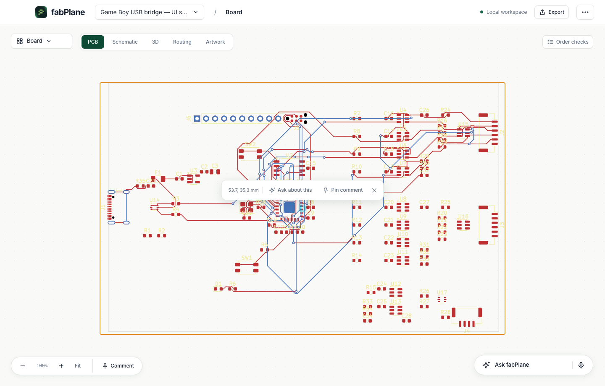
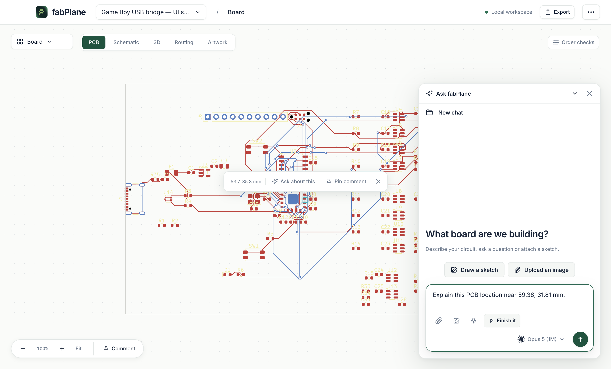

Root typecheck passes. UI tests: 217 pass. Client-core tests: 170 pass; desktop tests: 149 pass with local HTTP/process fixture access; the restricted sandbox denied two fixture servers. Native checks cover logo load, closed assistant, real board navigation, location tools, overview, project-scoped drafts and failed-first-send ownership. The full suite has the previously recorded unrelated KiCad/core failures; see [earlier validation](../sketch-first/README.md).

## Next work and limits

This is a navigation and interaction foundation, not completion of the screenshot roadmap. Still required: adaptive first-open overview for explicit multi-board projects; assembly membership and relationships; source revision/freshness tracking and directional reconciliation; native safe resize/replacement; model upload/generation flow; unified output/review workflows; remaining accessibility walkthroughs; all accepted concept states and end-to-end project exercises. Existing views are grouped, not yet fully redesigned. No fabricated synchronization or native editing controls are presented.

## Subsequent native walkthrough

All 12 existing destinations were opened in the native app: PCB, schematic, 3D/video, routing, artwork, CAD, parts/shopping, renders, changes, checks, files and notes. The assistant stayed closed and no page overflow appeared. This checks navigation and presentation, not successful execution of every backend operation.

The desktop enforces a minimum 960 × 720 window. Canvas and explicitly opened assistant fit that size. Appearance settings switched between fabPlane light and dark. A harmless comment was temporarily added to the isolated PCB SVG then restored: the preview blob URL changed automatically, while the host width and 125% zoom stayed identical.

Overview tools now appear only after board selection. The preview is labeled Saved preview; revision-based freshness remains a follow-up.

## Review comments milestone

Review now groups Changes, Comments and Checks. Comments reuse the existing project `comments.json` API and drawing pins. Active/resolved filters, resolve/reopen and source-drawing navigation are connected to saved project data. Ask about this prepares a draft containing the existing pin ID and opens the assistant; the user sends it explicitly.

A clearly labeled question was created in the isolated study project. Native walkthrough verified that resolving writes `resolved` to the server and removes the item from Active, reopening returns it, Show on drawing opens its exact selected pin/detail, and Ask about this retains the pin ID in the draft. Closing comment details restores focus to the Comment button. The assistant launcher no longer overlaps the comment-detail action area. UI tests now total 218 passing, including cross-project comment navigation isolation; root typecheck passed and the subsequent UI polish typecheck passed.

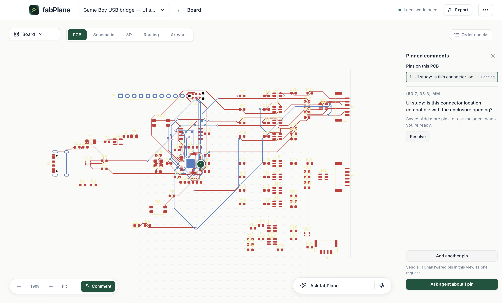

## PCB preview freshness milestone

PCB SVG exports now render an immutable snapshot and write `renders/pcb.svg.revision.json` with SHA-256 hashes of the saved PCB input and generated SVG bytes. If the source changes during export, generation fails before replacing the previous preview. The UI compares both files against that receipt and responds to the existing project-change events. It distinguishes a matching source, changed PCB, replaced SVG, missing files and absent/invalid provenance. Transport errors remain errors.

Update preview is explicit. Legacy previews stay unverified; opening the canvas does not regenerate them. A matching status covers this SVG against `board.kicad_pcb` only. It does not certify schematic reconciliation, 3D assets, renders, manufacturing outputs, electrical checks or enclosure fit. Those remain separate dependency/compatibility work.

The earlier Game Boy study file requires KiCad 10.99 while the installed CLI rejects it. That failed update stayed unverified and showed the actual error. A new isolated project using the committed `mini-two-layer.kicad_pcb` KiCad 9 fixture was rendered through the real UI action. Native validation showed matching status, changed-source warning after a whitespace edit, matching status again after explicit snapshot export, and modified-preview status after a temporary SVG comment; the SVG was restored byte-for-byte. No circuit or production project was changed. A development-core restart encountered an existing port collision; only the verified isolated app/core were relaunched to finish the walkthrough.

Checks: root typecheck passes; UI 218, client-core 175, protocol 86, tools 392 tests pass. Seven new focused tests cover legacy/invalid receipts, source change/return, altered outputs, missing files, transport failure, exact export hashes and source changes during generation (preserving the previous SVG). The draft PR's preceding comments milestone also passed its GitHub verify jobs; these new changes require their own CI run.

## Interactive board model milestone

Board → 3D now opens a real interactive model canvas instead of video configuration. Generate/Update explicitly exports the saved KiCad board to GLB. Orbit, zoom, keyboard pan/rotation and Fit change the view only. Video configuration lives under Outputs → Models & video, with View model and authenticated Download GLB actions. The classic fallback keeps its existing export view.

The viewer loads lazily, renders on demand, resizes with its container, retains the camera through model refresh, and disposes graphics resources when closed. Standalone model loading blocks referenced remote resources. Graphics/load failures have retry guidance. The source file remains untouched by view controls. This milestone is a viewer, not native placement/resize or a multi-board assembly editor. GLB revision/freshness tracking is not yet implemented.

Native validation used an actual CLI-exported GLB from the isolated KiCad 9 fixture, not a generated concept image or a pretend populated board. Its sparse geometry reflects the available fixture. Keyboard orbit, zoom, Fit and both directions of Board/Outputs navigation worked; SHA-256 of the GLB was identical after view actions. The download button and authenticated file path are connected; an OS save-dialog/download walkthrough remains to do. Root typecheck and UI218 tests pass. Three.js 0.186.1 and matching 0.186.0 type definitions were added with the root lockfile.

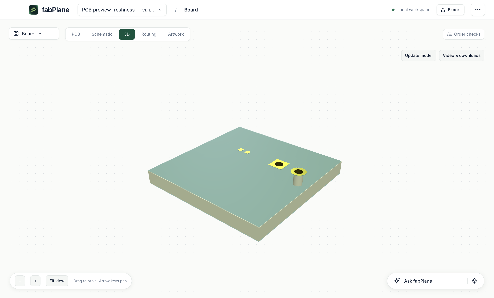
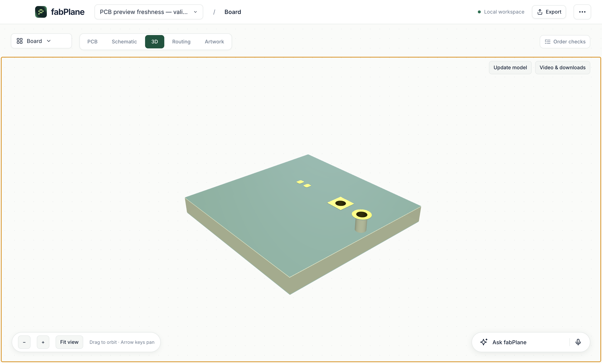
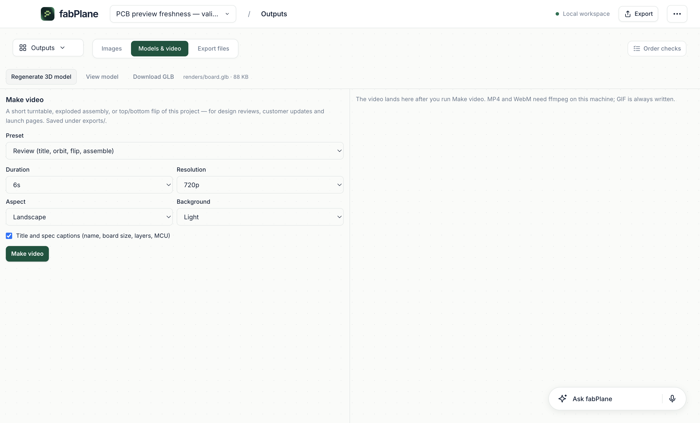

## Mechanical import and generation milestone

Mechanical now starts with two clear choices: Import a model or Generate from PCB. Advanced CAD is opened explicitly; its runtime/kernel setup does not occupy the initial canvas. Redundant single-option tab pills are hidden.

STL/OBJ imports require source-unit confirmation; GLB uses metres and STEP retains file-defined units. Originals are written unchanged under a unique project import directory, with versioned metadata (original name, format, units, SHA-256, byte length, import time and unplaced status). Metadata retries reuse the same file/path; parallel saves do not create duplicate imports. Source paths stay scoped to the captured project. No parametric conversion or fit certification is implied.

STL/GLB/OBJ files can be viewed on the canvas; STEP is preserved with an explicit preview-unavailable state. STEP editing/preview integration, physical alignment, model combination, lid display, watertightness/manufacturability validation, import cancellation, and a complete OS file-picker walkthrough remain follow-ups. STL faces are shown on both sides so reversed winding does not make surfaces disappear; this is display behavior, not mesh repair or print-readiness proof.

Existing enclosure generation/check controls, vents, snap-fits and STL/STEP downloads remain available after choosing generation. The resulting base STL can be selected on the same canvas as imported originals. The existing generator's own board-hash/alignment report is retained; live freshness warnings on the collapsed generated-case canvas are still to add.

Native isolated walkthrough: imported the repository's generated test-box STL through the actual input/change/save handlers (fixture supplied through the development bridge); Import was disabled until millimetres were selected. Original bytes and recorded SHA-256 matched exactly; metadata remained unplaced. Ran real case generation from the KiCad9 fixture: report was 21 × 21 × 16.1 mm, one cutout, zero standoffs. Both the imported model and generated STL remained selectable. This is a fixture result, not validation of arbitrary mechanical fit.

Checks: root typecheck passes; UI218/client179/protocol86 tests pass. Four new session tests cover original bytes, metadata-retry reuse and unit correction, concurrent saves/different-file rejection, and unit/format/path validation.

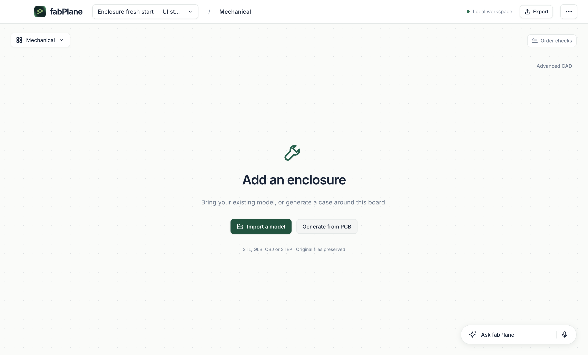

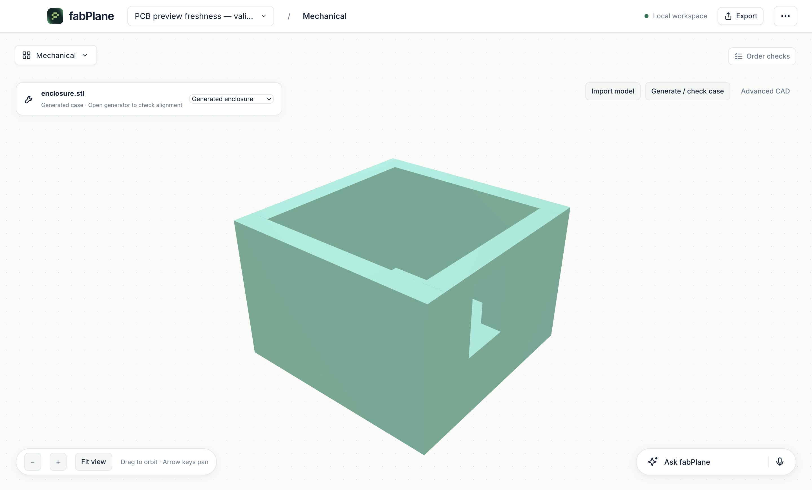

## Live enclosure source review

The generated-case canvas now warns when `board.kicad_pcb` differs from the revision recorded in `enclosure.json`. This is a negative freshness signal; unchanged source is not presented as fit/print-readiness certification. The case is never regenerated automatically.

An open generator report refreshes when project data refreshes, including same-size/same-timestamp source edits. Background refresh and explicit alignment checks preserve unsaved parameter controls. A project without a PCB can import a model; generation is disabled with guidance to add the PCB first.

Native walkthrough temporarily edited the isolated PCB while preserving its byte length and mtime. The report changed to stale and the unsaved outline offset remained 2 mm. The collapsed canvas also showed the changed-source warning; SHA-256 of the generated STL remained identical. The PCB bytes/timestamps were restored. Two added client tests cover byte identity, changed source, invalid provenance, missing PCB and transport errors. Client181/UI218 pass; root typecheck passed before the final UI guard, and affected client/UI typechecks passed afterward.

## Native placement prerequisite

Native component inspection on the isolated KiCad9 fixture returned the real R1/J1/C1 references, saved positions, rotation, layer and lock state. The existing placement tool preserves embedded geometry and routed copper by default and reports affected copper. Canvas footprint selection/movement/resize is still not presented as implemented.

`pcb_place` now optionally accepts the saved PCB SHA-256 from inspection. The native provider rejects stale source before opening a session and rechecks after asynchronous preflight; the existing native save guard handles later external writes. A conflict does not overwrite the changed disk file. Callers that omit the optional hash retain existing behavior.

Root typecheck passes. Two focused core tests prove a stale hash is rejected without opening a session, and a source edited during preflight never enters a commit or overwrites the external edit. Two tools tests verify hash forwarding and malformed-hash rejection before mutation context. Tools394 tests pass. The preceding `5774417` milestone passed both GitHub verify jobs and the real-board pipeline. A native end-to-end guarded edit and canvas controls are next, not yet certified by these mock/unit checks.

## Contextual native part positioning and coordinate verification

Select a drawing location, then Parts to inspect actual saved KiCad references nearby. The compact popup offers absolute X/Y in native PCB millimetres, rotation, a 90° shortcut, Reload part, Apply position and a part-specific assistant draft. Chat and properties remain closed by default. The popup stays within the window and scrolls when needed. Locked parts, missing/unknown coordinates, stale inspections and non-current previews cannot drive a placement. The captured project and source SHA stay attached to each edit.

A real isolated walkthrough moved R1 from (105, 100) to (105.5, 100) through these controls. Native inspection confirmed the saved position, and tracks, vias, zones and net records were identical before/after. Placement analysis reported two affected copper items, displayed with an Open checks action; this is not a DRC pass. Temporarily changing the source disabled Apply while preserving the typed value; restoring the exact source re-enabled it. The fixture and its preview/receipt were restored after the test.

Preview refresh exposed a local toolchain mismatch: the installed native editor writes PCB format 20260901, while the CLI rejects that format despite both reporting 10.99. The saved position remains saved; the preview stays visibly stale, further placement is disabled, and export details are available without claiming the preview updated. A follow-up walkthrough used the already-installed fabPlane-bundled CLI (the exact executable serving the native session) through a temporary setting in the isolated profile. Save → preview refresh → matching source/artifact receipt then passed, with the two affected-copper warning retained. The setting and fixture were restored. The default development CLI selection still chooses the incompatible host install and needs separate discovery/alignment work.

The coordinate investigation found that KiCad board-area SVG export rebases its origin. New exports use current-page mode (native coordinates), then crop only the SVG viewport to the outline plus margin. Physical scale is checked and the root receives a coordinate-frame stamp. An actual CLI integration test confirms nonzero source coordinates stay nonzero. The behavior is also documented in [KiCad's SVG exporter source](https://gitlab.com/kicad/code/kicad/-/blob/9.0/pcbnew/exporters/export_svg.cpp). Existing previews remain origin-unverified until explicitly regenerated. Earlier screenshot pin labels predate this verification and must not be treated as proof of native positions.

New pins record their coordinate frame. Legacy pins whose mixed SVG/mm fields have an unknown origin remain in Review, but are neither projected onto the verified native frame nor passed to the agent as native millimetres. No origin is guessed. Re-pinning old comments still needs a dedicated flow. Changing preview coordinate frames clears unsaved drawing selections/pins so a location cannot silently change meaning.

Validation: final root typecheck passes. UI220, client186, protocol87 tests pass; the client transport suite requires loopback permission. Three crop-coordinate unit tests and the real CLI SVG-export integration test pass. The preceding native SHA guard has tools394 tests plus two focused core conflict tests. Dragging, board resizing, replacement, multi-board ownership, persistent placement findings, and full schematic/output reconciliation remain work in progress.

## Native outline resize prerequisite

The existing outline tool now accepts an optional inspected-source SHA and checks it before opening the native document and again after asynchronous preflight. It rejects unsaved documents and refuses replacement of mixed human/tool-owned boundaries, curved/non-segment Edge.Cuts and locked edges. Exact segment comparison includes every existing edge, preventing a partial tool-owned match from hiding additional human edges. Ownership property keys remain unchanged for compatibility; visible commit/error wording uses fabPlane.

Native board-geometry inspection now includes lock and tool-owned-outline facts for the upcoming contextual controls. This is a backend prerequisite, not a shipped drag/resize UI. Unrelated silkscreen is preserved by the native transaction; arbitrary human-authored outlines still require KiCad editing.

Validation: seven new core cases cover stale-before-open, external changes during preflight, mixed ownership, curves, locks, unsaved state, and exact owned-only replacement. Two tools tests cover hash forwarding and malformed-hash rejection. Core46 focused/compatibility tests, tools396 tests, and affected core/tools typechecks pass. Tools HTTP/process fixtures require execution outside the restrictive sandbox. The preceding implementation commit's real-board GitHub pipeline passed; its verify jobs were still queued when checked.

## Contextual board-size controls

Selecting a PCB location now offers Board size beside Parts, using the same single contextual popup. Simple width/height editing is available only for a complete, unlocked, axis-aligned four-segment rectangle owned by the existing outline tool. Imported/manual, curved, duplicate, disconnected, truncated, unknown-ownership and locked cases stay read-only with guidance and Reload. Missing outlines require explicit dimensions. Edits preserve the native top-left origin; they do not scale footprints, routing or mechanical models. Apply uses the inspected SHA, and save/refresh errors remain distinct. Controls cannot switch/close during a write.

A live read-only test found that the older spatial provider does not normalize the string Edge.Cuts alias; this briefly made an imported rectangle appear empty. The client now requests the explicit native BoardLayer enum 47 from inspection v2, with a regression test. No outline was changed in that failed inspection. The actual imported rectangle is now correctly read-only.

Native UI validation used a separate empty project whose outline was created through the native outline tool at (100,95)–(115,110). Applying width 20 mm retained height 15 mm and produced exact bounds (100,95)–(120,110). Native inspection confirmed four owned segments and a current refreshed preview. Components/tracks/vias/zones/nets were unchanged; those collections are empty in this fixture, so this is not a populated-board clearance or routed-resize validation. The compatible installed fabPlane CLI was temporarily selected only in the test profile and restored afterward.

Final root typecheck, UI220/client191/protocol87 tests pass. Five client cases cover native-origin preservation, unsupported ownership/locks/curves/truncation, invalid topology/dimensions and exact layer filtering. Prior guard validation remains core46/tools396. Drag handles, populated-board resize validation and physical compatibility checks remain follow-ups.

## Populated native resize and complete Checks display

A second isolated project copies the committed routed mini-board fixture. Preparation removes only its exact known test-outline rectangle from the new copy, then creates the same bounds through the native outline tool; no imported production boundary is adopted or changed. The repository fixture is untouched. Through the actual UI, width 15→20 mm preserved top-left (100,95), height 15 mm, all three components, five track/via rows, the via, the zone and all net records. The regenerated SVG receipt matches the saved PCB. This demonstrates content preservation, not clearance or manufacturability.

Real saved-PCB DRC ran afterward with schematic parity explicitly disabled: **8 errors, 4 warnings, 2 unconnected items**. The PCB source hash was identical before/after checking. No claim is made about which findings were caused by the resize because a before-resize DRC baseline was not measured.

Open checks exposed a report-format mismatch: the existing view dropped normalized `unconnected` and `schematicParity` categories. It now reads normalized and raw KiCad names without counting alias copies or nested raw payloads twice. The native view shows all **14 findings**, including the two missing connections. Loading no longer briefly labels an empty array as zero findings; an empty report no longer claims that the board passes every rule. UI221 tests and affected typecheck pass; prior final root typecheck passed for the board-size milestone.

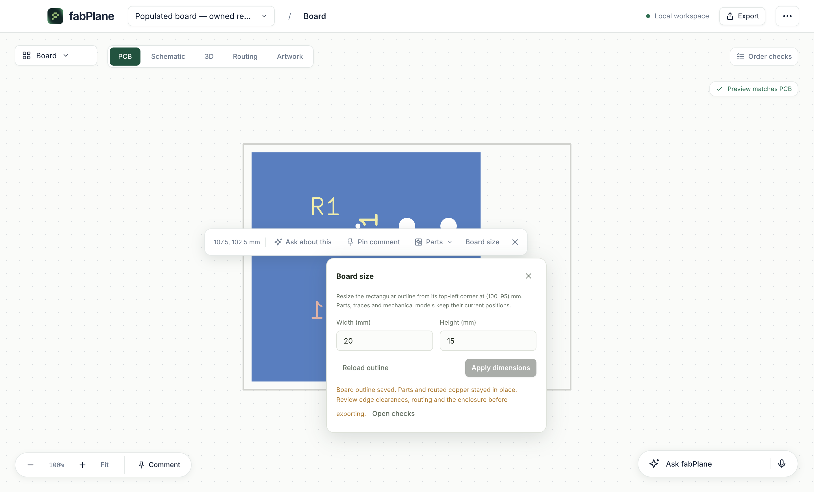

## Saved-check source warnings

Checks compares the PCB SHA-256 stored in a qualified DRC report with the current saved board bytes. A changed board produces an explicit re-run warning; unchanged bytes are described only as unchanged since the report, never as a rule-check pass. Missing/legacy/invalid provenance stays unverified and transport failures offer retry. The view also makes missing ERC and unverified schematic parity explicit; ERC freshness is not yet implemented.

Actual native validation replaced one whitespace byte in the populated study PCB while preserving file size and mtime. The source warning appeared, and hashes of the saved DRC report and SVG stayed identical: no automatic check/render was run. Restoring the exact PCB bytes cleared the warning. The original source bytes/timestamps were restored. Unit coverage includes changed/returned bytes, missing/invalid receipts, missing PCB and transport failures.

Final root typecheck and UI221/client193/protocol87 tests pass. This tracks saved PCB identity only. It does not authenticate a manually edited report, certify ERC/parity, track external library/rule dependencies or replace complete DRC freshness qualification.

## Part position targets on the canvas

Selecting an actual native reference reveals a labeled position target. Dragging proposes absolute coordinates snapped to 0.1 mm; Shift uses 0.01 mm. Arrow keys provide the same increments. Pointer cancellation restores the draft at drag start. Apply remains the only placement write; the saved footprint/copper image stays visible until the native save and preview refresh complete. This is a position target, not a live footprint-shape or DRC simulation. The popup opens beside the selection, stays within the window and retains canvas theme tokens; the target remains visible above it.

Native verification used real keyboard input plus development-bridge pointer move/up/cancel events on R1. Nudges changed the proposal, cancellation restored the prior typed position, and the board hash remained unchanged until Apply. Apply saved R1 at (105.5,100), refreshed the SVG, and retained tracks/vias/zones/nets exactly. The fixture and its preview/receipt were restored. A separate physical mouse drag through native computer control changed the proposal to X=105.4; a source-hash check proved no PCB write, and Reload restored X=105. Mouse release uses its final coordinates. Multi-pointer starts cannot replace an active drag.

Visual review moved the popup off the target and checked non-overlapping rectangles. Native position/dimension Apply is disabled while source verification is pending or a current inspection failed; cached successful data cannot keep the action enabled. Preview verification also stops showing the matching badge during a pending/error recheck. Root typecheck and UI221 tests pass. Physical drag-to-save in a populated design, broader compact-window drag/accessibility scenarios, footprint geometry ghosts, magnetic snapping, collision/clearance overlays, multi-select and undo UI remain follow-ups.

## Fine-coordinate target entry

Keyboard nudging now preserves off-grid coordinates on the untouched axis and adds the requested delta at native precision, rather than snapping both axes. Pointer dragging still uses its explicit absolute grid. A stationary target click focuses it without snapping; a small movement threshold separates focus from drag. Number fields accept valid fractional positions/angles and PCB outline dimensions, and values are captured immediately before state updates. Outline dimensions smaller than one native nanometre are rejected.

Three regression tests cover off-grid/negative coordinates, reversible nudges, and pointer-grid behavior. A native walkthrough entered (105.123,100.456789), clicked the target without movement, then nudged right and Shift-up: the resulting proposal was exactly (105.223,100.446789), the form remained valid and the PCB hash stayed unchanged. Reload restored the saved position. Root typecheck and client196/UI221 tests pass.

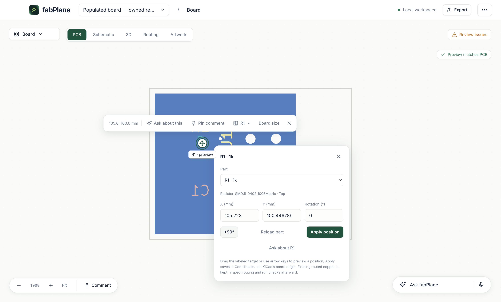

## Native board corner resizing

Owned rectangular outlines now have a labeled bottom-right corner handle and dashed size proposal. Mouse dragging or arrow keys updates width/height; the top-left native origin stays fixed. Pointer snapping uses that origin, so fractional native origins do not distort dimension increments. The geometry is not written until Apply dimensions. Cancellation/blur restores the draft at gesture start. Imported/complex/locked boundaries remain read-only in this milestone.

Resize mode shows one contextual dimension panel and hides the unrelated drawing-location toolbar/marker. Closing it restores the toolbar and focus. The panel stays beside the drawing and the resize target stays visible. The primary preview status shares native-save/refresh activity, preventing a duplicate manual update during this flow.

Native validation used the populated fixture: keyboard and window-level pointer gestures proposed 22×16 mm, cancellation and blur restored the prior draft, and source bytes stayed unchanged before Apply. Save retained origin (100,95), all components, tracks, vias, zones and nets; the preview refreshed to the saved source. A separate physical mouse drag and native Apply saved **21.9×16 mm** with the same preservation checks. The temporary CLI setting, source files, preview receipt and original timestamps were restored afterward.

The physical drag exposed an OS-driver/capture path where movement outside the small handle stopped reaching it. The target now tracks a single active gesture at window scope, cleans listeners on up/cancel/blur/unmount, and suppresses only the immediate post-drag click. The actual physical drag then passed. The part-target native save regression also passed using this shared engine. Final root typecheck and client197/UI221 suites pass; the added origin-relative snap case passes. Multi-edge/curved outline editing, additional anchors/aspect constraints, multi-selection, undo/recovery UI and broader platform/compact-window gesture coverage remain follow-ups.

## Resize imported rectangles without replacing their native edges

Complete unlocked rectangular boundaries now use `pcb_resize_outline`: either one native rectangle or four closed, axis-aligned segments. The operation updates the existing primitives in place, retaining IDs, style and custom metadata without claiming tool ownership of imported geometry. Locked ancestor groups, missing/partial edges, curves, cutouts, unsaved documents and stale source hashes stop the write. Legacy outline creation/replacement keeps its ownership guard. UI editing additionally requires the explicit native millimetre coordinate frame and the runtime's resize capability.

A real KiCad integration test saves, closes and reopens an imported rectangle, checks its original ID, stroke and custom property, and compares components, pads, tracks, vias, zones and named connectivity. Internal numeric net codes can be renumbered on reopen and are excluded only from the net-list comparison. The native UI walkthrough resized the populated imported rectangle from 15×15 to 20×16 mm, kept its original ID and non-tool-owned status, and refreshed the matching SVG receipt. The generated enclosure then displayed a source-change warning while its STL and specification bytes stayed unchanged. Restoring the source cleared the warning. All fixture files and timestamps were restored after the walkthrough.

Validation: root typecheck; client-core 200, UI 221, protocol 87 and tools 398 tests; 52 focused core/tool checks; one real KiCad save/reopen integration test all pass. These establish source/content preservation, not clearance, enclosure fit or manufacturability. Irregular boundary editing, multiple outlines and undo/recovery UI remain follow-ups. Earlier imported-outline read-only screenshots document the previous milestone.

## Respect native placement locks

Component inspection now reports effective locking through ancestor groups as well as the footprint's own lock. Contextual positioning explains that the part or its group must be unlocked in KiCad. Native placement rejects geometry edits to members of locked groups before any mutation, including an attempted footprint-only unlock. A separately locked footprint can still be deliberately unlocked with the existing explicit `lock=false` tool option; unlocked groups do not block editing.

Focused placement/revision/compatibility checks: 42 pass. Real KiCad tests create and save a locked group containing an unlocked R1, confirm inspection reports it locked, reject both movement attempts (with/without own unlock), and compare saved bytes and native coordinates unchanged. The existing imported resize save/reopen test also passes. Root typecheck, final core typecheck, UI221 and tools398 suites pass. Group-aware lock coverage does not replace clearance or full editor recovery validation.

## Board model source tracking across canvas and Outputs

Board → 3D and Outputs → Models & video share source identity warnings for the saved GLB. A qualified receipt compares both saved PCB and GLB SHA-256 bytes; a replaced model cannot inherit the prior receipt. Missing/legacy/invalid provenance stays unverified. Source equality says only that the PCB bytes are unchanged since export: external component models and physical fit remain explicitly unverified. No model regeneration or video creation is triggered by a change notification.

GLB export now writes to a fresh temporary output, checks saved PCB bytes before/after the live export, and publishes the new model/receipt only after a successful write and source recheck. This also prevents an existing output from hiding a failed native exporter. The board remains in its real project during export so relative component model paths and project variables keep their resolution. Unlike the PCB SVG exporter, the GLB path does not render an immutable source snapshot, and external model changes during export are not qualified. Complete dependency tracking remains pending.

Actual native verification generated a real GLB, matched its receipt to source/artifact bytes, then replaced a whitespace byte in the PCB while retaining size and mtime. Both the model canvas and Outputs warned; the model bytes stayed identical. Restoring the original PCB cleared the warning. Fixture source/model/receipt files and timestamps were restored afterward. Tests cover failed/missing exports and source changes preserving the prior model/receipt, legacy/invalid receipts, missing inputs, replaced outputs and transport failures. Root typecheck and tools402/client205/UI221/protocol87 suites pass.

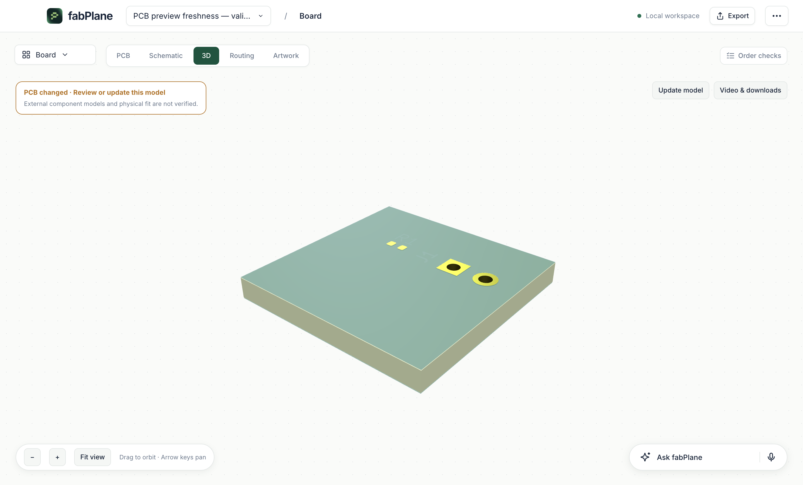

## Quiet saved-output library

Canvas Outputs now lands on a Library containing actual saved images, videos, models and manufacturing deliverables. Category filters share this library rather than opening more panels. Native sources, imported mechanical originals, reports and revision receipts do not become output cards. File paths, sizes and dates come from project files; no synthetic revision/currentness badges are added. Existing image generation, model/video settings and export file tools remain reachable through Create output and local tabs. Classic image browsing stays available.

Selection reveals one compact action bar beside the selected card, without moving the grid. Previews open only on request: saved images/videos and GLB/STL/OBJ models are supported; STEP stays download/file-only. Deselect/Escape returns focus to the card. Known PCB preview, model and enclosure source warnings update on the cards; other sources remain unverified. A matching case source does not certify mesh identity or fit. Model previews use the saved files, not substituted stock illustrations.

Native walkthrough: six real saved files, no forms/dialogs/actions on initial mount; one selected-model toolbar; actual GLB and SVG previews; Escape closes previews; Models filters four saved model files; Create output → Make video reaches the existing settings. A same-size/same-mtime PCB edit flags the SVG and generated-case cards; exact restore clears both. Source files/timestamps were restored finally. Root typecheck passed after the library integration; final UI/client typecheck and client207/UI221 tests pass after the contextual layout. Original grouping remains compatible with persisted workspace tabs. Native OS download-dialog, video creation/playback and manufacturing output exercises remain pending; this walkthrough does not claim those passed.

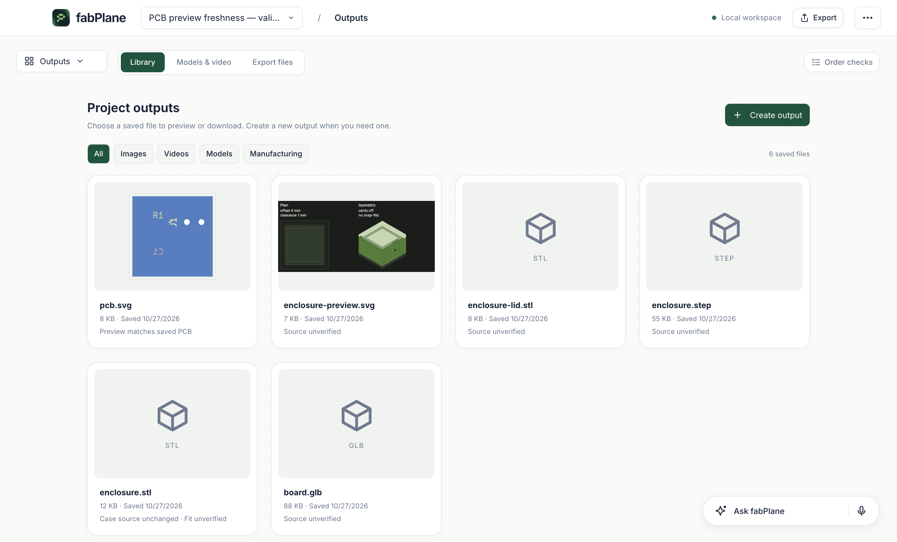
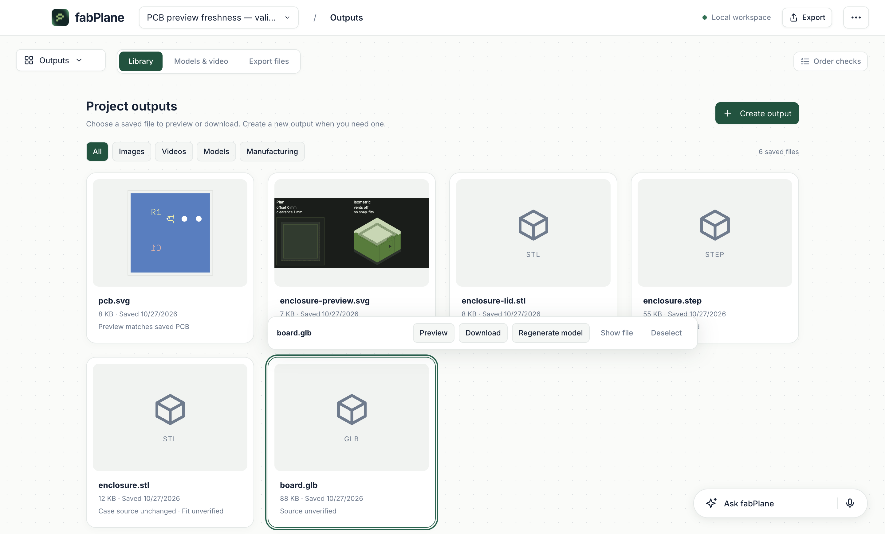

## Physical fresh-project drawing and native JPEG picker

Created a new isolated project through the header's New project dialog, then opened Sketch or image → Draw a sketch. Actual mouse drags drew two labeled concept blocks and an arrow. Save and attach produced a real 12,183-byte PNG in that project's sketches folder and left an unsent attachment in the fresh composer. The saved image was visually inspected and retains the block diagram. A typed draft and the attachment survived a real app reload. No message was sent and no circuit was generated.

Opened the native image picker, cancelled it, and confirmed Save and attach stayed disabled with no file chosen. Reopened the picker and selected an existing repository JPEG reference; native upload saved the original 74,022 bytes unchanged (SHA-256 `7b29dc306fd3d9ab94066f3ebe48b9556af67915bab65a180f58028be3cd14c7`). Both originals remain attached to the same project draft. The reference is a test screenshot, not a new circuit or agent interpretation. The vendor fixture was read only.

This closes the physical drawing/JPEG picker portion of onboarding validation. It does not implement editable scene-file persistence/import or a sketch-to-circuit run: a saved drawing is currently a PNG reference, and a new drawing starts a fresh scene after attachment. Projectless-chat migration remains explicitly deferred.

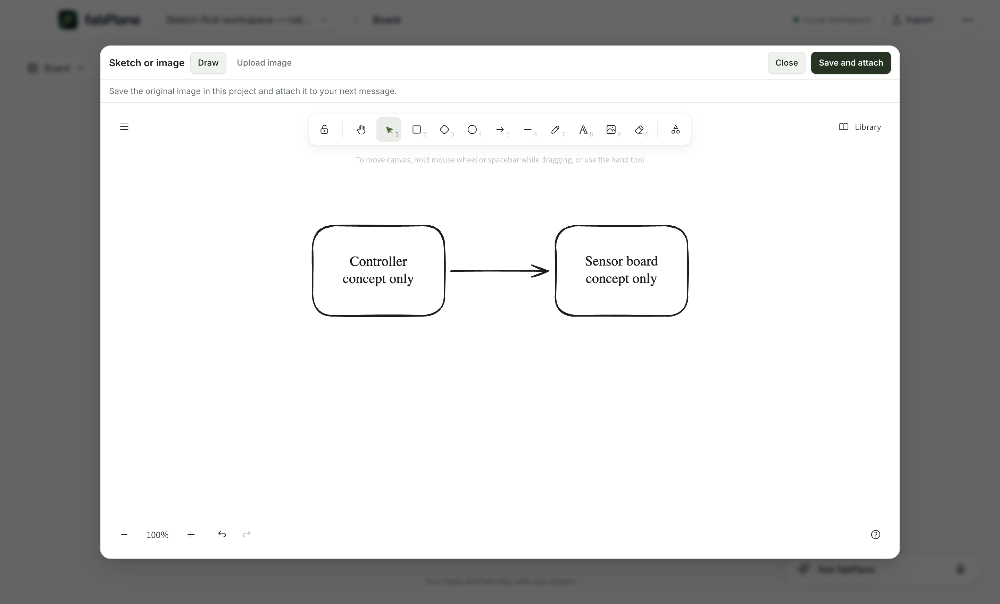

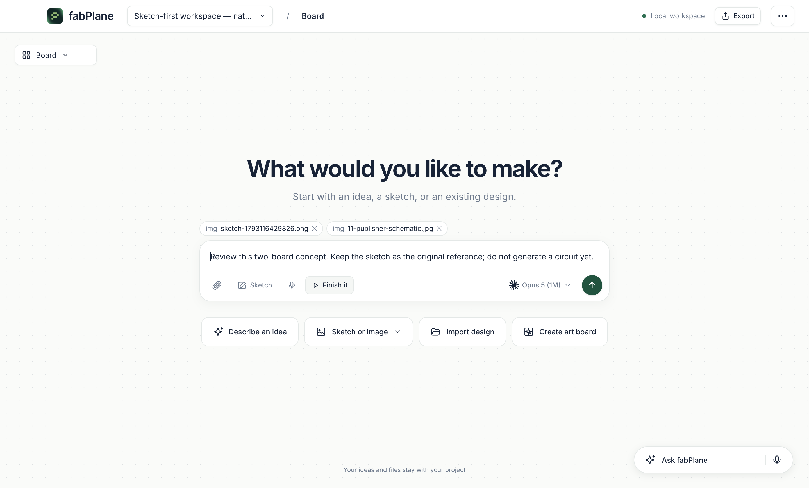

## Central Review updates and quiet project switching

Review now opens Updates alongside Changes, Comments and Checks. It brings the qualified saved PCB preview, GLB, generated-case and DRC source signals together. Each row has its own deliberate next action: update a preview/model, inspect case controls, open Checks or browse saved outputs. Opening the view only reads state. Other outputs stay explicitly untracked; matching source is separate from electrical/fit correctness. Missing source files or unverified receipts do not become a complete-system pass.

Native validation changed one PCB whitespace byte while keeping size and mtime, observed the preview and case warnings together, then explicitly updated only the preview. Its receipt matched the changed source while the GLB and case bytes stayed unchanged and the case warning remained. Original PCB/SVG/receipt bytes and timestamps were restored finally. A separate real project with schematic and PCB confirmed Ask about sync direction appends to the correct draft, retains prior text, opens the assistant and sends nothing. The draft was restored. This prepares a review question; directional native preview/apply and persistent keep-older decisions are not implemented by this view.

The fresh-start walkthrough exposed an inherited assistant pane covering a different project's canvas. Switching project now closes canvas assistant/navigation panes, preserving drafts and destination/tab restore. Selecting the same project keeps its current pane; explicitly selecting a conversation reopens the assistant. A regression test covers these cases. Native source-review captures confirm the table opens unobscured. Root typecheck and UI222/client207 suites pass. Existing classic keyboard tab indices stay unchanged; Updates is appended. Hosted push/pull remains in its existing separate feature stack, not recreated here.

## Full-suite validation cleanup

The standard root `bun run test` now exits successfully across all workspace packages and script tests. Core reports 531 pass / 26 native-environment skips; script tests report 94 pass. The installed-fork native placement-lock and imported-outline save/reopen tests were also run separately and passed (2 tests, 23 assertions). Earlier full-suite failure entries above record historical outcomes rather than the current result.

The broad check caught the MCP discovery test's old tool counts after adding `pcb_resize_outline`; the updated HTTP test verifies the new tool is listed. macOS retention fixtures now use the canonical temporary root instead of the OS `/var` symlink alias, retaining the production symlink-ancestor deletion protection and deliberate attack fixtures. The queued-message test counts only its own thread's events, excluding asynchronous completions from earlier stopped fake adapters. The npm workflow test uses canonical paths too. These are test fixtures/expectations only: runtime retention, consent and publishing behavior are unchanged. Final core typecheck passes. The generated tracked Python cache was restored after testing.

## Optional PCB and schematic alongside each other

The default board workspace remains one drawing. Show schematic/PCB alongside opens an explicitly chosen comparison with independently zoomable saved previews and a resizable divider. The preference and divider width restore for that project; another project stays single-view unless comparison was enabled there. The same useful local tabs remain. Comparison is not a schematic/PCB synchronization or equivalence check, and the schematic preview's unverified freshness is visible.

Focusing a drawing reveals only its selection tools. Both drawing components remain stable while focus changes; native edits retain their captured project/source. Comment focus restoration now targets its own drawing instead of the first comment button in the document, and status styling is scoped to its own comment panel. Inactive native position/outline targets and popups hide. A real unsaved R1 proposal at X=105.1 disappeared from the inactive PCB pane's tools, returned unchanged on refocus and reset to the saved X=105 with Reload; source bytes never changed. A missing schematic is shown explicitly rather than fabricated.

Native verification used the real Game Boy study's PCB and 2.8 MB schematic SVG: independent zoom at 125%/156%, one visible selection toolbar, scoped comment close/focus and unchanged image sources. A physical divider drag produced approximately 57%/43%, and real reload restored that chosen layout. PCB/schematic/render SHA-256 values stayed unchanged. A physical window resize reached exactly 960×720; compact toolbars now sit above the corner assistant. At the 25% pane limit, icon/zoom controls and wrapped source status remain within their pane. The window was restored to 1440×870 and comparison deliberately closed after validation.

Root typecheck, subsequent UI/desktop typecheck, UI223 tests and the complete standard root test command pass: **2,075 passed / 28 skipped / 0 failed** across workspaces and script tests. Native operations documented earlier remain separate installed-fork runs. This is one board's two views; multiple independent board sources, pin-map/physical compatibility and board-scoped assembly editing remain unfinished.

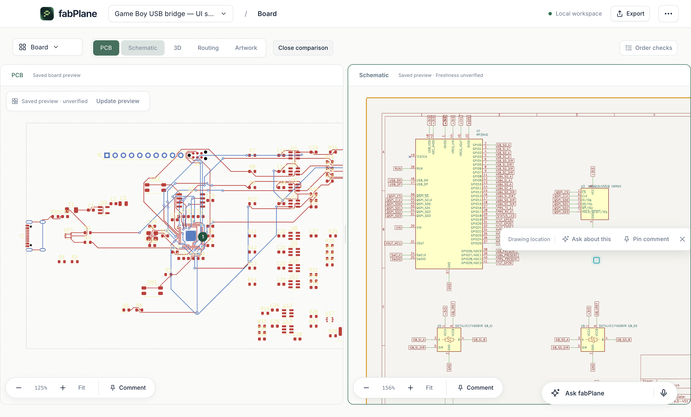
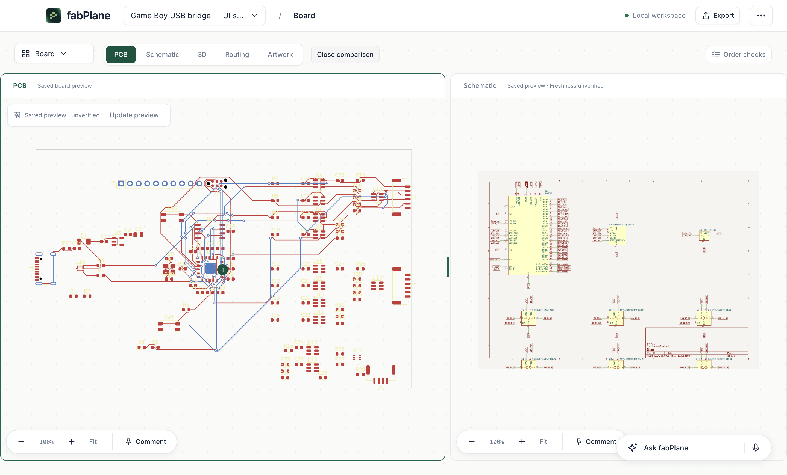
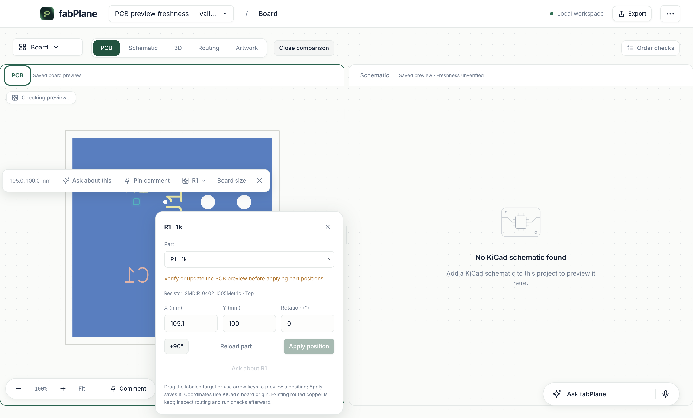

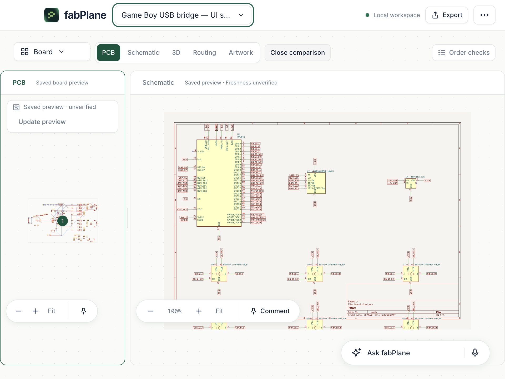

## Read-only multi-board source foundation

[Explicit source and instance contract](../../assembly-sources.md) adds typed, jailed inspection of declared board membership through the local daemon. It distinguishes repeated physical instances from editable source ownership, preserves unresolved provenance, and does not import viewer PASS labels. Unit and HTTP regression tests exercise two source directories, omitted historical variants, aliases and malformed manifests. The UI and native editing remain single-board until board-scoped ownership and job guards are complete; this increment does not present assembly editing as available.

## Live overview source signals and compact layout

The single-board overview now brings qualified PCB-preview, saved model, enclosure and DRC source changes into one **Review updates** action. Its count covers tracked artifacts only. Untracked images remain explicitly source-unverified, matching SVG receipts are labeled only as matching the saved PCB, and no regeneration or electrical/fit validation happens on entry. Saved-output counts reuse the library classifier and exclude JSON receipts/intermediate reports.

Native isolated walkthroughs detected a whitespace-only PCB source change with its file size and timestamp retained. The overview showed the two actually tracked dependent artifacts (PCB SVG and case), navigated to Review, and cleared the source warnings after restoring the original PCB. The legacy GLB had no receipt and was not assigned a fabricated currentness result. Case/model bytes stayed unchanged. The script restores source bytes and timestamps in `finally`.

SVG previews now scale within the overview rather than rendering at a tiny physical-unit intrinsic size. Selection outlines follow the preview instead of the full canvas width. The layout reserves bottom space for the closed assistant; at a physically resized **960×720** native window, one contextual toolbar stayed within the viewport, summary cards were above the assistant, and there was no horizontal overflow. Physical selection/Escape passed; the window was restored to 1440×870. The empty saved-project entry still offers idea/sketch actions with no dialog opened.

UI typecheck and all **223 UI tests** pass. The complete suite at the preceding source-inspection milestone passed 2,088 tests / 28 skips / zero failures; no backend code changed in this overview increment.

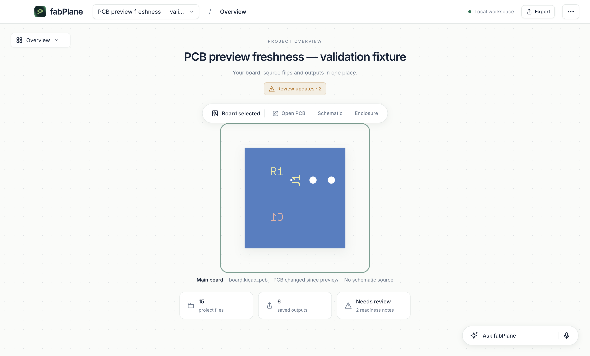
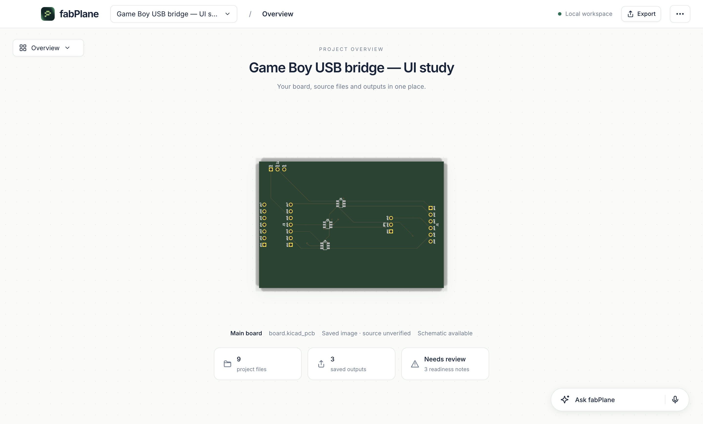

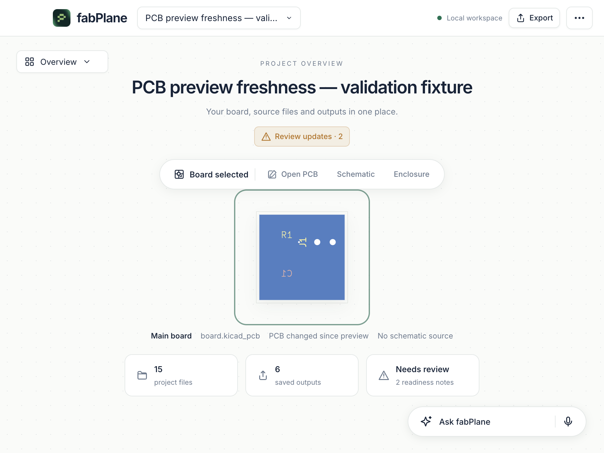
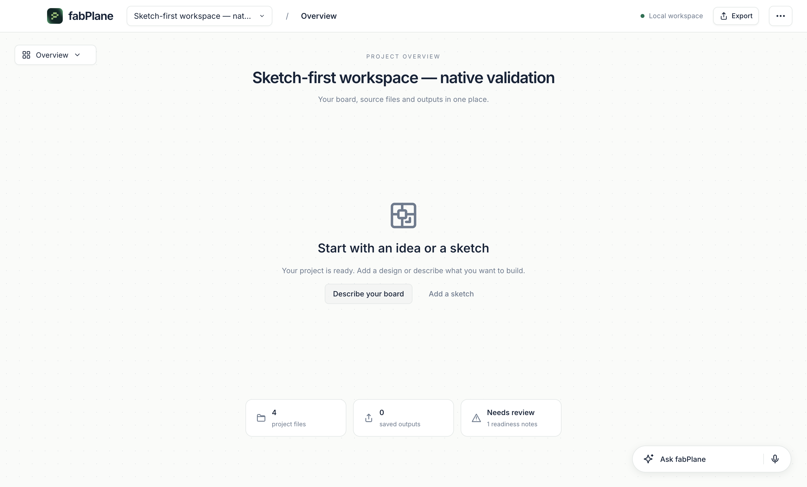

## Assembly membership in agent context

`project_status` now exposes explicit assembly sources, instances, links, provenance and inspected source hashes to the agent. Root native/build/release/DRC facts are qualified as project-root data; available source files are not described as compatible. Invalid or dangling declarations preserve an unavailable membership section instead of silently becoming an ordinary root board. Legacy single-board status remains unchanged.

An authenticated running-app walkthrough used copies of two actual native test boards, three physical instances and one unverified illustrative link. It returned exactly two declared sources, omitted an archived PCB, matched both source hashes, and exposed the same membership through agent status. An invalid manifest returned HTTP 400 for inspection and unavailable membership for status. Source originals were unchanged and the valid declaration was restored. This tests context/ownership inspection, not multi-board editing or cable correctness.

All **411 tool tests** and tool typecheck pass, including three assembly-context regressions and the existing registry/MCP/HTTP coverage. The full standard suite was green at the preceding source-inspection milestone (2,088 / 28 skips / zero failures); these three new tests were also exercised in the tool suite.

## Captured native board ownership before assembly editing

An internal execution guard now captures one declared source and exact manifest SHA, isolates concurrent/nested scopes, and rechecks ownership at native entry and immediately before save. It rejects wrong directories, replaced source containers, stale queued selections and native/companion aliases. Public assembly-member editing remains unavailable: transport, job, query, asset and comment scoping still need implementation. See [ownership contract and limits](../../assembly-sources.md).

The installed KiCad runtime test performed a valid 0.1 mm placement save, rejected a wrong source directory, and retained both saved bytes and a second unsaved live placement when membership changed before the next save. **1 native test / 7 assertions passed**. Guard/session/design regressions: **63 passed**; root and core typechecks passed. The complete standard suite passed **2,099 / 29 skipped / zero failures**. One earlier concurrent run hit the existing mechanical-truth test’s five-second timeout; its isolated retry passed all 18 tests, then the complete standard rerun passed without changes to that test or production exporter. The new installed-KiCad test is skipped in the ordinary suite when its native runtime is not configured and was run separately with the installed fork.

## Explicit member inspection and queued ownership

`pcb_inspect` now accepts a captured assembly source selector over HTTP, direct MCP and capability discovery. Results qualify their source through `_board` identity; native sessions use the owned leaf directory while project leases/jobs retain the parent ID. Missing/stale/instance selectors and hosts that ignore the scope fail closed. Parent default metadata cannot silently become board metadata. Unsupported native operations are blocked at an assembly root; member mutation/export/UI support remains pending.

Deferred-job regressions also reject a retargeted project and a byte-identical replacement source directory, and verify original cancellation/progress ownership. The running isolated app inspected carrier 20 mm / four edges, I/O 15 mm / one rectangle, then carrier 20 mm again. Both sources had three native parts. Source, manifest and saved preview bytes remained unchanged; only KiCad’s normal session locks appeared. No root PCB was created. [Native walkthrough results](scoped-inspection-native.json).

Root typecheck passes. The complete standard suite passes **2,112 tests / 29 skips / zero failures**, including core 548, tools 415 and protocol 93. Eighteen focused selector/transport/registry regressions passed before the broad run. No assembly editing UI is presented by this increment.

## Declared multi-board canvas and source preview updates

The overview now uses actual declared instances and saved PCB previews. One selection toolbar appears beside a board or link; no assistant or property panel opens by default. The Boards destination uses an explicit member picker. Native PCB inspection replaces the main canvas and is read-only. Ordinary single-board workflows remain available.

Installed native-app validation used two owned PCB designs, three physical instances and one explicitly unverified illustrative connector link. It checked I/O 15 × 15 mm and carrier 20 × 15 mm inspections, shared-source warnings, selected-source generation from both overview and detail, unchanged carrier files, a retained 125% detail zoom and retained graph camera. A same-length/timestamp source change triggered warnings automatically. Membership changes disabled stale selections. The 960 × 720 window had no horizontal overflow and its toolbar stayed within the window. Dark-theme contrast was visually checked; Ask prepared an unsent draft. All fixture PCB/manifest/preview bytes and the original light theme were restored. [Walkthrough evidence](assembly-overview-native.json).

Root typecheck passes. The complete standard suite passes **2,121 tests / 29 skips / zero failures**. The new helper coverage checks repeated instances, stale/missing ownership, response identity, partial geometry and member-relative preview receipts. Scoped export tests check selected-source publication, changed-membership preservation and aliased output rejection.

This is a logical assembly overview with native read-only member inspection and explicit SVG preview generation. Member editing, schematic/3D/CAD actions, compatibility validation and review anchors are still pending.

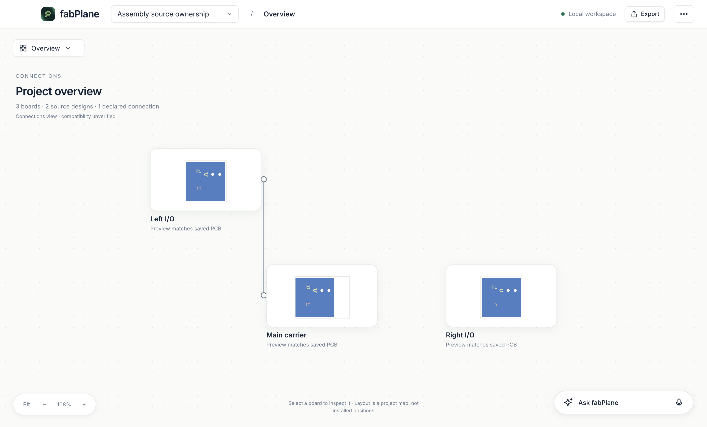
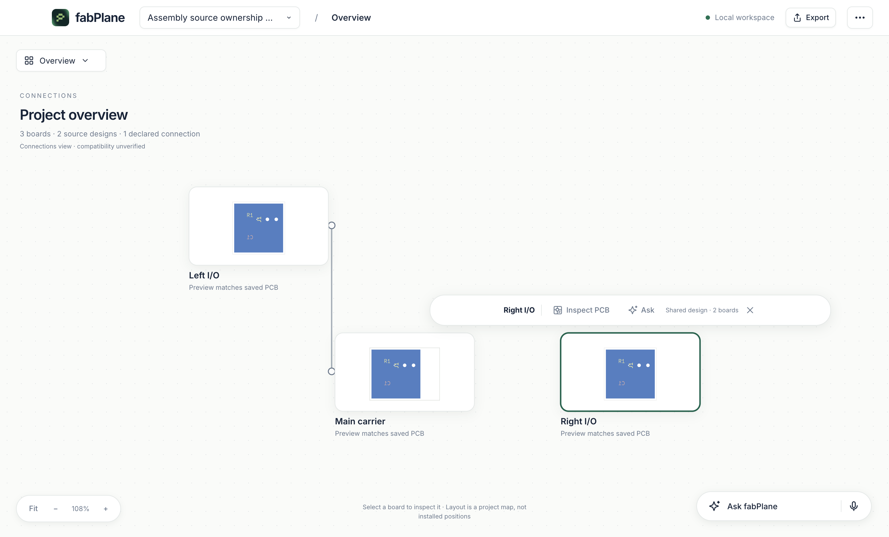

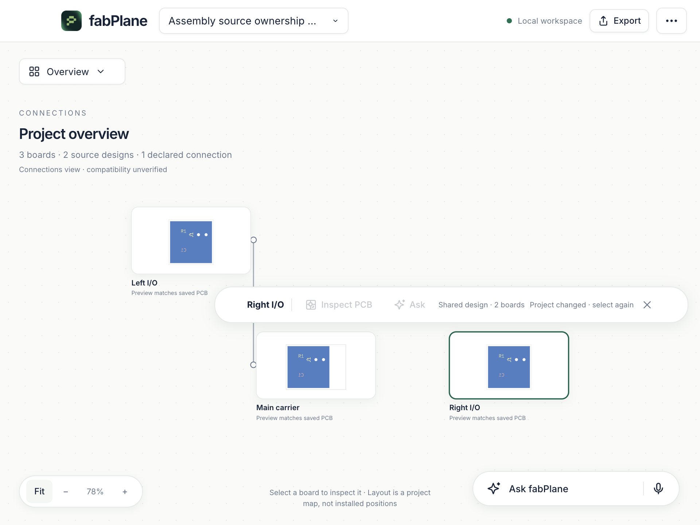

## Real VAIO source exercise and source-attention refinement

The native app now displays six explicitly declared VAIO instances and five intended links. Carrier B2.21, LCD R2.6, I/O Rev H A18, RH-A13 and battery B8.3 were downloaded at pinned GitHub commits and their PCB SHA-256 values exactly match the original viewer scene manifest. Five previews were exported from these actual native files through the scoped tool. No repository scripts were executed. This is a PCB-only read-only canvas study, not a complete project/dependency import.

The published keyboard board differs from the viewer’s recorded RevH-A1 hash. Its intended instance remains visible and explicitly unresolved; an alternative revision was not substituted. The overview’s Sources to review badge now includes unavailable source designs and changed previews, counting shared sources once. It leads to the relevant instance; Inspect PCB stays disabled until its source is owned.

The physical walkthrough selected I/O (22 native parts, 36 × 27.455 mm), selected its RH link using the keyboard, and opened RH (11 native parts; complex-outline dimensions unverified). A same-size/timestamp I/O source edit updated the canvas warning and attention count without moving the camera or regenerating any artifact. All original bytes were restored. At 960 × 720, the content-sized link toolbar stayed inside the window and below the measured heading; there was no horizontal overflow. The window was restored to 1440 × 870. [Source hashes and native evidence](vaio-canvas-native.json).

The current interconnect contract requires LCD R2.9 and rejects this viewer’s R2.6 endpoint. That mismatch is recorded in the study notes; **the UI does not yet automatically validate those contracts or surface their findings**. All links remain unverified, and viewer PASS labels were not copied. Schematics, 3D dependencies, physical alignment, battery commissioning and manufacturing checks were not exercised. This does not complete the VAIO acceptance checklist.

The affected client suite passes **215 tests** and UI suite **223 tests**, with zero failures. Root typecheck passes, followed by a UI typecheck after the final toolbar adjustment. The preceding full standard suite passed 2,121 / 29 skips / zero failures; the new attention regression adds one client test. This refinement does not change backend native-edit behavior.

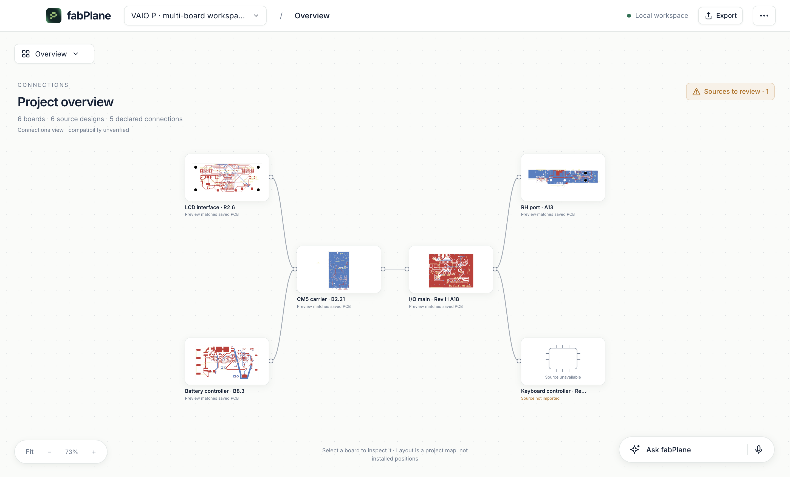

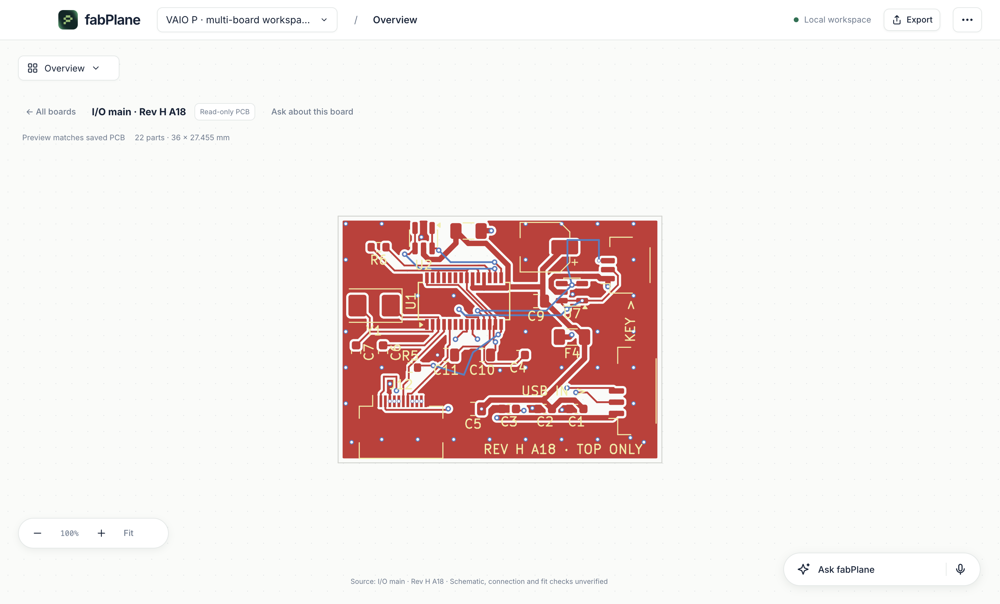
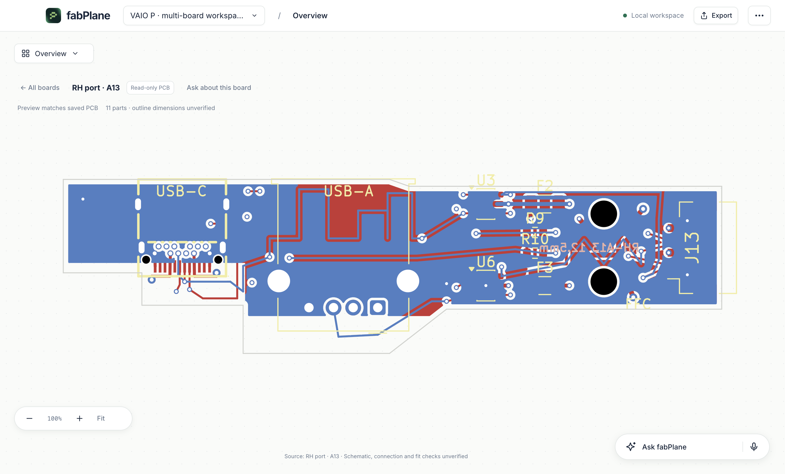

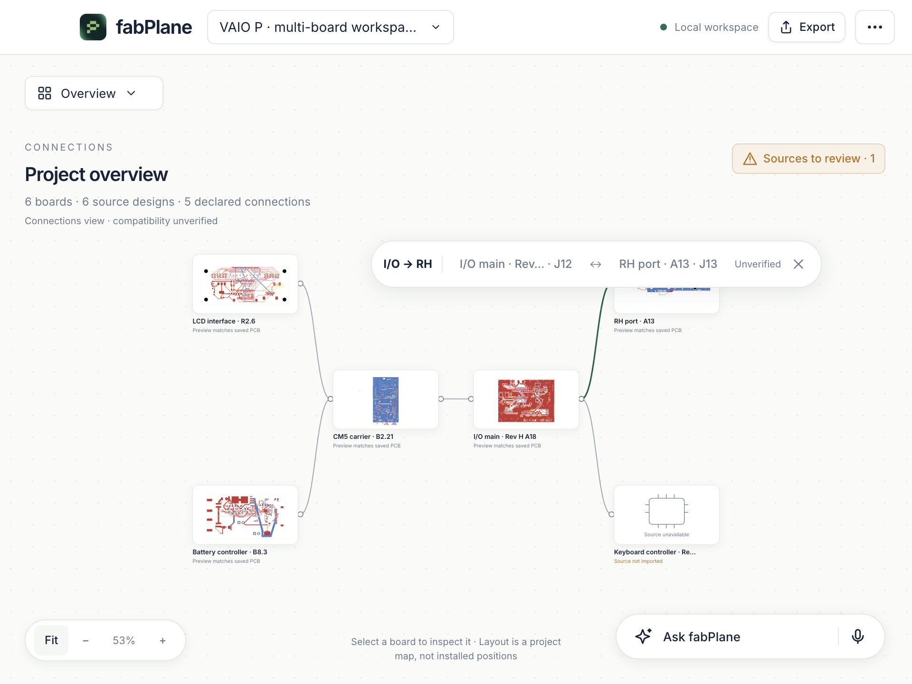

## Guarded native member placement and rectangle resize

The source-scoped tool contract now opts in `pcb_place` and `pcb_resize_outline`. An assembly selector always names a source design and captured manifest SHA, and these mutations require its inspected saved-source SHA. Shared physical instances therefore refer to the same edited source. No-selector assembly operations cannot fall back to a root PCB; unsupported tools stay blocked. Project/agent status now reports `explicit-source-tools` and names the supported operations, rather than advertising a complete member editor. Legacy single-board placement keeps its previous optional-hash contract.

The installed KiCad registry/context integration test used two independent source directories with identical native item IDs and two instances of source A. It rejected missing/stale source hashes before opening a native session, moved R1 in A by 0.1 mm with copper retained, rejected a stale resize revision, then resized A from 15 × 15 to 20 × 15 mm with its original outline ID and minimum corner. Tracks/vias/zones/nets stayed identical; resize also preserved the placed component/pad data. The other source and unrelated root PCB stayed byte-identical. Changed manifest membership and a host ignoring the selector were rejected. Native close/reopen confirmed the stored part position and rectangle coordinates. The existing ownership test also retained a saved revision and an unsaved live placement when the declaration changed before save.

**Two installed-native tests passed, 34 assertions.** The focused source/transport/status set passed 22 tests / 117 assertions. Root typecheck passed. The complete standard suite passes **2,124 tests / 30 skips / zero failures** (core 553 passed / 28 native-environment skips; client 215, tools 415, UI 223). The installed-native tests were run separately; their skipped ordinary-suite entries are not counted as native passes. An initial broad run found an HTTP assertion still expecting the earlier single-board-only assembly mode; its expectation was updated to the new limited explicit-source capability.

The canvas member inspector remains read-only. Client queries, preview coordinates, action ownership and review anchors must carry the captured source before native editing controls are exposed. Other member workflows, native replacement, undo/recovery UX and compatibility validation remain unfinished. No source in the real VAIO study was edited by this increment, and it does not establish DRC, routing safety or chassis fit.

## Source-bound member canvas editing controls

Selecting a board opens one source-bound canvas. Only clicking a verified native PCB location reveals Parts and Board size; secondary tools remain closed by default. Part/outline inspection keys, saved-source guards, mutation confirmations and preview regeneration carry the captured source and manifest SHA. Root/older or mismatched responses cannot become facts for a member. A source’s initial empty outline cannot fall through to unsupported root creation, and locked/complex native boundaries remain read-only with their actual reason.

The physical app walkthrough used the owned two-source fixture, not real VAIO files. A keyboard R1 proposal left files unchanged; Apply saved X 105 → 105.1 mm only in I/O and refreshed its matching preview. A physical corner drag proposed 20 × 15 mm without writing; Apply resized the original 15 × 15 mm rectangle while keeping the edge ID and native (100, 95) minimum corner. Placed components, pads and routed copper stayed identical during resize. Carrier files and parent metadata stayed byte-identical throughout. Both I/O instances showed the shared updated source. Switching to carrier began with no selected part and its own original R1 coordinate, not the I/O form state.

Changing manifest membership disabled a pending carrier Apply while preserving X 105.1 in the form; the carrier file stayed unchanged. Ask prepared an unsent draft naming assembly source carrier. Member post-save guidance no longer navigates to unrelated root checks, and root comment anchors are not reused. All fixture PCB/manifest/preview/receipt bytes were restored. A subsequent native inspection returned the original I/O R1 position and 15 × 15 mm geometry, confirming it did not retain stale edited-session facts. The window was restored to 1440 × 870 with secondary tools closed.

The compact-window check found that popup placement could use geometry from before the SVG finished fitting. Observing the drawing’s final size fixes that timing issue. An actual wide → 960 × 720 round trip kept the popup within the window, clear of the native drag target, with no horizontal overflow. [Native UI evidence and restored hashes](member-controls-native.json).

Root typecheck and the full standard suite pass **2,127 tests / 30 skips / zero failures**. Sixteen focused part/outline/source helper tests pass (61 assertions), including immutable captured selectors, response ownership rejection and legacy single-board behavior. After refining locked/complex rejection copy, the final UI typecheck and all 223 UI tests passed. Native replacement, member checks/comments/schematic/3D/CAD, persistent board-workspace selection and undo/recovery UX remain unfinished. No compatibility, DRC or fit pass is implied.

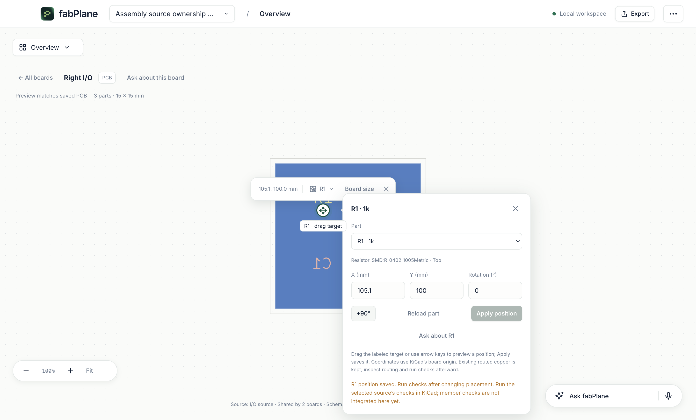

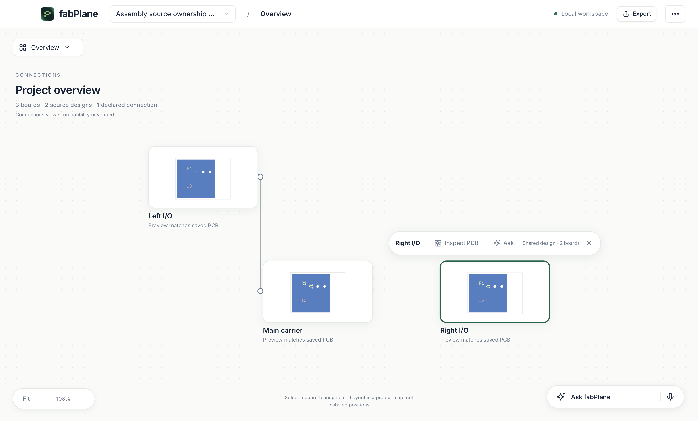

The final restarted runtime also inspected the populated VAIO I/O board through the same source controls. It displayed native F1 (1.5 A) at (88.5, 56.5) mm, rotation 180°, with Apply disabled because no proposal was made. All five imported PCB sources and saved previews remained byte-identical to their recorded hashes. The app was left on the six-instance overview with secondary tools closed. This read-only inspection is separate from the disposable fixture’s saved edits.

## Captured board workspace restoration

Boards now remembers the inspected physical instance and its captured project/source/manifest identity per project, across task navigation and full reloads. Inspect PCB opens Boards; Overview always shows the project map. All boards clears the saved selection. Restored state is validated against the current explicit declaration and availability; a changed declaration or missing source shows a reselection notice and never retargets the editor. Restoring opens neither contextual tools nor the assistant. Draft part/outline values are not persisted by this milestone.

The actual Electron VAIO walkthrough opened I/O main (22 parts, native dimensions 36 × 27.455 mm), visited Files, returned to Boards, reloaded, returned to Overview, then cleared the remembered board. Every previously recorded real-study source/preview/manifest hash stayed identical. A disposable two-source fixture then changed only declaration whitespace: after reload Boards showed the reselection warning without mounting a native editor; the original declaration bytes and timestamps were restored. This also exposed and fixed the fresh-start classifier incorrectly treating an assembly with no canonical root PCB as an empty project.

Validation: root typecheck passed; client-core **219 passed**, UI **224 passed**, zero failures with local fixture-server access. The first restricted client run could not bind its fixture HTTP servers; the permitted rerun passed unchanged. Focused restoration/ownership tests: **27 passed / 123 assertions**. No backend changes or new native board edits in this milestone. The previous full-suite and separate installed-KiCad results above belong to their recorded milestones. Actual walkthrough evidence: [board-workspace-native.json](board-workspace-native.json).

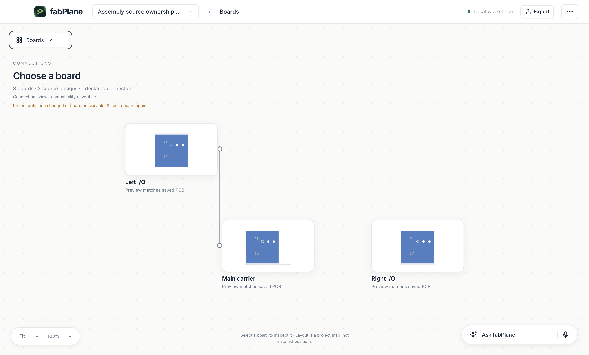

## Saved editable sketches

Drawing saves now embed the original editable scene in the PNG using the installed drawing library's supported scene metadata. The same project-owned PNG remains a chat image; no separate sidecar write can get out of sync with it. Sketch → Draw offers a Saved drawings picker only when this project has reserved scene-export filenames. Open a copy explicitly replaces the working draft after decoding succeeds; saving uses a new filename and retains previous versions. Ordinary uploaded PNG/JPEG images remain reference images and are preserved unchanged. A filename is not proof of editable content; invalid/missing scene data produces recovery guidance without replacing the current scene.

Actual native mouse/keyboard walkthrough: created a rectangle and two-line board note, saved, reloaded the full Electron renderer, reopened the disk copy, edited the restored text and saved a second version. Decoded PNG metadata confirmed both original object IDs survived and the old PNG SHA stayed identical. After another full reload, an intentionally invalid saved file failed to load; saving the still-visible draft preserved the exact object IDs, types, text and geometry of the second version. Both earlier PNG hashes stayed identical, and the created invalid fixture was removed. No agent message was sent. The reopened picker and canvas fit at the actual 960 × 720 minimum window. [Source/metadata evidence](editable-sketch-native.json).

Root typecheck passed; final UI typecheck passed. Affected suites: client-core **220 passed**, UI **224 passed**, zero failures with local fixture-server access. Complete standard suite: **2,130 passed / 30 skipped / zero failures**. A final duplicate-name filter refinement was followed by the same 220 client-core + 224 UI tests passing. The actual upload endpoint produced a byte-identical `.excalidraw-2.png` copy; this server suffix remains recognized as an editable drawing. Earlier board-workspace head `d82b9d0` passed hosted verify, mobile verify, real-board-pipeline and TraceMaker checks; the new sketch head needs its own CI.

Limits: this persists **saved drawings**. Unsaved scenes still live in memory until saved; standalone `.excalidraw` JSON import and broader embedded-image/asset walkthroughs remain unfinished. Previous plain PNG drawings cannot recover vectors they never stored. This is a user sketch, not a native PCB, schematic or verified mechanical model.

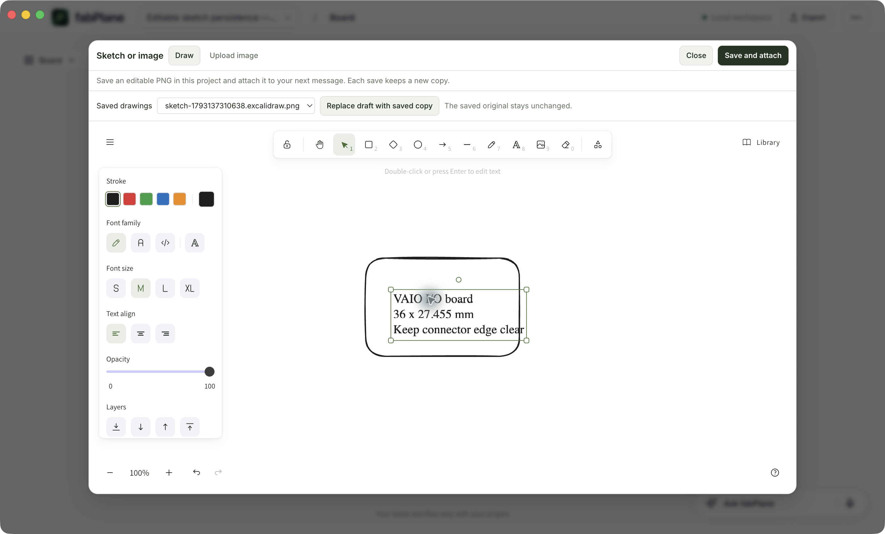

## Standalone drawing-file import

Sketch → Draw now imports an existing `.excalidraw` version 2 drawing through the native file picker. Import fully decodes a working copy before replacing the draft; it writes nothing until Save and attach. Save preserves the original file bytes under `sketches/` before uploading an editable PNG of the current drawing. An open save session reuses its successfully uploaded original when retrying a failed PNG upload. Original-source failures prevent the PNG upload; project creation/retry ownership remains captured. Source files and PNG copies both appear under Saved drawings, and reopening either does not overwrite it. Uploading an ordinary reference image also keeps a separately remembered unsaved drawing instead of clearing it.

The HTTP boundary accepts a supported drawing envelope, limits new source files to 10 MiB / 10,000 elements, rejects invalid JSON/library files/unsupported versions and keeps collision names separate. It preserves unknown fields and whitespace; the installed drawing library restores the editable objects. This structural envelope check is not PCB, schematic or compatibility validation.

Native human-style walkthrough: header → New project → named fresh project → Sketch → native macOS picker → original file. The project sketches folder stayed empty until Save. Closing/reopening the tool kept the source File with its in-memory scene. Choosing an invalid library envelope kept the valid original and working draft. After editing the text object and saving, the project contained exactly the original JSON and one editable PNG. Original SHA/bytes, whitespace and extra notes matched the chosen file; native drawing IDs survived in the edited PNG. After renderer reload, the original reopened with its original text and the PNG reopened with the edited text. Actual 960 × 720 fit passed, then the original window size was restored. No agent message was sent. [Exact preservation evidence](sketch-import-native.json).

Root typecheck passed; final UI typecheck passed after hiding the duplicate native input from keyboard navigation. Complete standard suite: **2,134 passed / 30 skipped / zero failures**. Focused envelope/client retry/HTTP tests passed, including raw-source equality, collision naming, invalid envelope and 10 MiB rejection. Earlier installed-native PCB evidence remains qualified under its own milestones; this change did not edit a PCB.

Limits: external import supports the stated version 2 envelope, not every historical or library format. Unsaved recovery was added in the following milestone. Image/asset compatibility and full sketch-to-engineering generation still need broader walkthroughs. Save is staged, not a two-file filesystem transaction: if the PNG upload fails, the preserved original may already exist and stays available for retry/reopening.

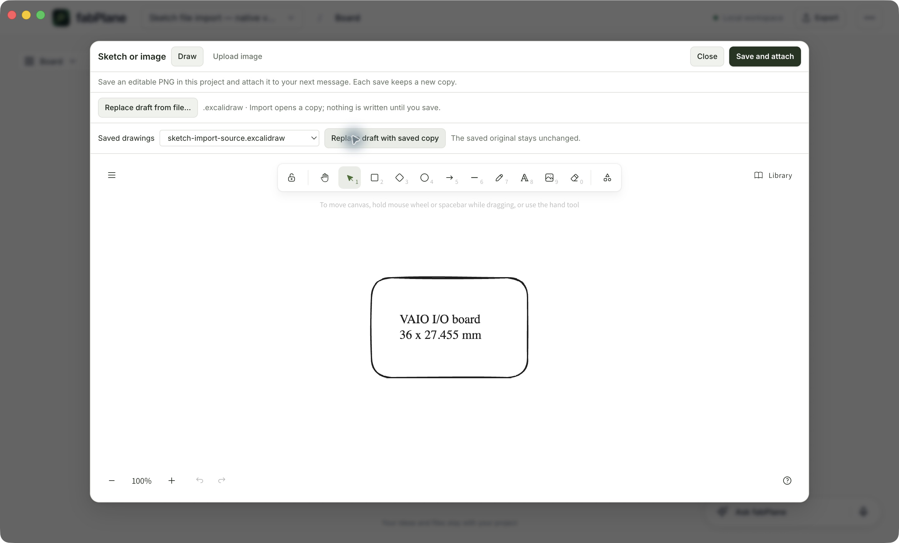
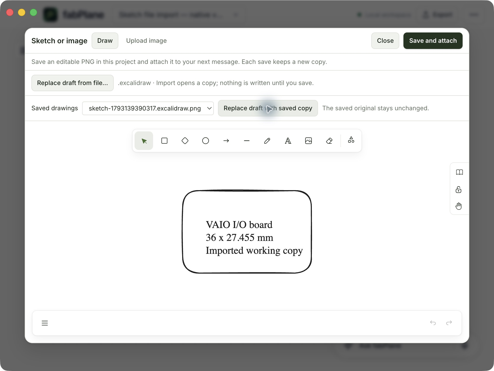

## Private unsaved sketch recovery

Drawings and their imported original File now have a private IndexedDB recovery copy, scoped to the captured connection, project and conversation. Content changes debounce for 350 ms; closing the tool flushes the latest scene. Opening checks recovery before enabling drawing/import/save, then restores through the official drawing library. Status distinguishes pending, durable and recovered drafts. Nothing is written into project files until Save and attach. Successful save removes only that draft's recovery record, after queued writes; reopening cannot resurrect an older queued snapshot. An unused blank canvas creates no recovery record. Explicit deletion of drawing content is still a content revision.

Actual native validation reloaded a drawing with unsaved text and an imported original, recovered the same object IDs/geometry/text and unchanged original bytes, then saved a new original/PNG pair while preserving earlier project files. A second project recovered its first single object independently. Saving the first did not remove the second. A simulated IndexedDB quota failure displayed a warning and retained the previous backup; normal storage was restored immediately, then a native keyboard edit successfully persisted both objects. Actual compact 960 × 720 controls remained usable; canvas zoom was used to fit the drawing. No agent message was sent. All VAIO source/preview/manifest hashes remained unchanged. [Exact evidence](sketch-recovery-native.json).

Final root typecheck passed. Complete standard suite: **2,139 passed / 30 skipped / zero failures**. New helper tests cover ownership keys, byte preservation/limits, delayed-write/cleanup ordering, quota failure/retry and first-edit/deletion signatures. Native-environment skips retain their earlier qualifications.

Limits: this is local profile storage, not project synchronization or a backup service. Abrupt exit before the debounce commits, unavailable/quota-limited storage, or clearing app data can lose unsaved work; failures tell the user to save before quitting. Ordinary reference-image upload selections are not recovered. Multiwindow concurrency, projectless adoption and broader embedded-image assets still need walkthroughs. Recovery cleanup is separate from the already-staged original/PNG project save.

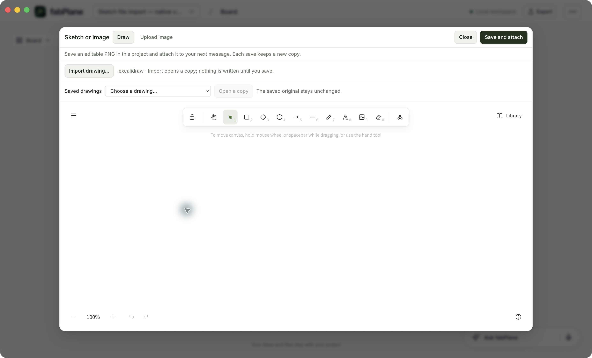

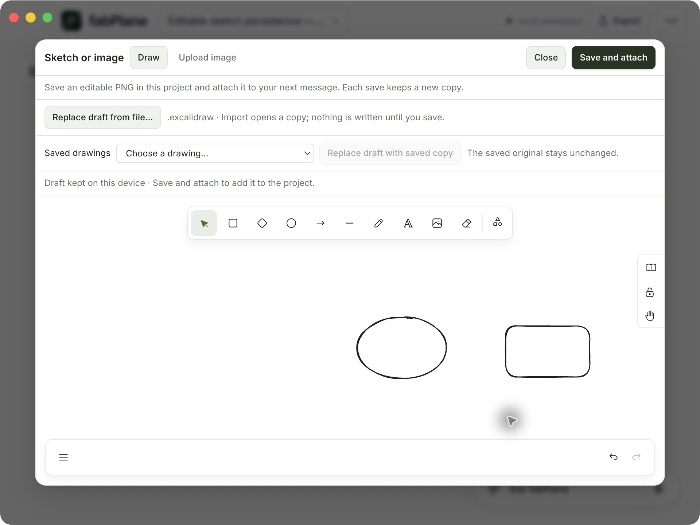

## Assembly source review

Review → Updates now selects an assembly-aware view before mounting root-board artifact queries. One row represents each explicitly declared source, with shared board instances listed together. Known preview hashes distinguish matching, changed, missing, checking and unverified states. Unavailable sources offer an unsent source-specific assistance draft. Inspect opens the captured instance/source/declaration in Boards; changed or untracked previews can be refreshed explicitly through the source-qualified renderer. Matching previews show only inspection. The view does not inherit root DRC/model/enclosure/schematic statuses as assembly results. Existing single-board review remains available; unsupported source inspection fails closed.

Actual native VAIO walkthrough showed five matching previews and one unresolved keyboard source, inspected the exact I/O board, and prepared a keyboard-specific draft without sending it. A separate three-board/two-source fixture received a whitespace-only I/O source change: one shared-source warning covered Left and Right I/O. Explicit Update preview produced a receipt matching that changed source; the carrier, PCB bytes and parent files remained unchanged. All nine fixture files were then restored byte-for-byte. Actual 960 × 720 controls passed. All real VAIO source/preview/manifest hashes remained unchanged and its quiet Overview was restored. [Evidence](assembly-review-native.json).

Root typecheck passed. Both affected suites passed: **231 client-core + 224 UI tests**, zero failures; new helper cases cover shared ownership, unavailable sources, changed/missing previews and checking/error states without stale match claims. The preceding full standard run was **2,139 passed / 30 skipped / zero failures** at the sketch-recovery milestone; it was not repeated for this frontend/helper increment.

Limits: only saved PCB preview provenance is tracked per member here. Source-qualified DRC/ERC, schematic parity, comments/diffs, 3D/model dependencies and enclosure fit remain separate unfinished workflows. Declared links and a matching preview are not compatibility passes. Warning capture below predates the final footer wording refinement; the compact capture shows final guidance.

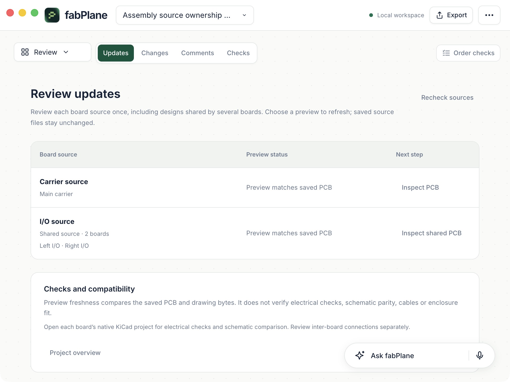

## DRC report preservation prerequisite

DRC now writes the native CLI's raw output into a temporary directory. The saved project report is replaced atomically only after native execution, enrichment, PCB/hierarchy revision checks, output-jail revalidation, captured execution-scope validation and cancellation checks succeed. CLI failure, changed source, rejected ownership or cancellation preserves the previous report bytes. Temporary native output is removed on success and failure. Existing violation counts and release-gate semantics stay unchanged; completing a check with violations remains a measurement, not an infrastructure failure.

Targeted registry tests passed: **8 passed / 60 assertions**. A separate installed fabPlane-bundled KiCad CLI walkthrough/test on a disposable mini-board copy passed **1 test / 16 assertions**: real DRC report hash matched the unchanged PCB, parity was explicitly disabled, then an injected post-CLI failure and changed-source case preserved the saved report exactly. These checks do not certify the fixture as electrically clean; geometry enrichment was stubbed in this publication test. [Reproducible native test](../../../packages/tools/test/drc-publication.kicad.test.ts) requires `FABPLANE_KICAD_CLI` and is skipped when it is absent.

Root typecheck passed. Complete standard suite: **2,143 passed / 31 skipped / zero failures**; the additional standard skip is the explicit installed-CLI publication test, run separately above. This is a prerequisite only: `verify_drc` is still not enabled for assembly members. Source-qualified report queries, hierarchy ownership and native member walkthroughs must be completed before exposing that workflow. No PCB source or real VAIO study was changed, and this increment has no new UI screenshot.

## Explicit-source PCB-only DRC backend

`verify_drc` now supports a captured assembly source selector. Member calls must include that source's inspected `expectedSourceSha256` and explicitly set `schematicParity=false`. Missing/changed revisions, implicit root execution and hosts that ignore the selector are rejected. Member schematic parity remains disabled. The report is saved under the selected source directory and carries project/source/declaration identity plus the checked PCB hash; the tool response echoes the same ownership. Project status names the limited capability separately from root facts. Staged publication preserves earlier reports when source, membership or queued-job ownership changes.

Scope/ownership tests plus an explicit installed-KiCad run passed **3 tests / 47 assertions**, including one actual CLI case. They cover required scope/hash/PCB-only choice, unchanged other/root reports, selected-source identity, changed-source and membership rejection, and queued stale work never reaching the native handler. The temporary-folder path assertion was corrected to use the canonical macOS path. Geometry enrichment is stubbed only in that isolated test.

The running native app then executed the HTTP long-running job against the disposable shared-I/O source using actual native geometry queries. It returned **8 errors, 4 warnings and 2 unconnected items**, saved the matching source receipt, and echoed the same source identity in the job result. All nine baseline source/artifact/parent files stayed unchanged. The temporary study report was restored to its previous absent state; real VAIO sources/previews/manifest stayed unchanged. No agent message was sent. [Native job evidence](member-drc-native.json).

Root typecheck passed. Complete standard suite: **2,145 passed / 32 skipped / zero failures**. The added standard skip is the explicit installed-CLI member test, run successfully above. An initial full run found the prior agent capability-list expectation; its replacement asserts the new capability and its PCB-only/non-compatibility limits, then the complete rerun passed.

Limits: this increment enables the tool/API and agent capability, not the member Checks UI. Source-qualified report queries/display and the board picker are next; root reports must not be inherited as assembly reports. Member parity/ERC, complete schematic/dependency import and inter-board compatibility remain unavailable. Checks with violations are successful measurements, not clean-board certification. No new UI screenshot accompanies this backend increment.

## Source-specific member Checks UI

Review → Checks now resolves assembly sources before mounting report queries. It starts from a valid captured board selection or asks for a source. Shared boards use one report; unavailable sources cannot be selected. Run PCB-only DRC uses the checked source hash and captured declaration, checks the returned ownership, then rereads that source's report. PCB-only scope is visible beside the board name. Board inspection and Review updates link into Checks without opening another window.

The client derives report/PCB paths from a freshly inspected, validated source declaration and rechecks ownership and PCB bytes after reading. A missing, malformed, root, different-source or older-declaration report supplies no member findings. A correctly owned report for an older PCB remains visible with a stale warning. Source-change events invalidate the report query. Normalized finding parsing now lives in client-core and retains the existing single-board API/tests. Selecting a finding expands its native item details directly beneath that row.

Actual native app walkthrough: selected shared I/O → Run PCB-only DRC → **14 findings (8 errors, 4 warnings, 2 unconnected)** → selected clearance row → native item coordinates/descriptions appeared inline. Carrier did not inherit I/O's findings; switching back recovered them. A whitespace-only PCB change automatically showed the stale-PCB warning. The actual 960 × 720 layout remained usable. A changed declaration hid findings and required explicit reselection; after reselection, the older-declaration report remained unverified. All nine source/artifact/parent fixture files were restored byte-for-byte and the temporary report restored to absent. VAIO board inspection → PCB checks preserved its exact I/O source; the unresolved keyboard option was disabled. All VAIO source/preview/manifest hashes stayed unchanged; its quiet Overview was restored. No agent message was sent. [Native evidence](member-checks-ui-native.json).

Root typecheck passed; final UI typecheck passed. Both affected complete package suites passed: **234 client-core + 224 UI**, zero failures. Focused report-scope/normalization cases passed **5 tests / 24 assertions**, including wrong/missing report ownership, changed source/declaration/directory and captured-selector mutation. The preceding full standard suite remains **2,145 passed / 32 skipped / zero failures** at the backend milestone; it was not repeated for this frontend/client-only increment.

Limits: these are per-source PCB checks. Member schematic parity/ERC, inter-board electrical contracts and mechanical fit remain unverified. The checker does not navigate findings to exact source-canvas geometry yet. Persistent keep-older decisions, all-source check summaries and report artifact-integrity receipts remain future work; a matching source hash alone is not a pass.

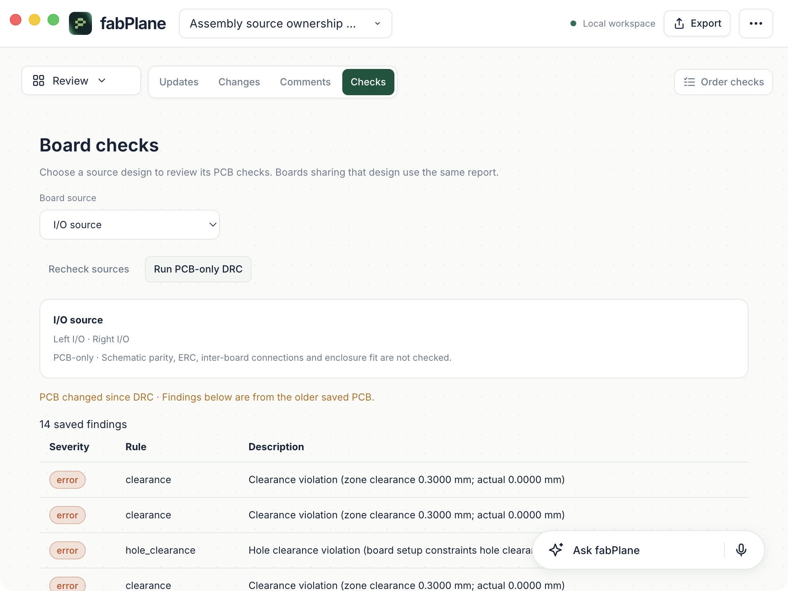

## Canvas PCB-check attention and combined source review

Assembly Overview now annotates shared board instances when their saved PCB check is older than the source, has unverified ownership, or lists findings. Attention counts deduplicate source designs across instances and across preview/check issues. Selecting a board reveals a source-bound PCB checks action. Review updates shows preview freshness and PCB-check status together, so regenerating an image cannot imply electrical checks became current.

The summary reads each declared source report once with at most four concurrent reads, applies a 10 MiB parsing limit, and performs one final source/declaration reinspection. It reuses the membership's PCB hashes instead of rereading and hashing every PCB for every member. Missing reports remain unknown coverage; unavailable sources, mismatched ownership, changed sources and transport failures never imply a pass. A current report with zero listed findings is still described as PCB-only, not assembly compatibility.

Actual native study restored the prior real I/O DRC report from the preceding walkthrough (not a synthetic result), then changed only PCB whitespace. Both shared instances showed the stale DRC warning with one source attention count. Explicit native preview refresh produced a source/artifact receipt matching that modified PCB, yet the DRC warning remained. The contextual Checks action opened that exact source. Review showed a matching preview beside the stale check, including at actual 960 × 720 size. Restoring original PCB/preview bytes then showed the real report's 14 findings on both cards. All nine fixture files were restored and the study report removed back to its previous absent state. Real VAIO source/preview/manifest hashes stayed unchanged and its quiet Overview was restored. No agent message was sent. [Native evidence](check-attention-native.json).

Root typecheck passed. Both affected suites passed: **237 client-core + 224 UI**, zero failures. New summary tests: **3 passed / 18 assertions**, covering one read per source, bounded concurrency, one final inspection, shared instances, missing/malformed/mismatched reports, source/declaration changes and transport errors. Error paths stop further batches and settle already-started reads before rejecting, so retries do not overlap an abandoned worker pool. The preceding full standard run remains **2,145 passed / 32 skipped / zero failures** at the member DRC backend milestone; it was not repeated for this client/UI increment.

Limits: the summary tracks saved PCB-only reports, not ERC, schematic parity, design-rule/model dependencies or assembly-wide compatibility. Report bodies over 10 MiB are unverified in this overview summary. Electrical-clean certification, persistent keep-older choices, artifact-integrity receipts and exact finding-to-canvas navigation remain separate work.

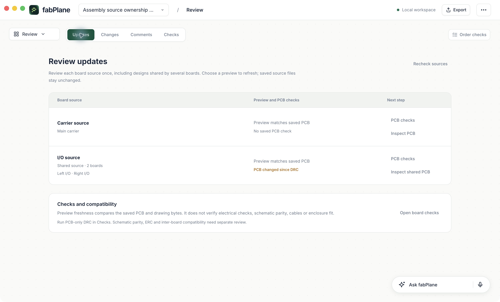

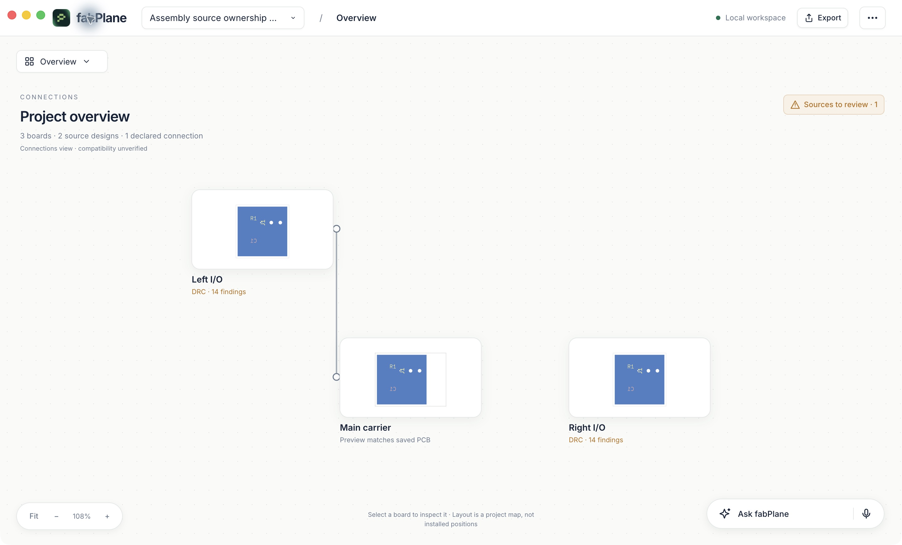

## Source-bound check finding locations

A current member PCB-check finding now offers **Show on PCB** beside each actual native item coordinate. It opens the captured source on the main canvas and preserves the selected physical instance when several boards share a design. The marker is read-only; it does not open placement/resize controls. The finding summary remains visible above the drawing, with a dismiss action and keyboard Escape. Location state is transient and clears across projects.

Navigation requires an owned report matching the current declaration and PCB hash, a finite reported item coordinate and a declared available source. At the destination, the current source hash, native SVG coordinate stamp, preview receipt and SHA of the exact displayed SVG must agree. While fetching, failed, stale, unverified or outside the saved viewBox, the marker stays hidden with an explanation. Older report details remain readable without a misleading navigation action. Marking one item location does not highlight its complete geometry or certify a design.

Native app validation restored the prior actual I/O DRC report, clicked a real clearance item's **107.000, 100.000 mm** location, and verified the marker. Changing PCB whitespace hid it automatically; a changed displayed SVG also hid it. Both were restored byte-for-byte. The older PCB report retained details but offered no Show on PCB action. Native selection of Right I/O → PCB checks → finding returned to **Right I/O**, rather than its shared Left instance. Native Escape dismissed the finding, and 960 × 720 controls remained usable. All recorded fixture and real VAIO source/preview/manifest hashes were preserved; the temporary report was restored to absent and the quiet VAIO Overview restored. No agent message was sent. [Native evidence](finding-navigation-native.json).

Root typecheck passed. Affected complete suites: **240 client-core + 225 UI passed**, zero failures. Focused navigation/store tests: **24 passed / 108 assertions**. The first sandboxed affected run could not bind local ephemeral test servers; the authorized rerun passed. Previous full standard suite remains **2,145 passed / 32 skipped / zero failures** at the member DRC backend milestone. No backend or native mutation behavior changed in this increment.

Member ERC/parity, source-qualified comments/diffs, complete affected-geometry highlighting and check artifact/dependency integrity remain unfinished. This section supersedes the earlier exact-location-navigation limitation only.

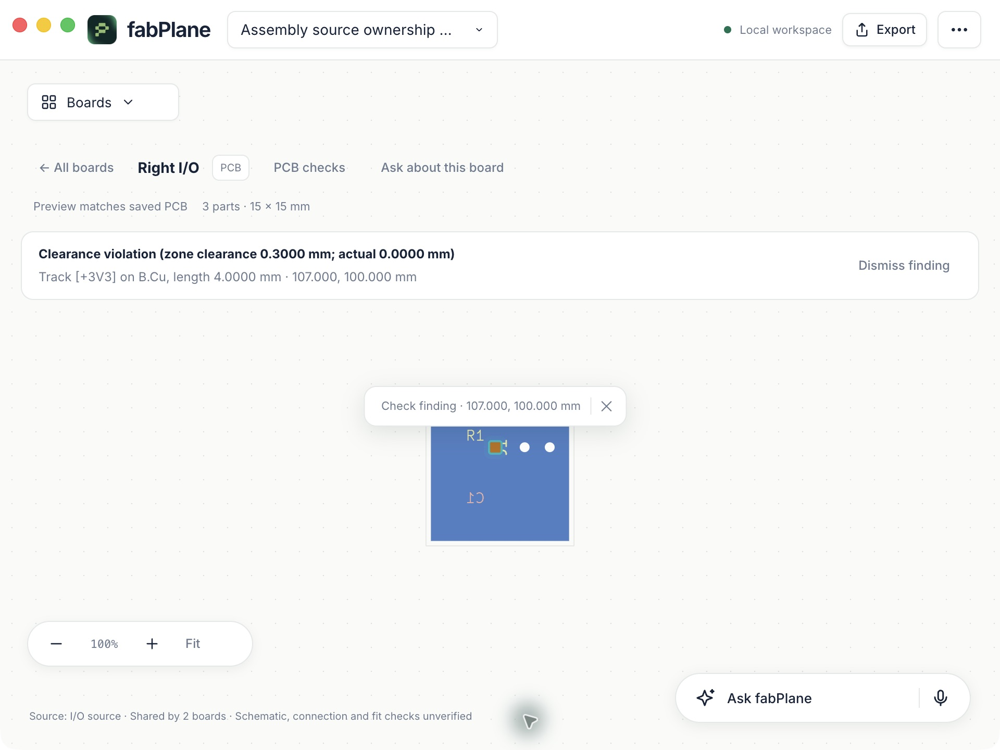

## Live saved-source PCB previews

While an assembly project remains open in the canvas workspace, a newly saved PCB hash now queues its existing tracked PCB preview for refresh. Rapid saves coalesce for 1.2 seconds; shared instances use one source job, and sources render sequentially in the mounted workspace. An initial stale preview, missing preview, manually changed artifact or unverified receipt stays an explicit user action. Errors do not create an automatic retry loop. Checks, heavy renders, models and videos are not regenerated by this queue.

Assembly preview queries include the captured PCB hash and reject a read of different source bytes, so a cached older match cannot swallow a new saved change. `render_pcb_svg` accepts an optional expected saved hash and rejects a queued render that would otherwise use newer bytes; existing during-render source and membership guards remain. The small activity notice offers View/Review and dismissal without opening a panel. View revalidates the destination and retains an owned saved physical-instance choice for a shared source. Camera, selection and unsaved native proposal fields are not reset by the background refresh.

Actual native app study: revision-guarded I/O R1 placement to **105.3, 100 mm** triggered one automatic preview job. Both physical instances updated, source/artifact receipt hashes matched, the old DRC remained stale, and the overview camera and Right I/O selection were unchanged. A genuine CLI parse failure on intentionally invalid fixture bytes retained the prior SVG/receipt and produced one failed job without retries. A separately changed SVG survived another saved source change; Review correctly showed it as unverified. A new valid save then recovered with one successful preview job. Compact 960 × 720 View opened the captured Right I/O source; activity dismissal worked. Before restoring, all jobs were terminal. All recorded fixture/VAIO hashes were preserved, the prior real DRC study report restored to absent, and the quiet real VAIO Overview restored. No agent message was sent. [Native evidence](live-preview-native.json).

Root typecheck passed; final client-core/UI/tools typechecks passed after activity-copy/navigation refinements. Complete standard suite: **2,160 passed / 32 skipped / zero failures**. Focused queue/preview/client/render guard tests: **13 passed / 44 assertions**. The generated tracked Python cache was restored after tests.

Limits: this observes changes while the assembly workspace is mounted, not a background service or a cross-window job coordinator. Initial/imported stale previews remain explicit. PCB-only automatic preview refresh does not establish schematic parity, inter-board compatibility, dependency-complete DRC or physical fit. Heavy output and historical-export freshness remain separate work.

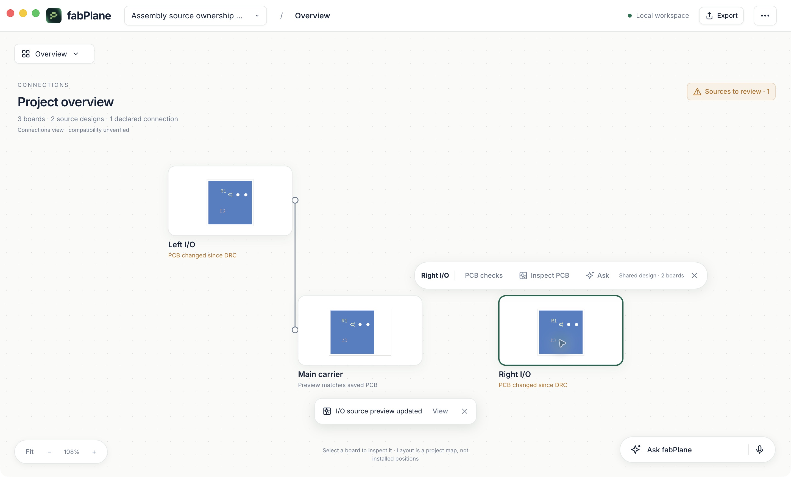

Live-preview navigation follow-up: explicit saved board selection changes now update an already open Boards detail. Background declaration/source updates still keep the active captured detail stale rather than silently retargeting or resetting it. Native validation opened Carrier, updated I/O, confirmed Carrier remained visible during automatic refresh, then clicked View and verified the I/O detail. All recorded fixture/VAIO hashes were restored again. Final UI typecheck and **225 UI tests passed**, zero failures. See the same native evidence record's crossSourceView entry.

## Source-qualified member 3D models and Outputs

Each captured assembly board now has local **PCB / 3D** controls on the same canvas. The PCB subtree remains mounted while hidden to retain proposal fields; hidden native-tool portals receive the existing visibility guard. The requested 3D view lazily loads the model renderer. Outputs → Models also offers an explicit source picker, preserves its captured source through workspace reload and requires reselection after a declaration change. Shared physical instances use the same source model. The source picker does not implicitly choose a root board.

Member `render_glb` requires the inspected saved PCB hash. Exports use the leaf board's real directory so relative model paths can resolve, then recheck saved source bytes, the output jail, cancellation and captured declaration before publication. Failures retain the prior model/receipt. The receipt records project/source/declaration, source and model hashes, export notes, and explicitly unverified external dependencies. The agent's project status names this limited capability separately from root-board status.

The client checks ownership before and after reading the leaf PCB, model and receipt and passes the **exact inspected Blob** to the viewer and download. Source, artifact and ownership changes have distinct labels. A legacy/root or older-declaration receipt cannot become a current member result. Saved unverified models remain inspectable with an explicit label; model dependencies, physical placement and enclosure fit are never inferred from a PCB hash.

The Outputs library now discovers render/export files under explicitly declared available source directories, labels their source, and excludes undeclared historical folders, blocked sources, receipts and native sources. It does not hash large models merely to fill the library; use the source-specific model view to check provenance. Assembly model creation routes to the source picker. Unsupported member image/video rendering actions are disabled rather than invoking unrelated root tools. Saved member files can still be previewed/downloaded. Full assembly alignment, enclosure fit and member video creation remain unavailable.

Model Fit view now projects the actual eight bounding-box corners into the perspective viewport instead of estimating from the largest dimension. It preserves the default orientation and reserves space for the controls; this changes the camera only. Narrow/wide viewports, flat boards and tall cases have property tests, and compact/full-size native rendering was checked.

Native study: generated the isolated I/O model through the UI, orbited it, downloaded through the native Save panel and verified byte equality. The source/member/model receipt and all original source/preview hashes matched. PCB whitespace changes marked the model stale even after the PCB preview automatically refreshed. Changed GLB bytes were unverified; changed declaration blocked actions and required explicit reselection. Carrier did not inherit I/O's model; Right I/O used the same source model. Outputs displayed the declared artifacts, and its model source survived a full renderer reload. All recorded fixture hashes and prior model-file presence were restored.

Real VAIO: native Generate 3D preview exported the exact I/O main Rev H A18 source and displayed its available board geometry at 960 × 720 and 1440 × 870. This PCB-only study lacks complete component-model dependencies; the preview is not a fully populated assembly or a fit check. Source/model/member hashes matched; all recorded real-study source/preview/manifest hashes stayed unchanged. The temporary generated model/receipt were preserved as evidence and restored to their prior absent state after all jobs were terminal. The quiet VAIO Overview was restored. No agent message was sent. [Native evidence](member-model-native.json).

Validation: final root typecheck passed; final client-core/UI suites **250 + 225 passed**, zero failures. Installed KiCad scope/publication tests **3 passed / 48 assertions**, including actual exports and retained prior output on source/declaration/queued changes. Initial focused model cases **9 passed / 1 native opt-in skip / 64 assertions**; camera properties **2 passed / 231 assertions**. The first standard suite found an outdated capability-list assertion; it was updated to include member GLB export and preserve the dependency/fit limitation. The following complete suite passed **2165 / 33 skipped / zero failures** before the final Outputs/camera refinement. The final complete standard suite passed **2,168 / 33 skipped / zero failures**. Final minor warning-color and creation-scope guard refinements also passed UI typecheck.

Remaining model work: combine member-model freshness with Overview/Review attention, dependency-complete import/receipts, assembly alignment, enclosure fit and member video/media generation. Member schematic/ERC/parity, qualified comments/diffs and native replacement/undo remain separate unfinished work.

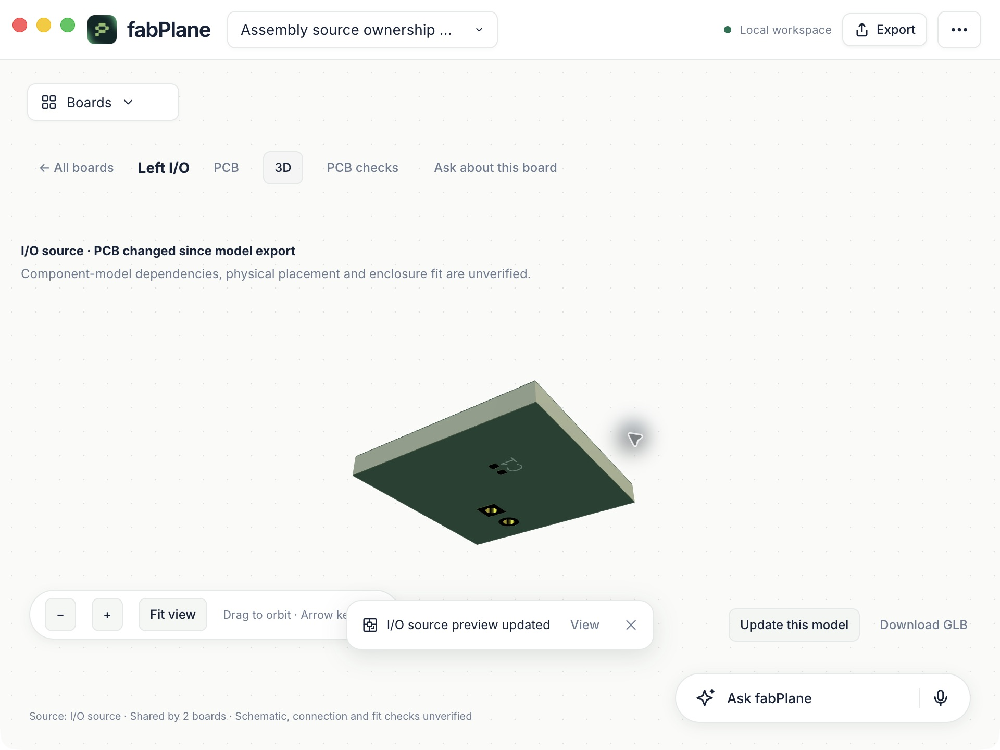

### Assembly model freshness in Overview and Review

Model receipt summaries compare the current declared PCB hash without downloading every GLB. Known source/declaration differences annotate shared boards once per source; Review keeps preview, PCB-check and model-source status separate. No receipt is unknown, and unchanged PCB source does not attest model bytes or dependencies. Contextual 3D and Review actions open the qualified source. Root typecheck and 254 client-core + 225 UI tests passed; four receipt tests include bounded concurrency, settle-before-reject and ownership changes. Native validation restored an actual earlier fixture GLB, saved its PCB, verified the automatic SVG refresh, and confirmed both shared cards retained one 3D attention count. Review/compact/source-navigation passed. Eight baseline fixture hashes, prior absent model outputs and all recorded VAIO hashes restored. No agent message sent.

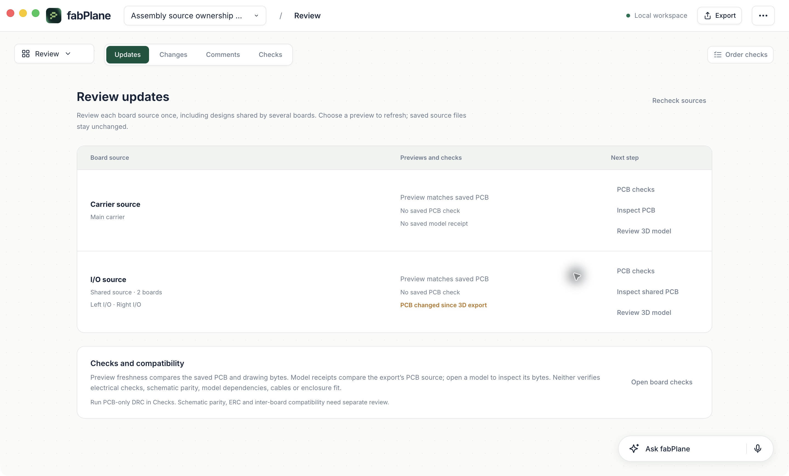

Native evidence: [model-freshness-native.json](model-freshness-native.json).
