# Canvas workspace implementation milestone

Design roadmap: [#388](https://github.com/TensorFleet/fabdesk/pull/388). Implementation continues in [#389](https://github.com/TensorFleet/fabdesk/pull/389).

Current local UI checkpoint: **2f03dae**, after16f2dcd/efe9b2c/ae4a231/f1d233a. The latest batch adds existing drill/placement/DXF/ZIP access on demand, actual ZIP missing-file feedback, a counted entry for large manufacturing sets, and keyboard context across check/finding/file/search transitions. It builds on the canvas shell, source overviews and guarded native part/rectangle tools, sketch retention, live source warnings and grouped Review/Outputs.

Final root typecheck and standard regression suite passed at2f03dae: **2256 passed / 36 skipped / zero failures**. Native proof is separate: real source-preserving exports, real DRC findings, exact-file access and compact/wide UI walkthroughs are recorded below. All48current study files remain exact after final verification, and all40original concept image hashes/dimensions are unchanged. No owned fault or export job remains active.

The real assistant sketch-to-board walkthrough remains blocked by “Claude needs you to sign in again”; human reauthentication was requested without changing credentials/provider. Native replacement/general Undo, directional reconciliation, complete VAIO dependencies/keyboard revision and hosted-stack integration remain capability/dependency gaps. Board Art Apply/polish is user-deferred; Mechanical is teammate-owned. This is a verified UI checkpoint, not completion of every original roadmap phase. All progress remains local-only; nothing was pushed or published. Historical sections below retain earlier results and limits.

## Implemented

- One primary canvas with the assistant and project/chat drawer closed by default. Project selection lives in the header. The previous shell remains available through the workspace menu.
- Task navigation groups Overview, Board, Mechanical, Parts, Outputs, Review, and Files. Existing PCB, schematic, 3D, routing, artwork, CAD, BOM, renders, files, notes, diff and checks remain reachable. Local tabs stay available within a task.
- Board SVG preview keeps its camera across source refreshes. Selecting a location reveals Ask about this and Pin comment; keyboard selection works too. These are location tools, not native footprint selection or editing.
- A project overview uses real saved files, previews and readiness responses. It currently represents the canonical single board. Saved previews may be older than source; this milestone does not certify their freshness.
- Centered fresh start offers idea, sketch/image, GitHub design import and a new artboard project. First sending creates project ownership; sketch upload preserves original image bytes and project-scoped drafts.
- A single mounted conversation/composer survives the transition into the assistant dock, including a failed initial send. Project switching restores the saved task, clears unrelated conversation context and reveals the canvas.
- Official desktop icon and fabPlane wordmark in the new header. User-facing privacy/import copy uses fabPlane.

## Evidence — initial milestone (historical)

Native Electron development app, isolated profile/core/projects; existing project sources were copied into the study project without changing the original. The board preview and saved render are separate existing artifacts and visibly differ. No new board, compatibility or freshness claim is inferred from these images.

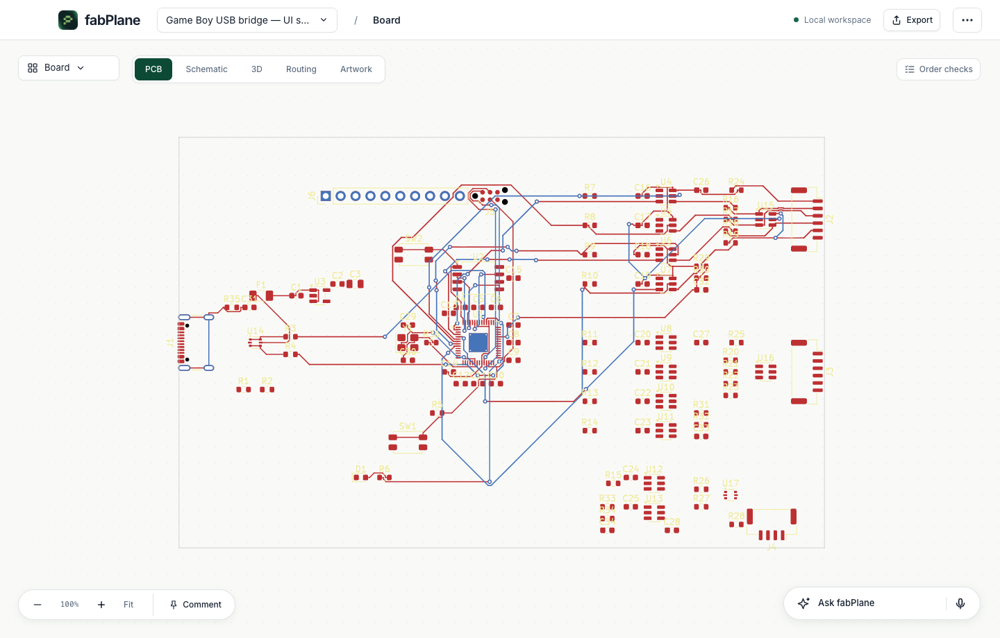

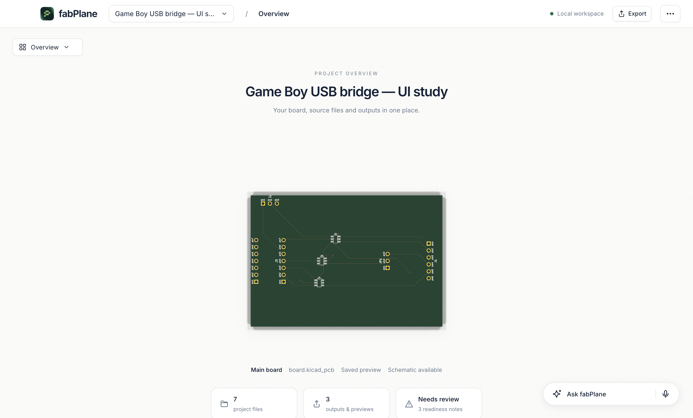

Root typecheck passes. UI tests: 217 pass. Client-core tests: 170 pass; desktop tests: 149 pass with local HTTP/process fixture access; the restricted sandbox denied two fixture servers. Native checks cover logo load, closed assistant, real board navigation, location tools, overview, project-scoped drafts and failed-first-send ownership. The full suite has the previously recorded unrelated KiCad/core failures; see [earlier validation](../sketch-first/README.md).

## Next work and limits

The initial navigation checklist below is historical; later milestones implement several of its items. The accepted roadmap is still unfinished. Remaining work includes safe native footprint replacement and recovery/undo, directional schematic/PCB reconciliation, complete output dependency tracking, uncovered source-specific workflows, and remaining human/visual acceptance. Source-qualified member editing is bounded, and no assembly compatibility or physical fit is inferred. Board Art expansion is deferred; enclosure is teammate-owned.

## Subsequent native walkthrough

All 12 existing destinations were opened in the native app: PCB, schematic, 3D/video, routing, artwork, CAD, parts/shopping, renders, changes, checks, files and notes. The assistant stayed closed and no page overflow appeared. This checks navigation and presentation, not successful execution of every backend operation.

The desktop enforces a minimum 960 × 720 window. Canvas and explicitly opened assistant fit that size. Appearance settings switched between fabPlane light and dark. A harmless comment was temporarily added to the isolated PCB SVG then restored: the preview blob URL changed automatically, while the host width and 125% zoom stayed identical.

Overview tools now appear only after board selection. The preview is labeled Saved preview; revision-based freshness remains a follow-up.

## Review comments milestone

Review now groups Changes, Comments and Checks. Comments reuse the existing project `comments.json` API and drawing pins. Active/resolved filters, resolve/reopen and source-drawing navigation are connected to saved project data. Ask about this prepares a draft containing the existing pin ID and opens the assistant; the user sends it explicitly.

A clearly labeled question was created in the isolated study project. Native walkthrough verified that resolving writes `resolved` to the server and removes the item from Active, reopening returns it, Show on drawing opens its exact selected pin/detail, and Ask about this retains the pin ID in the draft. Closing comment details restores focus to the Comment button. The assistant launcher no longer overlaps the comment-detail action area. UI tests now total 218 passing, including cross-project comment navigation isolation; root typecheck passed and the subsequent UI polish typecheck passed.

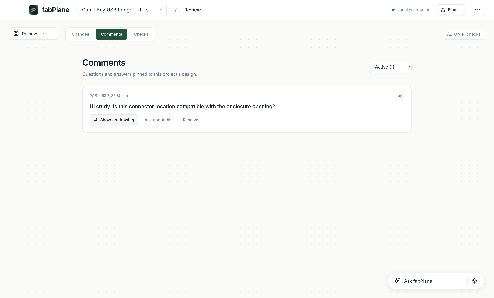

## PCB preview freshness milestone

PCB SVG exports now render an immutable snapshot and write `renders/pcb.svg.revision.json` with SHA-256 hashes of the saved PCB input and generated SVG bytes. If the source changes during export, generation fails before replacing the previous preview. The UI compares both files against that receipt and responds to the existing project-change events. It distinguishes a matching source, changed PCB, replaced SVG, missing files and absent/invalid provenance. Transport errors remain errors.

Update preview is explicit. Legacy previews stay unverified; opening the canvas does not regenerate them. A matching status covers this SVG against `board.kicad_pcb` only. It does not certify schematic reconciliation, 3D assets, renders, manufacturing outputs, electrical checks or enclosure fit. Those remain separate dependency/compatibility work.

The earlier Game Boy study file requires KiCad 10.99 while the installed CLI rejects it. That failed update stayed unverified and showed the actual error. A new isolated project using the committed `mini-two-layer.kicad_pcb` KiCad 9 fixture was rendered through the real UI action. Native validation showed matching status, changed-source warning after a whitespace edit, matching status again after explicit snapshot export, and modified-preview status after a temporary SVG comment; the SVG was restored byte-for-byte. No circuit or production project was changed. A development-core restart encountered an existing port collision; only the verified isolated app/core were relaunched to finish the walkthrough.

Checks: root typecheck passes; UI 218, client-core 175, protocol 86, tools 392 tests pass. Seven new focused tests cover legacy/invalid receipts, source change/return, altered outputs, missing files, transport failure, exact export hashes and source changes during generation (preserving the previous SVG). The draft PR's preceding comments milestone also passed its GitHub verify jobs; these new changes require their own CI run.

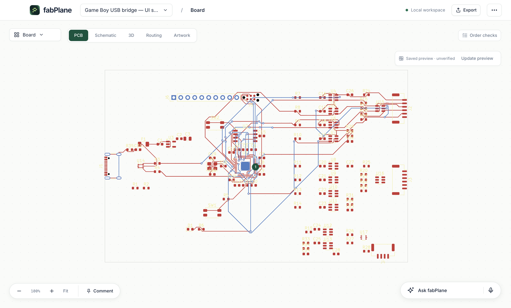
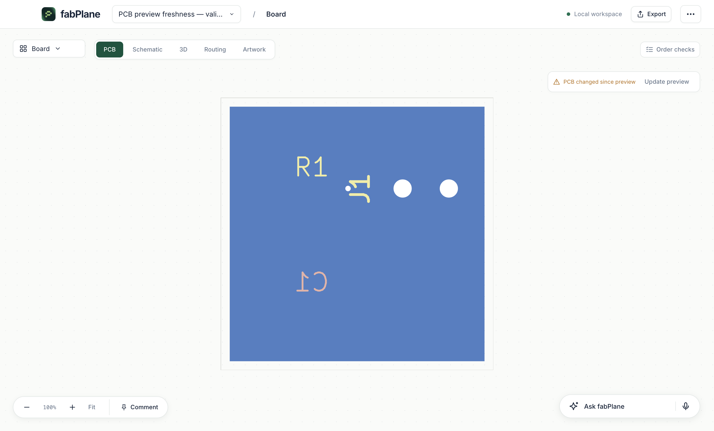

## Interactive board model milestone

Board → 3D now opens a real interactive model canvas instead of video configuration. Generate/Update explicitly exports the saved KiCad board to GLB. Orbit, zoom, keyboard pan/rotation and Fit change the view only. Video configuration lives under Outputs → Models & video, with View model and authenticated Download GLB actions. The classic fallback keeps its existing export view.

The viewer loads lazily, renders on demand, resizes with its container, retains the camera through model refresh, and disposes graphics resources when closed. Standalone model loading blocks referenced remote resources. Graphics/load failures have retry guidance. The source file remains untouched by view controls. This milestone is a viewer, not native placement/resize or a multi-board assembly editor. GLB revision/freshness tracking is not yet implemented.

Native validation used an actual CLI-exported GLB from the isolated KiCad 9 fixture, not a generated concept image or a pretend populated board. Its sparse geometry reflects the available fixture. Keyboard orbit, zoom, Fit and both directions of Board/Outputs navigation worked; SHA-256 of the GLB was identical after view actions. The download button and authenticated file path are connected; an OS save-dialog/download walkthrough remains to do. Root typecheck and UI218 tests pass. Three.js 0.186.1 and matching 0.186.0 type definitions were added with the root lockfile.

## Mechanical import and generation milestone

Mechanical now starts with two clear choices: Import a model or Generate from PCB. Advanced CAD is opened explicitly; its runtime/kernel setup does not occupy the initial canvas. Redundant single-option tab pills are hidden.

STL/OBJ imports require source-unit confirmation; GLB uses metres and STEP retains file-defined units. Originals are written unchanged under a unique project import directory, with versioned metadata (original name, format, units, SHA-256, byte length, import time and unplaced status). Metadata retries reuse the same file/path; parallel saves do not create duplicate imports. Source paths stay scoped to the captured project. No parametric conversion or fit certification is implied.

STL/GLB/OBJ files can be viewed on the canvas; STEP is preserved with an explicit preview-unavailable state. STEP editing/preview integration, physical alignment, model combination, lid display, watertightness/manufacturability validation, import cancellation, and a complete OS file-picker walkthrough remain follow-ups. STL faces are shown on both sides so reversed winding does not make surfaces disappear; this is display behavior, not mesh repair or print-readiness proof.

Existing enclosure generation/check controls, vents, snap-fits and STL/STEP downloads remain available after choosing generation. The resulting base STL can be selected on the same canvas as imported originals. The existing generator's own board-hash/alignment report is retained; live freshness warnings on the collapsed generated-case canvas are still to add.

Native isolated walkthrough: imported the repository's generated test-box STL through the actual input/change/save handlers (fixture supplied through the development bridge); Import was disabled until millimetres were selected. Original bytes and recorded SHA-256 matched exactly; metadata remained unplaced. Ran real case generation from the KiCad9 fixture: report was 21 × 21 × 16.1 mm, one cutout, zero standoffs. Both the imported model and generated STL remained selectable. This is a fixture result, not validation of arbitrary mechanical fit.

Checks: root typecheck passes; UI218/client179/protocol86 tests pass. Four new session tests cover original bytes, metadata-retry reuse and unit correction, concurrent saves/different-file rejection, and unit/format/path validation.

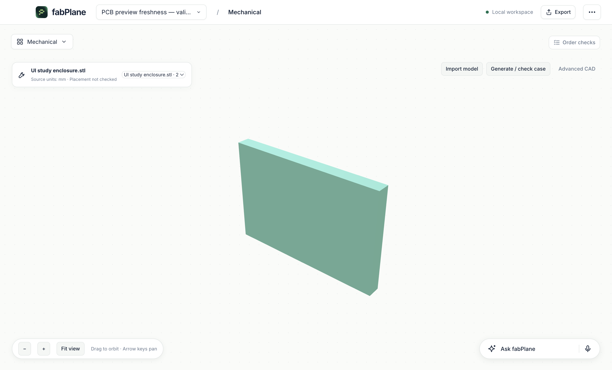

## Live enclosure source review

The generated-case canvas now warns when `board.kicad_pcb` differs from the revision recorded in `enclosure.json`. This is a negative freshness signal; unchanged source is not presented as fit/print-readiness certification. The case is never regenerated automatically.

An open generator report refreshes when project data refreshes, including same-size/same-timestamp source edits. Background refresh and explicit alignment checks preserve unsaved parameter controls. A project without a PCB can import a model; generation is disabled with guidance to add the PCB first.

Native walkthrough temporarily edited the isolated PCB while preserving its byte length and mtime. The report changed to stale and the unsaved outline offset remained 2 mm. The collapsed canvas also showed the changed-source warning; SHA-256 of the generated STL remained identical. The PCB bytes/timestamps were restored. Two added client tests cover byte identity, changed source, invalid provenance, missing PCB and transport errors. Client181/UI218 pass; root typecheck passed before the final UI guard, and affected client/UI typechecks passed afterward.

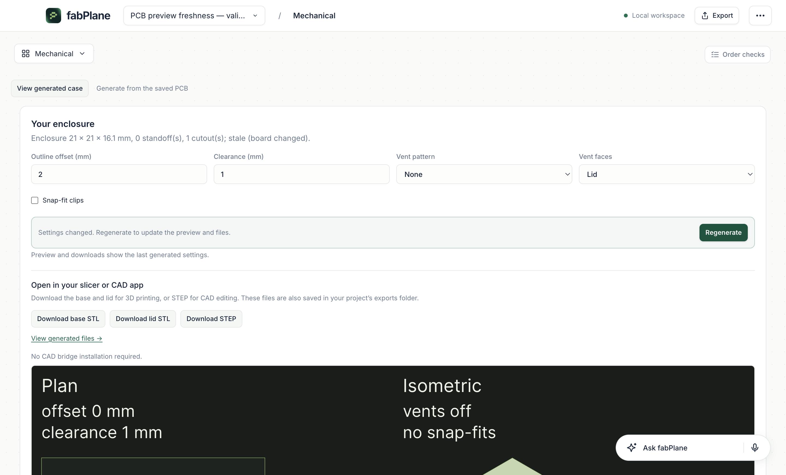

## Native placement prerequisite

Native component inspection on the isolated KiCad9 fixture returned the real R1/J1/C1 references, saved positions, rotation, layer and lock state. The existing placement tool preserves embedded geometry and routed copper by default and reports affected copper. Canvas footprint selection/movement/resize is still not presented as implemented.

`pcb_place` now optionally accepts the saved PCB SHA-256 from inspection. The native provider rejects stale source before opening a session and rechecks after asynchronous preflight; the existing native save guard handles later external writes. A conflict does not overwrite the changed disk file. Callers that omit the optional hash retain existing behavior.

Root typecheck passes. Two focused core tests prove a stale hash is rejected without opening a session, and a source edited during preflight never enters a commit or overwrites the external edit. Two tools tests verify hash forwarding and malformed-hash rejection before mutation context. Tools394 tests pass. The preceding `5774417` milestone passed both GitHub verify jobs and the real-board pipeline. A native end-to-end guarded edit and canvas controls are next, not yet certified by these mock/unit checks.

## Contextual native part positioning and coordinate verification

Select a drawing location, then Parts to inspect actual saved KiCad references nearby. The compact popup offers absolute X/Y in native PCB millimetres, rotation, a 90° shortcut, Reload part, Apply position and a part-specific assistant draft. Chat and properties remain closed by default. The popup stays within the window and scrolls when needed. Locked parts, missing/unknown coordinates, stale inspections and non-current previews cannot drive a placement. The captured project and source SHA stay attached to each edit.

A real isolated walkthrough moved R1 from (105, 100) to (105.5, 100) through these controls. Native inspection confirmed the saved position, and tracks, vias, zones and net records were identical before/after. Placement analysis reported two affected copper items, displayed with an Open checks action; this is not a DRC pass. Temporarily changing the source disabled Apply while preserving the typed value; restoring the exact source re-enabled it. The fixture and its preview/receipt were restored after the test.

Preview refresh exposed a local toolchain mismatch: the installed native editor writes PCB format 20260901, while the CLI rejects that format despite both reporting 10.99. The saved position remains saved; the preview stays visibly stale, further placement is disabled, and export details are available without claiming the preview updated. A follow-up walkthrough used the already-installed fabPlane-bundled CLI (the exact executable serving the native session) through a temporary setting in the isolated profile. Save → preview refresh → matching source/artifact receipt then passed, with the two affected-copper warning retained. The setting and fixture were restored. The default development CLI selection still chooses the incompatible host install and needs separate discovery/alignment work.

The coordinate investigation found that KiCad board-area SVG export rebases its origin. New exports use current-page mode (native coordinates), then crop only the SVG viewport to the outline plus margin. Physical scale is checked and the root receives a coordinate-frame stamp. An actual CLI integration test confirms nonzero source coordinates stay nonzero. The behavior is also documented in [KiCad's SVG exporter source](https://gitlab.com/kicad/code/kicad/-/blob/9.0/pcbnew/exporters/export_svg.cpp). Existing previews remain origin-unverified until explicitly regenerated. Earlier screenshot pin labels predate this verification and must not be treated as proof of native positions.

New pins record their coordinate frame. Legacy pins whose mixed SVG/mm fields have an unknown origin remain in Review, but are neither projected onto the verified native frame nor passed to the agent as native millimetres. No origin is guessed. Re-pinning old comments still needs a dedicated flow. Changing preview coordinate frames clears unsaved drawing selections/pins so a location cannot silently change meaning.

Validation: final root typecheck passes. UI220, client186, protocol87 tests pass; the client transport suite requires loopback permission. Three crop-coordinate unit tests and the real CLI SVG-export integration test pass. The preceding native SHA guard has tools394 tests plus two focused core conflict tests. Dragging, board resizing, replacement, multi-board ownership, persistent placement findings, and full schematic/output reconciliation remain work in progress.

## Native outline resize prerequisite

The existing outline tool now accepts an optional inspected-source SHA and checks it before opening the native document and again after asynchronous preflight. It rejects unsaved documents and refuses replacement of mixed human/tool-owned boundaries, curved/non-segment Edge.Cuts and locked edges. Exact segment comparison includes every existing edge, preventing a partial tool-owned match from hiding additional human edges. Ownership property keys remain unchanged for compatibility; visible commit/error wording uses fabPlane.

Native board-geometry inspection now includes lock and tool-owned-outline facts for the upcoming contextual controls. This is a backend prerequisite, not a shipped drag/resize UI. Unrelated silkscreen is preserved by the native transaction; arbitrary human-authored outlines still require KiCad editing.

Validation: seven new core cases cover stale-before-open, external changes during preflight, mixed ownership, curves, locks, unsaved state, and exact owned-only replacement. Two tools tests cover hash forwarding and malformed-hash rejection. Core46 focused/compatibility tests, tools396 tests, and affected core/tools typechecks pass. Tools HTTP/process fixtures require execution outside the restrictive sandbox. The preceding implementation commit's real-board GitHub pipeline passed; its verify jobs were still queued when checked.

## Contextual board-size controls

Selecting a PCB location now offers Board size beside Parts, using the same single contextual popup. Simple width/height editing is available only for a complete, unlocked, axis-aligned four-segment rectangle owned by the existing outline tool. Imported/manual, curved, duplicate, disconnected, truncated, unknown-ownership and locked cases stay read-only with guidance and Reload. Missing outlines require explicit dimensions. Edits preserve the native top-left origin; they do not scale footprints, routing or mechanical models. Apply uses the inspected SHA, and save/refresh errors remain distinct. Controls cannot switch/close during a write.

A live read-only test found that the older spatial provider does not normalize the string Edge.Cuts alias; this briefly made an imported rectangle appear empty. The client now requests the explicit native BoardLayer enum 47 from inspection v2, with a regression test. No outline was changed in that failed inspection. The actual imported rectangle is now correctly read-only.

Native UI validation used a separate empty project whose outline was created through the native outline tool at (100,95)–(115,110). Applying width 20 mm retained height 15 mm and produced exact bounds (100,95)–(120,110). Native inspection confirmed four owned segments and a current refreshed preview. Components/tracks/vias/zones/nets were unchanged; those collections are empty in this fixture, so this is not a populated-board clearance or routed-resize validation. The compatible installed fabPlane CLI was temporarily selected only in the test profile and restored afterward.

Final root typecheck, UI220/client191/protocol87 tests pass. Five client cases cover native-origin preservation, unsupported ownership/locks/curves/truncation, invalid topology/dimensions and exact layer filtering. Prior guard validation remains core46/tools396. Drag handles, populated-board resize validation and physical compatibility checks remain follow-ups.

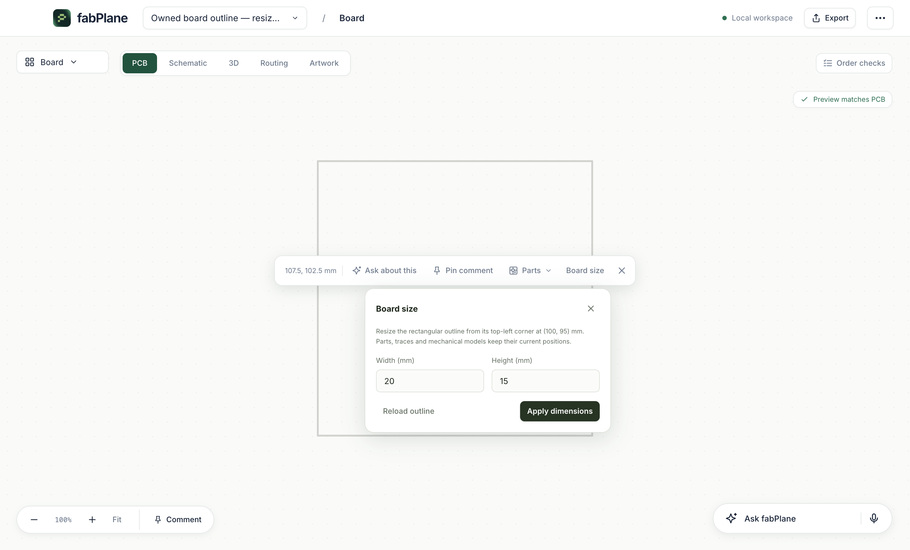

## Populated native resize and complete Checks display

A second isolated project copies the committed routed mini-board fixture. Preparation removes only its exact known test-outline rectangle from the new copy, then creates the same bounds through the native outline tool; no imported production boundary is adopted or changed. The repository fixture is untouched. Through the actual UI, width 15→20 mm preserved top-left (100,95), height 15 mm, all three components, five track/via rows, the via, the zone and all net records. The regenerated SVG receipt matches the saved PCB. This demonstrates content preservation, not clearance or manufacturability.

Real saved-PCB DRC ran afterward with schematic parity explicitly disabled: **8 errors, 4 warnings, 2 unconnected items**. The PCB source hash was identical before/after checking. No claim is made about which findings were caused by the resize because a before-resize DRC baseline was not measured.

Open checks exposed a report-format mismatch: the existing view dropped normalized `unconnected` and `schematicParity` categories. It now reads normalized and raw KiCad names without counting alias copies or nested raw payloads twice. The native view shows all **14 findings**, including the two missing connections. Loading no longer briefly labels an empty array as zero findings; an empty report no longer claims that the board passes every rule. UI221 tests and affected typecheck pass; prior final root typecheck passed for the board-size milestone.

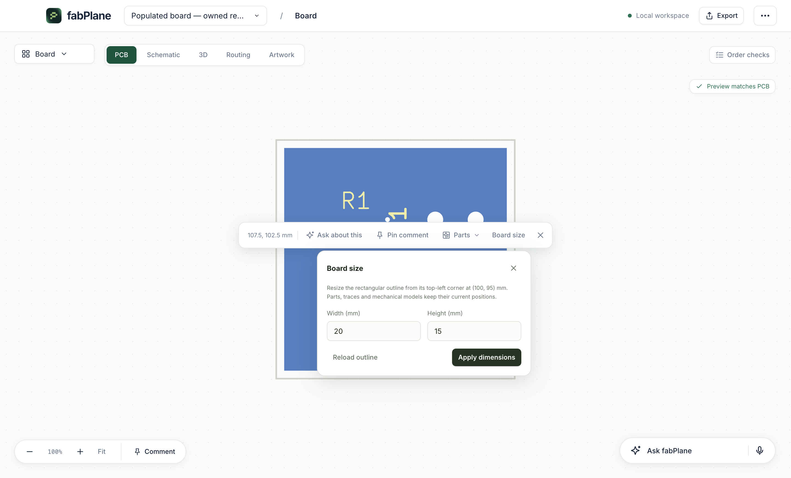

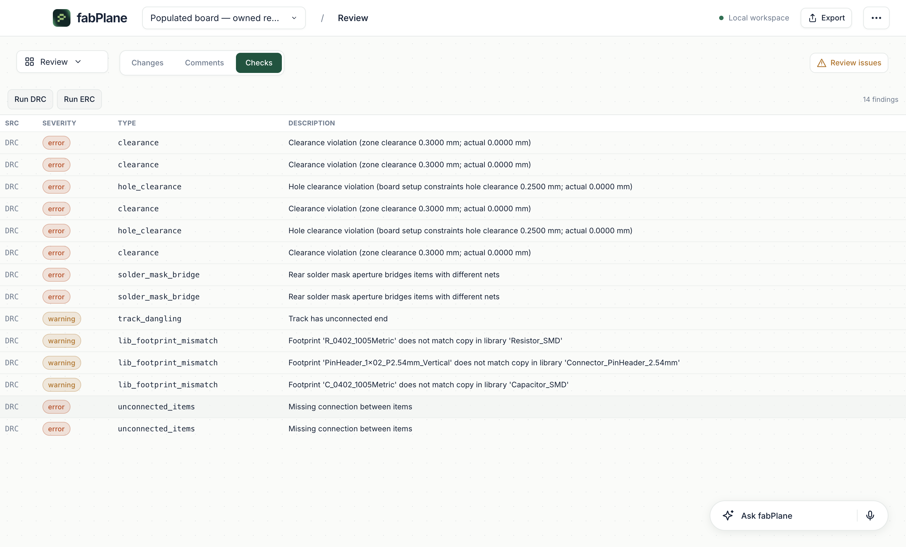

## Saved-check source warnings

Checks compares the PCB SHA-256 stored in a qualified DRC report with the current saved board bytes. A changed board produces an explicit re-run warning; unchanged bytes are described only as unchanged since the report, never as a rule-check pass. Missing/legacy/invalid provenance stays unverified and transport failures offer retry. The view also makes missing ERC and unverified schematic parity explicit; ERC freshness is not yet implemented.

Actual native validation replaced one whitespace byte in the populated study PCB while preserving file size and mtime. The source warning appeared, and hashes of the saved DRC report and SVG stayed identical: no automatic check/render was run. Restoring the exact PCB bytes cleared the warning. The original source bytes/timestamps were restored. Unit coverage includes changed/returned bytes, missing/invalid receipts, missing PCB and transport failures.

Final root typecheck and UI221/client193/protocol87 tests pass. This tracks saved PCB identity only. It does not authenticate a manually edited report, certify ERC/parity, track external library/rule dependencies or replace complete DRC freshness qualification.

## Part position targets on the canvas

Selecting an actual native reference reveals a labeled position target. Dragging proposes absolute coordinates snapped to 0.1 mm; Shift uses 0.01 mm. Arrow keys provide the same increments. Pointer cancellation restores the draft at drag start. Apply remains the only placement write; the saved footprint/copper image stays visible until the native save and preview refresh complete. This is a position target, not a live footprint-shape or DRC simulation. The popup opens beside the selection, stays within the window and retains canvas theme tokens; the target remains visible above it.

Native verification used real keyboard input plus development-bridge pointer move/up/cancel events on R1. Nudges changed the proposal, cancellation restored the prior typed position, and the board hash remained unchanged until Apply. Apply saved R1 at (105.5,100), refreshed the SVG, and retained tracks/vias/zones/nets exactly. The fixture and its preview/receipt were restored. A separate physical mouse drag through native computer control changed the proposal to X=105.4; a source-hash check proved no PCB write, and Reload restored X=105. Mouse release uses its final coordinates. Multi-pointer starts cannot replace an active drag.

Visual review moved the popup off the target and checked non-overlapping rectangles. Native position/dimension Apply is disabled while source verification is pending or a current inspection failed; cached successful data cannot keep the action enabled. Preview verification also stops showing the matching badge during a pending/error recheck. Root typecheck and UI221 tests pass. Physical drag-to-save in a populated design, broader compact-window drag/accessibility scenarios, footprint geometry ghosts, magnetic snapping, collision/clearance overlays, multi-select and undo UI remain follow-ups.

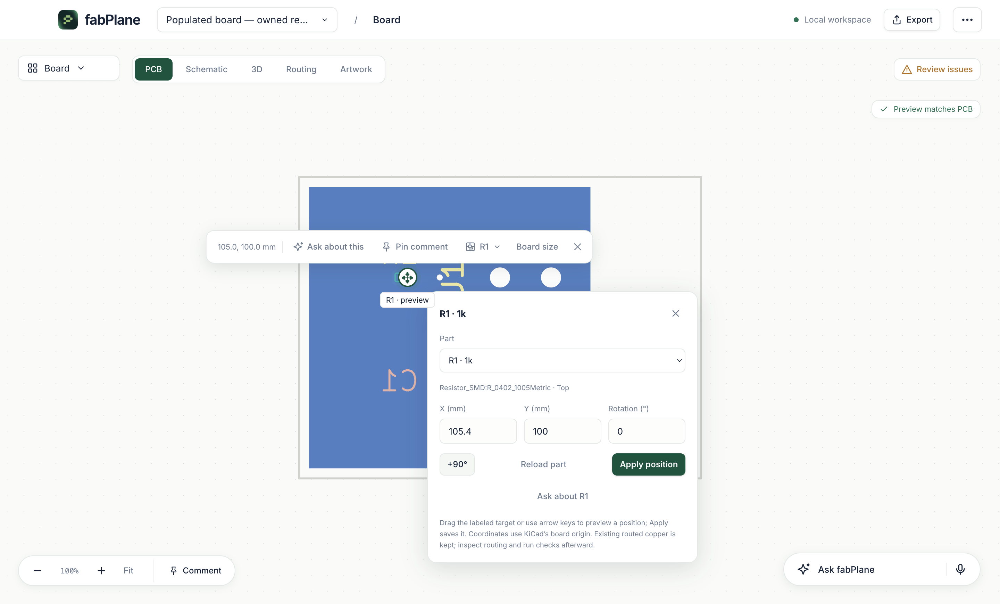
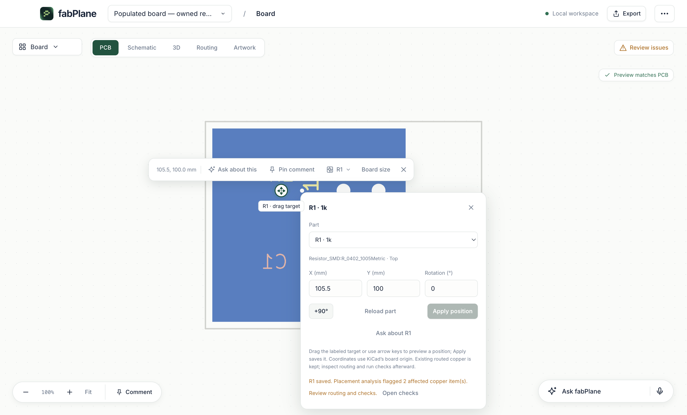

## Fine-coordinate target entry

Keyboard nudging now preserves off-grid coordinates on the untouched axis and adds the requested delta at native precision, rather than snapping both axes. Pointer dragging still uses its explicit absolute grid. A stationary target click focuses it without snapping; a small movement threshold separates focus from drag. Number fields accept valid fractional positions/angles and PCB outline dimensions, and values are captured immediately before state updates. Outline dimensions smaller than one native nanometre are rejected.

Three regression tests cover off-grid/negative coordinates, reversible nudges, and pointer-grid behavior. A native walkthrough entered (105.123,100.456789), clicked the target without movement, then nudged right and Shift-up: the resulting proposal was exactly (105.223,100.446789), the form remained valid and the PCB hash stayed unchanged. Reload restored the saved position. Root typecheck and client196/UI221 tests pass.

## Native board corner resizing

Owned rectangular outlines now have a labeled bottom-right corner handle and dashed size proposal. Mouse dragging or arrow keys updates width/height; the top-left native origin stays fixed. Pointer snapping uses that origin, so fractional native origins do not distort dimension increments. The geometry is not written until Apply dimensions. Cancellation/blur restores the draft at gesture start. Imported/complex/locked boundaries remain read-only in this milestone.

Resize mode shows one contextual dimension panel and hides the unrelated drawing-location toolbar/marker. Closing it restores the toolbar and focus. The panel stays beside the drawing and the resize target stays visible. The primary preview status shares native-save/refresh activity, preventing a duplicate manual update during this flow.

Native validation used the populated fixture: keyboard and window-level pointer gestures proposed 22×16 mm, cancellation and blur restored the prior draft, and source bytes stayed unchanged before Apply. Save retained origin (100,95), all components, tracks, vias, zones and nets; the preview refreshed to the saved source. A separate physical mouse drag and native Apply saved **21.9×16 mm** with the same preservation checks. The temporary CLI setting, source files, preview receipt and original timestamps were restored afterward.

The physical drag exposed an OS-driver/capture path where movement outside the small handle stopped reaching it. The target now tracks a single active gesture at window scope, cleans listeners on up/cancel/blur/unmount, and suppresses only the immediate post-drag click. The actual physical drag then passed. The part-target native save regression also passed using this shared engine. Final root typecheck and client197/UI221 suites pass; the added origin-relative snap case passes. Multi-edge/curved outline editing, additional anchors/aspect constraints, multi-selection, undo/recovery UI and broader platform/compact-window gesture coverage remain follow-ups.

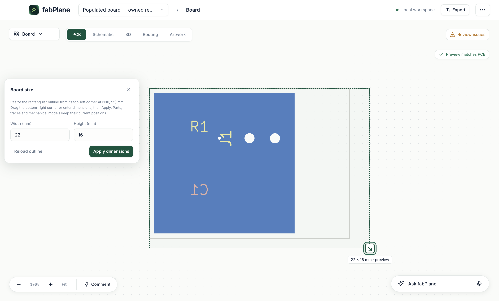

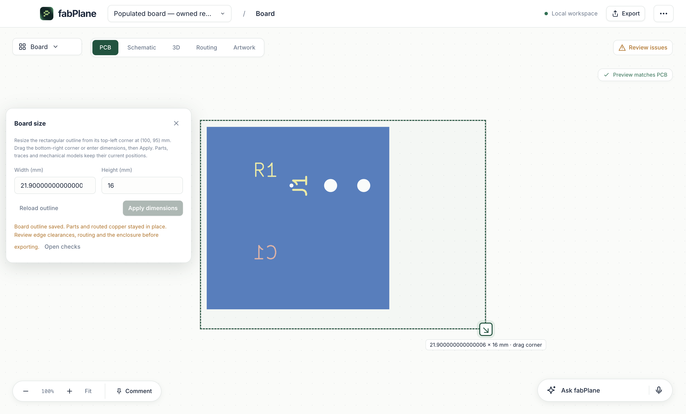

## Resize imported rectangles without replacing their native edges

Complete unlocked rectangular boundaries now use `pcb_resize_outline`: either one native rectangle or four closed, axis-aligned segments. The operation updates the existing primitives in place, retaining IDs, style and custom metadata without claiming tool ownership of imported geometry. Locked ancestor groups, missing/partial edges, curves, cutouts, unsaved documents and stale source hashes stop the write. Legacy outline creation/replacement keeps its ownership guard. UI editing additionally requires the explicit native millimetre coordinate frame and the runtime's resize capability.

A real KiCad integration test saves, closes and reopens an imported rectangle, checks its original ID, stroke and custom property, and compares components, pads, tracks, vias, zones and named connectivity. Internal numeric net codes can be renumbered on reopen and are excluded only from the net-list comparison. The native UI walkthrough resized the populated imported rectangle from 15×15 to 20×16 mm, kept its original ID and non-tool-owned status, and refreshed the matching SVG receipt. The generated enclosure then displayed a source-change warning while its STL and specification bytes stayed unchanged. Restoring the source cleared the warning. All fixture files and timestamps were restored after the walkthrough.

Validation: root typecheck; client-core 200, UI 221, protocol 87 and tools 398 tests; 52 focused core/tool checks; one real KiCad save/reopen integration test all pass. These establish source/content preservation, not clearance, enclosure fit or manufacturability. Irregular boundary editing, multiple outlines and undo/recovery UI remain follow-ups. Earlier imported-outline read-only screenshots document the previous milestone.

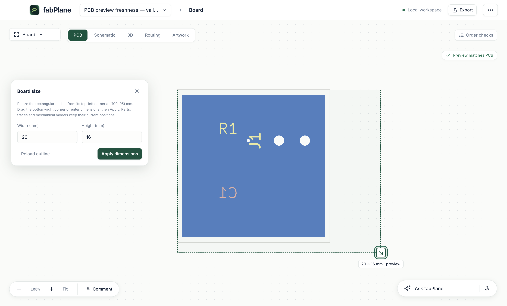

## Respect native placement locks

Component inspection now reports effective locking through ancestor groups as well as the footprint's own lock. Contextual positioning explains that the part or its group must be unlocked in KiCad. Native placement rejects geometry edits to members of locked groups before any mutation, including an attempted footprint-only unlock. A separately locked footprint can still be deliberately unlocked with the existing explicit `lock=false` tool option; unlocked groups do not block editing.

Focused placement/revision/compatibility checks: 42 pass. Real KiCad tests create and save a locked group containing an unlocked R1, confirm inspection reports it locked, reject both movement attempts (with/without own unlock), and compare saved bytes and native coordinates unchanged. The existing imported resize save/reopen test also passes. Root typecheck, final core typecheck, UI221 and tools398 suites pass. Group-aware lock coverage does not replace clearance or full editor recovery validation.

## Board model source tracking across canvas and Outputs

Board → 3D and Outputs → Models & video share source identity warnings for the saved GLB. A qualified receipt compares both saved PCB and GLB SHA-256 bytes; a replaced model cannot inherit the prior receipt. Missing/legacy/invalid provenance stays unverified. Source equality says only that the PCB bytes are unchanged since export: external component models and physical fit remain explicitly unverified. No model regeneration or video creation is triggered by a change notification.

GLB export now writes to a fresh temporary output, checks saved PCB bytes before/after the live export, and publishes the new model/receipt only after a successful write and source recheck. This also prevents an existing output from hiding a failed native exporter. The board remains in its real project during export so relative component model paths and project variables keep their resolution. Unlike the PCB SVG exporter, the GLB path does not render an immutable source snapshot, and external model changes during export are not qualified. Complete dependency tracking remains pending.

Actual native verification generated a real GLB, matched its receipt to source/artifact bytes, then replaced a whitespace byte in the PCB while retaining size and mtime. Both the model canvas and Outputs warned; the model bytes stayed identical. Restoring the original PCB cleared the warning. Fixture source/model/receipt files and timestamps were restored afterward. Tests cover failed/missing exports and source changes preserving the prior model/receipt, legacy/invalid receipts, missing inputs, replaced outputs and transport failures. Root typecheck and tools402/client205/UI221/protocol87 suites pass.

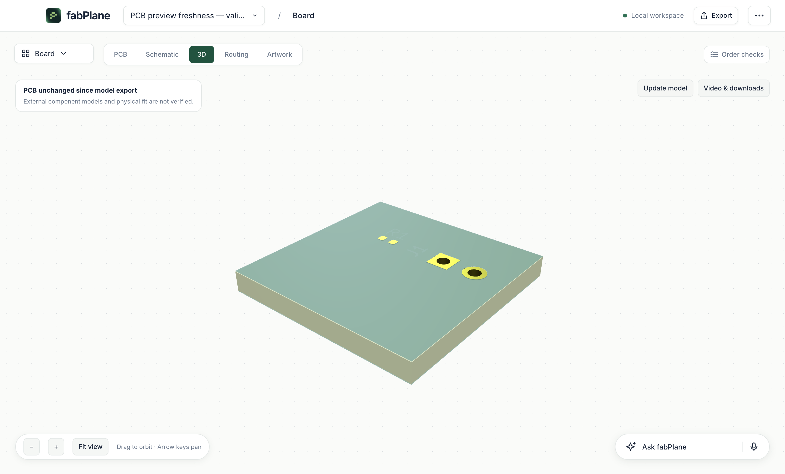

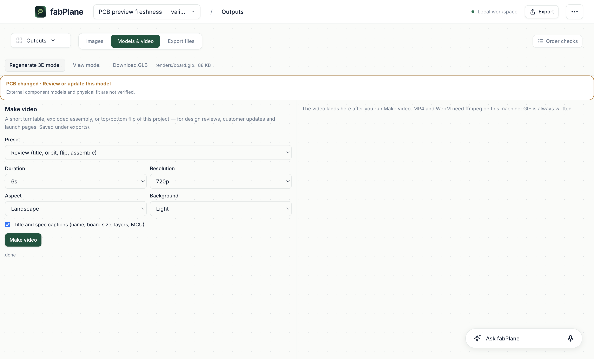

## Quiet saved-output library

Canvas Outputs now lands on a Library containing actual saved images, videos, models and manufacturing deliverables. Category filters share this library rather than opening more panels. Native sources, imported mechanical originals, reports and revision receipts do not become output cards. File paths, sizes and dates come from project files; no synthetic revision/currentness badges are added. Existing image generation, model/video settings and export file tools remain reachable through Create output and local tabs. Classic image browsing stays available.

Selection reveals one compact action bar beside the selected card, without moving the grid. Previews open only on request: saved images/videos and GLB/STL/OBJ models are supported; STEP stays download/file-only. Deselect/Escape returns focus to the card. Known PCB preview, model and enclosure source warnings update on the cards; other sources remain unverified. A matching case source does not certify mesh identity or fit. Model previews use the saved files, not substituted stock illustrations.

Native walkthrough: six real saved files, no forms/dialogs/actions on initial mount; one selected-model toolbar; actual GLB and SVG previews; Escape closes previews; Models filters four saved model files; Create output → Make video reaches the existing settings. A same-size/same-mtime PCB edit flags the SVG and generated-case cards; exact restore clears both. Source files/timestamps were restored finally. Root typecheck passed after the library integration; final UI/client typecheck and client207/UI221 tests pass after the contextual layout. Original grouping remains compatible with persisted workspace tabs. Native OS download-dialog, video creation/playback and manufacturing output exercises remain pending; this walkthrough does not claim those passed.

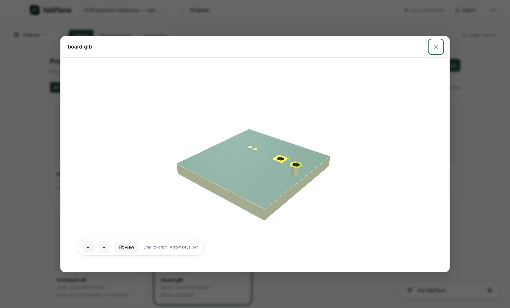

## Physical fresh-project drawing and native JPEG picker

Created a new isolated project through the header's New project dialog, then opened Sketch or image → Draw a sketch. Actual mouse drags drew two labeled concept blocks and an arrow. Save and attach produced a real 12,183-byte PNG in that project's sketches folder and left an unsent attachment in the fresh composer. The saved image was visually inspected and retains the block diagram. A typed draft and the attachment survived a real app reload. No message was sent and no circuit was generated.

Opened the native image picker, cancelled it, and confirmed Save and attach stayed disabled with no file chosen. Reopened the picker and selected an existing repository JPEG reference; native upload saved the original 74,022 bytes unchanged (SHA-256 `7b29dc306fd3d9ab94066f3ebe48b9556af67915bab65a180f58028be3cd14c7`). Both originals remain attached to the same project draft. The reference is a test screenshot, not a new circuit or agent interpretation. The vendor fixture was read only.

This closes the physical drawing/JPEG picker portion of onboarding validation. It does not implement editable scene-file persistence/import or a sketch-to-circuit run: a saved drawing is currently a PNG reference, and a new drawing starts a fresh scene after attachment. Projectless-chat migration remains explicitly deferred.

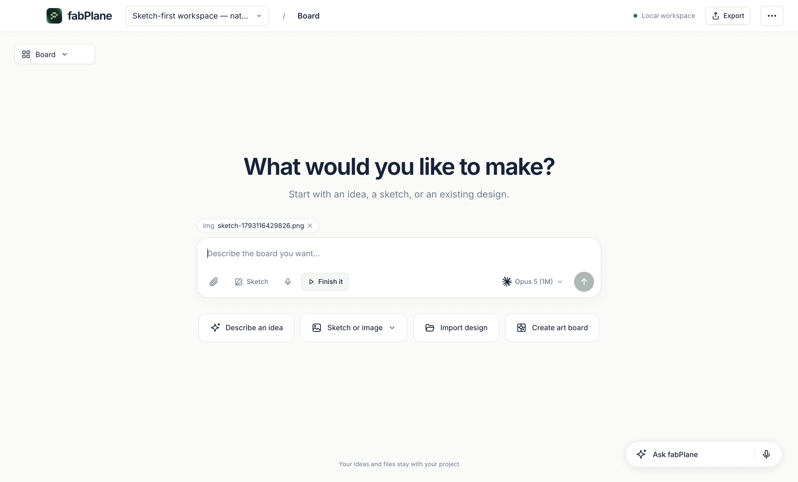
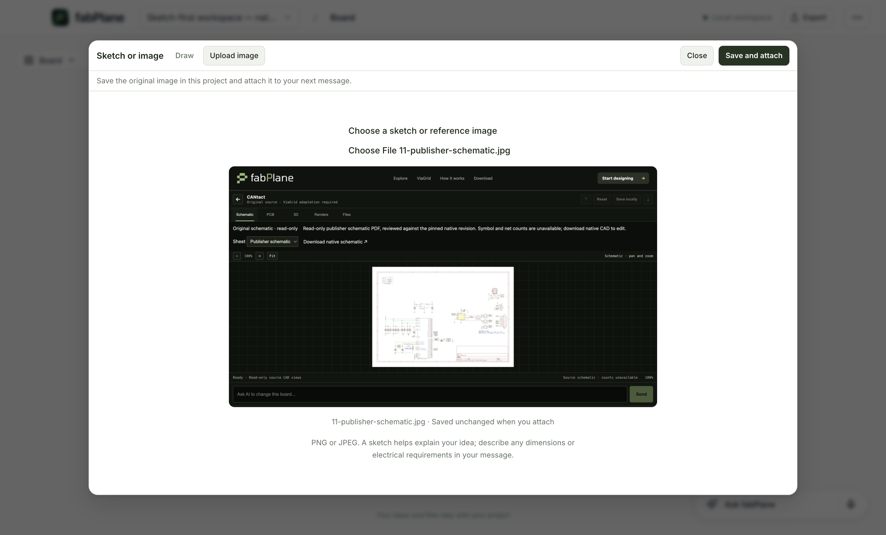

## Central Review updates and quiet project switching

Review now opens Updates alongside Changes, Comments and Checks. It brings the qualified saved PCB preview, GLB, generated-case and DRC source signals together. Each row has its own deliberate next action: update a preview/model, inspect case controls, open Checks or browse saved outputs. Opening the view only reads state. Other outputs stay explicitly untracked; matching source is separate from electrical/fit correctness. Missing source files or unverified receipts do not become a complete-system pass.

Native validation changed one PCB whitespace byte while keeping size and mtime, observed the preview and case warnings together, then explicitly updated only the preview. Its receipt matched the changed source while the GLB and case bytes stayed unchanged and the case warning remained. Original PCB/SVG/receipt bytes and timestamps were restored finally. A separate real project with schematic and PCB confirmed Ask about sync direction appends to the correct draft, retains prior text, opens the assistant and sends nothing. The draft was restored. This prepares a review question; directional native preview/apply and persistent keep-older decisions are not implemented by this view.

The fresh-start walkthrough exposed an inherited assistant pane covering a different project's canvas. Switching project now closes canvas assistant/navigation panes, preserving drafts and destination/tab restore. Selecting the same project keeps its current pane; explicitly selecting a conversation reopens the assistant. A regression test covers these cases. Native source-review captures confirm the table opens unobscured. Root typecheck and UI222/client207 suites pass. Existing classic keyboard tab indices stay unchanged; Updates is appended. Hosted push/pull remains in its existing separate feature stack, not recreated here.

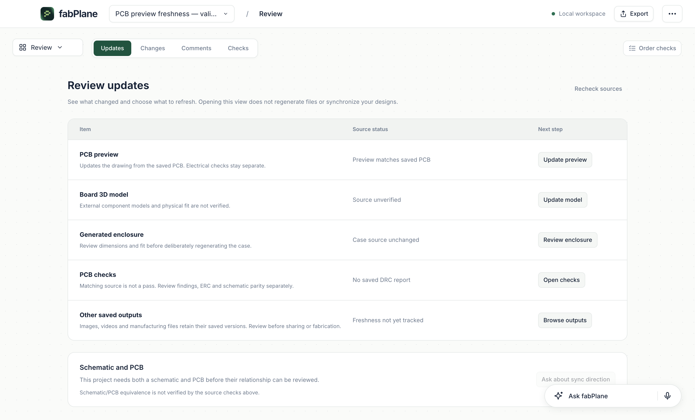
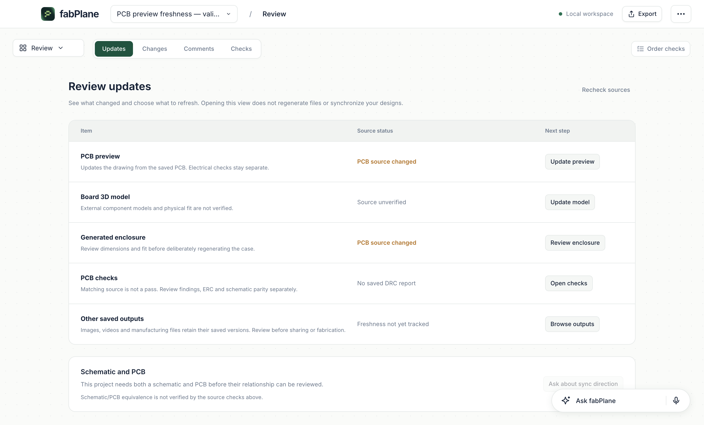
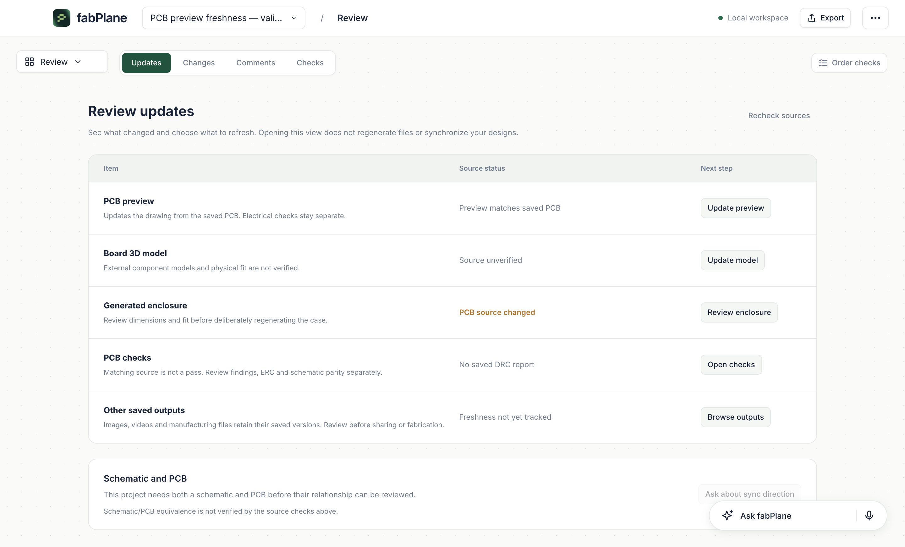

## Full-suite validation cleanup

The standard root `bun run test` now exits successfully across all workspace packages and script tests. Core reports 531 pass / 26 native-environment skips; script tests report 94 pass. The installed-fork native placement-lock and imported-outline save/reopen tests were also run separately and passed (2 tests, 23 assertions). Earlier full-suite failure entries above record historical outcomes rather than the current result.

The broad check caught the MCP discovery test's old tool counts after adding `pcb_resize_outline`; the updated HTTP test verifies the new tool is listed. macOS retention fixtures now use the canonical temporary root instead of the OS `/var` symlink alias, retaining the production symlink-ancestor deletion protection and deliberate attack fixtures. The queued-message test counts only its own thread's events, excluding asynchronous completions from earlier stopped fake adapters. The npm workflow test uses canonical paths too. These are test fixtures/expectations only: runtime retention, consent and publishing behavior are unchanged. Final core typecheck passes. The generated tracked Python cache was restored after testing.

## Optional PCB and schematic alongside each other

The default board workspace remains one drawing. Show schematic/PCB alongside opens an explicitly chosen comparison with independently zoomable saved previews and a resizable divider. The preference and divider width restore for that project; another project stays single-view unless comparison was enabled there. The same useful local tabs remain. Comparison is not a schematic/PCB synchronization or equivalence check, and the schematic preview's unverified freshness is visible.

Focusing a drawing reveals only its selection tools. Both drawing components remain stable while focus changes; native edits retain their captured project/source. Comment focus restoration now targets its own drawing instead of the first comment button in the document, and status styling is scoped to its own comment panel. Inactive native position/outline targets and popups hide. A real unsaved R1 proposal at X=105.1 disappeared from the inactive PCB pane's tools, returned unchanged on refocus and reset to the saved X=105 with Reload; source bytes never changed. A missing schematic is shown explicitly rather than fabricated.

Native verification used the real Game Boy study's PCB and 2.8 MB schematic SVG: independent zoom at 125%/156%, one visible selection toolbar, scoped comment close/focus and unchanged image sources. A physical divider drag produced approximately 57%/43%, and real reload restored that chosen layout. PCB/schematic/render SHA-256 values stayed unchanged. A physical window resize reached exactly 960×720; compact toolbars now sit above the corner assistant. At the 25% pane limit, icon/zoom controls and wrapped source status remain within their pane. The window was restored to 1440×870 and comparison deliberately closed after validation.

Root typecheck, subsequent UI/desktop typecheck, UI223 tests and the complete standard root test command pass: **2,075 passed / 28 skipped / 0 failed** across workspaces and script tests. Native operations documented earlier remain separate installed-fork runs. This is one board's two views; multiple independent board sources, pin-map/physical compatibility and board-scoped assembly editing remain unfinished.

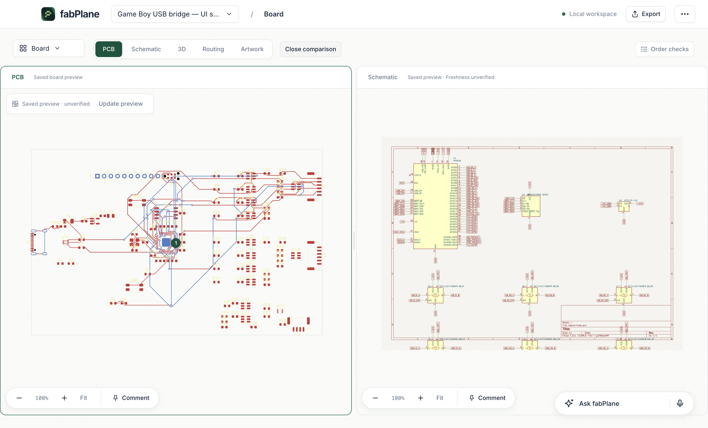

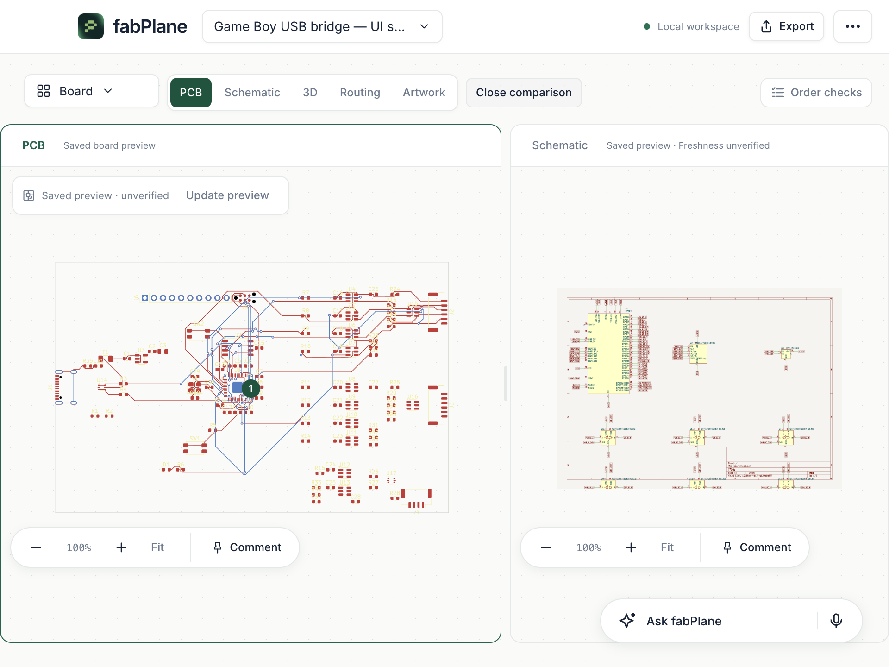

## Read-only multi-board source foundation

[Explicit source and instance contract](../../assembly-sources.md) adds typed, jailed inspection of declared board membership through the local daemon. It distinguishes repeated physical instances from editable source ownership, preserves unresolved provenance, and does not import viewer PASS labels. Unit and HTTP regression tests exercise two source directories, omitted historical variants, aliases and malformed manifests. The UI and native editing remain single-board until board-scoped ownership and job guards are complete; this increment does not present assembly editing as available.

## Live overview source signals and compact layout

The single-board overview now brings qualified PCB-preview, saved model, enclosure and DRC source changes into one **Review updates** action. Its count covers tracked artifacts only. Untracked images remain explicitly source-unverified, matching SVG receipts are labeled only as matching the saved PCB, and no regeneration or electrical/fit validation happens on entry. Saved-output counts reuse the library classifier and exclude JSON receipts/intermediate reports.

Native isolated walkthroughs detected a whitespace-only PCB source change with its file size and timestamp retained. The overview showed the two actually tracked dependent artifacts (PCB SVG and case), navigated to Review, and cleared the source warnings after restoring the original PCB. The legacy GLB had no receipt and was not assigned a fabricated currentness result. Case/model bytes stayed unchanged. The script restores source bytes and timestamps in `finally`.

SVG previews now scale within the overview rather than rendering at a tiny physical-unit intrinsic size. Selection outlines follow the preview instead of the full canvas width. The layout reserves bottom space for the closed assistant; at a physically resized **960×720** native window, one contextual toolbar stayed within the viewport, summary cards were above the assistant, and there was no horizontal overflow. Physical selection/Escape passed; the window was restored to 1440×870. The empty saved-project entry still offers idea/sketch actions with no dialog opened.

UI typecheck and all **223 UI tests** pass. The complete suite at the preceding source-inspection milestone passed 2,088 tests / 28 skips / zero failures; no backend code changed in this overview increment.

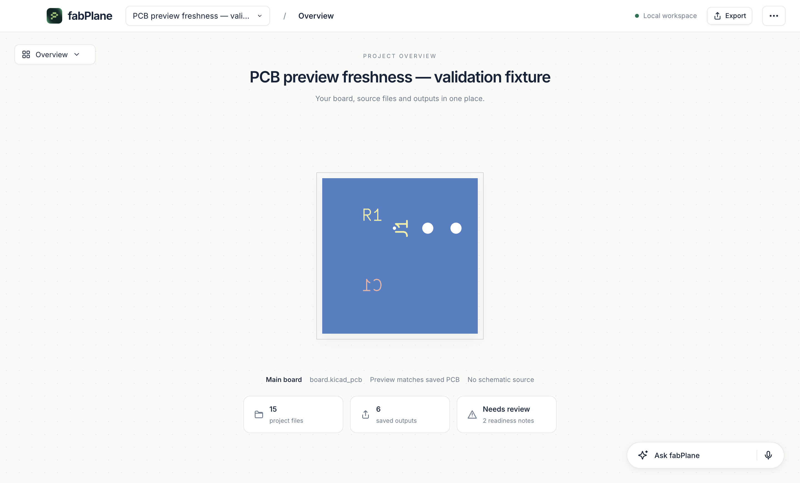

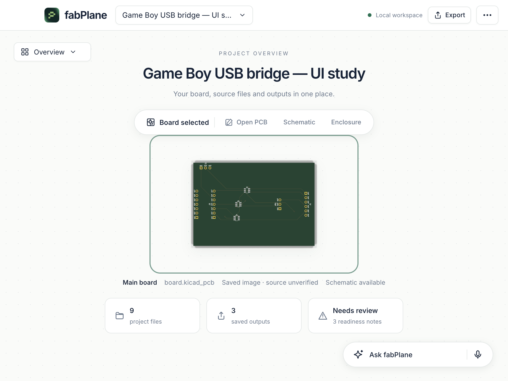

## Assembly membership in agent context

`project_status` now exposes explicit assembly sources, instances, links, provenance and inspected source hashes to the agent. Root native/build/release/DRC facts are qualified as project-root data; available source files are not described as compatible. Invalid or dangling declarations preserve an unavailable membership section instead of silently becoming an ordinary root board. Legacy single-board status remains unchanged.

An authenticated running-app walkthrough used copies of two actual native test boards, three physical instances and one unverified illustrative link. It returned exactly two declared sources, omitted an archived PCB, matched both source hashes, and exposed the same membership through agent status. An invalid manifest returned HTTP 400 for inspection and unavailable membership for status. Source originals were unchanged and the valid declaration was restored. This tests context/ownership inspection, not multi-board editing or cable correctness.

All **411 tool tests** and tool typecheck pass, including three assembly-context regressions and the existing registry/MCP/HTTP coverage. The full standard suite was green at the preceding source-inspection milestone (2,088 / 28 skips / zero failures); these three new tests were also exercised in the tool suite.

## Captured native board ownership before assembly editing

An internal execution guard now captures one declared source and exact manifest SHA, isolates concurrent/nested scopes, and rechecks ownership at native entry and immediately before save. It rejects wrong directories, replaced source containers, stale queued selections and native/companion aliases. Public assembly-member editing remains unavailable: transport, job, query, asset and comment scoping still need implementation. See [ownership contract and limits](../../assembly-sources.md).

The installed KiCad runtime test performed a valid 0.1 mm placement save, rejected a wrong source directory, and retained both saved bytes and a second unsaved live placement when membership changed before the next save. **1 native test / 7 assertions passed**. Guard/session/design regressions: **63 passed**; root and core typechecks passed. The complete standard suite passed **2,099 / 29 skipped / zero failures**. One earlier concurrent run hit the existing mechanical-truth test’s five-second timeout; its isolated retry passed all 18 tests, then the complete standard rerun passed without changes to that test or production exporter. The new installed-KiCad test is skipped in the ordinary suite when its native runtime is not configured and was run separately with the installed fork.

## Explicit member inspection and queued ownership

`pcb_inspect` now accepts a captured assembly source selector over HTTP, direct MCP and capability discovery. Results qualify their source through `_board` identity; native sessions use the owned leaf directory while project leases/jobs retain the parent ID. Missing/stale/instance selectors and hosts that ignore the scope fail closed. Parent default metadata cannot silently become board metadata. Unsupported native operations are blocked at an assembly root; member mutation/export/UI support remains pending.

Deferred-job regressions also reject a retargeted project and a byte-identical replacement source directory, and verify original cancellation/progress ownership. The running isolated app inspected carrier 20 mm / four edges, I/O 15 mm / one rectangle, then carrier 20 mm again. Both sources had three native parts. Source, manifest and saved preview bytes remained unchanged; only KiCad’s normal session locks appeared. No root PCB was created. [Native walkthrough results](scoped-inspection-native.json).

Root typecheck passes. The complete standard suite passes **2,112 tests / 29 skips / zero failures**, including core 548, tools 415 and protocol 93. Eighteen focused selector/transport/registry regressions passed before the broad run. No assembly editing UI is presented by this increment.

## Declared multi-board canvas and source preview updates

The overview now uses actual declared instances and saved PCB previews. One selection toolbar appears beside a board or link; no assistant or property panel opens by default. The Boards destination uses an explicit member picker. Native PCB inspection replaces the main canvas and is read-only. Ordinary single-board workflows remain available.

Installed native-app validation used two owned PCB designs, three physical instances and one explicitly unverified illustrative connector link. It checked I/O 15 × 15 mm and carrier 20 × 15 mm inspections, shared-source warnings, selected-source generation from both overview and detail, unchanged carrier files, a retained 125% detail zoom and retained graph camera. A same-length/timestamp source change triggered warnings automatically. Membership changes disabled stale selections. The 960 × 720 window had no horizontal overflow and its toolbar stayed within the window. Dark-theme contrast was visually checked; Ask prepared an unsent draft. All fixture PCB/manifest/preview bytes and the original light theme were restored. [Walkthrough evidence](assembly-overview-native.json).

Root typecheck passes. The complete standard suite passes **2,121 tests / 29 skips / zero failures**. The new helper coverage checks repeated instances, stale/missing ownership, response identity, partial geometry and member-relative preview receipts. Scoped export tests check selected-source publication, changed-membership preservation and aliased output rejection.

This is a logical assembly overview with native read-only member inspection and explicit SVG preview generation. Member editing, schematic/3D/CAD actions, compatibility validation and review anchors are still pending.

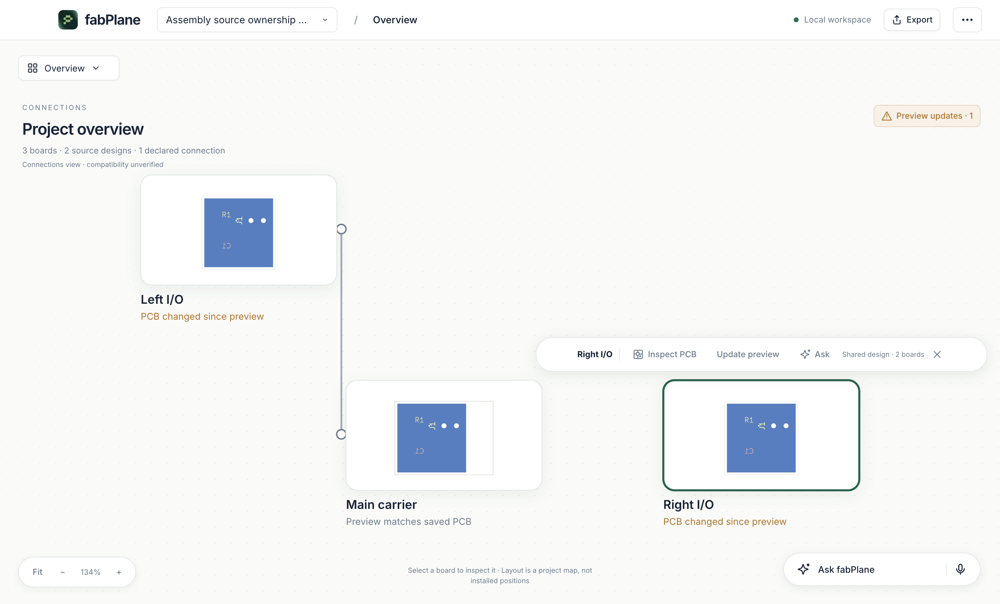
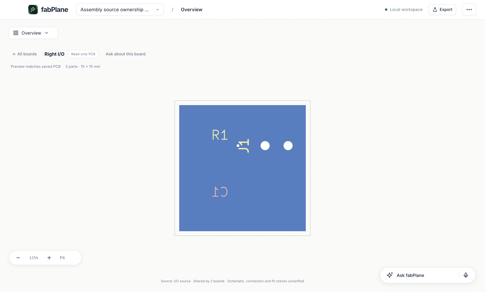
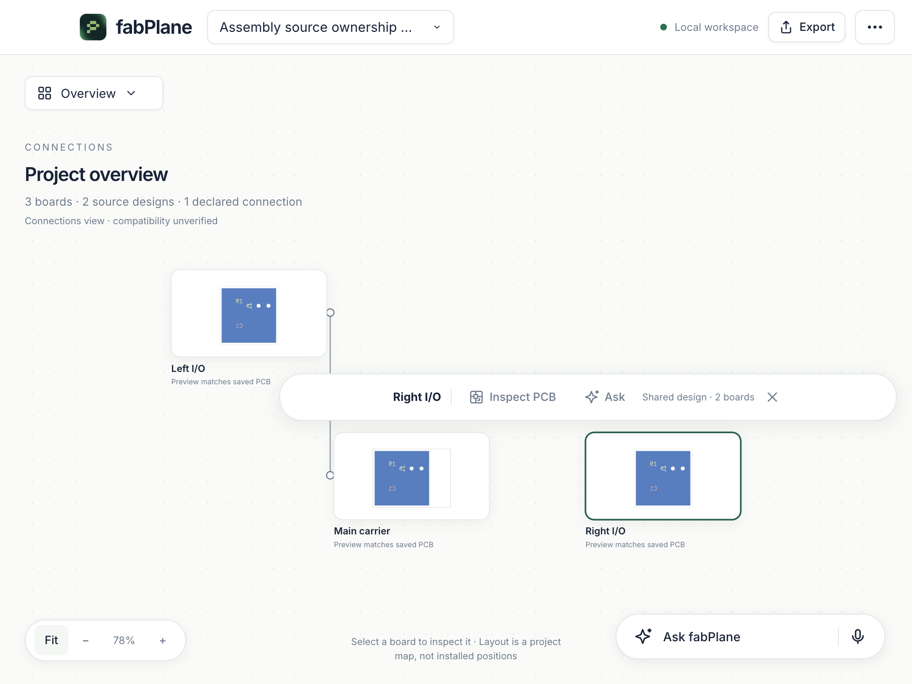

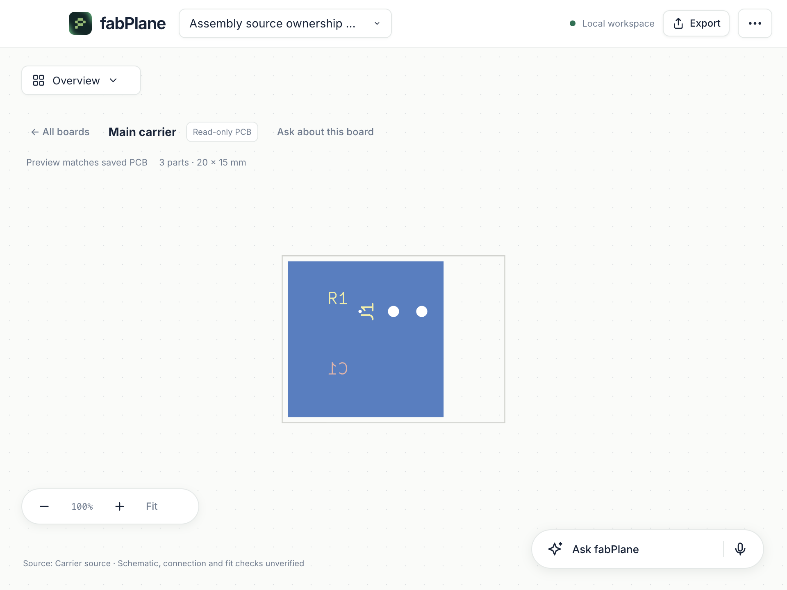
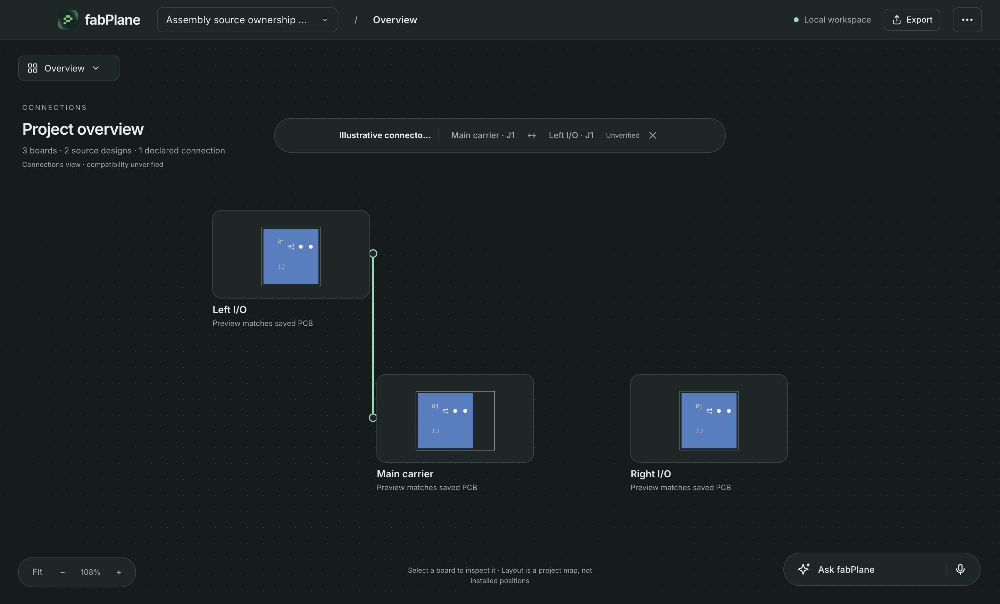

## Real VAIO source exercise and source-attention refinement

The native app now displays six explicitly declared VAIO instances and five intended links. Carrier B2.21, LCD R2.6, I/O Rev H A18, RH-A13 and battery B8.3 were downloaded at pinned GitHub commits and their PCB SHA-256 values exactly match the original viewer scene manifest. Five previews were exported from these actual native files through the scoped tool. No repository scripts were executed. This is a PCB-only read-only canvas study, not a complete project/dependency import.

The published keyboard board differs from the viewer’s recorded RevH-A1 hash. Its intended instance remains visible and explicitly unresolved; an alternative revision was not substituted. The overview’s Sources to review badge now includes unavailable source designs and changed previews, counting shared sources once. It leads to the relevant instance; Inspect PCB stays disabled until its source is owned.

The physical walkthrough selected I/O (22 native parts, 36 × 27.455 mm), selected its RH link using the keyboard, and opened RH (11 native parts; complex-outline dimensions unverified). A same-size/timestamp I/O source edit updated the canvas warning and attention count without moving the camera or regenerating any artifact. All original bytes were restored. At 960 × 720, the content-sized link toolbar stayed inside the window and below the measured heading; there was no horizontal overflow. The window was restored to 1440 × 870. [Source hashes and native evidence](vaio-canvas-native.json).

The current interconnect contract requires LCD R2.9 and rejects this viewer’s R2.6 endpoint. That mismatch is recorded in the study notes; **the UI does not yet automatically validate those contracts or surface their findings**. All links remain unverified, and viewer PASS labels were not copied. Schematics, 3D dependencies, physical alignment, battery commissioning and manufacturing checks were not exercised. This does not complete the VAIO acceptance checklist.

The affected client suite passes **215 tests** and UI suite **223 tests**, with zero failures. Root typecheck passes, followed by a UI typecheck after the final toolbar adjustment. The preceding full standard suite passed 2,121 / 29 skips / zero failures; the new attention regression adds one client test. This refinement does not change backend native-edit behavior.

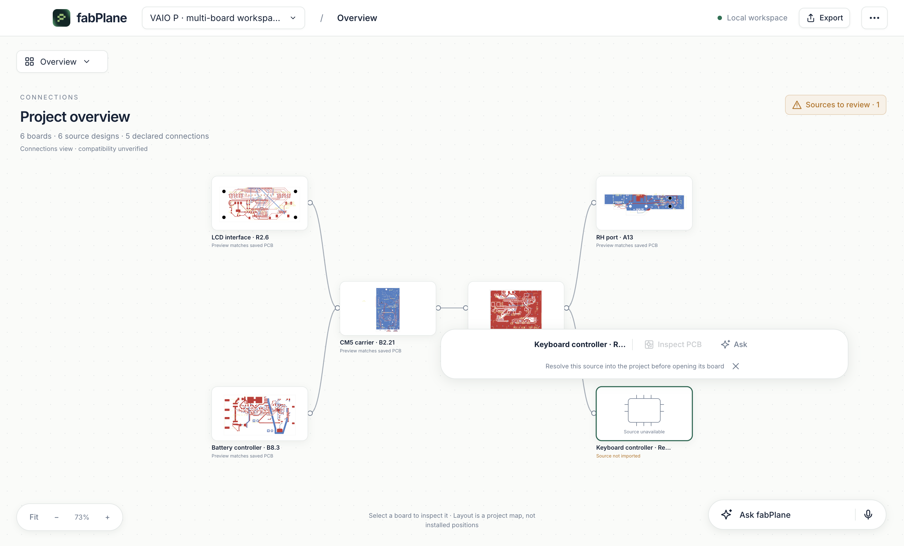

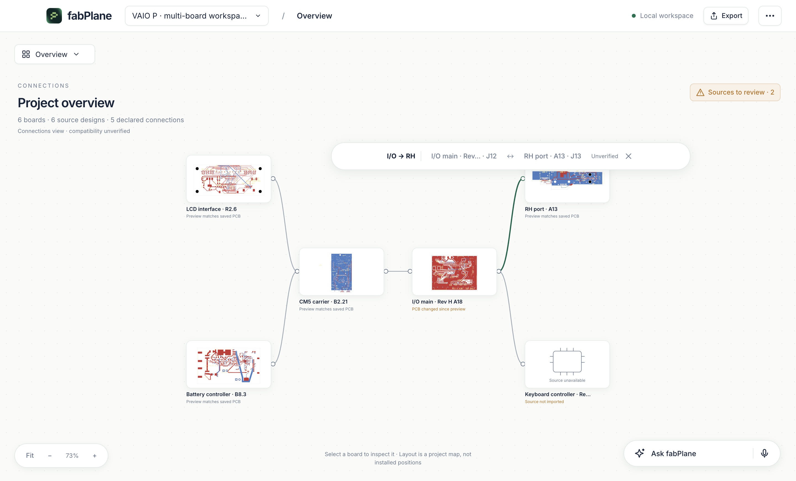

## Guarded native member placement and rectangle resize

The source-scoped tool contract now opts in `pcb_place` and `pcb_resize_outline`. An assembly selector always names a source design and captured manifest SHA, and these mutations require its inspected saved-source SHA. Shared physical instances therefore refer to the same edited source. No-selector assembly operations cannot fall back to a root PCB; unsupported tools stay blocked. Project/agent status now reports `explicit-source-tools` and names the supported operations, rather than advertising a complete member editor. Legacy single-board placement keeps its previous optional-hash contract.

The installed KiCad registry/context integration test used two independent source directories with identical native item IDs and two instances of source A. It rejected missing/stale source hashes before opening a native session, moved R1 in A by 0.1 mm with copper retained, rejected a stale resize revision, then resized A from 15 × 15 to 20 × 15 mm with its original outline ID and minimum corner. Tracks/vias/zones/nets stayed identical; resize also preserved the placed component/pad data. The other source and unrelated root PCB stayed byte-identical. Changed manifest membership and a host ignoring the selector were rejected. Native close/reopen confirmed the stored part position and rectangle coordinates. The existing ownership test also retained a saved revision and an unsaved live placement when the declaration changed before save.

**Two installed-native tests passed, 34 assertions.** The focused source/transport/status set passed 22 tests / 117 assertions. Root typecheck passed. The complete standard suite passes **2,124 tests / 30 skips / zero failures** (core 553 passed / 28 native-environment skips; client 215, tools 415, UI 223). The installed-native tests were run separately; their skipped ordinary-suite entries are not counted as native passes. An initial broad run found an HTTP assertion still expecting the earlier single-board-only assembly mode; its expectation was updated to the new limited explicit-source capability.

The canvas member inspector remains read-only. Client queries, preview coordinates, action ownership and review anchors must carry the captured source before native editing controls are exposed. Other member workflows, native replacement, undo/recovery UX and compatibility validation remain unfinished. No source in the real VAIO study was edited by this increment, and it does not establish DRC, routing safety or chassis fit.

## Source-bound member canvas editing controls

Selecting a board opens one source-bound canvas. Only clicking a verified native PCB location reveals Parts and Board size; secondary tools remain closed by default. Part/outline inspection keys, saved-source guards, mutation confirmations and preview regeneration carry the captured source and manifest SHA. Root/older or mismatched responses cannot become facts for a member. A source’s initial empty outline cannot fall through to unsupported root creation, and locked/complex native boundaries remain read-only with their actual reason.

The physical app walkthrough used the owned two-source fixture, not real VAIO files. A keyboard R1 proposal left files unchanged; Apply saved X 105 → 105.1 mm only in I/O and refreshed its matching preview. A physical corner drag proposed 20 × 15 mm without writing; Apply resized the original 15 × 15 mm rectangle while keeping the edge ID and native (100, 95) minimum corner. Placed components, pads and routed copper stayed identical during resize. Carrier files and parent metadata stayed byte-identical throughout. Both I/O instances showed the shared updated source. Switching to carrier began with no selected part and its own original R1 coordinate, not the I/O form state.

Changing manifest membership disabled a pending carrier Apply while preserving X 105.1 in the form; the carrier file stayed unchanged. Ask prepared an unsent draft naming assembly source carrier. Member post-save guidance no longer navigates to unrelated root checks, and root comment anchors are not reused. All fixture PCB/manifest/preview/receipt bytes were restored. A subsequent native inspection returned the original I/O R1 position and 15 × 15 mm geometry, confirming it did not retain stale edited-session facts. The window was restored to 1440 × 870 with secondary tools closed.

The compact-window check found that popup placement could use geometry from before the SVG finished fitting. Observing the drawing’s final size fixes that timing issue. An actual wide → 960 × 720 round trip kept the popup within the window, clear of the native drag target, with no horizontal overflow. [Native UI evidence and restored hashes](member-controls-native.json).

Root typecheck and the full standard suite pass **2,127 tests / 30 skips / zero failures**. Sixteen focused part/outline/source helper tests pass (61 assertions), including immutable captured selectors, response ownership rejection and legacy single-board behavior. After refining locked/complex rejection copy, the final UI typecheck and all 223 UI tests passed. Native replacement, member checks/comments/schematic/3D/CAD, persistent board-workspace selection and undo/recovery UX remain unfinished. No compatibility, DRC or fit pass is implied.

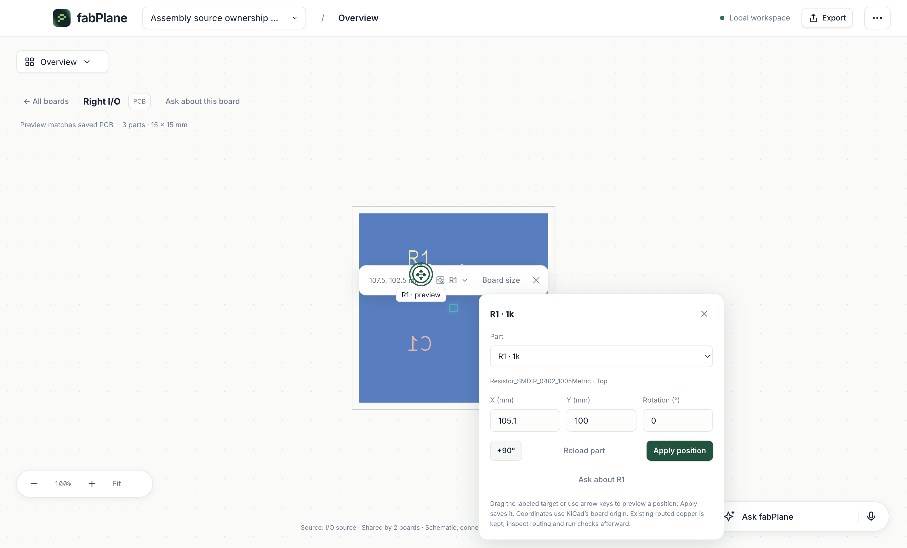

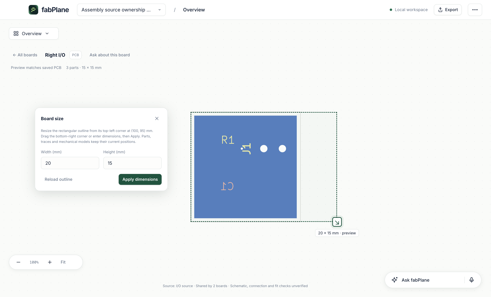
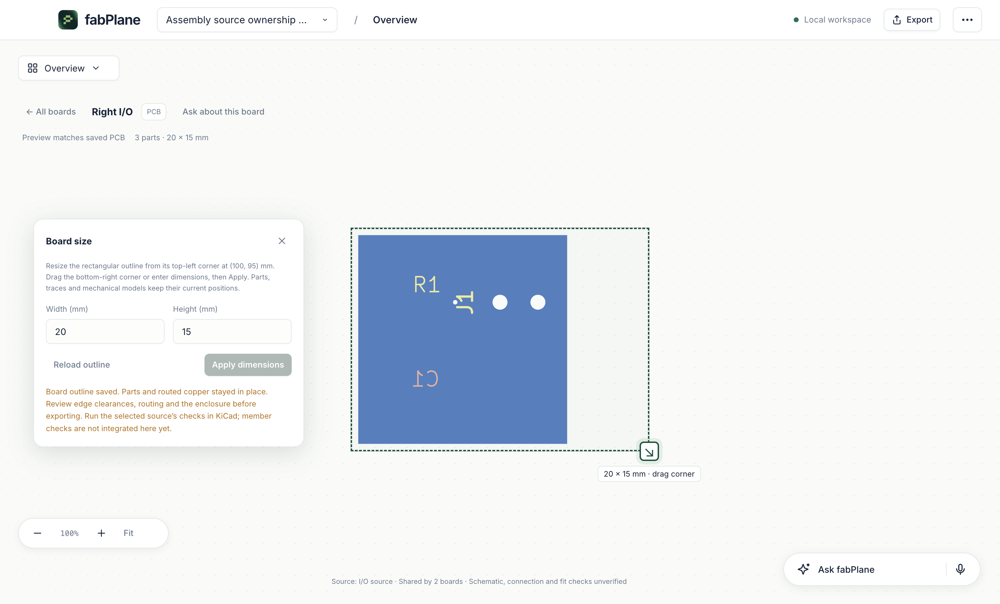

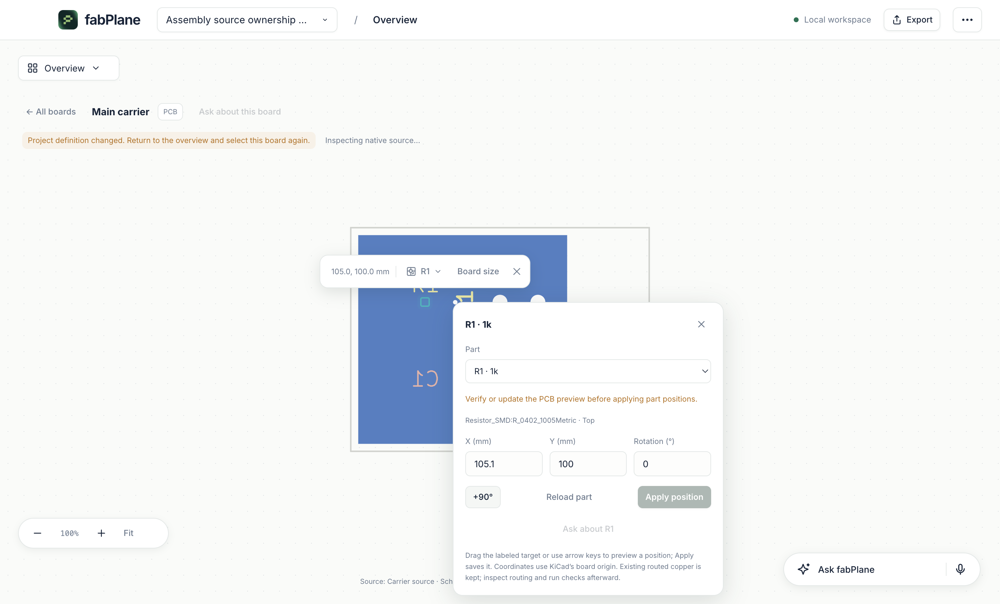
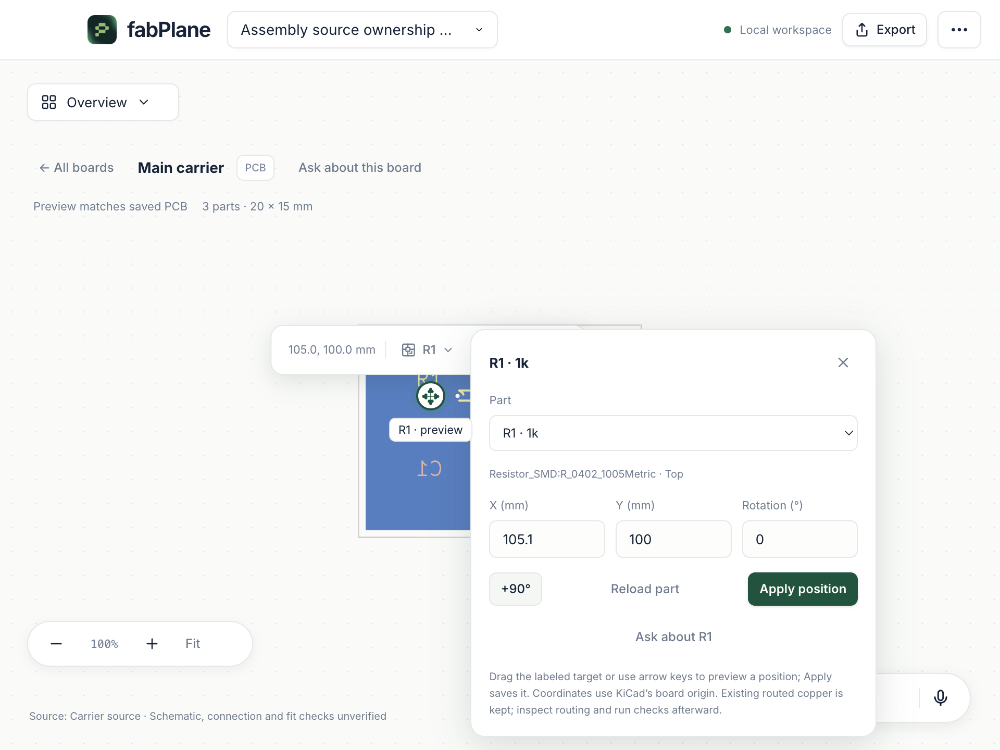

The final restarted runtime also inspected the populated VAIO I/O board through the same source controls. It displayed native F1 (1.5 A) at (88.5, 56.5) mm, rotation 180°, with Apply disabled because no proposal was made. All five imported PCB sources and saved previews remained byte-identical to their recorded hashes. The app was left on the six-instance overview with secondary tools closed. This read-only inspection is separate from the disposable fixture’s saved edits.

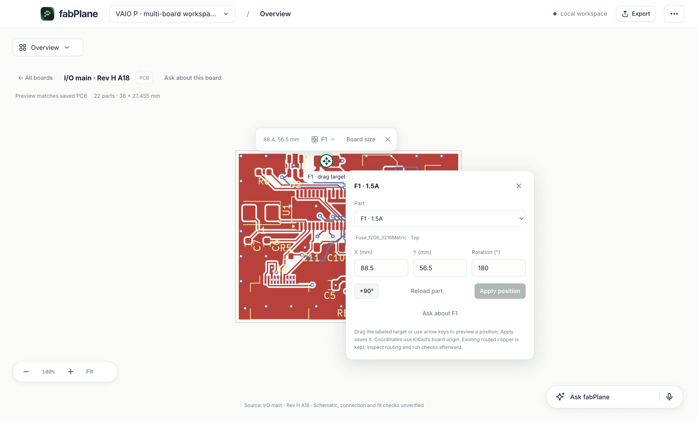

## Captured board workspace restoration

Boards now remembers the inspected physical instance and its captured project/source/manifest identity per project, across task navigation and full reloads. Inspect PCB opens Boards; Overview always shows the project map. All boards clears the saved selection. Restored state is validated against the current explicit declaration and availability; a changed declaration or missing source shows a reselection notice and never retargets the editor. Restoring opens neither contextual tools nor the assistant. Draft part/outline values are not persisted by this milestone.

The actual Electron VAIO walkthrough opened I/O main (22 parts, native dimensions 36 × 27.455 mm), visited Files, returned to Boards, reloaded, returned to Overview, then cleared the remembered board. Every previously recorded real-study source/preview/manifest hash stayed identical. A disposable two-source fixture then changed only declaration whitespace: after reload Boards showed the reselection warning without mounting a native editor; the original declaration bytes and timestamps were restored. This also exposed and fixed the fresh-start classifier incorrectly treating an assembly with no canonical root PCB as an empty project.

Validation: root typecheck passed; client-core **219 passed**, UI **224 passed**, zero failures with local fixture-server access. The first restricted client run could not bind its fixture HTTP servers; the permitted rerun passed unchanged. Focused restoration/ownership tests: **27 passed / 123 assertions**. No backend changes or new native board edits in this milestone. The previous full-suite and separate installed-KiCad results above belong to their recorded milestones. Actual walkthrough evidence: [board-workspace-native.json](board-workspace-native.json).

## Saved editable sketches

Drawing saves now embed the original editable scene in the PNG using the installed drawing library's supported scene metadata. The same project-owned PNG remains a chat image; no separate sidecar write can get out of sync with it. Sketch → Draw offers a Saved drawings picker only when this project has reserved scene-export filenames. Open a copy explicitly replaces the working draft after decoding succeeds; saving uses a new filename and retains previous versions. Ordinary uploaded PNG/JPEG images remain reference images and are preserved unchanged. A filename is not proof of editable content; invalid/missing scene data produces recovery guidance without replacing the current scene.

Actual native mouse/keyboard walkthrough: created a rectangle and two-line board note, saved, reloaded the full Electron renderer, reopened the disk copy, edited the restored text and saved a second version. Decoded PNG metadata confirmed both original object IDs survived and the old PNG SHA stayed identical. After another full reload, an intentionally invalid saved file failed to load; saving the still-visible draft preserved the exact object IDs, types, text and geometry of the second version. Both earlier PNG hashes stayed identical, and the created invalid fixture was removed. No agent message was sent. The reopened picker and canvas fit at the actual 960 × 720 minimum window. [Source/metadata evidence](editable-sketch-native.json).

Root typecheck passed; final UI typecheck passed. Affected suites: client-core **220 passed**, UI **224 passed**, zero failures with local fixture-server access. Complete standard suite: **2,130 passed / 30 skipped / zero failures**. A final duplicate-name filter refinement was followed by the same 220 client-core + 224 UI tests passing. The actual upload endpoint produced a byte-identical `.excalidraw-2.png` copy; this server suffix remains recognized as an editable drawing. Earlier board-workspace head `d82b9d0` passed hosted verify, mobile verify, real-board-pipeline and TraceMaker checks; the new sketch head needs its own CI.

Limits: this persists **saved drawings**. Unsaved scenes still live in memory until saved; standalone `.excalidraw` JSON import and broader embedded-image/asset walkthroughs remain unfinished. Previous plain PNG drawings cannot recover vectors they never stored. This is a user sketch, not a native PCB, schematic or verified mechanical model.

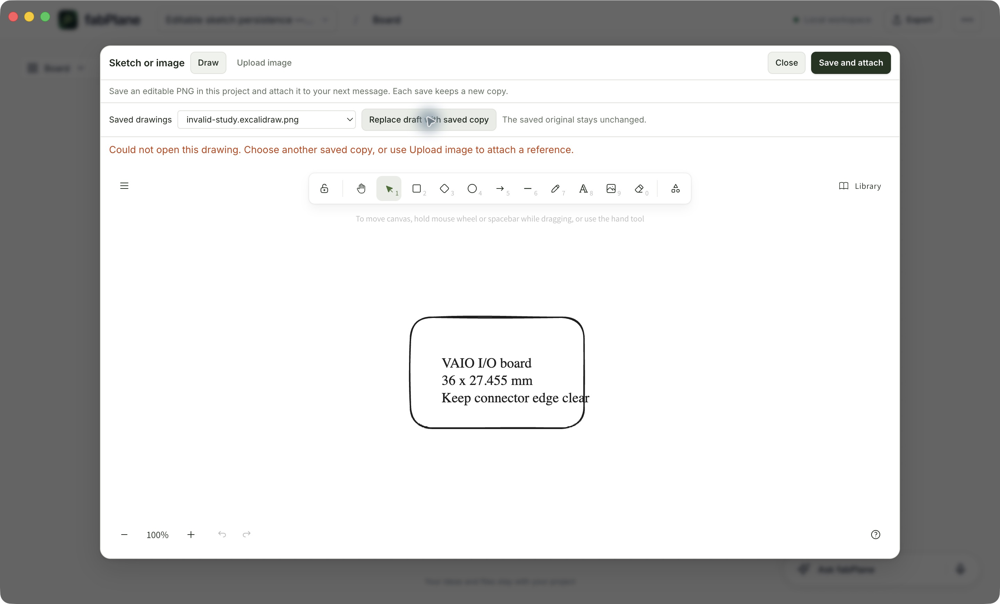
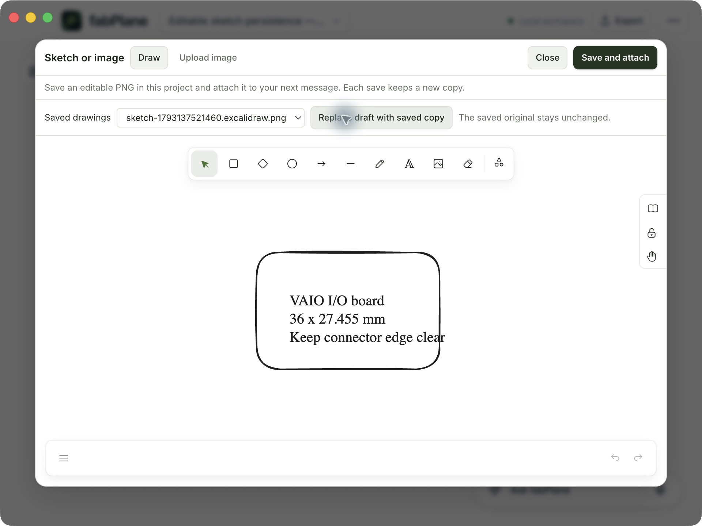

## Standalone drawing-file import

Sketch → Draw now imports an existing `.excalidraw` version 2 drawing through the native file picker. Import fully decodes a working copy before replacing the draft; it writes nothing until Save and attach. Save preserves the original file bytes under `sketches/` before uploading an editable PNG of the current drawing. An open save session reuses its successfully uploaded original when retrying a failed PNG upload. Original-source failures prevent the PNG upload; project creation/retry ownership remains captured. Source files and PNG copies both appear under Saved drawings, and reopening either does not overwrite it. Uploading an ordinary reference image also keeps a separately remembered unsaved drawing instead of clearing it.

The HTTP boundary accepts a supported drawing envelope, limits new source files to 10 MiB / 10,000 elements, rejects invalid JSON/library files/unsupported versions and keeps collision names separate. It preserves unknown fields and whitespace; the installed drawing library restores the editable objects. This structural envelope check is not PCB, schematic or compatibility validation.

Native human-style walkthrough: header → New project → named fresh project → Sketch → native macOS picker → original file. The project sketches folder stayed empty until Save. Closing/reopening the tool kept the source File with its in-memory scene. Choosing an invalid library envelope kept the valid original and working draft. After editing the text object and saving, the project contained exactly the original JSON and one editable PNG. Original SHA/bytes, whitespace and extra notes matched the chosen file; native drawing IDs survived in the edited PNG. After renderer reload, the original reopened with its original text and the PNG reopened with the edited text. Actual 960 × 720 fit passed, then the original window size was restored. No agent message was sent. [Exact preservation evidence](sketch-import-native.json).

Root typecheck passed; final UI typecheck passed after hiding the duplicate native input from keyboard navigation. Complete standard suite: **2,134 passed / 30 skipped / zero failures**. Focused envelope/client retry/HTTP tests passed, including raw-source equality, collision naming, invalid envelope and 10 MiB rejection. Earlier installed-native PCB evidence remains qualified under its own milestones; this change did not edit a PCB.

Limits: external import supports the stated version 2 envelope, not every historical or library format. Unsaved recovery was added in the following milestone. Image/asset compatibility and full sketch-to-engineering generation still need broader walkthroughs. Save is staged, not a two-file filesystem transaction: if the PNG upload fails, the preserved original may already exist and stays available for retry/reopening.

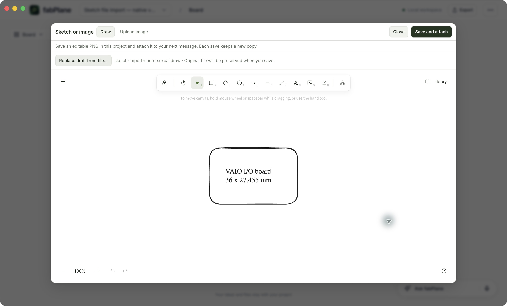

## Private unsaved sketch recovery

Drawings and their imported original File now have a private IndexedDB recovery copy, scoped to the captured connection, project and conversation. Content changes debounce for 350 ms; closing the tool flushes the latest scene. Opening checks recovery before enabling drawing/import/save, then restores through the official drawing library. Status distinguishes pending, durable and recovered drafts. Nothing is written into project files until Save and attach. Successful save removes only that draft's recovery record, after queued writes; reopening cannot resurrect an older queued snapshot. An unused blank canvas creates no recovery record. Explicit deletion of drawing content is still a content revision.

Actual native validation reloaded a drawing with unsaved text and an imported original, recovered the same object IDs/geometry/text and unchanged original bytes, then saved a new original/PNG pair while preserving earlier project files. A second project recovered its first single object independently. Saving the first did not remove the second. A simulated IndexedDB quota failure displayed a warning and retained the previous backup; normal storage was restored immediately, then a native keyboard edit successfully persisted both objects. Actual compact 960 × 720 controls remained usable; canvas zoom was used to fit the drawing. No agent message was sent. All VAIO source/preview/manifest hashes remained unchanged. [Exact evidence](sketch-recovery-native.json).

Final root typecheck passed. Complete standard suite: **2,139 passed / 30 skipped / zero failures**. New helper tests cover ownership keys, byte preservation/limits, delayed-write/cleanup ordering, quota failure/retry and first-edit/deletion signatures. Native-environment skips retain their earlier qualifications.

Limits: this is local profile storage, not project synchronization or a backup service. Abrupt exit before the debounce commits, unavailable/quota-limited storage, or clearing app data can lose unsaved work; failures tell the user to save before quitting. Ordinary reference-image upload selections are not recovered. Multiwindow concurrency, projectless adoption and broader embedded-image assets still need walkthroughs. Recovery cleanup is separate from the already-staged original/PNG project save.

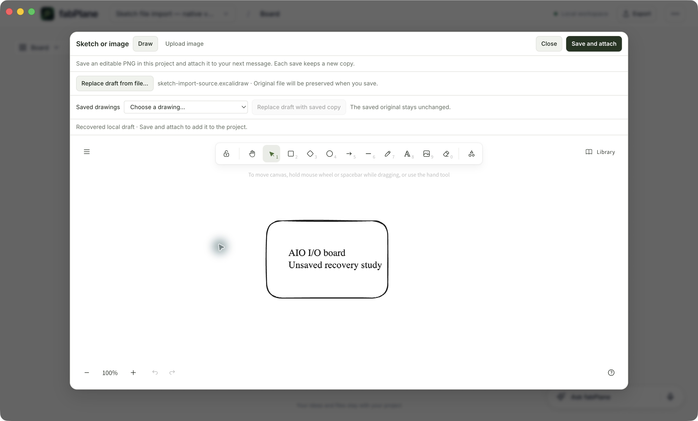

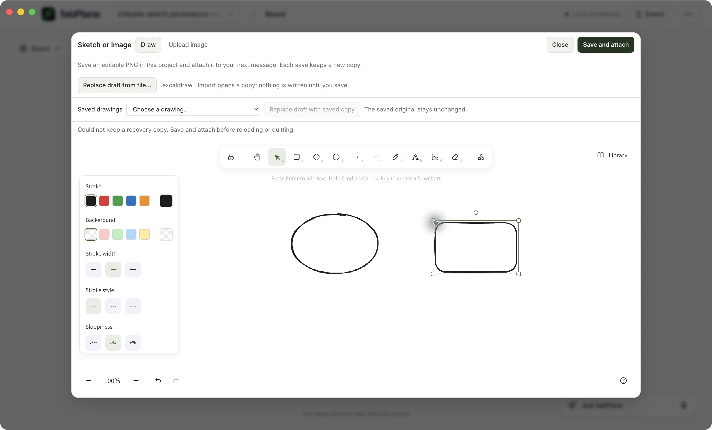

## Assembly source review

Review → Updates now selects an assembly-aware view before mounting root-board artifact queries. One row represents each explicitly declared source, with shared board instances listed together. Known preview hashes distinguish matching, changed, missing, checking and unverified states. Unavailable sources offer an unsent source-specific assistance draft. Inspect opens the captured instance/source/declaration in Boards; changed or untracked previews can be refreshed explicitly through the source-qualified renderer. Matching previews show only inspection. The view does not inherit root DRC/model/enclosure/schematic statuses as assembly results. Existing single-board review remains available; unsupported source inspection fails closed.

Actual native VAIO walkthrough showed five matching previews and one unresolved keyboard source, inspected the exact I/O board, and prepared a keyboard-specific draft without sending it. A separate three-board/two-source fixture received a whitespace-only I/O source change: one shared-source warning covered Left and Right I/O. Explicit Update preview produced a receipt matching that changed source; the carrier, PCB bytes and parent files remained unchanged. All nine fixture files were then restored byte-for-byte. Actual 960 × 720 controls passed. All real VAIO source/preview/manifest hashes remained unchanged and its quiet Overview was restored. [Evidence](assembly-review-native.json).

Root typecheck passed. Both affected suites passed: **231 client-core + 224 UI tests**, zero failures; new helper cases cover shared ownership, unavailable sources, changed/missing previews and checking/error states without stale match claims. The preceding full standard run was **2,139 passed / 30 skipped / zero failures** at the sketch-recovery milestone; it was not repeated for this frontend/helper increment.

Limits: only saved PCB preview provenance is tracked per member here. Source-qualified DRC/ERC, schematic parity, comments/diffs, 3D/model dependencies and enclosure fit remain separate unfinished workflows. Declared links and a matching preview are not compatibility passes. Warning capture below predates the final footer wording refinement; the compact capture shows final guidance.

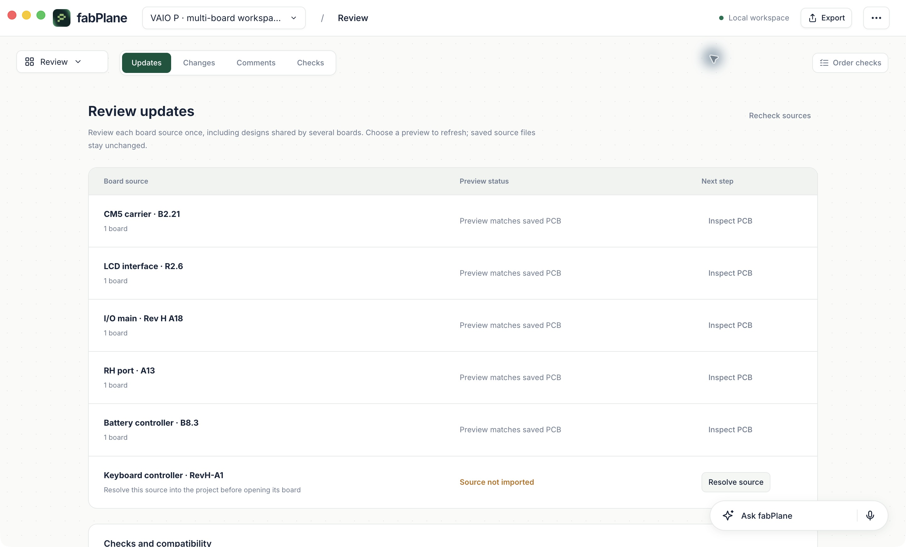
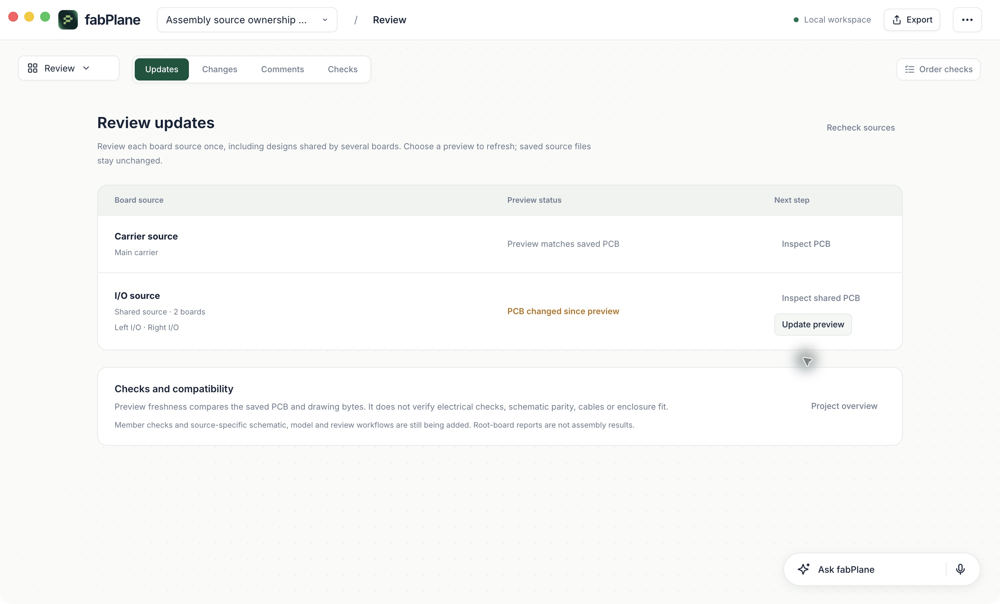

## DRC report preservation prerequisite

DRC now writes the native CLI's raw output into a temporary directory. The saved project report is replaced atomically only after native execution, enrichment, PCB/hierarchy revision checks, output-jail revalidation, captured execution-scope validation and cancellation checks succeed. CLI failure, changed source, rejected ownership or cancellation preserves the previous report bytes. Temporary native output is removed on success and failure. Existing violation counts and release-gate semantics stay unchanged; completing a check with violations remains a measurement, not an infrastructure failure.

Targeted registry tests passed: **8 passed / 60 assertions**. A separate installed fabPlane-bundled KiCad CLI walkthrough/test on a disposable mini-board copy passed **1 test / 16 assertions**: real DRC report hash matched the unchanged PCB, parity was explicitly disabled, then an injected post-CLI failure and changed-source case preserved the saved report exactly. These checks do not certify the fixture as electrically clean; geometry enrichment was stubbed in this publication test. [Reproducible native test](../../../packages/tools/test/drc-publication.kicad.test.ts) requires `FABPLANE_KICAD_CLI` and is skipped when it is absent.

Root typecheck passed. Complete standard suite: **2,143 passed / 31 skipped / zero failures**; the additional standard skip is the explicit installed-CLI publication test, run separately above. This is a prerequisite only: `verify_drc` is still not enabled for assembly members. Source-qualified report queries, hierarchy ownership and native member walkthroughs must be completed before exposing that workflow. No PCB source or real VAIO study was changed, and this increment has no new UI screenshot.

## Explicit-source PCB-only DRC backend

`verify_drc` now supports a captured assembly source selector. Member calls must include that source's inspected `expectedSourceSha256` and explicitly set `schematicParity=false`. Missing/changed revisions, implicit root execution and hosts that ignore the selector are rejected. Member schematic parity remains disabled. The report is saved under the selected source directory and carries project/source/declaration identity plus the checked PCB hash; the tool response echoes the same ownership. Project status names the limited capability separately from root facts. Staged publication preserves earlier reports when source, membership or queued-job ownership changes.

Scope/ownership tests plus an explicit installed-KiCad run passed **3 tests / 47 assertions**, including one actual CLI case. They cover required scope/hash/PCB-only choice, unchanged other/root reports, selected-source identity, changed-source and membership rejection, and queued stale work never reaching the native handler. The temporary-folder path assertion was corrected to use the canonical macOS path. Geometry enrichment is stubbed only in that isolated test.

The running native app then executed the HTTP long-running job against the disposable shared-I/O source using actual native geometry queries. It returned **8 errors, 4 warnings and 2 unconnected items**, saved the matching source receipt, and echoed the same source identity in the job result. All nine baseline source/artifact/parent files stayed unchanged. The temporary study report was restored to its previous absent state; real VAIO sources/previews/manifest stayed unchanged. No agent message was sent. [Native job evidence](member-drc-native.json).

Root typecheck passed. Complete standard suite: **2,145 passed / 32 skipped / zero failures**. The added standard skip is the explicit installed-CLI member test, run successfully above. An initial full run found the prior agent capability-list expectation; its replacement asserts the new capability and its PCB-only/non-compatibility limits, then the complete rerun passed.

Limits: this increment enables the tool/API and agent capability, not the member Checks UI. Source-qualified report queries/display and the board picker are next; root reports must not be inherited as assembly reports. Member parity/ERC, complete schematic/dependency import and inter-board compatibility remain unavailable. Checks with violations are successful measurements, not clean-board certification. No new UI screenshot accompanies this backend increment.

## Source-specific member Checks UI

Review → Checks now resolves assembly sources before mounting report queries. It starts from a valid captured board selection or asks for a source. Shared boards use one report; unavailable sources cannot be selected. Run PCB-only DRC uses the checked source hash and captured declaration, checks the returned ownership, then rereads that source's report. PCB-only scope is visible beside the board name. Board inspection and Review updates link into Checks without opening another window.

The client derives report/PCB paths from a freshly inspected, validated source declaration and rechecks ownership and PCB bytes after reading. A missing, malformed, root, different-source or older-declaration report supplies no member findings. A correctly owned report for an older PCB remains visible with a stale warning. Source-change events invalidate the report query. Normalized finding parsing now lives in client-core and retains the existing single-board API/tests. Selecting a finding expands its native item details directly beneath that row.

Actual native app walkthrough: selected shared I/O → Run PCB-only DRC → **14 findings (8 errors, 4 warnings, 2 unconnected)** → selected clearance row → native item coordinates/descriptions appeared inline. Carrier did not inherit I/O's findings; switching back recovered them. A whitespace-only PCB change automatically showed the stale-PCB warning. The actual 960 × 720 layout remained usable. A changed declaration hid findings and required explicit reselection; after reselection, the older-declaration report remained unverified. All nine source/artifact/parent fixture files were restored byte-for-byte and the temporary report restored to absent. VAIO board inspection → PCB checks preserved its exact I/O source; the unresolved keyboard option was disabled. All VAIO source/preview/manifest hashes stayed unchanged; its quiet Overview was restored. No agent message was sent. [Native evidence](member-checks-ui-native.json).

Root typecheck passed; final UI typecheck passed. Both affected complete package suites passed: **234 client-core + 224 UI**, zero failures. Focused report-scope/normalization cases passed **5 tests / 24 assertions**, including wrong/missing report ownership, changed source/declaration/directory and captured-selector mutation. The preceding full standard suite remains **2,145 passed / 32 skipped / zero failures** at the backend milestone; it was not repeated for this frontend/client-only increment.

Limits: these are per-source PCB checks. Member schematic parity/ERC, inter-board electrical contracts and mechanical fit remain unverified. The checker does not navigate findings to exact source-canvas geometry yet. Persistent keep-older decisions, all-source check summaries and report artifact-integrity receipts remain future work; a matching source hash alone is not a pass.

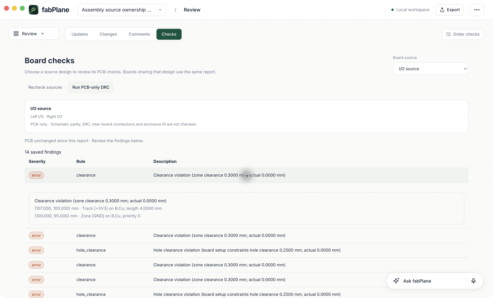

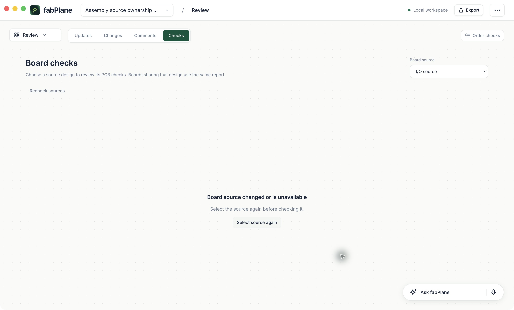
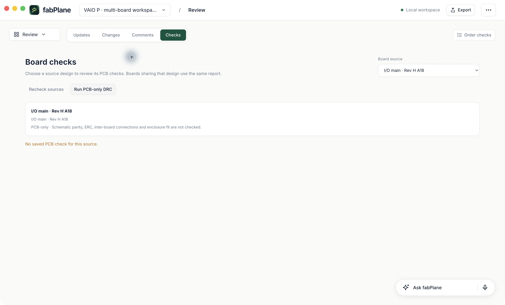

## Canvas PCB-check attention and combined source review

Assembly Overview now annotates shared board instances when their saved PCB check is older than the source, has unverified ownership, or lists findings. Attention counts deduplicate source designs across instances and across preview/check issues. Selecting a board reveals a source-bound PCB checks action. Review updates shows preview freshness and PCB-check status together, so regenerating an image cannot imply electrical checks became current.

The summary reads each declared source report once with at most four concurrent reads, applies a 10 MiB parsing limit, and performs one final source/declaration reinspection. It reuses the membership's PCB hashes instead of rereading and hashing every PCB for every member. Missing reports remain unknown coverage; unavailable sources, mismatched ownership, changed sources and transport failures never imply a pass. A current report with zero listed findings is still described as PCB-only, not assembly compatibility.

Actual native study restored the prior real I/O DRC report from the preceding walkthrough (not a synthetic result), then changed only PCB whitespace. Both shared instances showed the stale DRC warning with one source attention count. Explicit native preview refresh produced a source/artifact receipt matching that modified PCB, yet the DRC warning remained. The contextual Checks action opened that exact source. Review showed a matching preview beside the stale check, including at actual 960 × 720 size. Restoring original PCB/preview bytes then showed the real report's 14 findings on both cards. All nine fixture files were restored and the study report removed back to its previous absent state. Real VAIO source/preview/manifest hashes stayed unchanged and its quiet Overview was restored. No agent message was sent. [Native evidence](check-attention-native.json).

Root typecheck passed. Both affected suites passed: **237 client-core + 224 UI**, zero failures. New summary tests: **3 passed / 18 assertions**, covering one read per source, bounded concurrency, one final inspection, shared instances, missing/malformed/mismatched reports, source/declaration changes and transport errors. Error paths stop further batches and settle already-started reads before rejecting, so retries do not overlap an abandoned worker pool. The preceding full standard run remains **2,145 passed / 32 skipped / zero failures** at the member DRC backend milestone; it was not repeated for this client/UI increment.

Limits: the summary tracks saved PCB-only reports, not ERC, schematic parity, design-rule/model dependencies or assembly-wide compatibility. Report bodies over 10 MiB are unverified in this overview summary. Electrical-clean certification, persistent keep-older choices, artifact-integrity receipts and exact finding-to-canvas navigation remain separate work.

## Source-bound check finding locations

A current member PCB-check finding now offers **Show on PCB** beside each actual native item coordinate. It opens the captured source on the main canvas and preserves the selected physical instance when several boards share a design. The marker is read-only; it does not open placement/resize controls. The finding summary remains visible above the drawing, with a dismiss action and keyboard Escape. Location state is transient and clears across projects.

Navigation requires an owned report matching the current declaration and PCB hash, a finite reported item coordinate and a declared available source. At the destination, the current source hash, native SVG coordinate stamp, preview receipt and SHA of the exact displayed SVG must agree. While fetching, failed, stale, unverified or outside the saved viewBox, the marker stays hidden with an explanation. Older report details remain readable without a misleading navigation action. Marking one item location does not highlight its complete geometry or certify a design.

Native app validation restored the prior actual I/O DRC report, clicked a real clearance item's **107.000, 100.000 mm** location, and verified the marker. Changing PCB whitespace hid it automatically; a changed displayed SVG also hid it. Both were restored byte-for-byte. The older PCB report retained details but offered no Show on PCB action. Native selection of Right I/O → PCB checks → finding returned to **Right I/O**, rather than its shared Left instance. Native Escape dismissed the finding, and 960 × 720 controls remained usable. All recorded fixture and real VAIO source/preview/manifest hashes were preserved; the temporary report was restored to absent and the quiet VAIO Overview restored. No agent message was sent. [Native evidence](finding-navigation-native.json).

Root typecheck passed. Affected complete suites: **240 client-core + 225 UI passed**, zero failures. Focused navigation/store tests: **24 passed / 108 assertions**. The first sandboxed affected run could not bind local ephemeral test servers; the authorized rerun passed. Previous full standard suite remains **2,145 passed / 32 skipped / zero failures** at the member DRC backend milestone. No backend or native mutation behavior changed in this increment.

Member ERC/parity, source-qualified comments/diffs, complete affected-geometry highlighting and check artifact/dependency integrity remain unfinished. This section supersedes the earlier exact-location-navigation limitation only.

## Live saved-source PCB previews

While an assembly project remains open in the canvas workspace, a newly saved PCB hash now queues its existing tracked PCB preview for refresh. Rapid saves coalesce for 1.2 seconds; shared instances use one source job, and sources render sequentially in the mounted workspace. An initial stale preview, missing preview, manually changed artifact or unverified receipt stays an explicit user action. Errors do not create an automatic retry loop. Checks, heavy renders, models and videos are not regenerated by this queue.

Assembly preview queries include the captured PCB hash and reject a read of different source bytes, so a cached older match cannot swallow a new saved change. `render_pcb_svg` accepts an optional expected saved hash and rejects a queued render that would otherwise use newer bytes; existing during-render source and membership guards remain. The small activity notice offers View/Review and dismissal without opening a panel. View revalidates the destination and retains an owned saved physical-instance choice for a shared source. Camera, selection and unsaved native proposal fields are not reset by the background refresh.

Actual native app study: revision-guarded I/O R1 placement to **105.3, 100 mm** triggered one automatic preview job. Both physical instances updated, source/artifact receipt hashes matched, the old DRC remained stale, and the overview camera and Right I/O selection were unchanged. A genuine CLI parse failure on intentionally invalid fixture bytes retained the prior SVG/receipt and produced one failed job without retries. A separately changed SVG survived another saved source change; Review correctly showed it as unverified. A new valid save then recovered with one successful preview job. Compact 960 × 720 View opened the captured Right I/O source; activity dismissal worked. Before restoring, all jobs were terminal. All recorded fixture/VAIO hashes were preserved, the prior real DRC study report restored to absent, and the quiet real VAIO Overview restored. No agent message was sent. [Native evidence](live-preview-native.json).

Root typecheck passed; final client-core/UI/tools typechecks passed after activity-copy/navigation refinements. Complete standard suite: **2,160 passed / 32 skipped / zero failures**. Focused queue/preview/client/render guard tests: **13 passed / 44 assertions**. The generated tracked Python cache was restored after tests.

Limits: this observes changes while the assembly workspace is mounted, not a background service or a cross-window job coordinator. Initial/imported stale previews remain explicit. PCB-only automatic preview refresh does not establish schematic parity, inter-board compatibility, dependency-complete DRC or physical fit. Heavy output and historical-export freshness remain separate work.

Live-preview navigation follow-up: explicit saved board selection changes now update an already open Boards detail. Background declaration/source updates still keep the active captured detail stale rather than silently retargeting or resetting it. Native validation opened Carrier, updated I/O, confirmed Carrier remained visible during automatic refresh, then clicked View and verified the I/O detail. All recorded fixture/VAIO hashes were restored again. Final UI typecheck and **225 UI tests passed**, zero failures. See the same native evidence record's crossSourceView entry.

## Source-qualified member 3D models and Outputs

Each captured assembly board now has local **PCB / 3D** controls on the same canvas. The PCB subtree remains mounted while hidden to retain proposal fields; hidden native-tool portals receive the existing visibility guard. The requested 3D view lazily loads the model renderer. Outputs → Models also offers an explicit source picker, preserves its captured source through workspace reload and requires reselection after a declaration change. Shared physical instances use the same source model. The source picker does not implicitly choose a root board.

Member `render_glb` requires the inspected saved PCB hash. Exports use the leaf board's real directory so relative model paths can resolve, then recheck saved source bytes, the output jail, cancellation and captured declaration before publication. Failures retain the prior model/receipt. The receipt records project/source/declaration, source and model hashes, export notes, and explicitly unverified external dependencies. The agent's project status names this limited capability separately from root-board status.

The client checks ownership before and after reading the leaf PCB, model and receipt and passes the **exact inspected Blob** to the viewer and download. Source, artifact and ownership changes have distinct labels. A legacy/root or older-declaration receipt cannot become a current member result. Saved unverified models remain inspectable with an explicit label; model dependencies, physical placement and enclosure fit are never inferred from a PCB hash.

The Outputs library now discovers render/export files under explicitly declared available source directories, labels their source, and excludes undeclared historical folders, blocked sources, receipts and native sources. It does not hash large models merely to fill the library; use the source-specific model view to check provenance. Assembly model creation routes to the source picker. Unsupported member image/video rendering actions are disabled rather than invoking unrelated root tools. Saved member files can still be previewed/downloaded. Full assembly alignment, enclosure fit and member video creation remain unavailable.

Model Fit view now projects the actual eight bounding-box corners into the perspective viewport instead of estimating from the largest dimension. It preserves the default orientation and reserves space for the controls; this changes the camera only. Narrow/wide viewports, flat boards and tall cases have property tests, and compact/full-size native rendering was checked.

Native study: generated the isolated I/O model through the UI, orbited it, downloaded through the native Save panel and verified byte equality. The source/member/model receipt and all original source/preview hashes matched. PCB whitespace changes marked the model stale even after the PCB preview automatically refreshed. Changed GLB bytes were unverified; changed declaration blocked actions and required explicit reselection. Carrier did not inherit I/O's model; Right I/O used the same source model. Outputs displayed the declared artifacts, and its model source survived a full renderer reload. All recorded fixture hashes and prior model-file presence were restored.

Real VAIO: native Generate 3D preview exported the exact I/O main Rev H A18 source and displayed its available board geometry at 960 × 720 and 1440 × 870. This PCB-only study lacks complete component-model dependencies; the preview is not a fully populated assembly or a fit check. Source/model/member hashes matched; all recorded real-study source/preview/manifest hashes stayed unchanged. The temporary generated model/receipt were preserved as evidence and restored to their prior absent state after all jobs were terminal. The quiet VAIO Overview was restored. No agent message was sent. [Native evidence](member-model-native.json).

Validation: final root typecheck passed; final client-core/UI suites **250 + 225 passed**, zero failures. Installed KiCad scope/publication tests **3 passed / 48 assertions**, including actual exports and retained prior output on source/declaration/queued changes. Initial focused model cases **9 passed / 1 native opt-in skip / 64 assertions**; camera properties **2 passed / 231 assertions**. The first standard suite found an outdated capability-list assertion; it was updated to include member GLB export and preserve the dependency/fit limitation. The following complete suite passed **2165 / 33 skipped / zero failures** before the final Outputs/camera refinement. The final complete standard suite passed **2,168 / 33 skipped / zero failures**. Final minor warning-color and creation-scope guard refinements also passed UI typecheck.

Remaining model work: combine member-model freshness with Overview/Review attention, dependency-complete import/receipts, assembly alignment, enclosure fit and member video/media generation. Member schematic/ERC/parity, qualified comments/diffs and native replacement/undo remain separate unfinished work.

### Assembly model freshness in Overview and Review

Model receipt summaries compare the current declared PCB hash without downloading every GLB. Known source/declaration differences annotate shared boards once per source; Review keeps preview, PCB-check and model-source status separate. No receipt is unknown, and unchanged PCB source does not attest model bytes or dependencies. Contextual 3D and Review actions open the qualified source. Root typecheck and 254 client-core + 225 UI tests passed; four receipt tests include bounded concurrency, settle-before-reject and ownership changes. Native validation restored an actual earlier fixture GLB, saved its PCB, verified the automatic SVG refresh, and confirmed both shared cards retained one 3D attention count. Review/compact/source-navigation passed. Eight baseline fixture hashes, prior absent model outputs and all recorded VAIO hashes restored. No agent message sent.

Native evidence: [model-freshness-native.json](model-freshness-native.json).

### Source-qualified schematic inventory prerequisite

Member `schematic_inspect` now supports only a saved hierarchy summary. Each referenced sheet and native project metadata must be independently owned by that source; the native netlist runs against a captured scratch snapshot. The aggregate revision includes member project metadata, and saved files/declaration are rechecked afterward. Aliases/hardlinks, missing sheets and changing sources cannot produce a complete member inventory. Root project behavior remains separate; live member editing, ERC/parity, schematic rendering and synchronization remain unavailable.

Review → Checks has a folded Schematic sources disclosure and an explicit Inspect action. File details stay folded until requested. Background source refresh retains the inspected snapshot and marks it older; incomplete inventories show unknown electrical totals. Other sources cannot inherit the result. The generic tool runner now retains immediate HTTP results as well as wrapped/queued results.

Complete standard suite: **2187 passed / 34 skipped / zero failures**; root typecheck passed. Installed KiCad scoped tests: **4 passed / 40 assertions**, including a real two-sheet snapshot and source/declaration preservation. Hierarchy tests: **21 passed / 73 assertions**, covering nested filesystem aliases, missing sheets and changes during export. Client result/transport tests: **3 passed / 15 assertions**. Latest UI disclosure typecheck passed after the final folding refinement.

Native screenshots169–171 show the requested temporary two-sheet fixture inventory, retained older warning and missing-sheet guidance at 960×720; screenshot172 shows the final closed-by-default disclosure in actual VAIO Checks. The fixture contains zero-component validation sheets, not a generated design. Native testing found and fixed the immediate-result bug and snapshot unmount during background checking. Both temporary sheets were restored absent; all eight recorded fixture hashes and all recorded VAIO hashes stayed unchanged. No agent messages. Final native app is quiet wide VAIO Overview.

Native record: [member-schematic-native.json](member-schematic-native.json). The earlier three captures precede the final outer disclosure refinement; all screenshot iterations are preserved.

### Source-qualified schematic canvas connection

The selected member board now has a read-only Schematic view beside PCB and 3D, with sheet selection/previous/next navigation on the same canvas. Create/Update explicitly inspects the native hierarchy before using the existing native KiCad SVG exporter. Verified captured sheet/project bytes reach the CLI; immutable SVG versions and one atomically replaced source receipt preserve earlier previews on failure. Client inspection checks all recorded native inputs and the exact selected SVG, rechecks inputs after page loading and rejects obsolete pointers, ownership and selections. PCB placement proposals remain mounted/hidden when changing local views. No member schematic editing, ERC, PCB parity or automatic heavy rendering is claimed.

Root typecheck PASS. The complete standard workspace suites plus scripts passed **sequentially: 2205 PASS / 36 SKIP / 0 FAIL**. The default concurrent command failed twice on existing five-second mechanical/agent-detection timeouts (and resulting canceled-process errors); mechanical alone passed18/0 and both packages passed in the sequential complete run. Test limits outside this feature were not changed. Focused snapshot/publication tests with installed KiCad: **10 PASS / 130 assertions**, including two real native cases; the multi-export native test has a30-second allowance after its initial five-second timeout. Client scope/transport/race tests **10 PASS /32 assertions**. Native skips in the standard run are not native passes.

Actual UI generation rendered two temporary note-only KiCad sheets, retained native inputs and switched to the child page with the Next button. The actual app client then distinguished changed child source, modified SVG, restored bytes and another source with no inherited preview. The native window changed to Checks during an attempted resize; compact/popup interaction and visual stale-warning acceptance remain unverified. Further interactive navigation stopped. Both temporary native sources and their new preview directory/pointer were restored absent; all eight recorded fixture and all recorded VAIO hashes stayed unchanged. Actual generated versions/receipts are backed up under work/schematic-preview-generated-evidence. Current native app remains at the observed fixture Checks; it was not retargeted afterward.

This image is the first native generation before the previous/next refinement. The original173.png filename is preserved in outputs; its native capture bytes are JPEG, so an identical173.jpg and this correctly named evidence copy were added without recompressing. [Native evidence](schematic-preview-native.json).

The human's latest direction prioritizes UI flow, feature organization, tool discoverability and visual fidelity to the approved concepts. Subsequent milestones should reuse verified engineering functionality and add backend work only for necessary UI connections or observed regressions. Compact and visual acceptance checks remain on that UI checklist.

### Quieter overview and tools on selection

The overview drops its repeated Connections eyebrow and gives more height to the board canvas. A selected board exposes **Open board**, **Ask** and **More**. PCB checks, 3D model, optional preview refresh and shared-design context appear only when requested. Selecting another board closes More. Escape closes the open disclosure while preserving selection; disabled actions do not dismiss it. Existing ownership, source-refresh and job guards remain in place. The workspace header identifies the restored owned physical board instead of a generic Boards label. No new native/backend capability was added.

Native validation covered the shared Right I/O primary and checks navigation, Escape, selection changes and actual six-board VAIO layout. UI typecheck and **225 UI tests PASS / 0 FAIL**. All eight recorded fixture and sixteen recorded VAIO hashes are unchanged. Source inspection returned HTTP503 and its Retry state was displayed; this milestone does not claim current part-count/dimension validation. Compact acceptance remains pending. All earlier concepts and actual captures are retained.

[Native walkthrough evidence](overview-context-native.json). The small fixture capture is [also preserved](overview-context-tools.jpg).

### Fresh start with requested tools

A blank project opens on the idea/sketch canvas without a Board selector, Board breadcrumb or Export button. Existing project destinations remain in Workspace options. The sketch menu distinguishes drawing/.excalidraw files from PNG/JPEG reference images. Duplicate composer Sketch controls are removed on the start screen only; advanced Finish it stays available under Assistant tools. Existing chat composer controls remain unchanged. Import no longer forces PCB after selecting the project, allowing the existing adaptive/restore flow to choose the view. No native/backend behavior was rebuilt.

Created a private blank project through the actual native UI, opened the loaded drawing editor and its existing Import drawing entry, closed it without saving, inspected the requested automation menu without running it, and navigated Files → Board → fresh start. The study still has only its metadata and .gitignore, with no thread or source creation. UI typecheck and **225 UI tests PASS**; all24 recorded fixture/VAIO hashes unchanged. A new repository import and compact acceptance were not rerun; earlier sketch upload/save validation is retained, not claimed as newly repeated.

[Native walkthrough record](fresh-start-flow-native.json). Original177 capture is retained as an earlier placeholder iteration.

### Outputs as one saved-file library

Category filters and Create output share the central toolbar; the responsive card grid follows the approved three-column layout. A selected file reveals Preview/Play, Download and a requested More menu for Show file, with a separate dismiss control. Existing task tabs retain model/video creation and fabrication export access. Member cards show the board source name so identical pcb.svg filenames remain distinguishable.

Existing preview and model source queries now feed member card labels and known-change badges. A Review updates shortcut appears for known warnings. Model summaries inspect small receipts only and explicitly say model bytes were not inspected; unknown files are not called current. No new exporter, source-editing or backend pipeline was added.

Native walkthrough: real VAIO member Preview opened boards/io/renders/pcb.svg; More→Show file selected that exact path. An isolated earlier actual native GLB/receipt showed unchanged PCB source with model-not-inspected wording. A newline in only the fixture SVG triggered Needs review and Review updates1, which led to one shared I/O source row. Restoring the original bytes cleared the warning; all24 recorded fixture/VAIO hashes and prior absent GLB/receipt state were restored. No agent message or native editing job. Client/UI types and **267client +225UI tests PASS/0FAIL**; initial sandboxed transport tests could not bind ephemeral ports, authorized rerun passed. Compact acceptance remains pending.

[Native evidence](output-flow-native.json). The earlier181 HMR-position capture is preserved;182 follows native deselect/reselect and settled placement.

### Review with one next step per source

Review now uses the approved “Choose what to update” table. Each member source has one primary action: refresh a missing/older preview, open its board, or resolve an unavailable source. Checks/model status and secondary actions open inline on request. Known DRC findings and model warnings remain visible while those details are closed. The explanation of source checks is folded. Returning to a shared source preserves the currently owned physical instance and explicitly opens PCB. No batch-regeneration, automatic sync or compatibility behavior is implied.

Actual native validation restored an earlier measured report, confirmed14findings stayed visible despite unchanged source bytes, and opened the correct source’s Checks through requested details. The prior report absence was restored. Right I/O→Review→Open board retained Right I/O. All six VAIO source rows fit with keyboard Resolve source visible; secondary details stay closed. UI typecheck and225UItests pass; all24recordedfixture/VAIOhashes unchanged, no new engineering job or agent message. Compact acceptance remains pending. Screenshot184 precedes final summary accessibility/spacing;185 is the final VAIO layout.

The previously observed inspection503 was an offline development PCB bridge. Restarting the existing installed official bridge on loopback with a short socket directory restored actual native inspection; the app displayed3parts and15×15mm. No backend/source implementation changed. The first source launcher lacked a submodule dependency, and the first binary attempt’s long socket path failed startup; both are recorded, not counted as successful validation.

[Native evidence](review-flow-native.json).

### Enclosure tools around the actual task

The enclosure entry now offers Import 3D model or Generate enclosure beside the available board reference. The VAIO assembly reuses the actual board map; its positions remain a project map, not installed geometry. Generation is disabled for assemblies rather than silently using an unrelated canonical PCB. Existing imported originals and advanced CAD remain available through requested tools. Formats and units are explained on request.

A single-board generator keeps its saved GLB reference visible when available, explicitly labeling unverified source/fit. Outline offset and clearance are immediately available; vents/fastening, saved downloads and cutout drawing disclose on request. Existing alignment/generation actions remain ahead of the supporting sections. Import uses a visible keyboard-accessible chooser; the duplicate hidden file input is removed from the focus sequence. No exporter, generator or native editing implementation was rebuilt.

Native validation opened and canceled VAIO import, verified Close then Choose model keyboard focus, and disclosed/closed existing root-case fastening, downloads and cutout drawing. No new generation, import, download or alignment job was run. UI types and225UItests pass;14root+8assembly+16VAIO recorded hashes are unchanged and the root fixture has no added files. Compact viewport acceptance remains pending.

[Native walkthrough evidence](mechanical-flow-native.json). All concepts and prior captures remain preserved.

### Single-board overview and compact native tools

The single-board overview now uses the shared compact heading and selection pattern: Open board and Ask, with schematic/model/enclosure/checks under More. Resource counts stay available as a quiet footer. Selection resets when the project changes. Existing artifact source labels and Review updates remain; no unknown schematic/model parity is inferred. Ask prepares a draft without sending it.

Post-edit placement/outline notices now link to existing Checks. Member navigation requires the current owned physical selection to match the edit’s captured source and declaration; a project/selection change disables it. The obsolete claim that member checks are unavailable is removed. Native popup placement reserves space above the corner assistant in canvas mode. No native editing or check implementation was rebuilt.

Actual native window961×721: overview selection/More→existing Checks passed; Open board→location→Parts→R1 showed105,100mm/rotation0 with Apply disabled until changes. Reopened settled inspector stayed above the corner assistant. No edits, reports, regeneration or messages were submitted.225UItests and types pass; all38recordedroot/assembly/VAIOhashes unchanged. Post-edit Checks was typechecked but not triggered by another native mutation this pass; compact acceptance for other surfaces remains open.

[Native evidence](board-flow-native.json).

### Artwork starts with an image, then reveals tools

Artwork now starts with one upload/sketch choice. Selecting an image reveals crop/style tools; exact position, board settings and fabrication layers are requested disclosures. The source image is folded; Create art project is the primary action, with download and explicit current-board replacement under Export and save. The existing replacement confirmation remains. Error/success messages stay available even before an image is loaded. Canvas styling uses the shared light project surface and keeps the corner assistant clear.

The current verified tool creates standalone art PCBs. It does not preserve an existing circuit while decorating it; the UI says so instead of imitating that proposed screenshot behavior. Existing worker, placement, native generation and Gerber pipelines are reused. Fit now accounts for both available dimensions using the decoded preview’s actual aspect ratio; image and placement overlay remain identical in size and position.

Actual native961×721walkthrough: existing local logo image selected, Halftone→Solid silhouette updated worker preview, requested exact position and keyboard40→40.1→40mm preview passed. Export and save→Replace current board showed the existing explicit warning and was canceled. No project creation, upload/save, replacement, export download or native editing job ran.225UItests/types pass;38recordedfixture/VAIOhashes unchanged. Read-only geometry verified fitted image=overlay, image inside canvas and tools above assistant. Other viewport sizes remain to validate.192 captures the empty-card layout before final height-fit refinement;193 is final loaded layout.

[Native evidence](art-flow-native.json).

### Parts list first, catalog on request

Parts & BOM now opens as one project list. Add parts opens the existing hardware catalog in a requested dialog; search, filters, multiple additions and In BOM navigation remain. Adding restores search focus, while returning to a line closes the dialog and highlights the row. Shopping remains a separate requested view. CSV export and guarded parts-file editing are unchanged.

Scope copy distinguishes the saved root netlist and project extras from member-board BOM coverage, which is not implemented. Source freshness is unverified; unreadable electrical netlists show a warning and Retry rather than silently suggesting component coverage. No BOM aggregation or backend pipeline was rebuilt.

Native961×721walkthrough in the isolated blank UI study added SG90 and M3 standoff, saved servo quantity2, used catalog search and In BOM return; the new project.parts.json is intentionally retained as study data. Both original metadata files remain byte-identical. All38recordedroot/assembly/VAIOhashes unchanged. Shopping signed-out state and VAIO member-coverage limitation verified.225UItests/types pass. No CSV export, shopping sync, login or native board edit was run.

[Native evidence](parts-flow-native.json).

### Revision review opens on the drawing

Changes keeps existing revision selectors, highlights, overlay/blend and side-by-side tools. The change index opens only through Change list; compact controls use Latest commit/Current files labels. Saved reports are explicitly labeled Saved comparison. A project without Git history gets a clear explanation and Files action rather than a row of disabled controls. Member-board diff remains unavailable and cannot silently invoke root-board comparison.

Comment review labels project-root scope for assemblies and prevents unqualified pins opening on a selected member. Existing project notes remain reachable. Root comment creation now focuses the question and folds optional component/pin/net fields. Existing pin persistence and review/navigation are reused. Hosted Repo/Share remain a separate feature stack; a fresh main fetch still resolves519cc3c.

Actual native961×721workflow: copied an earlier native fixture unchanged into the isolated UI study, created one local Git baseline, rendered it, and used the guarded UI to move R1 from105→106mm. The refreshed native preview and post-edit Open checks worked in that project. Placement analysis warned of2affectedcopperitems/1possible short; no DRC or engineering pass is claimed. Compare produced one moved R1 with unchanged nets/tracks; requested change highlighting and overlayAfter passed. A local pin at107.5,102.5mm was saved and Review→Show on drawing returned to it. No agent request or cloud publication.

The study intentionally retains its copied/edited PCB, local baseline, generated preview/comparison outputs and one local comment; earlier hardware is unchanged. All38recordedroot/assembly/VAIOhashes plus2studyoriginals remain unchanged.225UItests/types pass. Final no-history entry and VAIO diff/comment limitations were verified in the native app.197/198 precede the final saved-report prefix;201 is the final default canvas.

[Native workflow evidence](change-flow-native.json).

### Models and video share one output flow

Models & video now keeps model actions/source status together and opens video tools only when requested. If no saved video/poster exists, the actual saved GLB is the main reference. Preset/duration come first; resolution, aspect, background and captions stay under Output settings. Closing tools retains values while mounted; project changes reset their local state. The primary action stays reachable in the compact scroll area. Model/video progress and failures remain visible outside the folded form.

Generation requires a verified single-board scope and saved PCB; existing model viewing/downloads remain available independently. The same exporters, camera controls, presets and formats are reused. This does not add member video, assembly alignment or fit checking.

Native961×721walkthrough opened the existing root GLB with source/fit uncertainty visible, disclosed settings, changed6→8seconds and reopened with8retained, then checked the no-PCB prerequisite disables both generators. No model/video regeneration, download or injected job failure was run.225UItests/types pass; all38recordedfixture/VAIOhashes unchanged. One initial test expected old exports/ wording; updated copy assertion retained every existing preset/caption check before the successful rerun.202 precedes the final prerequisite guard;203 is requested tools,204 verifies the guard.

[Native evidence](video-flow-native.json).

### Export files follows a fabrication task

Outputs → Export files now presents the actual saved PCB beside four export choices. Gerbers comes first; stencil thickness and existing laser settings appear for their respective selection. The source note and primary action stay reachable in the compact scroll area. Files retains its full explorer and requested export dialog, using the same shared controls and unchanged four exporters.

Source scope must load before export. Manufacturing requires a single saved root PCB; assembly exports remain explicitly unavailable rather than falling back to a root board. Project parts CSV explains its root netlist/extras coverage. Preview freshness is separate from manufacturing readiness.

Native961×721walkthrough changed/restored stencil thickness, inspected laser settings, canceled the existing Files dialog, verified missing-PCB and VAIO scope guards, and actually exported the isolated study BOM. The CSV contains M1 SG90 quantity2 and ST1 standoff quantity1; success opened the output library. All38recordedsource hashes unchanged. UItypes and225UItests pass. No Gerber/stencil/laser job or DRC pass claimed. The study CSV is intentionally retained. Screenshot205 preserves the earlier vertical choice layout;206/207 show the final compact grid.

[Native evidence](export-flow-native.json).

### Routing starts from one board and keeps history scoped

A saved-board reference and one router setup card replace the blank routing entry. Manage routers opens the existing settings page. Playback keeps its timeline/camera/speed controls; layers and performance details open on request, as does New run setup. Escape closes setup and restores focus; keyboard shortcuts preserve button activation. Exact-run cancellation uses the existing tool and source ownership.

The global frame store has no project identity in frame metadata. The view now verifies the durable run owner before showing frames and lists only this project’s runs; failed history/frame reads have retry actions. Starting routing waits for saved-source/history checks, refuses assembly-root fallback and missing PCB, and prevents duplicate active project runs. Routing engines, painter and publication rules are unchanged.

Actual961×721private-study attempt failed because the installed PCB bridge lacks @fabplane/fab-router. The UI exposed the failure/recovery action and exact expandable diagnostic; static geometry is not successful routing. No routing frames were produced, so playback remained disabled. Switching to another project showed no inherited run; switching back restored the correct failed run. Requested layers/setup/failure details and Escape passed. Assembly and no-PCB guards were checked through retained classic task access, then canvas layout restored. Exact-run cancellation and successful live playback were not newly exercised.

UItypes/225UItests pass; all38recordedoriginalhashes and18priorprivate-studyfiles unchanged. The failed run’s diagnostics are intentionally retained under .fabdesk/runs; no canonical PCB edit occurred.

[Native evidence](routing-flow-native.json).

### Compact gallery and Review details

Gallery creation now follows the dedicated screens’ saved-PCB/source-scope prerequisites, with visible recovery guidance when unavailable. Member model entry says Review board models rather than implying a new unscoped export. Root freshness queries wait for source scope. Small files use the existing precise size formatter (the real study BOM is220B). Contextual actions reserve space above the corner assistant.

Single-board Review keeps status and one next step visible; source explanations disclose on request. A matching saved preview opens the board instead of prompting redundant regeneration. Manual preview/model generation waits for verified single-board scope and checks the active project. Copy no longer implies all previews update only manually.

Native961×721gallery More→Show file opened exact exports/bom.csv; lower-row image Preview/Escape restored action focus, and another Escape restored selected-card focus. Reference-only Create output showed disabled image/model/video actions with their prerequisite. Review source details open/close passed; a temporary preview-byte change kept the warning and Update preview visible. Guarded restoration returned Open board, which opened the actual same root PCB. No output generation/download/sync or native source edit ran. All38recordedoriginalhashes unchanged; UItypes and225UItests pass. Mechanical/member Review compact walkthroughs continue separately.

[Native evidence](compact-output-review-native.json).

### Enclosure handoff — teammate-owned, further work stopped

The user reassigned further enclosure work to a teammate. Preserve this implementation as it stands; do not continue enclosure UI, import, generation, fit or validation. It is not claimed complete and does not block other page work.

Before that scope change, compact961×721use exposed two workflow issues now fixed locally: a legacy in-sync headline is replaced by structured saved dimensions, and unfinished generator settings survive inspecting the saved model and resuming controls. Specific alignment findings/CAD failures remain available. The existing limited cutout/mounting-hole check now acknowledges completion without claiming full physical fit. Native clearance1→1.5and snap-fit enabled survived resume; both were reverted to saved values without regenerating.

Already completed validation: client/UItypes,268client tests and226UItests pass. No new generator/import/export/fit job ran. Further enclosure validation stopped on the scope change; the last38originalhash audit was the preceding Outputs/Review checkpoint. Draft retention is local to the mounted Mechanical workspace, not reload persistence.

[Teammate handoff and exact limits](enclosure-teammate-handoff.json).

### Member schematic flow with one useful next step

A board with no native schematic now shows one explanation and Ask about missing files. That prepares an unsent, source-specific question while preserving the existing draft. Selected-board PCB/Schematic/3D tabs remain; Ask is compact and PCB checks is requested through More. The existing source-qualified preview/export tools are unchanged.

Saved sheets get more canvas space and Previous/Next/select navigation. Matching previews keep optional regeneration and validation caveats under Preview details. Changed/unverified sources retain a visible warning and primary update action; older drawings stay available.

Native961×721VAIOmissing-file flow preserved the earlier unsent keyboard question and appended the correct I/O source. More→Checks retained I/O without running DRC. Five earlier verified note-only schematic/preview files were temporarily reused in the isolated fixture, with no new export. Previous/Next, requested details, a changed child-sheet warning and restoration passed. All5temporaryfiles restored absent; original8assembly/16VAIOhashes unchanged. This is not VAIO circuit or compatibility proof. UItypes and226UItests pass. Enclosure follow-up remains teammate-owned and untouched.

[Native evidence and exact restoration](member-schematic-flow-native.json).

### Project notes retain drafts during navigation

Notes is a project-wide document for decisions and open questions, with one editor canvas and requested Markdown preview. It no longer calls every project Git-tracked or treats an empty missing document as Saved. More provides recheck and exact saved-file access. Existing notes APIs are reused. Unfinished drafts are separate from chat, scoped by endpoint/project and kept during navigation in this app session. Reload recovery is not claimed.

An observed changed saved file blocks Save and offers Review saved notes, Use saved notes or Keep my draft. Reviewing uses the same canvas and preserves the draft; choosing to keep it does not write anything. Save remains explicit and rechecks saved text, retaining the draft on failure or a different result. The existing API has no atomic compare-and-swap, so this does not guarantee against writes racing the save request.

Actual961×721private-study flow drafted hardware decisions, previewed them, left for Files and returned with the draft intact. A deliberate external power-review note triggered the warning/disabled Save; the saved review showed its actual content. Keep my draft did not alter its file hash. Manually combined notes then saved through Command-S and reopened exact NOTES.md/244B in Files. The new note is intentionally retained; all18priorstudyfilehashes unchanged. Native Use saved notes and HTTP failure injection were not newly exercised. UItypes/227UItests pass, including draft host/project/chat isolation and session-only scope. No native PCB or enclosure work.

[Native evidence and limits](notes-flow-native.json).

### Root schematic: quiet drawing tools and honest source status

Saved root schematics now show an explicit freshness-unverified status. Drawing tools reveal update-from-saved-source and exact native-file access on request, with ERC and PCB parity kept separate. Missing sources get one explanation and a project-specific unsent help action. Existing exporters and native editing are reused. Root rendering and placement require verified single-board scope; classic assembly views return to the owned board canvas rather than falling back to a root file.

The actual compact native walkthrough opened the saved Game Boy schematic and its exact538.5KB source, requested PCB comparison, changed the focused pane and returned to one canvas. Comparison headers no longer repeat the status badge. Missing-source help prepared a draft without sending. The classic assembly guard and return passed. Native R1 inspection still opened on a matching root PCB; no position was changed. All9GameBoyfiles unchanged. UItypecheck and227UItests/866assertions pass. No render, synchronization or enclosure work performed; schematic freshness remains unverified.

[Native walkthrough and limits](root-schematic-flow-native.json).

### Command search follows the canvas workflow

Canvas command search groups the same Overview, Board, Parts, Outputs, Review and Files destinations as the workspace. Requested tools open their setup or review screen; they do not immediately start legacy export/routing/check jobs. Models & video and Export files preserve the Outputs area even though their underlying views are shared elsewhere. Existing classic direct commands and numeric shortcut order remain. Inactive chat actions and the full project/chat list no longer crowd initial canvas search; projects appear when searched. Unsupported assembly Routing/Artwork entries are omitted.

Actual compact native search opened stencil export setup, routing setup, Models & video and Checks without invoking engineering jobs. A discovered fuzzy Run DRC→Routing mismatch was corrected with canvas token matching; retest opened Review/Checks with no reports and explicit Run buttons. VAIO routing search returned no unsupported command; Escape restored its board canvas. UItypes/227tests pass. No new full-suite claim or enclosure work.

[Native command workflow evidence](command-flow-native.json).

### Artwork entry and save destination — incremental checkpoint

Fresh-start Create art board now opens the requested Artwork workspace instead of being hidden by the welcome screen. A project without native PCB/schematic offers current-project saving with an explicit replacement-summary confirmation. Existing circuits retain separate-project generation as the primary standalone-generator path. Styles move ahead of optional crop/precise placement and alternate project-image selection.

Native961×721Createartboard opened an isolated empty project. Existing reference-only project loaded its saved image, changed Line hatch and returned Halftone; requested Position and size revealed crop/exact placement. Save confirmation named the current target; Cancel preserved it. Original3referencefiles and new2emptyartprojectfiles unchanged. The new empty art project is intentionally retained. No generation or upload completed; the upload picker closed during a desktop state change. UItypes227tests pass.

Issue394 was received during this work: tab/project/reopen artwork retention, explicit ownership and non-destructive circuit-first application remain required. This entry checkpoint does not implement those requirements or claim art can decorate an existing circuit. Next: retain owned drafts using existing file APIs, then inspect the real native additive-application path. Enclosure remains teammate-owned.

[Native entry evidence and limits](art-entry-flow-native.json).

### Project-owned artwork survives navigation and explicit save

Artwork drafts now belong to endpoint/project, independently of chat. Image, style, crop, dimensions, layers, placement and view settings survive tab and project navigation in the app session. The canvas names the project and distinguishes session drafts from saved artwork. Explicit Save artwork retains the original image under a SHA-named artwork source and versioned artwork/board-art.json; it does not generate a circuit. Reopening verifies owner and image bytes before restoring the preview. Existing file APIs are reused. Known external metadata changes reject saving and retain the draft; checks are optimistic, not atomic. Standalone PCB generation stays in requested export tools and is never called Apply.

Actual961×721flow restored Line hatch/41mmX after leaving Artwork, saved only two artwork files, then recovered the saved image/settings after renderer reload. An unsaved42mmX survived another project and return, while that project stayed empty. New-conversation focus retained project artwork without sending. A deliberate metadata newline blocked Save and preserved external bytes; guarded restore/retry passed, with no pending fault. Original3referencefiles and new2empty-art-project files remain unchanged; saved artwork files are intentionally retained. No PCB was created or changed.

Root typecheck,278client tests(including10newartwork tests),94protocoltests and227UItests pass. Initial sandboxed client tests could not bind the transport test server; the authorized local-socket rerun passed. Tests cover endpoint/project/unassigned isolation, copied settings, byte verification, foreign ownership, unsafe paths, changed metadata and failed saves. Unsaved reload recovery and atomic saves are not claimed. Issue394 still requires real existing-board preview and non-destructive native application, plus full art-first/circuit-first application walkthroughs.

[Native persistence evidence and remaining limits](art-draft-persistence-native.json).

### Existing native graphics path verified for circuit artwork

A bounded conversion now maps the existing art converter’s clipped dots, rectangles and strokes onto the native graphics transaction’s front-silkscreen inputs. It preserves mark geometry and translates the inspected PCB origin. Excess detail and non-silkscreen layers reject explicitly; nothing is silently removed. A transparent proposal SVG contains only the artwork, ready for an existing-board preview. No backend or vendor implementation changed. Four new math/overlay tests pass with all33board-art tests and UItypes.

A separate private native study converted the saved reference image into31silkscreen rectangles and used the existing revision-guarded pcb_edit_graphics transaction. A stale revision rejected without a write. The actual saved native PCB retained all inspected components, pads, tracks, vias, zones and nets; all31graphic geometries matched the proposal. A real KiCad SVG export matches that PCB. Named F.SilkS inspection returned no rows in the installed provider; numeric native layer40 returned all31. Verification recovered through inspection, without a second apply. Initial setup/row-limit errors occurred before mutation and were corrected. No design checks ran. The original source fixture remains unchanged; the separate study intentionally retains its native board, transaction backup and exported preview.

A related art-first check temporarily added an actual native PCB to the saved-art project. Artwork remained available and Save artwork did not alter that PCB. The temporary native file was hash-guarded and restored absent. UI Apply, existing-board overlay and safe update ownership still need integration; this is a verified foundation rather than issue394completion.

[Exact native transaction evidence and limits](native-additive-art-proof.json).

### Artwork preview on the saved PCB — further art work deferred

Requested Preview on PCB uses the actual saved native drawing and inspected bounds. Transparent proposed silkscreen stays separate from the board; mismatched dimensions require explicit Fit artwork to PCB. Handles stay usable at board scale, and pointer selection enables keyboard nudging. Save artwork retains image/settings without changing native PCB geometry. Source/preview uncertainty hides the proposal and offers an explicit preview update.

Native compact-window use verified drag/resize, exact placement, keyboard nudging, saved settings, and a changed-source warning with guarded restoration. UI typecheck and227tests pass. The saved PCB hash remained unchanged. Apply is still unwired and remains a functional follow-up. The user explicitly asked to move on once the art structure works; further Board Art development is deferred in favor of core workspace functionality.

[Native preview evidence and limits](art-saved-pcb-preview-native.json).

### Clear check prerequisites and selected findings

Design checks explains PCB DRC and schematic ERC, requires each saved native source, and labels PCB-only checks when no schematic exists. Project/source checks gate actions and project switching resets selection/error state. Filters separate saved PCB/schematic findings; details appear on selection and close explicitly. Existing tools and report provenance are reused. Source-inspection failures expose retry instead of an indefinite checking label.

Actual native use ran PCB-only DRC on the private study:10errors,5warnings and3unconnected items (18displayedfindings). Matching source is not presented as a pass. Filtering to the absent ERC report showed no findings and explicitly no saved ERC; returning restored all18. A selected shorting finding exposed actual pad/track positions. A reference-only project disabled both actions. All18existing non-report study files stayed unchanged; the actual DRC report is intentionally retained. UItypecheck/227tests pass. ERC was not run; root finding-to-PCB navigation remains a follow-up.

[Exact check walkthrough](design-checks-flow-native.json).

### Continue from a saved project reference

Before a native PCB exists, Overview displays actual saved sketch/reference images rather than asking users to upload again. Select the image to reveal Use in conversation and Open file. The first action adds the existing project path to the current project conversation draft once, preserves message text and opens the assistant without sending. Open file selects the original in Files. Multiple saved images use a selector, and the image is explicitly a reference, not a generated PCB. Existing board and assembly overviews are unchanged.

Native use verified reference selection, one attachment after repeated action, original-file navigation and quiet return. The temporary study attachment was removed; original3referencefiles stayed unchanged. Root typecheck and the complete standard suite pass (see exact counts below); restricted-server failures from the first sandboxed attempt were resolved by rerunning with local fixture access. The test-generated tracked Python cache was restored. Additional reference selection was not newly exercised in the native app.

[Native reference walkthrough and full-suite counts](overview-reference-flow-native.json).

### Name a project without opening the chat drawer

The project header exposes Rename project using the existing shared dialog and mutation, rather than requiring a separate project/chat drawer. Modal close returns focus to the header when sidebar controls are absent. Native use saved a temporary private-project name, verified the updated header/menu and reopened form, then restored the display name. The update timestamp was restored to exact original metadata bytes using the recorded SHA guard; all18existing non-report study files match their baseline. UItypecheck and227tests pass.

[Native rename evidence and restoration](project-header-controls-native.json).

### Navigate a saved PCB finding to its drawing

Selected DRC item details now offer Show on PCB when the report source is current. The selection captures endpoint, project, report contents, source revision and actual finite native coordinates. Its marker requires the same report plus a matching PCB preview receipt and actual displayed SVG bytes; source/report/frame uncertainty hides it. This reuses the existing preview validator and engineering report. It does not create an edit selection or comment. Contextual details stay opposite the selected point and offer Back to checks/Dismiss; Dismiss restores drawing focus, and Escape dismisses after other selection tools. Project switching clears the finding.

Actual native use showed the saved R1pad short at105.49,100mm, hid the marker after a temporary PCB newline, and returned it after guarded byte restoration. Header switching to VAIO and back cleared selection; final endpoint-qualified action and Dismiss focus passed. All18existing non-report study files remain unchanged. Root typecheck,228UItests and5focused finding tests pass. The standard suite recorded2131passed/36skipped/1failed: an existing packaged KiCad test hit its5000ms timeout. Its default-timeout rerun also timed out; unchanged tests with a diagnostic15000ms timeout passed18/18. The standard full command is therefore not claimed green at this checkpoint. No backend/vendor/test-timeout code changed.

[Exact navigation evidence, validation and limits](root-check-finding-native.json).

### Readiness findings open directly

In the canvas, Review issues opens Design checks directly when a PCB/schematic check explicitly failed, became stale or is not applicable. Ordering remains the existing destination for ordinary readiness warnings and order options; classic layout behavior is unchanged. Native use confirmed the actual failed study report opens in one action, without the intermediate order screen. UItypecheck/228tests pass; all18existing non-report study files remain unchanged.

### Schematic checks surface in the shared update flow

Checks, Review updates and Overview now reuse the existing readiness service’s stale ERC evidence. A changed saved schematic shows ERC needs updating and an explicit Open checks action. Checking electrical rules remains distinct from deciding or applying schematic/PCB synchronization; a nonstale status is not presented here as verified parity or an overall pass. No backend or engineering engine changed.

A separate schematic-only project used the actual saved GameBoy source and ran the existing native ERC tool:0errors,201warnings, measured/applicable/stable evidence for1sheet. Changing source bytes surfaced the warning automatically in all three views. Exact guarded restoration cleared it without another ERC run. All3initial study files and9source-project files remain unchanged; the actual ERC report is intentionally retained. UItypes/228tests pass. Screenshot242also records the preexisting schematic-only Overview empty state, which is the next core-flow fix.

[Actual ERC source-attention evidence](erc-attention-native.json).

### Schematic-only designs have a useful starting workspace

Overview now recognizes a saved native schematic even before a PCB exists. Select its card to open Schematic; a saved schematic preview appears when available, explicitly freshness unverified. It does not borrow an old PCB image as a schematic preview or ask users to start an idea over an existing design. First-open defaults choose Overview for assemblies, Schematic when only the schematic exists, and the existing Board default otherwise. The choice is recorded once, including empty projects, so later source writes do not retarget the current task. Existing saved workspaces still win.

Native use opened the existing schematic from Overview, requested an actual native preview and returned to the real saved drawing. An unopened schematic-only project selected Schematic automatically. After choosing Overview, temporary source absence/restoration updated its card without changing tasks; a background native render then updated the open Overview and its4savedoutputcount automatically. Renderer reload restored Overview. All3initial files in each study and9source GameBoy files remain byte-identical. Native previews are intentionally retained. UItypecheck/228tests pass. No agent message, PCB generation or schematic/PCB equivalence is claimed.

[Native source, rendering and reopening evidence](schematic-only-workflow-native.json).

### Native model and video exports work through Outputs

The existing board export generated a real GLB and six-second MP4/WebM/GIF. Native use exposed a blocked blob-media policy and a metre/millimetre camera-scale bug. Targeted existing PR380 fixes address both without importing the Inspect/enclosure stack. Outputs now offers direct format downloads and Show exported file. Loading and source-check states distinguish ongoing work from actual failures.

After an owned development restart, the actual player loaded, played, paused and sought the correctly scaled board. Download MP4 opened the native Save dialog; after a focus change, the specifically requested downloaded file matched the generated file byte-for-byte. Files navigation opened its real video preview. All19stable preexisting files stayed identical; restart released one ephemeral KiCad lock. Root typecheck,228UItests,26product-video tests and2video-tool tests passed. The earlier full-suite mechanical timeout remains recorded; no new full-suite pass is claimed.

[Native evidence and precise limits](model-video-native.json).

### Saved video inputs participate in Review updates

New video manifests record hashes of the exact mesh bytes decoded and each saved video format. Outputs and Review compare those bytes; older manifests remain unverified. Changing an input warns without deleting or regenerating the video. The shared Review video action opens its existing tools in one step. Source details explicitly distinguish recorded mesh identity from current PCB, captions, newly added scene content and physical compatibility.

Actual native Make video created the record. A guarded model-byte change raised warnings in both views; exact restoration cleared them without another render. Native playback still worked.19stable preexisting files remain unchanged, the temporary model change is restored and regenerated outputs are intentionally retained.285client,228UI,28video and2tool tests pass, as do root types. The standard suite reports2136pass/36skip/1fail at the unchanged packaged mechanical-truth5000ms timeout; it ran before the final extra writer test. A final one-writer-per-output guard prevents overlapping same-runtime renders from mixing files and provenance; tested separately, pending next native core restart. No complete-suite pass is claimed.

[Native evidence and explicit scope](video-input-freshness-native.json).

### Placement and outline proposals have an explicit discard action

The existing position and rectangular-outline editors now reveal Discard proposal only when unsaved values differ from their inspected snapshot. It restores those local values without a tool call or source write; Apply remains the deliberate save step, and stale-source guards remain in force. UItypecheck and228tests pass. Native acceptance now passed after the next owned runtime restart: R1X106→proposal108→Discard106; outline width15→proposal18→Discard15. Both Apply buttons disabled afterward. Neither Apply was invoked. All19stable existing files remain unchanged; KiCad owns its new ephemeral lock nonce. The temporary automation-input issue and its recovery are recorded in the local handoff.

[Proposal-only native evidence](placement-discard-native.json).

### Make video reuses the guarded model exporter

Video generation now checks the existing PCB/model receipt by bytes instead of timestamps. If it needs a model, it calls the existing guarded GLB exporter, retaining its before/after saved-source checks and model receipt. Unchanged verified models are reused. A changed PCB during export preserves the previous model and video. The requested video controls explain the refresh before the user chooses Make video.

An isolated real KiCad study copied a PCB/model, deliberately changed only its saved PCB bytes and backdated the source to2000. Native Make video observed the mismatch, ran the guarded exporter, produced6seconds/144frames and played successfully. Its saved model receipt matches both the actual PCB and GLB; video input/output hashes match. Donor files and study source/metadata remain unchanged.4tool tests,228UItests and roottypes pass. The whole tools suite first hit an unrelated MCP heartbeat timing assertion, then passed focused10/626 and full419pass/1skip/0fail on recheck. The earlier full-root mechanical timeout remains recorded; no new complete-root-suite green claim.

[Native guarded export evidence](video-guarded-model-native.json).

### Video changes appear automatically in project Overview

Overview now includes recorded video input/output changes in its existing Review updates action. A temporary change to the saved MP4 alone surfaced one update while the PCB, model and check sources stayed unchanged. The action opened the video row in Review. Exact restoration cleared the badge without generating anything. All19stable original files remain unchanged; the video is restored and no source fault remains.

[Native Overview attention evidence](overview-video-attention-native.json).

### Invalid drafts remain easy to discard

Discard proposal now follows the raw edited fields, so it remains available when numbers are empty or outside the native limits. Inline guidance explains why Apply is disabled. Native use tested an invalid1518mmwidth and an emptyR1Xcoordinate: each showed guidance and Discard, kept Apply disabled, and restored15mm/106mmafter Discard. No Apply or source edit was requested; all19stable original files remain unchanged. UItypecheck/228tests pass.

[Native recovery evidence](invalid-proposal-recovery-native.json).

### One compact contextual part panel

Direct comparison with the approved selected-component/resize concepts showed the default part form obscuring too much canvas. Selecting a real footprint now leaves its alternate-part picker and exact properties closed until requested. Quick rotation, Apply, Discard and Ask remain accessible, with explicit numeric proposal feedback. The generic location toolbar hides while the requested tools are open, and a330pxpartpanel uses spare gutter space when available. Native saved geometry remains authoritative; no replacement/locking feature is simulated.

Native use verified closed defaults, a90°proposal/discard, requested106/100/0coordinates/footprint/Reload access, and switching to realJ1. Focus stays in the tool after Discard; Escape closes it and restores the correct R1orBoardSize trigger. The measured panel330×266fits outside the drawing with24pxgap. All19stable existing files remain unchanged; no Apply was invoked. UItypes/228tests pass. This slice validates1440×870; the narrower existing clamped fallback remains, without claiming a new compact native run.

[Native workflow, geometry and focus evidence](compact-part-tools-native.json).

### VAIO source resolution and board selection
Actual native map now omits the redundant source count when each board has its own source. Missing-source selection offers Resolve source and requested Source details; it no longer exposes an empty More menu or disabled Open board. Resolve source only prepares an unsent assistant draft. Native I/O board view reports the actual 22 parts and 36 × 27.455 mm; All boards restores card focus. All 16 baseline files unchanged. UI types and 228 tests pass. See vaio-source-resolution-native.json and captures vaio-source-details.png / vaio-io-board-context.png. Compatibility remains unverified.

### Project conversation entry
An empty conversation within an existing project now asks what to work on and invites questions, changes or references; the composer no longer assumes a new board. Fresh-start wording and sketch entry are preserved. Native VAIO corner assistant keeps the exact unsent missing-keyboard draft; no message sent. UI types and 228 tests pass. Capture: vaio-project-assistant.png.

### Compact map and keyboard recovery
At 960 × 720 the actual six-board map and requested source tools fit. Source details closes first with Escape; the next Escape or Deselect returns focus to the selected board. Enter reopens its tools. The same dismissal/reopen sequence passed for the I/O → RH link. Its RH J13 action opens the actual RH source (11 parts, complex-outline dimensions honestly unverified); All boards returns to the map. Restored 1440 × 870. All16original hashes remain exact, no engineering edit/send/regeneration. UItypes and228tests pass. Captures vaio-source-context-compact.png and vaio-rh-endpoint-compact.png.

### Attention-first source Review
Review keeps all source rows visible, placing unavailable/stale previews and reported model/check warnings first while preserving order within each group. Native VAIO now shows unresolved keyboard first, followed by the five unchanged sources. Requested I/O details correctly say No saved PCB check / No saved model receipt, with explicit existing actions. No generation or compatibility claim. UI/client types pass, UI228tests and authorized client285tests pass; initial restricted run failed to bind its local transport fixture server and was rerun with loopback permitted. Capture vaio-review-attention-first.png.

### Identify outputs by board
Source-owned library cards now lead with the declared board source name, retaining the filename beneath it. The selection bar and preview title identify the same owner; preview title also retains the exact filename. Source-free outputs keep their filenames. Native I/O preview showed boards/io/renders/pcb.svg; Escape restored Preview focus. No file rename, download or regeneration; all16originalVAIO hashes unchanged. UItypes/228tests pass. Captures vaio-output-source-labels.png / vaio-output-preview-source.png.

### Compact native tools preserve canvas space
Native960×720 study exposed a330pxpartpopup covering the drawing. Parts/outline tools now use a narrower available gutter when it can hold at least220px content, leaving24pxfrom the SVG host. Actual244pxpopup fits280pxgutter; R1 exact fields/quickrotation/discard and15→18→Discard15outlineproposal passed with noApply. Wider1440×870 restores preferred390pxoutline.19stableoriginalfiles unchanged; transientKiCadlock excluded. UItypes/228tests pass. compact-tools-gutter-native.json and compact-part-properties-gutter.png / compact-board-size-gutter.png. Also retained compact source-owned Outputs capture.

### Drawing location keyboard continuity
Root and source-local Deselect return focus to their own drawing. Source-local Escape now dismisses a location while respecting native busy guards; nested part popup Escape is handled first. Native root and VAIO I/O Deselect→Enter→Escape passed with correct drawing focus. Existing root comment unchanged;19root/16VAIOoriginalhashes exact. UItypes/228tests pass. See drawing-location-focus-native.json.

### Fresh project / shorter project menu
Project menu exposes five recently updated projects excluding the current project, preserving full Browse projects & chats. Native browser retained all19existingstudies. New project stays directly reachable rather than following the entire list. Native UI created an isolated fresh project: one starting surface; Sketch or image offers drawing/.excalidraw or PNG/JPEG; editor Import drawing stays explicit. Closing blank editor restored trigger focus and left only the normal .gitignore and fabdesk.json metadata (no sketch, board or conversation generated/sent). UItypes/228tests pass. fresh-project-navigation-native.json and captures project-menu-recent.png / fresh-project-quiet-start.png / fresh-project-sketch-options.png / fresh-project-sketch-editor.png.

### Workflow batch regression and theme acceptance
Required root typecheck passed. Full standard suite:2234pass/36skip/0fail at /tmp/canvas-workflow-batch-full-suite.log; previous mechanical-truth five-second timeout passed this run. Skipped native integrations are not passes; separate native UI evidence remains scoped above. Restored only test-generated tracked Python cache. Native supported Dark theme board/map reviewed, then original Light explicitly saved/restored; secondary tools closed. All16VAIOoriginalhashes unchanged. Retained vaio-board-dark.png / vaio-map-dark.png. Fresh project reload and recent-menu return restored the selected VAIO I/O workspace; no agent message/import/generation triggered. Remaining roadmap work is not completed by passing these checks.

### Guarded last-position recovery
NativePartTools now offers Revert last position only after a confirmed saved move, with previous coordinates/rotation and same inspected source snapshot. Reuses existing pcb_place with expectedSourceSha256/staleCopper keep; no new backend/native operation. New proposals disable Revert until Discard; Reload/new part/new location clears recovery. Refreshed part must match the requested position/footprint/value/side before recovery is offered. Native root rounds106→106.1→106 and106→106.2→106 restored PCB byte-for-byte, including existing copper; changed-source guard blocked recovery, exact restore re-enabled it. Focus returns to tools. Native possible-short warning retained, no DRC pass claim.19rootdonor/16VAIOoriginalhashes unchanged; no active fault. KiCad initialized only schematic.top_level_sheets in isolated study .kicad_pro; Revert does not undo that project-settings change. UItypes/228tests pass. position-recovery-native.json +3captures. General undo/replacement and assembly-specific recovery proof remain outstanding.

### Source-scoped position recovery in an assembly
Independent clone with2sources/3instances opened Overview adaptively. Native LeftI/O R1105→105.1→Revert105 passed using explicit captured source. Refreshed inspection exactly matches baseline components/tracks/vias/zones/nets/outline/bounds. All5non-I/O baselinefiles unchanged, including carrierPCB/previews, manifest and rootmetadata.19rootdonor/16VAIO/8originalassemblyfixturefiles unchanged. Owned manifest whitespace change blocked Revert; exact manifest restored and recovery completed. Both I/O instances declare/use the same refreshed source preview, matching actual PCB/SVG receipt hashes; map shows both current with tools closed. Native KiCad upgraded selected KiCad9 source to10.99 format, so semantic native preservation is proven here rather than byte identity. No electrical/compatibility pass claim. UItypes/228tests from implementation; no code changes needed for member proof. member-position-recovery-native.json and4captures retained.

### Guarded previous-dimension recovery
Existing editable rectangles now expose Revert last dimensions after a confirmed resize. Reuses pcb_resize_outline and source/edge/ownership checks; no general undo or deletion of newly created outline. Refreshed bounds must match requested dimensions, original anchor and edge IDs. Native member15×15→16×15→Revert15×15 passed, exact upgradedPCBbytes restored and all6protectedfiles unchanged. Source newline disabled Revert even after automatic preview refresh; exact source restored. New17mmproposal disabledRevert; Discardkeptrecovery. FocusreturnsBoard sizedialog. Noactivefault. UItypes/228tests pass. outline-dimensions-recovery-native.json +3captures. Root-size variant and historical auto-preview activity wording are next; existing old-job source-change toast remained while current receipt was verified matching.

### Single-board dimensions recovery
Native root15×15→16.5×15→Revert15×15 passed with the same guard and dialog focus. PCB, .kicad_pro and projectmetadata all byte-identical to the immediate baseline; refreshed SVG/source receipt verified. Escape closes size tools then selected location, keeping drawing focus. Capture root-dimensions-restored.png; root-outline-recovery-native.json. No code change after the member-verified implementation; broader UI workflow work continues.

### Distinguish older preview jobs from current source state
When an older automatic preview job is superseded and the current available source/SVG hashes are independently verified, activity now says preview matches PCB · older update skipped and View opens that owned source. It no longer exposes the old ownership error as the current View tooltip. Without verified latest bytes it retains Review/error behavior. Native race observed running job, restored owned source before completion, then verified new label and Overview→View LeftI/O. Altering SVG with XMLcomment switched back to Review/unverified and was not automatically overwritten; exact restoration re-enabled View. Activity Dismiss returns active drawing focus.6protectedstudyfiles unchanged, source/artifact receipts verified, allfaultsRESTORED. UItypes/228tests pass. preview-activity-native.json +3captures.

### Local source/activity/checks scope checkpoint647a73f
9eae19c: older preview work offers neutral View only when current source and preview hashes verify; altered SVG keeps Review until restored. Native293–295 and fault restoration passed. Recovery/activity fullsuite2234pass36skip0fail/roottypesPASS.647a73f corrects observed assembly Order checks regression: neutral Board checks opens existing selected-source page; any assembly declaration blocks root-only order readiness even malformed/capped out. Native296 and GET-only proof; six protected files unchanged;30focusedtests/228UItests/roottypesPASS. No manufacturing expansion, no vendor/order/external action. LOCAL only; next Review/Changes/Comments and feature-flow acceptance. ArtApplydeferred, enclosureteammate-owned.

### Project notes live updates and keyboard recovery
Actual assembly Comments leads to project Notes; saved-file updates preserve an unsaved draft and require Review saved / Use saved / Keep my draft. Navigation through Checks/Comments retains the draft. Fixed observed focus loss after resolving a conflict and successful save: focus returns to the same active project editor. Native297–298, exact final notes and six unchanged protected study files verified. New study NOTES.md intentional; no PCB/manifest/preview faults or sends. UItypecheck and228tests870assertions pass. This is in-session draft recovery, not cross-window atomic merge. Continue core workflow acceptance; LOCALonly, Artdeferred, Mechanicalteammateowned.

### Sketch controls and existing drawing native walkthrough
Secondary saved-copy/help/replacement controls folded under Drawing options; file import remains direct for empty drawings, selected drawing exposes filename/Fit, recovery warnings stay visible. Native .excalidraw picker/import/compact960×720/Fit/options/save-and-attach passed; original source and preexisting metadata byte-identical, new source copy exact+editable PNG saved, composerfocus, no message sent.299–301preserved; UItypes228testsPASS. NEXT observed gap: after Save and attach fresh surface shows only tiny attachment chip; use actual saved reference as main canvas with existing composer, matching approved fresh-02. No fakeboardgeneration, no newbackend. LOCALonly/Artfrozen/Mechanicalexcluded.

### Saved-reference fresh-start canvas
Native saved sketch stays on the main canvas with the existing unsent composer below, replacing the prior attachment-only fresh surface. Selection reveals Use in message/Draw or open a copy/View file/Deselect; Escape returns image focus, Enter reopens. Path-qualified selection hides tools on a new reference; use-in-message deduplicates its attachment. View file keeps the assistant closed; roundtrip/reload retain draft and attachments. Opening a saved editable PNG closes options and focuses the actual drawing canvas; recovered local drawing survived CmdR. Saving again preserved separate files; earlier reference selectable. No agent message sent or PCB generated. Actual302–306retained. Read-only geometry confirms no overlap at1440×870 and960×720; original drawing and projectmetadata exact. Reference choice itself is local/reopens attached/newest. Roottypes/finalUItypes/228UItestsPASS; permittedfullstandard2236pass36skip0fail. Sandboxedfullrun failed local server binds; actual rerun passed, logs retained. Restore test-generated Pythoncache only. Continue remaining core UI/feature/workflow acceptance; LOCALonly/noArt/Mechanicalchanges.

### Familiar tool names in command search
Observed export video returned No results. Shared navigation search terms now retain video/model export, render video, shopping list, compare revisions, pins, board dimensions and stencil/fabrication names after regrouping. Native export video→Models&video (generationblocked withoutPCB), shoppinglist→Parts,3dexport→Models&video,compare revisions→Changes,laser stencil→Exportfiles.307–308captured; nojob/send/nativefilechanges. Client/UItypes+285client/228UItestsPASS. Prior full2236/36/0beforealiases-onlyslice. LOCALonly; continue actual existing-native PCB capability/remainingUIflow audit; noArt/Mechanical.

### Sketch discussion remains on the canvas — actual agent authentication limitation
Actual review-only sketch message submitted through native Send with one current image, creating threadth_mvs98ynlf9708589c1. ConfiguredClaude failedafter1s: loginexpired/invalid. UIshowsAgentsettings/claudeauthlogin recovery; no successful assistant image interpretation/project-context reasoning claimed, no credentials/provider changed. All5pre-sendprojectfilesbyte-identical; no generation/nativeedits. This exposed+fixed UIregression: activeconversation no longer hidesreferencebehindemptyPCB. Reference staysbesidecornerchatuntilnativedesignexists; localchoice survivesdraftattachmentclearing, newattachmentsselecttheirnewreference. Native960×720geometryimage/tools/picker fullyleftofchat(24pxgap), Escape/Enter, Closeassistantfullcanvas+launcherfocus, reloadactiveconversationandclosedassistantPASS.309–311retained; UItypes228testsPASS. Mainapp26samepids/Light1440×870 quietreference, nojob/fault. NEXTuseexistingprojectAPIonisolatedstudytoexerciseactualnativePCBfilearrival/reference→PCBpreviewUI; authblockdoesnotpreventthisUIvalidation. LOCALonly/Artfrozen/Mechanicalexcluded.

### Real native-file arrival after sketch conversation
Existing local project API added unchanged fixturePCB/PRO to isolatedsketchstudy; defaultBoard surfacedwithoutreload, honestlyNoPCBpreviewyet→nativeCreatePCBpreview→matchesPCB. Exactsource+SVGreceipt hashes verified. Original5sketch/projectfiles andcopiedPCB/PROunchanged; newpreview/receipt/NOTES intentional.312–313actualcaptures. Fixture15×15mm intentionallydiffersfromreference36×27.455mm; projectNOTESexplicitlyrecordsnotagent-generated/reconciled. Claudeauthenticationstillblocksactualreasoningreview, no credentials changed. Currentapp26Light1440×870thisstudyPCBquietassistantclosednojob/fault. NEXT explicit keep-saved-output choice in sourceReview ifexistinghashhelpers support honestrevisionbinding; avoiddirectionalsyncsave-as-preview and backendrebuilds. LOCALonly/Artfrozen/Mechanicalexcluded.

### Deliberately keep a saved preview or model
Root trackedPCBpreview/GLB Review rows offer Keep saved version only after sourcechanged+artifactidentityverified; hash-bound devicepreference(endpoint/project/output/currentPCB/artifact/exactreceipt), no filewrite/archive/releasepass/synchronization. Realbytes checkedagainafterfinalsource/record/scopecheck. Sourcewarnings and existingUpdate actions remain; missingDRCstillblocksorderreadiness. Nativebothchoices/reload/focus/Reconsiderpassed; sourceCinvalidatesBdecision, SVGtamperhidespreviewchoicewhileunchangedmodelchoice remains, exactrestoreidentifieschoiceagain. Compactcontrolsfit/no clipping; finalwordingKept savedversion avoidschronologicalguess.314–318iterations retained. Both testpreferencescleared; source/SVGfaultsRESTORED; all23pre-faultfilesexact. Roottypes+full2241pass36skip0fail; finaldoubleartifactcheck6helpertests24assert+291clienttests1411assert+UItypes/228UItestsPASS, finalrealAPIcaptureall23exact. Keep supportedonlyrootpreview/model; otheroutputs/assemblypreferencesnotclaimed. Enclosureunchanged/teammate-owned. NEXTtransitivevideowarningthroughrecordedrootmodelPCBreceipt; reuseexistinghashinspector, no rendererrebuild. LOCALonlycontinueimmediately.

### Video follows the tracked board model’s PCB source
Recordedrenders/board.glb now follows existing model source inspector: PCBsourcechange warns evenwhileGLB/MP4bytesstayidentical; missing/untracked/inconsistentmodelrecord staysunverified. UnrelatedimportedmeshesdonotinheritrootPCB. SharedclassifierfeedsOutputs/Review/Overviewwithoutnewrenderer/backend. NativeexistingverifiedMP4/manifestreusedonlyaftermodel/videohashmatch; PCBnewlineonly producedOutputs319/Overview320Reviewupdates3(includesvideo)/Review321warning. ExactsourceRESTORED/all25baselinefilesunchanged. Helper7tests23assert/clientUItypes228UItestsPASS. **Playback continuity not passed:** beforelooping1.369s/playing→sourcewrite→unchangedMP4newblobURL/paused0; existingblobhookreloadregressionmustfixnext. No fakefreshness/generation/fit claims. Captions/newscene/externalcomponentfilesremainoutsidecheck. LOCALonlykeepworking; noArt/Mechanical.

## Media continuity, saved-output cards and quiet Parts

A PCB-only change now updates the video’s source warning without resetting an unchanged playing video. Its freshly fetched Blob retains identity only when size, MIME and SHA match within the same endpoint/project/path query. Real changed bytes load a different asset. Native fault tests restored the exact source/video bytes and all25 baseline file hashes. This preserves the original failed proof as well as the successful proof; no new rendered scene is claimed.

[Native continuity proof](video-board-chain-stable-media-native-proof.json), [changed asset proof](video-continuity-changed-media-proof.json).

Models & video now fits native controls and saved-format actions within the panel at1440×870 and960×720. Generation setup remains requested, with advanced settings folded. Actual compact geometry confirms the playing video and actions fit without default scrolling.

[Native compact geometry](video-preview-fit-compact-native.json).

Library video cards reuse the same recorded-input inspector as the selected player. A PCB-only change marks preview/model/video and Review updates3; restoring source clears those known warnings. This check applies to canonical saved product-video formats; unrelated video provenance is not invented. Contextual Play works; visible Close restores Play focus. Native media controls consumed Escape, so Escape-from-player dismissal is not claimed.

[Native library proof](video-library-source-native.json).

Parts starts with Add parts when there are no lines; search/filter controls appear after adding a line, while an unmatched search retains recovery controls. CSV export stays disabled for a genuinely empty list. The native walkthrough added one temporary hardware line, revealed it, searched/cleared it, then removed it. Clear returns search focus; removing the last line returns Add parts focus. The original25 study files remain exact; the existing UI intentionally saved an empty project.parts.json after removal. No export, order, PCB edit or VAIO edit occurred.

[Native Parts flow](parts-empty-flow-native.json).

## Native checks retain canvas keyboard context

The actual fresh-study readiness note opened Checks; Run PCB-only checks completed with18saved findings. Missing schematic/ERC/parity remain explicit, and the release header shows Review issues. The first shorting finding navigated to its actual105.490/100.000mm pad location on the verified PCB preview. Fixed an observed keyboard gap: a fresh Show on PCB transition now waits for the SVG host to become visible before focusing its selected finding summary; Escape dismisses it and returns focus to the drawing. It does not refocus on routine source queries or steal focus from another selected control.

Native fresh-route focus and Escape passed after the visibility fix; an earlier HMR-only attempt did not establish focus and is not counted as proof. All25protected baseline files remain exact. Intentional new files are the earlier empty project.parts.json and actual reports/drc.json. The fixture failed engineering checks; no clearance/parity/pass claim. Capture331 and JSONproof retained. Final affected UI typecheck/228tests pass. The combined preceding root typecheck/fullstandard2250pass36skip0fail passed at1e6b79c before this small focus change. No Art/Mechanical/remote work.

[Native check/focus proof](root-check-finding-focus-native.json).

## Return to the same finding

The existing captured root finding now restores its exact saved DRC row and detail panel when returning from the PCB canvas. A shared helper requires the same endpoint/project, exact report fingerprint/source SHA and a unique matching description/item/coordinate; changed or ambiguous reports cannot restore an arbitrary row. Fresh native roundtrip restored the same shorting finding and row focus. Close details also returns focus to that row. All25protected study files and the actual DRC report remain unchanged. Capture332/native JSON retained. Four helper tests14assertions,301client/228UItests and client/UItypes pass. No new check or engineering edit for this slice. Continue current scope locally, Art deferred and Mechanical excluded.

[Native return-navigation evidence](check-return-selection-native.json).

## Additional existing export formats

Added registered existing exporters under closed-by-default More formats in the shared Outputs/Files controls: Excellon drill files, pick-and-place CSV, default F.Cu/B.Cu/Edge.Cuts DXF and fabrication ZIP. No exporter/backend rebuilt. ZIP requires existing saved fabrication inputs; its scope note states packaging does not regenerate or validate. Completion feedback shows actual packaged count and missing optional files. Actual native paste/edge Gerbers (.gtp/.gbp/.gm1) now remain visible in the output library, and familiar format names remain searchable.

Native isolated-study exports passed:15Gerber files, board.drl,3placement rows,3DXFs, and17-entry ZIP. CRC and every ZIP entry match current saved bytes; absent bom.csv is reported in UI. The installed drill exporter produced no map, so UI promises Excellon hole files only. DXFs are separate from this ZIP. Compact requested-format actions are reachable; shared Files dialog on VAIO keeps Create ZIP disabled with assembly-scope explanation, Cancel restores export-button focus. All42 pre-additional-export files and16VAIO files remain exact. Captures333–335 and native JSON retained. Client/UI typechecks and302client/229UItests pass. Known fixture DRC errors remain; no engineering pass, download/order or remote action. Continue immediately with default library clarity after multi-file exports; individual files must remain accessible without flooding the first canvas.

[Actual export files and preservation evidence](additional-export-native.json).

## Large export sets stay behind one counted entry

All now keeps large native Gerber/drill/DXF sets behind one counted navigation entry. Actual example:23saved files become5individual cards plus an18-file entry, matching the approved calm gallery structure. Manufacturing still shows all20manufacturing files, with original metadata/source labels and contextual actions. Small sets stay directly visible. Grouping does not move files or assert ZIP coverage/freshness. Default gallery spacing no longer reserves an unused selection toolbar; the extra room appears only after selecting an actual file.

Native wide/compact entry→Manufacturing focus and exact DXF More→Show file passed. Wide six-card layout ends above the corner assistant; compact lower-row entry remains clear after normal scrolling. All48current study files remain exact. Captures336–340 preserve before/spacing/final iterations and native JSON.6partition/format helper tests29assertions,304client/229UItests and client/UItypes pass. Next observed core UI gap: Show file opens the exact Files path but leaves focus on the page body. Reuse the existing reveal intent to focus that selected file after its list renders, preserving project ownership. LOCALonly; noArt/Mechanical.

[Native grouping and preservation evidence](output-groups-native.json).

## Exact file reveal keeps keyboard context

Show file now consumes its existing project/path reveal intent once after the actual tree row renders, expands its folders, scrolls to it and focuses it. It checks active project/intent and does not steal focus after another control has been selected. Clear file search returns focus to its input. Native saved ZIP→Show file focused exports/fabrication.zip; unmatched search and Clear kept input focus and the exact ZIP selection. All48study files unchanged; capture341/native JSON retained. UI typecheck/229tests pass. No download or file/export mutation in this slice. Continue UI workflow acceptance locally; no Art/Mechanical.

[Native file reveal proof](file-reveal-focus-native.json).

## Final local verification for the current UI batch

At2f03dae the root typecheck and full standard `bun run test` passed:2256passed,36skipped,0failures. Logs are retained locally as /tmp/canvas-workspace-final-types.log and /tmp/canvas-workspace-final-tests.log. Skipped native integrations are not counted as native walkthroughs. All48recorded study file hashes remain exact; actual generated outputs and the failing DRC report are intentionally retained. All40original design PNGs match their saved SHA/dimension manifests and all planning relative file links resolve. No remote action, merge, deploy or order was performed.

## Ask about a selected saved finding

The PCB finding card now offers Ask about finding only while the report, PCB and preview remain verified. It appends the saved description, item, native position and full source SHA to the existing unsent project conversation draft, then focuses the corner assistant. The request asks the agent to inspect current sources and explain before making changes. Native draft preservation/focus and compact layout passed; the original empty draft was restored and no message was sent. All48study files remain exact. UI typecheck passes. Claude reauthentication remains pending, so this proves draft preparation only.

[Native evidence](finding-ask-native.json).

## Multi-board finding review keeps its source and place

Member finding tools now include Ask about finding and Back to checks. Questions carry the instance, shared source directory, PCB and assembly revision hashes and remain unsent. Return navigation restores only a unique item in the exact unchanged report with current source/manifest ownership; changed, missing or ambiguous reports do not restore a row. Close details restores row focus. Native compact walkthrough passed with a real14-finding PCB-only report in the isolated shared-I/O study; all12original files remain exact and the new member report is intentionally retained. No schematic/compatibility pass or successful agent reasoning is claimed. Client/UI types,229UItests and4finding helper tests pass.

[Native evidence](member-finding-native.json).

## Board questions include captured project identity

Overview Ask/Resolve source, inspected-board Ask and missing-schematic requests now retain the selected instance ID, source ID and manifest SHA rather than relying on display names. They ask the agent to verify the current declaration and shared-source consequences. Actual VAIO unresolved Keyboard Resolve source prepared the correct identity, preserved the existing draft, sent nothing and imported nothing; the original draft was restored and all16recorded VAIO files remain exact. UI typecheck passes.

[Native context evidence](board-ask-context-native.json).

Compact screenshot review caught that347focused the row at the viewport bottom while its details remained below the fold. Return navigation now centers that row; final349shows its whole detail card and Close details/Show on PCB controls above the corner assistant. Both iterations are preserved. The full standard suite atd314c0cpassed2257tests/36skip/0fail and roottypes passed; the final UI-only scroll correction was verified natively after that checkpoint.

## Routing opens onto one board canvas

The no-recorded-run entry now keeps setup closed until Set up routing. Existing router choices, management, requirements and Route board remain available on request; Escape returns trigger focus. The saved reference reuses SvgViewer with real zoom/Fit, preserves zoom across setup disclosure, and shows a separate unverified-routing/source note. Wide/compact native disclosure,125%zoom preservation and Fit passed. All48protected study files remain exact; no routing run started. This follows the approved11-routing canvas hierarchy without inventing selected-net routing or successful routing for the known unavailable installed bridge. Captures350–353 retain earlier static-reference iterations;354–356show the final zoomable reference.

[Native disclosure evidence](routing-disclosure-native.json).

## Requested Change list closes with a predictable keyboard path

Observed native gap: Escape could clear a highlighted change but could not close the requested list. Opening now focuses the semantic list region only if its trigger still has focus; Tab/Space selects an actual saved change. Escape clears that selection first, then closes the list and restores trigger focus. Compact/wide native roundtrip passed with the existing saved R1 movement comparison; all34current fixture files remain exact, no Compare/regeneration/native edits.

[Native keyboard evidence](diff-disclosure-native.json).

## Contextual actions follow the selected object for keyboard users

Observed in the actual overview: Tab from a selected board skipped the revealed toolbar and jumped to project files. Board/reference actions now follow their selection trigger in DOM order, while CSS preserves the approved floating toolbar position. The same fix applies to the saved-sketch canvas. Enter selects; Tab reaches Open board or Use in message/conversation; Escape deselects and restores trigger focus. Nested More Escape dismisses only More first. Wide/compact native walkthroughs passed, all6saved-sketch fixture files and48root-study files remain exact, unsent attachments unchanged. No source editing, drawing save or assistant request was performed. UI typecheck/229tests pass.

[Native keyboard evidence](overview-tools-keyboard-native.json).

## Reference canvas uses the active composer’s attachments

CanvasWorkspace now reads the active thread attachment key when a conversation exists, falling back to the project new-chat key otherwise, matching the composer and sketch-save workflow. Previously it always read the new-chat key, so a newly attached drawing during an existing conversation could fail to become the displayed reference. UI typecheck/229tests pass. Native new-chat regression retains the same selected saved drawing, all three prior unsent attachments and all6fixture file hashes. The active-conversation sketch-to-agent branch is code-reviewed but remains natively unverified while Claude sign-in is pending; no assistant request was sent.

## Failed source inspection is not an empty project

Fresh start now requires a successfully inspected single-board scope. Board/Overview source failures show retry and Open project files instead of silently treating an unknown or cached source scope as a new design. Files and other independent task views remain reachable; detailed diagnostics are requested. Native owned fault validation used an exclusively created malformed assembly declaration in the isolated saved-sketch fixture, with exact-byte removal guards. Both cached failure and cold full-reload failure passed. Restoring the original absent declaration automatically restored the same sketch and all three unsent attachments without navigation or another reload. All6original files remain exact and the temporary file is absent. UI typecheck/229tests pass; no parser/backend change, native PCB edit or agent request.

[Native fault and recovery evidence](source-failure-native.json).

## Map selection leads directly into contextual board tools

Observed native gaps: Enter selected a map object while subsequent Tab moved to another object, and opening a board lost focus to the page body. Keyboard selection now focuses the first enabled action in its captured board/link toolbar; pointer selection stays on the map. Sources to review focuses its selected source recovery action. Deferred focus is guarded by project, contextual identity and unchanged initiating focus. Board entry now has a semantic title that receives focus only on captured instance/source/manifest entry from the page body, so routine inspection refreshes preserve tool focus.

Actual VAIO I/O→RH keyboard endpoint navigation opened RH with11native parts; I/O reports22parts36×27.455mm. RH outline dimensions, schematic parity and compatibility remain unverified. All boards/Escape restored actual map nodes; unresolved Keyboard Resolve source/Source details passed compact keyboard access. No source import/edit, agent message or validation job ran. All16recorded VAIO files remain exact. UI typecheck/229tests pass. Capture367retains the earlier body-focus state;370is the final board-entry focus result.

[Native navigation evidence](map-keyboard-navigation-native.json).

## Current full regression and registered-view checkpoint

At3316f0c, root typecheck and the full standard suite pass:2257passed,36skipped,0failures. Skipped native integrations are not claimed as native passes. All16VAIO/6sketch/48root/34donor-diff protected files remain exact. [Local task registry audit](registered-view-reachability.json) confirms all14registered task views remain reachable through7grouped areas. Hosted Repo/Share remains absent from this checkout and separately tracked; ArtApply/polish is deferred and Mechanical belongs to the teammate. This is not a whole-roadmap completion claim. No remote action, order, merge or deploy occurred.

Board-entry focus regression check: existing shared-source Show on PCB still focuses Dismiss finding, so the board-title effect does not steal its contextual focus. Back to checks restores the exact saved row. All12original member fixture files and its recorded DRC report remain exact; no new check was run. [Actual finding entry](371-member-finding-entry-focus-preserved.png).

### Review opens a current saved model

Review updates now offers **Open model** when the tracked PCB is unchanged, rather than regenerating it. Changed/unverified or missing models retain explicit Update/Create actions; actions wait for the freshness check and retain project ownership guards. Native current→open existing model, controlled source change→Update, exact restoration→Open all passed. No exporter ran; all48 protected study files remain exact. UI types and229UItests pass. Captures372–375 and review-model-action-native.json preserve the proof. External model dependencies/fit remain unverified. LOCAL ONLY.

### Existing-conversation sketch reference acceptance

The active-thread attachment branch is now natively verified independently of agent authentication. In the isolated root study, a guarded temporary PCB hold exposed the reference canvas for its existing failed-review conversation. Choosing the earlier saved sketch and Use in message attached it only to that conversation. Renderer reload retained the exact earlier reference, unsent attachment and owned test draft. No message sent or job started. The test draft/attachment were removed through native UI and before/after state matched; guarded PCB restoration passed and all48 protected files are exact. Captures376–377 and active-reference-draft-check.json supersede its former unverified-branch limitation. Actual assistant interpretation still needs human Claude reauthentication.

### Project overview prefers the PCB drawing

When a PCB drawing and saved render coexist, Overview now shows renders/pcb.svg first. This avoids a static render masking later drawing updates; photo renders remain available in Outputs and as a fallback when no drawing exists. Native Game Boy study before/after, guarded no-drawing fallback and automatic return on exact SVG arrival passed. Legacy drawing stays source unverified; no generation/check job or agent request ran. All9original files exact; hold guard RESTORED. Captures378–381 and overview-primary-artifact-native.json. UI types/229tests pass. LOCAL ONLY; no Art/Mechanical changes.

### Source arrival does not inherit unrelated contextual tools

Single-board Overview now keys selection to its native PCB, schematic, preview or exact saved reference. A selected sketch no longer silently selects a newly arriving PCB; the user selects that board to open its tools. A drawing refresh for the same native board keeps the existing board selection. Native reproduced the old retargeting, verified reference→native arrival with tools closed and same-board SVG absence/arrival preserving selection; Escape recovery passed. All48 protected files exact, exclusive hold guards RESTORED/held files absent, no job/message. Captures382–384 and overview-selection-identity-native.json. UI typecheck/229tests pass. LOCAL ONLY.

### Missing native PCB has an explicit recovery path

Overview and Review now distinguish a missing PCB from an unverified saved artifact. Retained preview/model/DRC evidence receives an explicit missing-source warning; preview/model actions open project files instead of offering disabled regeneration. The saved-preview contextual action and double-click likewise open files when no native design exists. Keep choice cannot be recorded without the source. Native root source hold→4artifact attention→Review/Overview Files recovery→exact restore/current actions passed. Fresh sketch-only project has zero warning attributes: not-yet-generated outputs are not treated as lost sources. All48root/6sketch protected files exact; guard RESTORED/held file absent, no generation/check job or message. UI types/229tests pass. Captures385–392 and missing-root-source-native.json; LOCAL ONLY.

### Workspace areas remember the project’s last tab

Returning to Files now restores Notes when that was the project’s last Files task; Review similarly restores Changes or Checks. Preferences are additive, per-project and survive reload, while invalid/removed saved tabs fall back to that area’s default. Explicit file links, check actions and Open board remain authoritative; all explicit board recovery/inspection links still select PCB rather than inheriting remembered 3D/Routing. No new window or default panel opens.

Native Notes→Board→Files, Changes→Board→Review, explicit Review issues→Checks, renderer reload, VAIO project isolation and remembered3D→Open board→PCB passed. Existing root draft/attachments and3unsent sketch attachments remain intact; all48root/16VAIO/6sketch protected files remain exact. No source fault, job or message. Captures393–397 and area-tab-memory-native.json. Root typecheck/fullstandard2260pass/36skip/0fail; affected306client/231UItests pass. The suite-generated tracked Python cache alone was restored. This remembers task-tab preference, not a new general editor/camera session. LOCAL ONLY; Art/Mechanical scope unchanged.

### Saved outputs remain inspectable when native sources are missing

Saved member deliverables no longer vanish from Library when their explicitly declared PCB source disappears. Missing-source cards and requested image/model previews show the warning; source restoration clears it automatically. Root SVG/GLB cards receive the same missing-source status. Blocked/unresolved/undeclared directories remain excluded, and a nested blocked declaration cannot borrow an available parent’s output ownership. Browsing saved bytes does not enable native editing or imply validation.

Native member2→1before→2retainedafter, image preview warning/restoration and root card/model-preview warning/restoration passed. All12member originals plus recorded DRC and48root protected files exact; both temporary holds RESTORED/held files absent. No export/check job or agent message. Captures398–405 and retained-output-source-loss-native.json. Client/UI types and308client/231UItests pass; latest full root checkpoint remainsc8c2996(2260/36skip/0fail), not rerun here. LOCAL ONLY; Art/Mechanical scope unchanged.

## Import location recovery

The GitHub import destination check now reports failure and offers Retry location check while retaining the URL, name and folder. Query ownership follows connection/name/folder; an old or failed result cannot enable Import. Native missing-parent failure, failed retry, exact restoration, successful retry, default-location recovery and cancel/reopen passed without cloning or creating a project. UI typecheck passed. Captures406–407; [native evidence](import-location-recovery-native.json). No broad-suite rerun for this UI slice.

## Imported-project step guard

After import, the dialog now identifies the Project imported step and hides setup-mode tabs. While opening a selected board, it displays Opening board and disables Open without board alongside the already-disabled board choices. This prevents leaving through a competing action while adoption is in flight. UI typecheck PASS (/tmp/canvas-import-step-ui-types.log); reviewed against existing adopt/finish/error paths. This small control-state slice was not exercised through a fresh native clone/adoption, and has no new native success claim. Destination recovery captures406–407 remain the latest actual images.

## Search uses visible action names

Native search for browse projects previously returned No results. Action search values now include visible words for Browse projects & conversations, Switch canvas / conversation, Open sketch pad and Open fabPlane dashboard. Native browse query→navigation drawer and sketch query→existing sketch dialog passed, with no Save or Send; switch query found its action. Dashboard alias is typechecked only. UI typecheck PASS. Capture408 and [native evidence](command-label-search-native.json).

## Explicit overview and recovery destinations

Native Overview project files reopened Notes after tab memory was introduced. Project file/output counts and Changes recovery now select exact Files/Library destinations; generic area navigation still restores Notes. Native all three explicit links plus generic Notes restoration passed. All48protected study files remain exact; no edit/job/Send. UI typecheck and231UItests/890assertions PASS. Captures409–411 and [evidence](resource-shortcut-navigation-native.json).

Source-check recovery now also selects Files explicitly. Native owned malformed-manifest failure with Notes remembered opened Files; exact owned fault removed, saved-reference Overview recovered and all6original files remained exact. Capture412 and [source recovery evidence](source-error-files-shortcut-native.json). UI typecheck PASS; no new broad-suite claim.

## Selecting a conversation reveals the assistant

Selecting a same-project conversation previously left the navigation modal over the corner assistant. Nonempty conversation selection in canvas mode now dismisses navigation; classic sidebar behavior is retained. Native conversation-row and search-title routes passed without Send/retry; Notes remained the active task. Regression coverage preserves project/task/draft/attachment. All48protected root-study files exact; UI typecheck and231UItests/895assertions PASS. Captures413–414 and [native evidence](conversation-selection-native.json). Existing expired-auth response was viewed only, no reasoning-success claim.

## Project-row new conversation reveals its composer

Project-row New chat used the shared store action and left navigation over the draft. The shared canvas action now closes navigation, covering current/other-project rows and picker paths. Native current project retained Notes/focused composer; VAIO row restored Overview and its existing unsent source-resolution draft without Send. All48root/16VAIOprotected files exact. UI typecheck and231UItests/901assertions PASS. Captures415–416 and [native evidence](project-new-conversation-native.json). No new agent/auth/engineering success claim.

## Codex model routing — deferred by user

User selected Codex. Installed CLI login status confirmed ChatGPT login, and fabPlane default remains Codex. Actual isolated review requests rejected inherited gpt-6.1-sol and the offered gpt-5.5 preset with model_not_found for this account. No successful image reasoning/generation claimed. Per user, stop retries and move on to core UI work. Restored our model override to its prior null value; no global credentials/config changes. All3initial isolated-study files unchanged. Local [issue evidence](codex-model-compatibility-ticket.json), captures417–418; no remote ticket/publication.

Fresh-start Import design now says Import from GitHub, matching the existing importer and header command. UI typecheck PASS (/tmp/canvas-fresh-import-label-ui-types.log); no new native import/clone or broad-suite pass claimed for this label change.

## Selected saved drawing carries into copy options

Sketch-reference contextual tools and reference-only Project Overview now carry the selected editable saved path into the existing sketch copy picker. Requested options open with that exact source preselected; recovered/unsaved drafts stay until explicit replacement. Ordinary sketch/upload entry and closing clear the transient request. Existing owned saved-path eligibility and loader validation remain authoritative. Native preselection/load, unsaved separate-text retention, ordinary-entry reset and Overview entry passed. All3isolated-study original files exact; no project Save/attach or agent request. Captures419–422 and [native evidence](selected-sketch-copy-native.json). Final UI types PASS;231UItests/901assertions before final Overview wiring, subsequently typechecked/natively verified.
