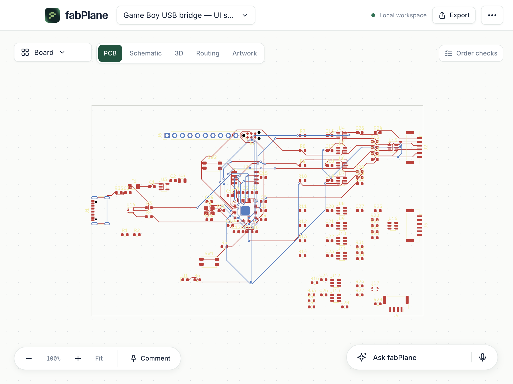
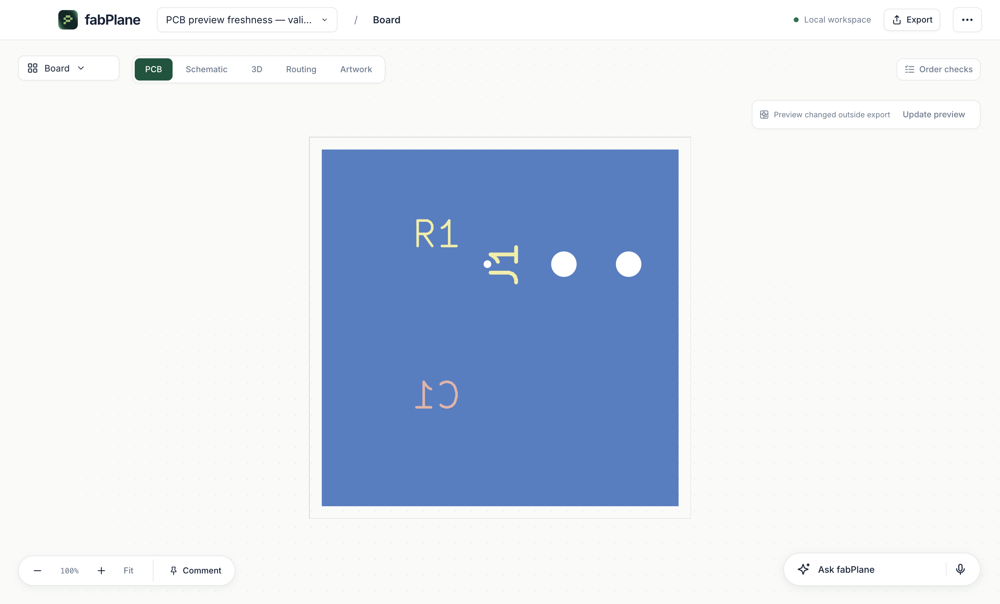
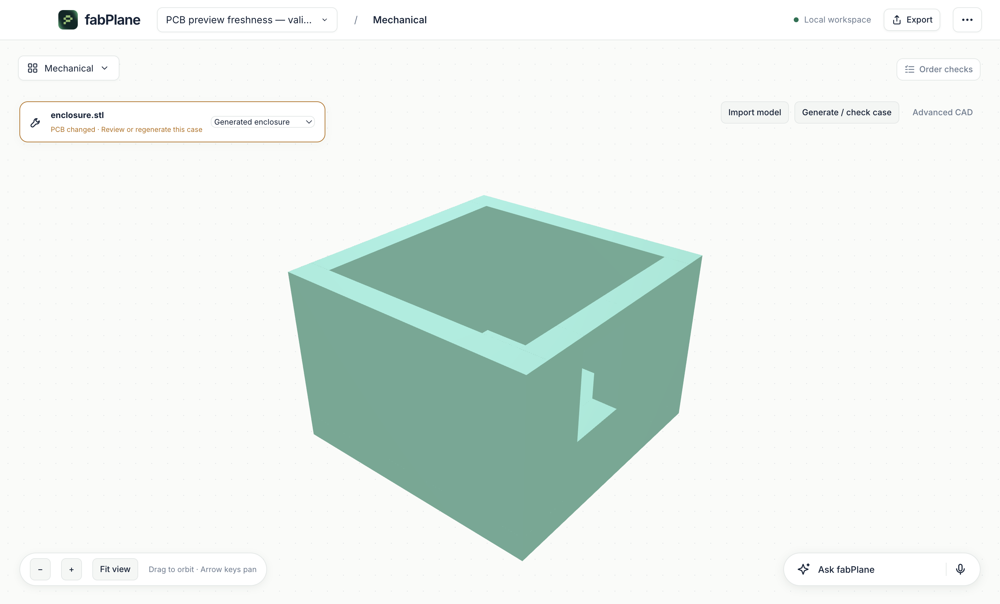
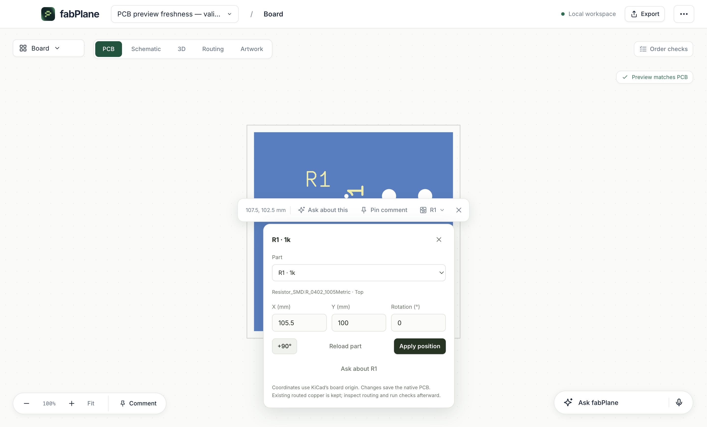
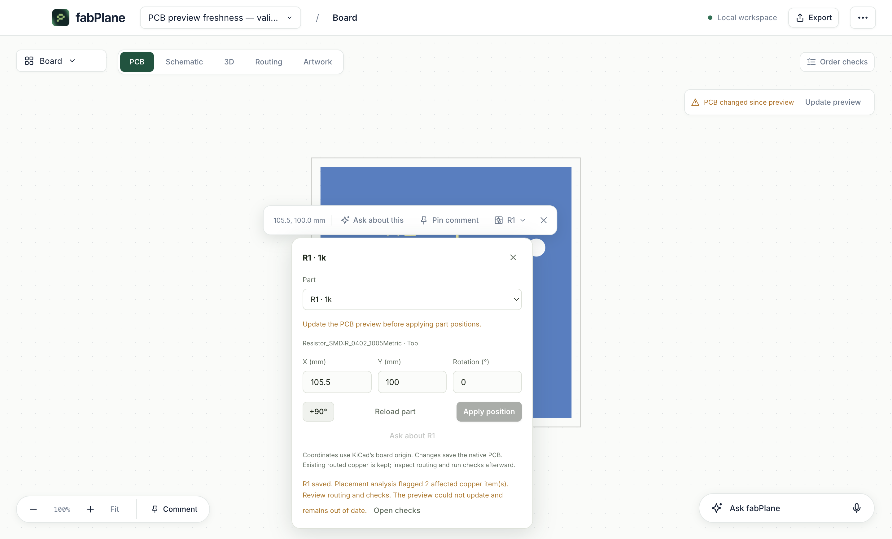
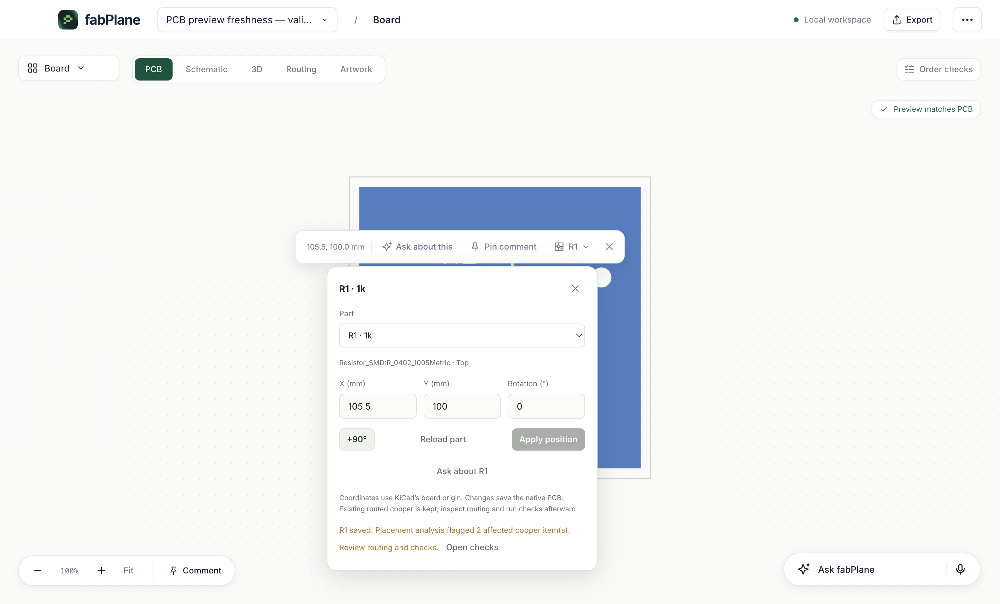
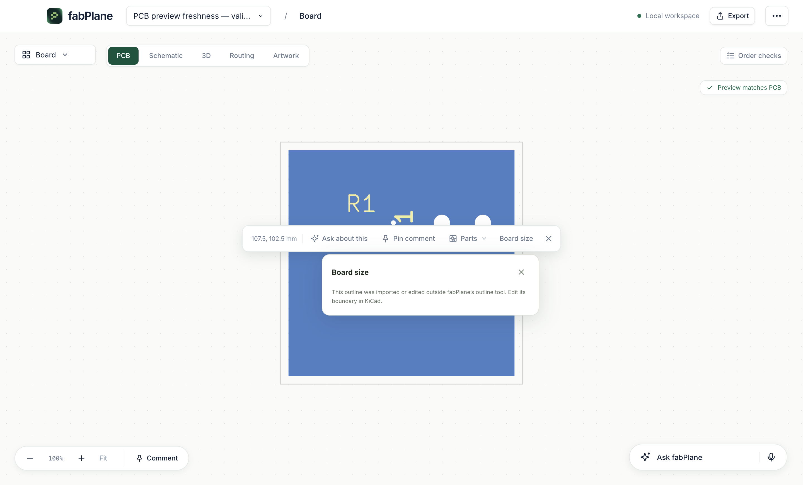
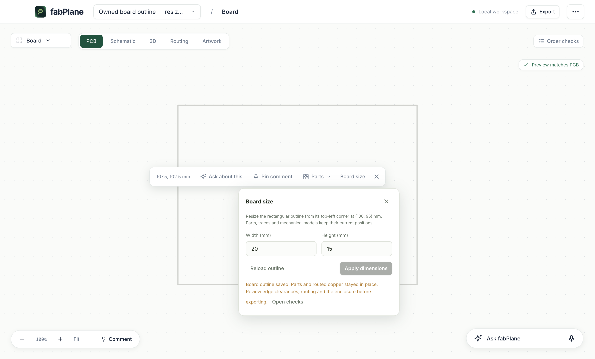
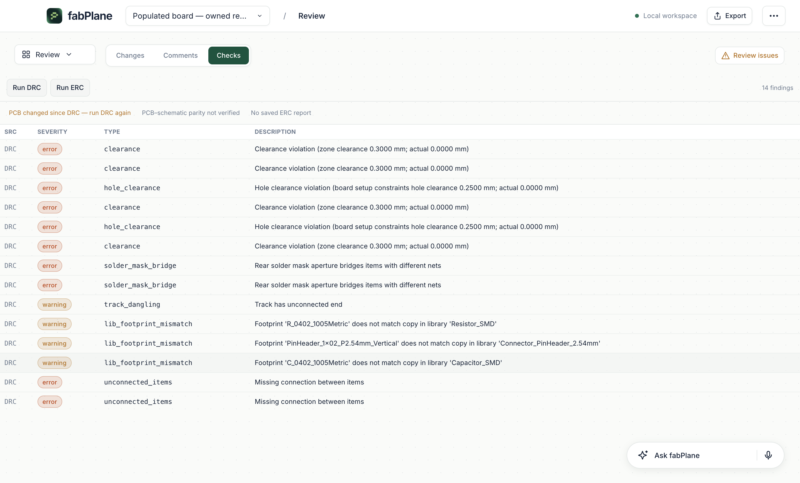
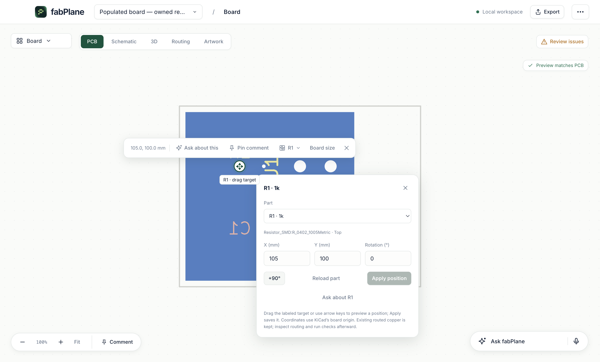

# Canvas workspace implementation milestone

Design roadmap: [#388](https://github.com/TensorFleet/fabdesk/pull/388). Implementation continues in [#389](https://github.com/TensorFleet/fabdesk/pull/389).

Current implementation includes: a primary canvas and corner assistant; project/task navigation; fresh sketch/idea/artboard entry; actual board overview; shared Review comments; PCB SVG byte provenance and explicit updates; interactive board model viewing; grouped model/video outputs; original enclosure imports with units/provenance; case generation and live source-change warnings. Native resize/replacement, multi-board assembly, schematic reconciliation and remaining artifact dependencies are still unfinished. Latest validation: UI218, client181, protocol86, tools392; root typecheck plus affected follow-up checks pass. Desktop149 passed at the shell milestone. See evidence sections below for scope and limits.

## Implemented

- One primary canvas with the assistant and project/chat drawer closed by default. Project selection lives in the header. The previous shell remains available through the workspace menu.
- Task navigation groups Overview, Board, Mechanical, Parts, Outputs, Review, and Files. Existing PCB, schematic, 3D, routing, artwork, CAD, BOM, renders, files, notes, diff and checks remain reachable. Local tabs stay available within a task.
- Board SVG preview keeps its camera across source refreshes. Selecting a location reveals Ask about this and Pin comment; keyboard selection works too. These are location tools, not native footprint selection or editing.
- A project overview uses real saved files, previews and readiness responses. It currently represents the canonical single board. Saved previews may be older than source; this milestone does not certify their freshness.
- Centered fresh start offers idea, sketch/image, GitHub design import and a new artboard project. First sending creates project ownership; sketch upload preserves original image bytes and project-scoped drafts.
- A single mounted conversation/composer survives the transition into the assistant dock, including a failed initial send. Project switching restores the saved task, clears unrelated conversation context and reveals the canvas.
- Official desktop icon and fabPlane wordmark in the new header. User-facing privacy/import copy uses fabPlane.

## Evidence

Native Electron development app, isolated profile/core/projects; existing project sources were copied into the study project without changing the original. The board preview and saved render are separate existing artifacts and visibly differ. No new board, compatibility or freshness claim is inferred from these images.

Root typecheck passes. UI tests: 217 pass. Client-core tests: 170 pass; desktop tests: 149 pass with local HTTP/process fixture access; the restricted sandbox denied two fixture servers. Native checks cover logo load, closed assistant, real board navigation, location tools, overview, project-scoped drafts and failed-first-send ownership. The full suite has the previously recorded unrelated KiCad/core failures; see [earlier validation](../sketch-first/README.md).

## Next work and limits

This is a navigation and interaction foundation, not completion of the screenshot roadmap. Still required: adaptive first-open overview for explicit multi-board projects; assembly membership and relationships; source revision/freshness tracking and directional reconciliation; native safe resize/replacement; model upload/generation flow; unified output/review workflows; remaining accessibility walkthroughs; all accepted concept states and end-to-end project exercises. Existing views are grouped, not yet fully redesigned. No fabricated synchronization or native editing controls are presented.

## Subsequent native walkthrough

All 12 existing destinations were opened in the native app: PCB, schematic, 3D/video, routing, artwork, CAD, parts/shopping, renders, changes, checks, files and notes. The assistant stayed closed and no page overflow appeared. This checks navigation and presentation, not successful execution of every backend operation.

The desktop enforces a minimum 960 × 720 window. Canvas and explicitly opened assistant fit that size. Appearance settings switched between fabPlane light and dark. A harmless comment was temporarily added to the isolated PCB SVG then restored: the preview blob URL changed automatically, while the host width and 125% zoom stayed identical.

Overview tools now appear only after board selection. The preview is labeled Saved preview; revision-based freshness remains a follow-up.

## Review comments milestone

Review now groups Changes, Comments and Checks. Comments reuse the existing project `comments.json` API and drawing pins. Active/resolved filters, resolve/reopen and source-drawing navigation are connected to saved project data. Ask about this prepares a draft containing the existing pin ID and opens the assistant; the user sends it explicitly.

A clearly labeled question was created in the isolated study project. Native walkthrough verified that resolving writes `resolved` to the server and removes the item from Active, reopening returns it, Show on drawing opens its exact selected pin/detail, and Ask about this retains the pin ID in the draft. Closing comment details restores focus to the Comment button. The assistant launcher no longer overlaps the comment-detail action area. UI tests now total 218 passing, including cross-project comment navigation isolation; root typecheck passed and the subsequent UI polish typecheck passed.

## PCB preview freshness milestone

PCB SVG exports now render an immutable snapshot and write `renders/pcb.svg.revision.json` with SHA-256 hashes of the saved PCB input and generated SVG bytes. If the source changes during export, generation fails before replacing the previous preview. The UI compares both files against that receipt and responds to the existing project-change events. It distinguishes a matching source, changed PCB, replaced SVG, missing files and absent/invalid provenance. Transport errors remain errors.

Update preview is explicit. Legacy previews stay unverified; opening the canvas does not regenerate them. A matching status covers this SVG against `board.kicad_pcb` only. It does not certify schematic reconciliation, 3D assets, renders, manufacturing outputs, electrical checks or enclosure fit. Those remain separate dependency/compatibility work.

The earlier Game Boy study file requires KiCad 10.99 while the installed CLI rejects it. That failed update stayed unverified and showed the actual error. A new isolated project using the committed `mini-two-layer.kicad_pcb` KiCad 9 fixture was rendered through the real UI action. Native validation showed matching status, changed-source warning after a whitespace edit, matching status again after explicit snapshot export, and modified-preview status after a temporary SVG comment; the SVG was restored byte-for-byte. No circuit or production project was changed. A development-core restart encountered an existing port collision; only the verified isolated app/core were relaunched to finish the walkthrough.

Checks: root typecheck passes; UI 218, client-core 175, protocol 86, tools 392 tests pass. Seven new focused tests cover legacy/invalid receipts, source change/return, altered outputs, missing files, transport failure, exact export hashes and source changes during generation (preserving the previous SVG). The draft PR's preceding comments milestone also passed its GitHub verify jobs; these new changes require their own CI run.

## Interactive board model milestone

Board → 3D now opens a real interactive model canvas instead of video configuration. Generate/Update explicitly exports the saved KiCad board to GLB. Orbit, zoom, keyboard pan/rotation and Fit change the view only. Video configuration lives under Outputs → Models & video, with View model and authenticated Download GLB actions. The classic fallback keeps its existing export view.

The viewer loads lazily, renders on demand, resizes with its container, retains the camera through model refresh, and disposes graphics resources when closed. Standalone model loading blocks referenced remote resources. Graphics/load failures have retry guidance. The source file remains untouched by view controls. This milestone is a viewer, not native placement/resize or a multi-board assembly editor. GLB revision/freshness tracking is not yet implemented.

Native validation used an actual CLI-exported GLB from the isolated KiCad 9 fixture, not a generated concept image or a pretend populated board. Its sparse geometry reflects the available fixture. Keyboard orbit, zoom, Fit and both directions of Board/Outputs navigation worked; SHA-256 of the GLB was identical after view actions. The download button and authenticated file path are connected; an OS save-dialog/download walkthrough remains to do. Root typecheck and UI218 tests pass. Three.js 0.186.1 and matching 0.186.0 type definitions were added with the root lockfile.

## Mechanical import and generation milestone

Mechanical now starts with two clear choices: Import a model or Generate from PCB. Advanced CAD is opened explicitly; its runtime/kernel setup does not occupy the initial canvas. Redundant single-option tab pills are hidden.

STL/OBJ imports require source-unit confirmation; GLB uses metres and STEP retains file-defined units. Originals are written unchanged under a unique project import directory, with versioned metadata (original name, format, units, SHA-256, byte length, import time and unplaced status). Metadata retries reuse the same file/path; parallel saves do not create duplicate imports. Source paths stay scoped to the captured project. No parametric conversion or fit certification is implied.

STL/GLB/OBJ files can be viewed on the canvas; STEP is preserved with an explicit preview-unavailable state. STEP editing/preview integration, physical alignment, model combination, lid display, watertightness/manufacturability validation, import cancellation, and a complete OS file-picker walkthrough remain follow-ups. STL faces are shown on both sides so reversed winding does not make surfaces disappear; this is display behavior, not mesh repair or print-readiness proof.

Existing enclosure generation/check controls, vents, snap-fits and STL/STEP downloads remain available after choosing generation. The resulting base STL can be selected on the same canvas as imported originals. The existing generator's own board-hash/alignment report is retained; live freshness warnings on the collapsed generated-case canvas are still to add.

Native isolated walkthrough: imported the repository's generated test-box STL through the actual input/change/save handlers (fixture supplied through the development bridge); Import was disabled until millimetres were selected. Original bytes and recorded SHA-256 matched exactly; metadata remained unplaced. Ran real case generation from the KiCad9 fixture: report was 21 × 21 × 16.1 mm, one cutout, zero standoffs. Both the imported model and generated STL remained selectable. This is a fixture result, not validation of arbitrary mechanical fit.

Checks: root typecheck passes; UI218/client179/protocol86 tests pass. Four new session tests cover original bytes, metadata-retry reuse and unit correction, concurrent saves/different-file rejection, and unit/format/path validation.

## Live enclosure source review

The generated-case canvas now warns when `board.kicad_pcb` differs from the revision recorded in `enclosure.json`. This is a negative freshness signal; unchanged source is not presented as fit/print-readiness certification. The case is never regenerated automatically.

An open generator report refreshes when project data refreshes, including same-size/same-timestamp source edits. Background refresh and explicit alignment checks preserve unsaved parameter controls. A project without a PCB can import a model; generation is disabled with guidance to add the PCB first.

Native walkthrough temporarily edited the isolated PCB while preserving its byte length and mtime. The report changed to stale and the unsaved outline offset remained 2 mm. The collapsed canvas also showed the changed-source warning; SHA-256 of the generated STL remained identical. The PCB bytes/timestamps were restored. Two added client tests cover byte identity, changed source, invalid provenance, missing PCB and transport errors. Client181/UI218 pass; root typecheck passed before the final UI guard, and affected client/UI typechecks passed afterward.

## Native placement prerequisite

Native component inspection on the isolated KiCad9 fixture returned the real R1/J1/C1 references, saved positions, rotation, layer and lock state. The existing placement tool preserves embedded geometry and routed copper by default and reports affected copper. Canvas footprint selection/movement/resize is still not presented as implemented.

`pcb_place` now optionally accepts the saved PCB SHA-256 from inspection. The native provider rejects stale source before opening a session and rechecks after asynchronous preflight; the existing native save guard handles later external writes. A conflict does not overwrite the changed disk file. Callers that omit the optional hash retain existing behavior.

Root typecheck passes. Two focused core tests prove a stale hash is rejected without opening a session, and a source edited during preflight never enters a commit or overwrites the external edit. Two tools tests verify hash forwarding and malformed-hash rejection before mutation context. Tools394 tests pass. The preceding `5774417` milestone passed both GitHub verify jobs and the real-board pipeline. A native end-to-end guarded edit and canvas controls are next, not yet certified by these mock/unit checks.

## Contextual native part positioning and coordinate verification

Select a drawing location, then Parts to inspect actual saved KiCad references nearby. The compact popup offers absolute X/Y in native PCB millimetres, rotation, a 90° shortcut, Reload part, Apply position and a part-specific assistant draft. Chat and properties remain closed by default. The popup stays within the window and scrolls when needed. Locked parts, missing/unknown coordinates, stale inspections and non-current previews cannot drive a placement. The captured project and source SHA stay attached to each edit.

A real isolated walkthrough moved R1 from (105, 100) to (105.5, 100) through these controls. Native inspection confirmed the saved position, and tracks, vias, zones and net records were identical before/after. Placement analysis reported two affected copper items, displayed with an Open checks action; this is not a DRC pass. Temporarily changing the source disabled Apply while preserving the typed value; restoring the exact source re-enabled it. The fixture and its preview/receipt were restored after the test.

Preview refresh exposed a local toolchain mismatch: the installed native editor writes PCB format 20260901, while the CLI rejects that format despite both reporting 10.99. The saved position remains saved; the preview stays visibly stale, further placement is disabled, and export details are available without claiming the preview updated. A follow-up walkthrough used the already-installed fabPlane-bundled CLI (the exact executable serving the native session) through a temporary setting in the isolated profile. Save → preview refresh → matching source/artifact receipt then passed, with the two affected-copper warning retained. The setting and fixture were restored. The default development CLI selection still chooses the incompatible host install and needs separate discovery/alignment work.

The coordinate investigation found that KiCad board-area SVG export rebases its origin. New exports use current-page mode (native coordinates), then crop only the SVG viewport to the outline plus margin. Physical scale is checked and the root receives a coordinate-frame stamp. An actual CLI integration test confirms nonzero source coordinates stay nonzero. The behavior is also documented in [KiCad's SVG exporter source](https://gitlab.com/kicad/code/kicad/-/blob/9.0/pcbnew/exporters/export_svg.cpp). Existing previews remain origin-unverified until explicitly regenerated. Earlier screenshot pin labels predate this verification and must not be treated as proof of native positions.

New pins record their coordinate frame. Legacy pins whose mixed SVG/mm fields have an unknown origin remain in Review, but are neither projected onto the verified native frame nor passed to the agent as native millimetres. No origin is guessed. Re-pinning old comments still needs a dedicated flow. Changing preview coordinate frames clears unsaved drawing selections/pins so a location cannot silently change meaning.

Validation: final root typecheck passes. UI220, client186, protocol87 tests pass; the client transport suite requires loopback permission. Three crop-coordinate unit tests and the real CLI SVG-export integration test pass. The preceding native SHA guard has tools394 tests plus two focused core conflict tests. Dragging, board resizing, replacement, multi-board ownership, persistent placement findings, and full schematic/output reconciliation remain work in progress.

## Native outline resize prerequisite

The existing outline tool now accepts an optional inspected-source SHA and checks it before opening the native document and again after asynchronous preflight. It rejects unsaved documents and refuses replacement of mixed human/tool-owned boundaries, curved/non-segment Edge.Cuts and locked edges. Exact segment comparison includes every existing edge, preventing a partial tool-owned match from hiding additional human edges. Ownership property keys remain unchanged for compatibility; visible commit/error wording uses fabPlane.

Native board-geometry inspection now includes lock and tool-owned-outline facts for the upcoming contextual controls. This is a backend prerequisite, not a shipped drag/resize UI. Unrelated silkscreen is preserved by the native transaction; arbitrary human-authored outlines still require KiCad editing.

Validation: seven new core cases cover stale-before-open, external changes during preflight, mixed ownership, curves, locks, unsaved state, and exact owned-only replacement. Two tools tests cover hash forwarding and malformed-hash rejection. Core46 focused/compatibility tests, tools396 tests, and affected core/tools typechecks pass. Tools HTTP/process fixtures require execution outside the restrictive sandbox. The preceding implementation commit's real-board GitHub pipeline passed; its verify jobs were still queued when checked.

## Contextual board-size controls

Selecting a PCB location now offers Board size beside Parts, using the same single contextual popup. Simple width/height editing is available only for a complete, unlocked, axis-aligned four-segment rectangle owned by the existing outline tool. Imported/manual, curved, duplicate, disconnected, truncated, unknown-ownership and locked cases stay read-only with guidance and Reload. Missing outlines require explicit dimensions. Edits preserve the native top-left origin; they do not scale footprints, routing or mechanical models. Apply uses the inspected SHA, and save/refresh errors remain distinct. Controls cannot switch/close during a write.

A live read-only test found that the older spatial provider does not normalize the string Edge.Cuts alias; this briefly made an imported rectangle appear empty. The client now requests the explicit native BoardLayer enum 47 from inspection v2, with a regression test. No outline was changed in that failed inspection. The actual imported rectangle is now correctly read-only.

Native UI validation used a separate empty project whose outline was created through the native outline tool at (100,95)–(115,110). Applying width 20 mm retained height 15 mm and produced exact bounds (100,95)–(120,110). Native inspection confirmed four owned segments and a current refreshed preview. Components/tracks/vias/zones/nets were unchanged; those collections are empty in this fixture, so this is not a populated-board clearance or routed-resize validation. The compatible installed fabPlane CLI was temporarily selected only in the test profile and restored afterward.

Final root typecheck, UI220/client191/protocol87 tests pass. Five client cases cover native-origin preservation, unsupported ownership/locks/curves/truncation, invalid topology/dimensions and exact layer filtering. Prior guard validation remains core46/tools396. Drag handles, populated-board resize validation and physical compatibility checks remain follow-ups.

## Populated native resize and complete Checks display

A second isolated project copies the committed routed mini-board fixture. Preparation removes only its exact known test-outline rectangle from the new copy, then creates the same bounds through the native outline tool; no imported production boundary is adopted or changed. The repository fixture is untouched. Through the actual UI, width 15→20 mm preserved top-left (100,95), height 15 mm, all three components, five track/via rows, the via, the zone and all net records. The regenerated SVG receipt matches the saved PCB. This demonstrates content preservation, not clearance or manufacturability.

Real saved-PCB DRC ran afterward with schematic parity explicitly disabled: **8 errors, 4 warnings, 2 unconnected items**. The PCB source hash was identical before/after checking. No claim is made about which findings were caused by the resize because a before-resize DRC baseline was not measured.

Open checks exposed a report-format mismatch: the existing view dropped normalized `unconnected` and `schematicParity` categories. It now reads normalized and raw KiCad names without counting alias copies or nested raw payloads twice. The native view shows all **14 findings**, including the two missing connections. Loading no longer briefly labels an empty array as zero findings; an empty report no longer claims that the board passes every rule. UI221 tests and affected typecheck pass; prior final root typecheck passed for the board-size milestone.

## Saved-check source warnings

Checks compares the PCB SHA-256 stored in a qualified DRC report with the current saved board bytes. A changed board produces an explicit re-run warning; unchanged bytes are described only as unchanged since the report, never as a rule-check pass. Missing/legacy/invalid provenance stays unverified and transport failures offer retry. The view also makes missing ERC and unverified schematic parity explicit; ERC freshness is not yet implemented.

Actual native validation replaced one whitespace byte in the populated study PCB while preserving file size and mtime. The source warning appeared, and hashes of the saved DRC report and SVG stayed identical: no automatic check/render was run. Restoring the exact PCB bytes cleared the warning. The original source bytes/timestamps were restored. Unit coverage includes changed/returned bytes, missing/invalid receipts, missing PCB and transport failures.

Final root typecheck and UI221/client193/protocol87 tests pass. This tracks saved PCB identity only. It does not authenticate a manually edited report, certify ERC/parity, track external library/rule dependencies or replace complete DRC freshness qualification.

## Part position targets on the canvas

Selecting an actual native reference reveals a labeled position target. Dragging proposes absolute coordinates snapped to 0.1 mm; Shift uses 0.01 mm. Arrow keys provide the same increments. Pointer cancellation restores the draft at drag start. Apply remains the only placement write; the saved footprint/copper image stays visible until the native save and preview refresh complete. This is a position target, not a live footprint-shape or DRC simulation. The popup opens beside the selection, stays within the window and retains canvas theme tokens; the target remains visible above it.

Native verification used real keyboard input plus development-bridge pointer move/up/cancel events on R1. Nudges changed the proposal, cancellation restored the prior typed position, and the board hash remained unchanged until Apply. Apply saved R1 at (105.5,100), refreshed the SVG, and retained tracks/vias/zones/nets exactly. The fixture and its preview/receipt were restored. A separate physical mouse drag through native computer control changed the proposal to X=105.4; a source-hash check proved no PCB write, and Reload restored X=105. Mouse release uses its final coordinates. Multi-pointer starts cannot replace an active drag.

Visual review moved the popup off the target and checked non-overlapping rectangles. Native position/dimension Apply is disabled while source verification is pending or a current inspection failed; cached successful data cannot keep the action enabled. Preview verification also stops showing the matching badge during a pending/error recheck. Root typecheck and UI221 tests pass. Physical drag-to-save in a populated design, broader compact-window drag/accessibility scenarios, footprint geometry ghosts, magnetic snapping, collision/clearance overlays, multi-select and undo UI remain follow-ups.

## Fine-coordinate target entry

Keyboard nudging now preserves off-grid coordinates on the untouched axis and adds the requested delta at native precision, rather than snapping both axes. Pointer dragging still uses its explicit absolute grid. A stationary target click focuses it without snapping; a small movement threshold separates focus from drag. Number fields accept valid fractional positions/angles and PCB outline dimensions, and values are captured immediately before state updates. Outline dimensions smaller than one native nanometre are rejected.

Three regression tests cover off-grid/negative coordinates, reversible nudges, and pointer-grid behavior. A native walkthrough entered (105.123,100.456789), clicked the target without movement, then nudged right and Shift-up: the resulting proposal was exactly (105.223,100.446789), the form remained valid and the PCB hash stayed unchanged. Reload restored the saved position. Root typecheck and client196/UI221 tests pass.

## Native board corner resizing

Owned rectangular outlines now have a labeled bottom-right corner handle and dashed size proposal. Mouse dragging or arrow keys updates width/height; the top-left native origin stays fixed. Pointer snapping uses that origin, so fractional native origins do not distort dimension increments. The geometry is not written until Apply dimensions. Cancellation/blur restores the draft at gesture start. Imported/complex/locked boundaries remain read-only in this milestone.

Resize mode shows one contextual dimension panel and hides the unrelated drawing-location toolbar/marker. Closing it restores the toolbar and focus. The panel stays beside the drawing and the resize target stays visible. The primary preview status shares native-save/refresh activity, preventing a duplicate manual update during this flow.

Native validation used the populated fixture: keyboard and window-level pointer gestures proposed 22×16 mm, cancellation and blur restored the prior draft, and source bytes stayed unchanged before Apply. Save retained origin (100,95), all components, tracks, vias, zones and nets; the preview refreshed to the saved source. A separate physical mouse drag and native Apply saved **21.9×16 mm** with the same preservation checks. The temporary CLI setting, source files, preview receipt and original timestamps were restored afterward.

The physical drag exposed an OS-driver/capture path where movement outside the small handle stopped reaching it. The target now tracks a single active gesture at window scope, cleans listeners on up/cancel/blur/unmount, and suppresses only the immediate post-drag click. The actual physical drag then passed. The part-target native save regression also passed using this shared engine. Final root typecheck and client197/UI221 suites pass; the added origin-relative snap case passes. Multi-edge/curved outline editing, additional anchors/aspect constraints, multi-selection, undo/recovery UI and broader platform/compact-window gesture coverage remain follow-ups.

## Resize imported rectangles without replacing their native edges

Complete unlocked rectangular boundaries now use `pcb_resize_outline`: either one native rectangle or four closed, axis-aligned segments. The operation updates the existing primitives in place, retaining IDs, style and custom metadata without claiming tool ownership of imported geometry. Locked ancestor groups, missing/partial edges, curves, cutouts, unsaved documents and stale source hashes stop the write. Legacy outline creation/replacement keeps its ownership guard. UI editing additionally requires the explicit native millimetre coordinate frame and the runtime's resize capability.

A real KiCad integration test saves, closes and reopens an imported rectangle, checks its original ID, stroke and custom property, and compares components, pads, tracks, vias, zones and named connectivity. Internal numeric net codes can be renumbered on reopen and are excluded only from the net-list comparison. The native UI walkthrough resized the populated imported rectangle from 15×15 to 20×16 mm, kept its original ID and non-tool-owned status, and refreshed the matching SVG receipt. The generated enclosure then displayed a source-change warning while its STL and specification bytes stayed unchanged. Restoring the source cleared the warning. All fixture files and timestamps were restored after the walkthrough.

Validation: root typecheck; client-core 200, UI 221, protocol 87 and tools 398 tests; 52 focused core/tool checks; one real KiCad save/reopen integration test all pass. These establish source/content preservation, not clearance, enclosure fit or manufacturability. Irregular boundary editing, multiple outlines and undo/recovery UI remain follow-ups. Earlier imported-outline read-only screenshots document the previous milestone.

## Respect native placement locks

Component inspection now reports effective locking through ancestor groups as well as the footprint's own lock. Contextual positioning explains that the part or its group must be unlocked in KiCad. Native placement rejects geometry edits to members of locked groups before any mutation, including an attempted footprint-only unlock. A separately locked footprint can still be deliberately unlocked with the existing explicit `lock=false` tool option; unlocked groups do not block editing.

Focused placement/revision/compatibility checks: 42 pass. Real KiCad tests create and save a locked group containing an unlocked R1, confirm inspection reports it locked, reject both movement attempts (with/without own unlock), and compare saved bytes and native coordinates unchanged. The existing imported resize save/reopen test also passes. Root typecheck, final core typecheck, UI221 and tools398 suites pass. Group-aware lock coverage does not replace clearance or full editor recovery validation.
