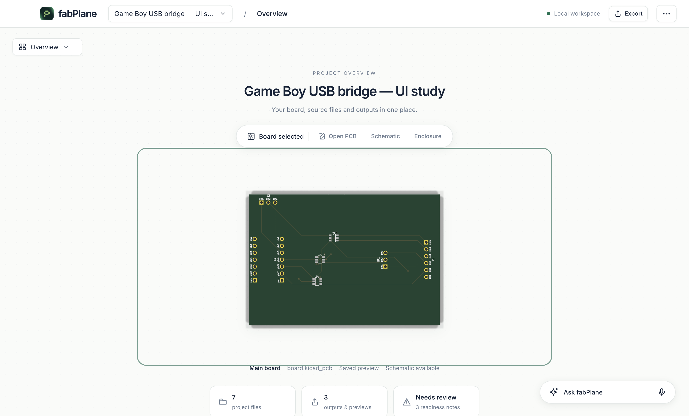
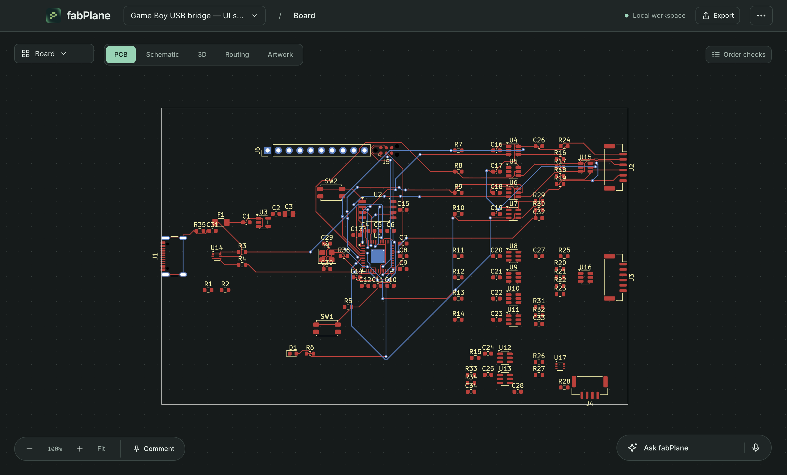
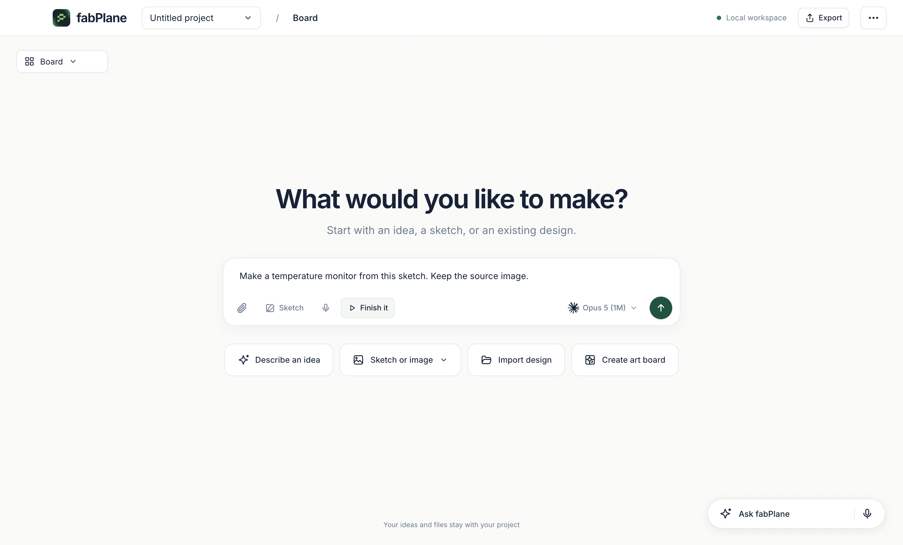

# Canvas workspace implementation milestone

Design roadmap: [#388](https://github.com/TensorFleet/fabdesk/pull/388). Implementation continues in [#389](https://github.com/TensorFleet/fabdesk/pull/389).

## Implemented

- One primary canvas with the assistant and project/chat drawer closed by default. Project selection lives in the header. The previous shell remains available through the workspace menu.
- Task navigation groups Overview, Board, Mechanical, Parts, Outputs, Review, and Files. Existing PCB, schematic, 3D, routing, artwork, CAD, BOM, renders, files, notes, diff and checks remain reachable. Local tabs stay available within a task.
- Board SVG preview keeps its camera across source refreshes. Selecting a location reveals Ask about this and Pin comment; keyboard selection works too. These are location tools, not native footprint selection or editing.
- A project overview uses real saved files, previews and readiness responses. It currently represents the canonical single board. Saved previews may be older than source; this milestone does not certify their freshness.
- Centered fresh start offers idea, sketch/image, GitHub design import and a new artboard project. First sending creates project ownership; sketch upload preserves original image bytes and project-scoped drafts.
- A single mounted conversation/composer survives the transition into the assistant dock, including a failed initial send. Project switching restores the saved task, clears unrelated conversation context and reveals the canvas.
- Official desktop icon and fabPlane wordmark in the new header. User-facing privacy/import copy uses fabPlane.

## Evidence

Native Electron development app, isolated profile/core/projects; existing project sources were copied into the study project without changing the original. The board preview and saved render are separate existing artifacts and visibly differ. No new board, compatibility or freshness claim is inferred from these images.

Root typecheck passes. UI tests: 217 pass. Client-core tests: 170 pass; desktop tests: 149 pass with local HTTP/process fixture access; the restricted sandbox denied two fixture servers. Native checks cover logo load, closed assistant, real board navigation, location tools, overview, project-scoped drafts and failed-first-send ownership. The full suite has the previously recorded unrelated KiCad/core failures; see [earlier validation](../sketch-first/README.md).

## Next work and limits

This is a navigation and interaction foundation, not completion of the screenshot roadmap. Still required: adaptive first-open overview for explicit multi-board projects; assembly membership and relationships; source revision/freshness tracking and directional reconciliation; native safe resize/replacement; model upload/generation flow; unified output/review workflows; remaining accessibility walkthroughs; all accepted concept states and end-to-end project exercises. Existing views are grouped, not yet fully redesigned. No fabricated synchronization or native editing controls are presented.

## Subsequent native walkthrough

All 12 existing destinations were opened in the native app: PCB, schematic, 3D/video, routing, artwork, CAD, parts/shopping, renders, changes, checks, files and notes. The assistant stayed closed and no page overflow appeared. This checks navigation and presentation, not successful execution of every backend operation.

The desktop enforces a minimum 960 × 720 window. Canvas and explicitly opened assistant fit that size. Appearance settings switched between fabPlane light and dark. A harmless comment was temporarily added to the isolated PCB SVG then restored: the preview blob URL changed automatically, while the host width and 125% zoom stayed identical.

Overview tools now appear only after board selection. The preview is labeled Saved preview; revision-based freshness remains a follow-up.

## Review comments milestone

Review now groups Changes, Comments and Checks. Comments reuse the existing project `comments.json` API and drawing pins. Active/resolved filters, resolve/reopen and source-drawing navigation are connected to saved project data. Ask about this prepares a draft containing the existing pin ID and opens the assistant; the user sends it explicitly.

A clearly labeled question was created in the isolated study project. Native walkthrough verified that resolving writes `resolved` to the server and removes the item from Active, reopening returns it, Show on drawing opens its exact selected pin/detail, and Ask about this retains the pin ID in the draft. Closing comment details restores focus to the Comment button. The assistant launcher no longer overlaps the comment-detail action area. UI tests now total 218 passing, including cross-project comment navigation isolation; root typecheck passed and the subsequent UI polish typecheck passed.

