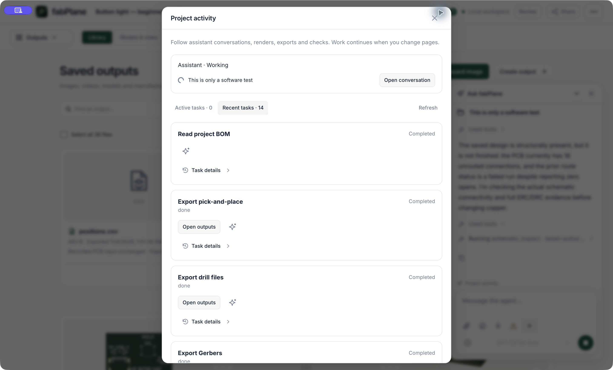
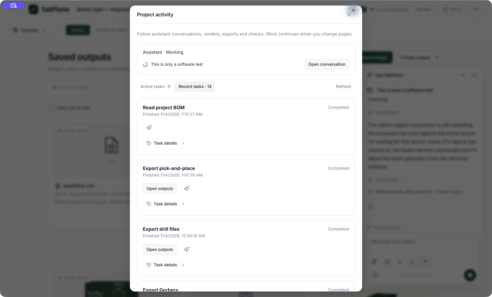
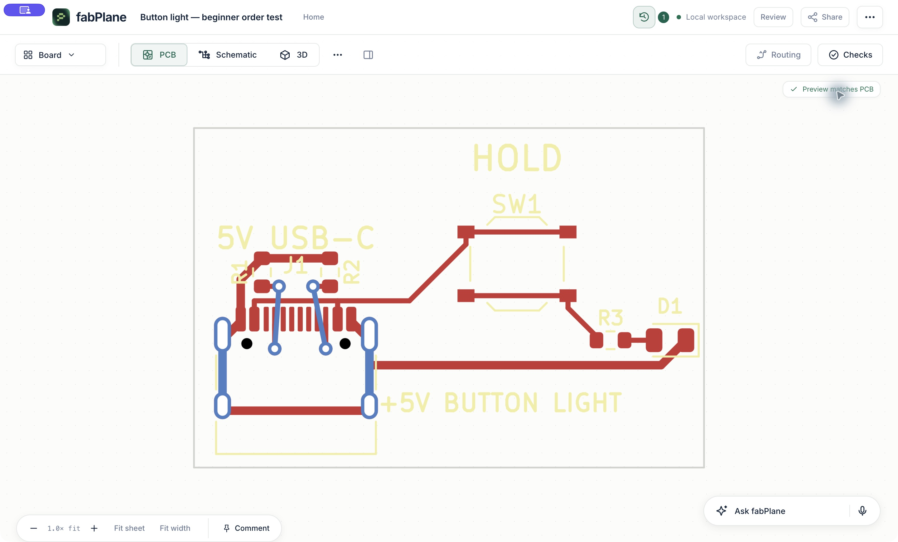
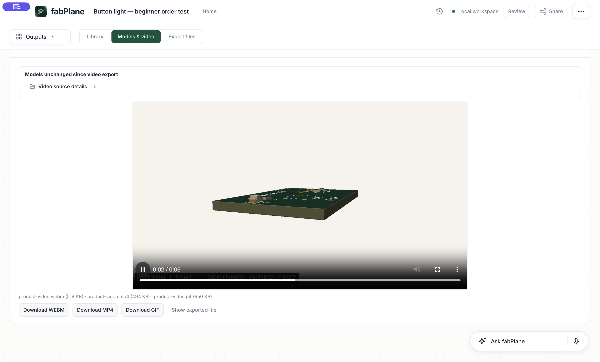

# Stabilization checkpoint · November 4

The beginner software test now reaches a clean saved native design and a manufacturing handoff. This closes the earlier sourcing pause **for this isolated test**: the owner said to use anything to complete it. Existing C165948 is allowed here; no general sourcing policy was weakened, live stock certified, manufacturer upload or purchase made.

The test remains **Passed with friction**, rather than evidence that every app feature or real-world board is production-ready. The owner asked for a solid checkpoint before more features; this pass is limited to completing the existing journey and documenting remaining integration work.

## Tested result

| Journey / verification | Result |
| --- | --- |
| Home → plain-language idea → named test project | Previously completed through visible UI; original user idea and unsent review draft preserved |
| Continue existing small-board design with test-only sourcing exception | New project conversation through normal clicks/typing; no source injected by the tester |
| Final saved native design | 30×20 mm, six fitted references, all copper routed |
| Complete-hierarchy ERC | 0 errors / 0 warnings; source-stable measured report |
| PCB DRC with schematic parity | 0 errors / 0 warnings / 0 unconnected; no parity findings |
| Release gate | Pass, stable native revision,39 required outputs; no warning baseline silently added |
| PCB drawing | Loads; visible Update preview repairs missing release-generated receipt, then Preview matches PCB |
| Schematic | Loads and Fit works; native labelled circuit is technical and needs explanation for a novice |
| 3D | Actual orbit works; PCB unchanged since export; exact J1/SW1 bodies remain missing and explicitly disclosed |
| Top/perspective images | Generated from final PCB; recorded PCB input unchanged; external model dependencies remain unverified |
| Review video | Native playback advances in a useful landscape viewport;1280×720 H.264,6 seconds,505745 bytes; MP4/WebM/GIF hashes verified against the recorded final GLB |
| Video download | Native Save → button-light-final-test-20261104.mp4; byte-exact against saved output |
| Manufacturing package | Fresh fabrication.zip146149 bytes/31entries/CRCclean; Gerbers, drills, schematic PDF, generic BOM and native placement CSV included |
| Assembly handoff | Final app-packaged ZIP73310bytes/28entries/CRCclean contains current Gerbers/drills/generic BOM/placement CSV. Supplier-ID bom-assembly.csv and five-board checklist remain separate; final ZIP and supplier BOM native downloads are byte-exact |
| Order review | Saved-file gate allows review and explains separate stock, assembly mapping and manufacturer preview checks; no external upload/order performed |

Read-only final audit: native PCB/schematic/project bytes still match the release inputs. Later UI/agent preview regeneration changed `renders/pcb.svg` and `renders/schematic/board.svg` relative to the release inventory; the other37 inventory hashes match. The passing release is a recorded checkpoint, not a claim that its two older SVG hashes certify the later preview bytes. The PCB has its separate current source/artifact receipt. Manufacturing ZIP/input receipts are verified independently.

Final PCB SHA-256: `b9c3d8c0005259de4d9bcfa122cc350fdf621a68b15002175c44491a722393dc`. Native schematic SHA-256: `9b866cf0d1022da9d91f05146fc5ce2939b91928a2762c300f2da00ab7acdbd0`. Test sources and pre-continuation backup remain outside this app repository; no generated board files are added to app source history.

Package receipt correction **passed with friction**: the first30-entry archive was changed after its receipt. The bounded UI follow-up rebuilt it with export_zip, preserving the final board. The intermediate explicit-Gerber-only call had26entries; the final normal app package has28entries including generic BOM and placement CSV. Its artifact and all input hashes match, and Library says **Packaged files unchanged · PCB not compared**. This is saved-file integrity, not a fresh PCB/manufacturer approval. Final native download: button-light-final-fabrication-20261104.zip, SHA-256 `048dc51db95800d8b37a4aa98292cdf70fc68aa2f76df3cd0dae3578c0272dbb`. The earlier30-entry download is preserved under its original name. Separate supplier-ID BOM download also matches saved bytes.

Final Review/Checks natively shows **0errors/0warnings/0findings**, with PCB unchanged since report ([capture45](beginner-order-20261104/45-final-zero-findings.png)). The UI conservatively does not attest ERC freshness; the independent saved hierarchy measurement is stable. The original unsent conversation draft remains untouched; engineering occurred in a new test conversation. No assistant/background task remains running.

## Fix and validation

`ee09892` adds recorded Finished/Started times to Project activity, so older successful exports/checks can be distinguished from the currently working assistant. It suppresses only a successful task’s redundant literal done note. Source associations, meaningful notes/errors and original timestamps are retained. Native before33/after34 verified the change while a live assistant remained separately Working.

At this code checkpoint: UI typecheck passes; full UI297tests/1278assertions pass; desktop production build passes in1m5s with zero packaged source maps. Earlier full-root run remains **2417pass/36skip/8fail**, with reproduced KiCad, telemetry and npm-fixture timeouts documented in [the full journey report](BEGINNER-ORDER-20261104.md). It was not rerun for this small presentation fix. No hosted-CI or whole-suite green claim; no timeout budgets, engineering gates or tests weakened.

## Remaining work before expanding scope

1. **Connected-part move/repair friction — existing [#222](https://github.com/TensorFleet/fabdesk/issues/222).** In this test, pcb_place(staleCopper=remove) reported0 stale items but2 foreign-pad contacts; subsequent DRC measured13errors. This is a reported intermediate damage state, not a false clean result. Bounded5V rerouting recovered. Review with teammate placement integration; do not duplicate the existing issue or rebuild PR393 here.
2. **Preflight exact geometry before proposing a correction.** The first0.3mm move and19mm board-height proposal did not clear silk extending to19.2mm; a20mm outline finally did. Repeated approval/repair loops make a small novice task slow. Existing native tools were used to finish this disposable design; teammate resize/replacement functionality was not integrated.
3. **Unify artifact receipts across release/agent exports.** release_build directly writes PCB previews/fabrication outputs while normal render/export tools record separate receipts. The UI correctly warns when evidence is missing or changed, but users need an extra Update preview or package rebuild. Preserve conservative freshness; record exact hashes only after stable-source verification. Do not equate file existence with freshness.
4. **Finish broader regression/performance diagnosis and hosted CI.** Keep the PR draft until those separately recorded failures and platform acceptance gaps are resolved.

The release’s advisory LED-current/polarity topology evaluator still reports undecided rail evidence. The native netlist/parity checks pass; no measured powered functionality, simulation, physical fit or manufacturer BOM/CPL/polarity/rotation acceptance is claimed. J1/SW1 exact STEP bodies and fresh supplier stock remain production checks. No enclosure, teammate replacement/resize integration, Board Art Apply/polish, mobile/installer/cross-platform fault sweep or purchasing was added to this pass.

## Actual evidence

All original screenshots remain unaltered locally, including failures and loading states. Capture39 is a loading state during export, not a clean-check screenshot. The selected originals below have a [SHA-256 manifest](beginner-order-20261104/SHA256SUMS).

| Activity before | Activity after |
| --- | --- |
|  |  |

| Final PCB preview | Final video playback |
| --- | --- |
|  |  |

[Interactive 3D with honest model warnings](beginner-order-20261104/42-final-3d-orbit.png) · [Order review](beginner-order-20261104/44-final-order-review.png).
