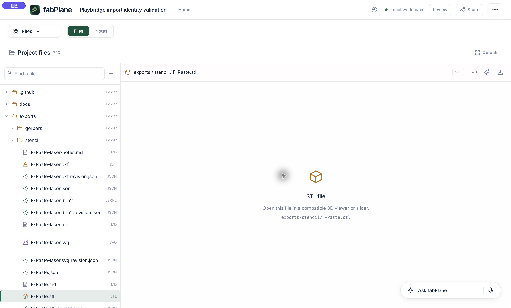
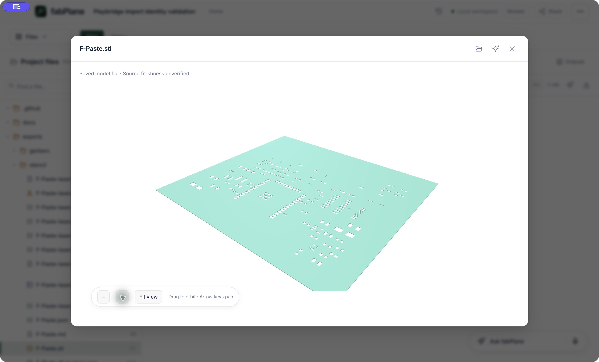
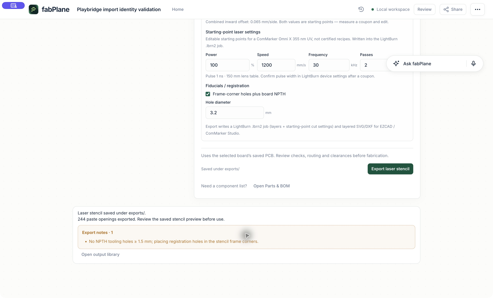
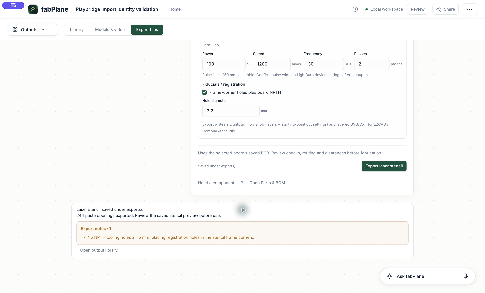

# Native walkthrough evidence · November 2

Actual Electron screenshots, Light theme, 1440×870 CSS / 2880×1740 physical pixels. The source is the isolated, publicly imported Playbridge v4.1 validation project. These are original captures, copied byte for byte; no illustrative board images or synthetic edits.

## Files → model preview

Before `c58ea02`, Library could preview the generated STL but Files sent users to an external viewer. After, Files → Preview model uses the same model dialog, supports Zoom/Fit/Close, and restores the selected file/trigger. Unknown source freshness stays explicitly unverified. The screenshot shows the real generated stencil; no printability certification is implied.

| Before | After |
| --- | --- |
|  |  |

## Long export task → stable navigation and Ask

The real laser exporter completed with244openings and a frame-registration note. `2ef0b17` retains that note on completion. Before `51bd9c9`, scrolling the long form also moved the task navigation and corner Ask button; after, the export task owns its scroll and those controls remain available. Both images show the same saved result and settings.

| Before scrolling fix | After scrolling fix |
| --- | --- |
|  |  |

Native completion checks also exercised standalone Excellon drill,80-row placement CSV, F.Cu/B.Cu/Edge.Cuts DXF, and a27-file saved fabrication ZIP. ZIP CRC and downloaded bytes matched; missing `bom.csv` was explicitly reported. All4 protected native/project metadata hashes remained unchanged. Detailed artifact hashes and other capture iterations remain local in `outputs/walkthrough-fixes-2026-10-30/156-additional-exports-proof.json`.
