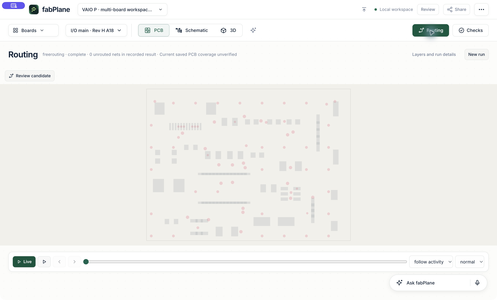
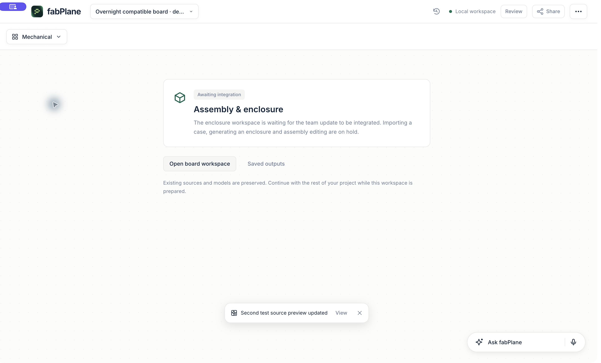
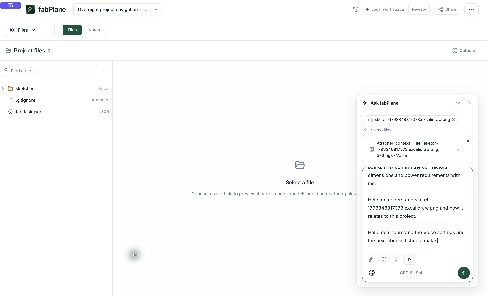
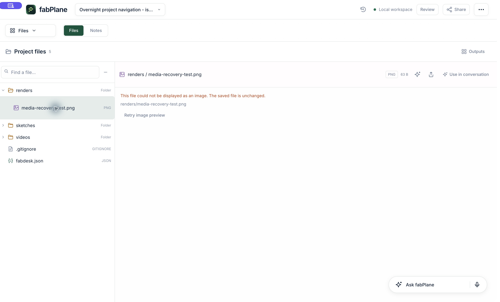
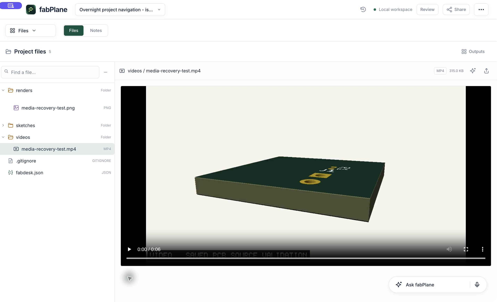
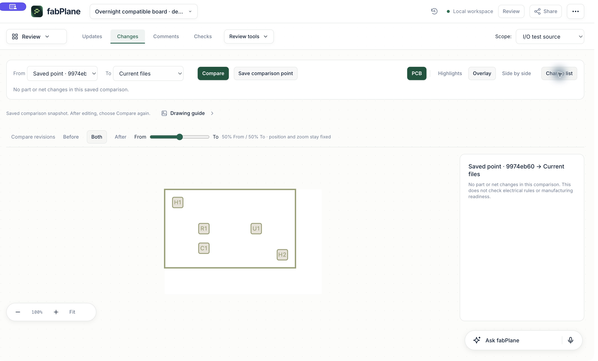
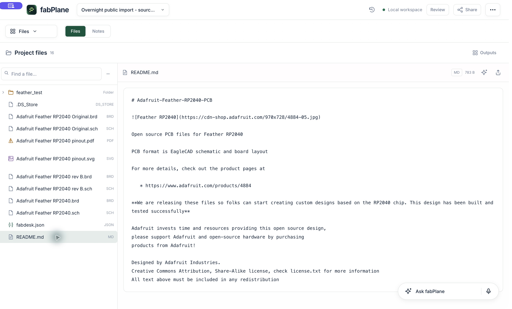
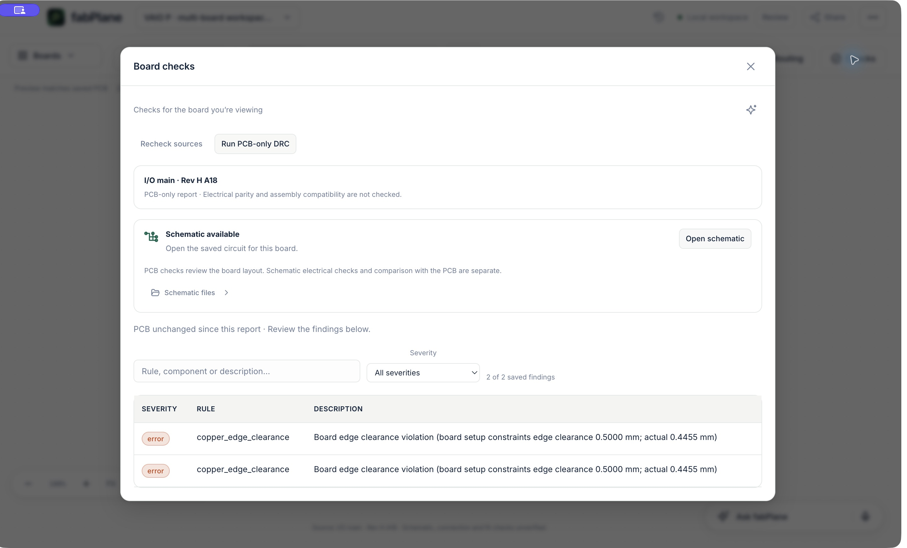

# Whole-app workflow acceptance · October 30 follow-up

This follow-up supersedes the implementation/runtime/check results in [the earlier overnight handoff](OVERNIGHT-20261030.md). It addresses the resumed whole-app queue, including the user's latest Routing, contextual Checks, schematic clarity, and teammate-feature deferrals. Code: **72cd7f1**; run start **f5fd03b**. Final publication uses one normal push to the existing draft PR389; its outcome is recorded in the local handoff. No merge/deploy.

The five requested journeys are covered by actual current walkthroughs plus explicitly retained earlier native evidence: create/open → understand → change → review → deliver. Existing native tools remain the foundation. This is completion of that UI/workflow integration queue with the limitations below, not a claim of universal engineering correctness or exhaustive native execution of every guard/failure branch.

## Action and journey review

| Surface | Working actions | Verification | Boundaries |
| --- | --- | --- | --- |
| Start/open | New project, sketch save/attach, Files, visit-ordered picker/reload, named GitHub import and catalog preview | Native current: project-navigation and secondary-workflows proof; earlier genuine Codex→PCB/schematic handoff retained | EAGLE stays source files; no live optional send retry |
| Overview/boards | Real source-owned preview candidates/default icon; declared nodes/links; PCB/Schematic/3D and contextual source tools | Native current: board-tools, final captures32–34; earlier shared-instance/VAIO journeys | Declared links and map positions are not installed fit/compatibility |
| Routing/checks | Shared board toolbar; contextual Checks; source-qualified candidate review and guarded Apply; schematic availability/Open | Native current: single/multi/shared toolbar/check return; earlier actual partial route Apply retained | Saved reports can have findings; completion is not electrical pass |
| Review | Scoped Updates, source-qualified saved/Git comparisons, change overlays, pins/comments, refresh/keep saved, explicit directional review | Native current: source-qualified comparison and model return; earlier native comments/finding/update proof retained | No automatic directional reconciliation or silent push/pull |
| Outputs/media | Checkbox multiselect/Select all/Clear, source-qualified ZIP, image/video/GLB windows, format-specific tools, recovery/retry/download | Native current: output receipts, invalid→valid PNG/MP4, player controls; earlier ZIP/GIF/GLB/Gerber proof retained | Legacy files and unknown dependencies stay unverified |
| Background work | Project activity history, progress, cancel acknowledgement, reload and result destinations | Native current: real render/background-video/cancel/reload proof; historical removed-member guard source reviewed | No invented source association for old jobs without metadata |
| Parts/shopping/order | Native schematic BOM coverage/DNP/quantities/hardware/reviewed CSV; supported vendor prerequisites; export/check recovery | Earlier native BOM/hardware/CSV/shopping proof; current Inventory→Account/return and blocked Order recovery | No purchases or account changes |
| Files/Notes/share | Readable source-only import Files/README, media previews, Markdown save/draft/discard, local review ZIP | Native current: named public import and video; earlier Notes/native Save/archive-byte proof retained | Local ZIP is not hosted sharing or a complete external dependency archive |
| Settings/Ask/commands | Current-section Settings help; secondary scopes; per-message captured project/page/window/selection/output; searchable commands | Native current: Settings Voice draft/PNG retained, catalog/inventory/order scopes; context tests and earlier native command/dialog proof | Questions remain unsent; account credentials omitted |
| Teammate features | Mechanical/assembly, part replacement, Board size show clear awaiting-integration notices and working return actions | Native current: all three notices and return verified | PR398/393 integration and Board Art deferred |

## Changes in this follow-up

- One requested Project activity dialog connects existing persisted jobs to progress, cancellation, history and source-qualified results after navigation/reload.
- Routing now uses the normal source/PCB/Schematic/3D bar. Board Checks opens in context and returns to the same board. Schematic sources now says available/missing, offers Open/Add, and folds file details without implying electrical checks passed.
- Render and manufacturing receipts record actual artifact/input hashes and scope. Legacy files remain unverified; packaging saved files does not certify current PCB freshness.
- Recently opened projects reflect visits, Settings help follows the displayed section, and catalog/inventory/order context excludes the hidden board.
- Broken images/videos expose useful Retry/Download recovery. File video controls fit above the corner assistant. Review model returns to the selected board's 3D viewer.
- Source-only imports open Files instead of an empty start page. Catalog selection reveals its preview. Inventory/service errors, revision history, order prerequisites, and busy modal close controls have explicit recovery/guard behavior.
- Enclosure, replacement and Board size display awaiting-integration notices. No concept screenshot is presented as actual current project geometry; the original concepts and teammate implementations remain preserved.

## Current verification

- Root typecheck passed at `a26021d`; final affected UI types pass at `72cd7f1`.
- Final UI: **249 passed / 993 assertions / 0 failed**.
- Current root test command is **not green**: two KiCad mechanical tests exceeded the default 5s under parallel workspace load. The isolated KiCad suite passed **146 / 1 skipped / 0 failed**, with those two cases near the time limit. Initial sandbox localhost fixture failures are also preserved. No test limits were weakened.
- Exact repository scripts: **94 passed / 318 assertions / 0 failed**. Other permitted root workspaces passed; skips are not native passes.
- Production desktop build: **PASS at `72cd7f1`**, renderer 38.20s; **zero source maps** in desktop output. No hosted CI result is claimed.
- **42 protected VAIO/root-study files remain byte-exact**. Named public EAGLE import sources also matched their Git checkout; no native conversion was claimed. Controlled preview/input faults were restored.
- Final dialog guard additions are source/type/test reviewed. Existing native close/recovery paths were exercised; no slow deletion, account operation or external outage was forced merely to test a disabled close control.

[Exact current acceptance and screenshot hashes](whole-app-20261030-acceptance.json). Full local proof and all 00–34 native captures: `outputs/whole-app-journeys-2026-10-30/`. Earlier native edit, comments, BOM, Notes, ZIP, GIF and routing evidence remains in `outputs/overnight-journeys-2026-10-29/`.

## Actual native screenshots

## Remaining integration and environment limits

- Enclosure/assembly PR398 and replacement/resize PR393 intentionally deferred with awaiting-integration notices. Underlying implementations and original concepts preserved.
- Board Art Apply/polish remains user-deferred.
- PCB-only checks are not ERC, electrical parity, inter-board compatibility or physical fit. Actual validation fixtures retain DRC findings and partial routing.
- Model/export input receipts establish only recorded inputs; unrecorded dependencies and legacy output freshness remain unverified. ZIP receipts track packaged saved files.
- Directional schematic/PCB and repository actions prepare explicit unsent reviews; no automatic reconciliation, remote sync or electrical success is claimed.
- Shopping/order auth recovery exercised; no sign-in, purchase, upload or live cart mutation performed. Optional later live-agent transmission was approval-review rejected and not retried; earlier genuine successful Codex/native-board evidence retained.
- Catalog Remix fallback source reviewed; fixed source-only Files landing natively exercised through GitHub import of the same public EAGLE source, not a third catalog clone. EAGLE conversion is not implemented or claimed.
- Service failure recovery and busy modal guards source/type/test reviewed; no external outage or destructive operation was forced.
- Recent projects use the exact connected core URL. Changing that URL starts a separate recent list.
- Native screenshots reflect real saved board drawings and models, not illustrative green concept geometry.

See the earlier handoff for the concrete PR398/393 adapter and source-context integration notes. These PRs were inspected read-only; no teammate changes were merged. Keep one owner for each feature and retain source/physical-instance identity when integrating them.
