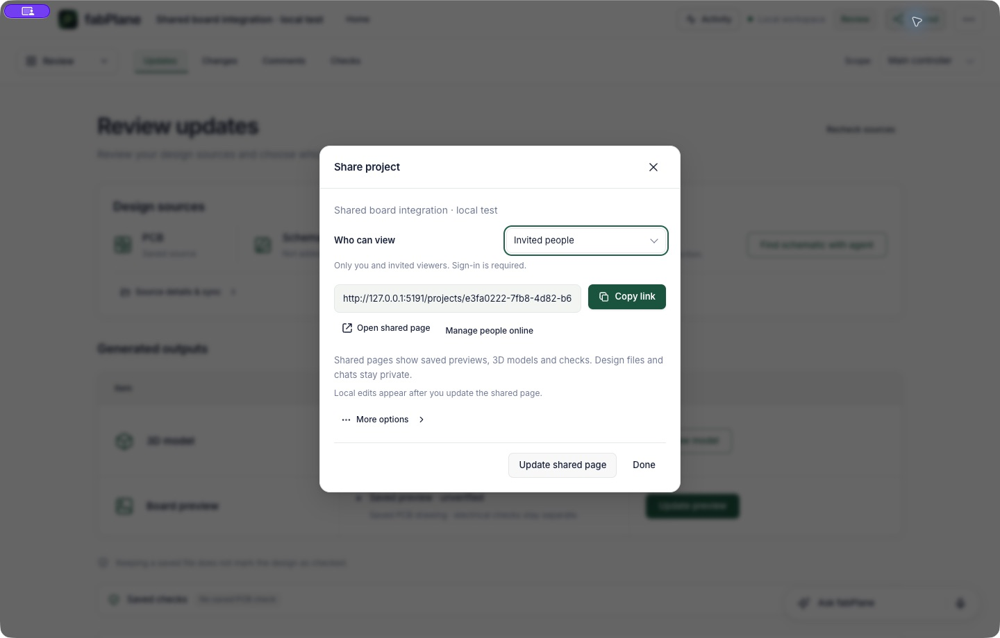

# Restricted publication — actual desktop capture

Captured November9,2026 with the normal repository Electron packager, a separate
test home/profile, the actual compiled core and SDK36d9dc3. The three-board project
and cloud accounts are synthetic. No production data or generated UI mockup.

Visible actions: Share → Invited people → Publish for invited viewers; browser
owner invitation and recipient acceptance; saved private3D; owner removal and
active-page revocation; turning an anonymous link off while retaining viewers;
desktop restricted update and automatic browser revision refresh; Copy link and
actual paste; Manage people online preserved the project destination through the
normal browser's sign-in entry. The companion browser PR contains further images.

Private member viewing is browser-only. Native authenticated member handoff,
Contributor editing, deployed staging/production and notarized/cross-device
validation are not included. Native anonymous-link viewing is unchanged.

The later update-only safeguard uses SDK7b92b2d. Final root/affected typechecks,
23 sharing tests, core/desktop builds and normal packaging passed. The final
visible update-only retest is blocked during native core startup before the
sharing UI. Re-signing the compiled binary and bundling it inside Resources did
not resolve that local wait; no root cause is claimed. Earlier capture12 above
uses SDK36d9dc3 and demonstrates the restricted publication/update UI, not the
later invisible safeguard. Repeat the final packaged update and staging journey
before release. The companion browser PR contains the complete walkthrough log.
