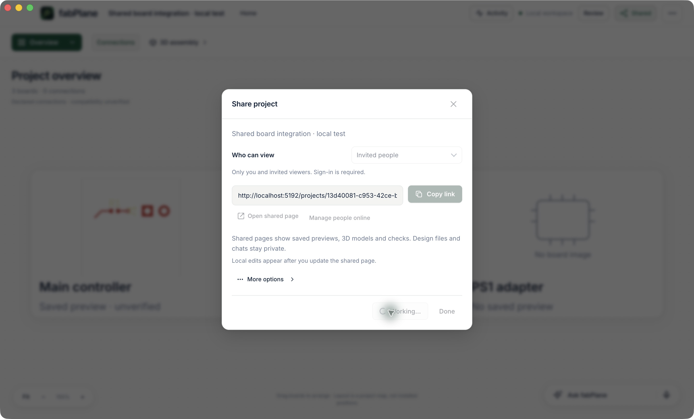
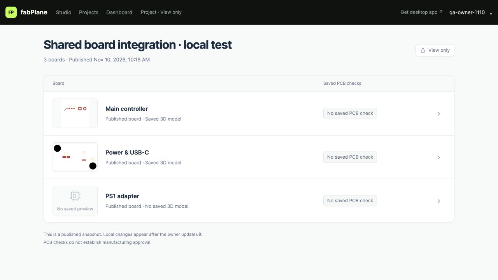

# November10 packaged sharing retest

The actual packaged app completed restricted publication, a real snapshot-only
update, anonymous-link enable/revocation, full unpublishing and private
republication. Recipient sign-in/acceptance, saved3D, Shared with me, leaving and
invitation cancellation passed through visible local UI with disposable accounts.
The viewer still loaded saved3D while desktop was closed. No source files or
production data were shared and no email was sent.

The fresh baseline package hit three startup timeouts. Its compiled Bun core
retained a plain ad-hoc signature without the app's JIT entitlements/runtime.
Explicit signing was tested on a copied artifact, then implemented in the normal
ad-hoc hook. A new normal package verified its signatures and started on its first
attempt in about56seconds. Its Share update advanced the browser timestamp from
10:03 to10:18. The real certificate-signing path is unchanged. First launch remains
slow; this does not establish that every startup delay has the same cause.

Validation:10 packaging tests, desktop typecheck, normal packaging and signature
verification passed. Focused browser/backend sharing/auth suite14passed. No source
maps in the app archive. The SDK pin7b92b2d is included in merged SDK main.

The full walkthrough is in the companion browser follow-up PR. Deployed staging,
production, live OAuth and notarized/cross-device installers remain untested.
Concurrent owner removal from a second independent browser was covered on
November9 and by database tests, and was not repeated in this session. No OS
security setting, quarantine attribute or user permission was changed.
