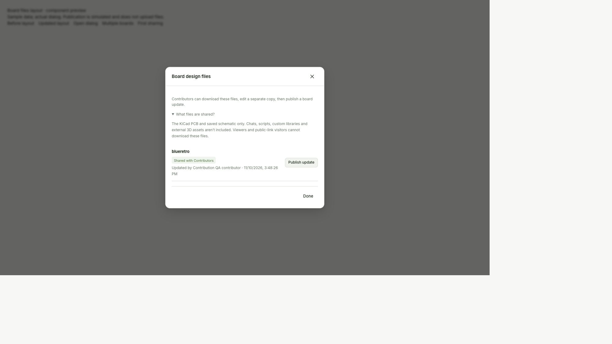
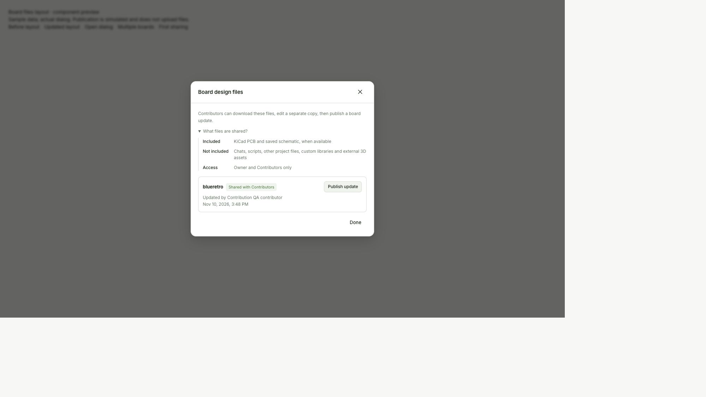
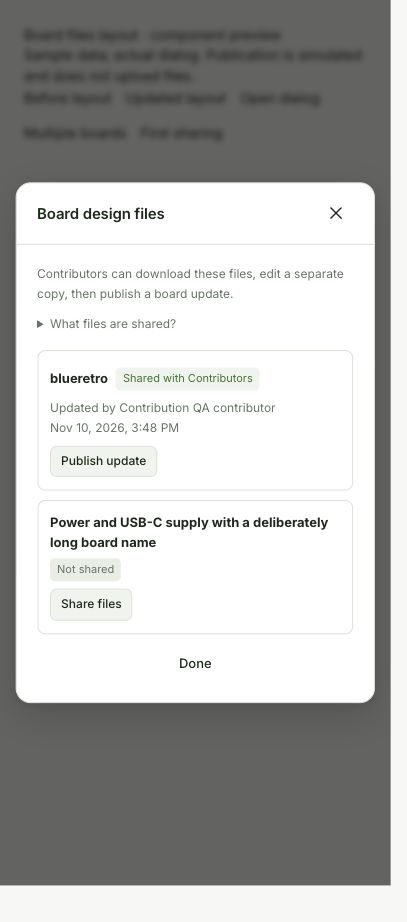

# Board design files layout refinement

The board name and sharing label form one heading, aligned with the publication action. Author and compact localized date/time have separate lines, preventing an orphaned AM/PM. Each board has a clear compact container. The duplicated list/footer separators are removed.

Expanded file details use Included / Not included / Access rows. The PCB/schematic scope and Owner/Contributor permissions are unchanged. Long names wrap, and narrow layouts place the action below the metadata. Missing author/date values are not fabricated.

Before is the actual component/CSS from f298218d; after uses the revised source. Captured in isolated pages with the same synthetic board, account and timestamp. They are component previews, not new cloud upload or permission tests. Desktop typecheck passed. Visible checks covered expanded details, one final publication action, Cancel recovery, multiple boards, long-name wrapping and375px-target layout. No real publication was performed.

