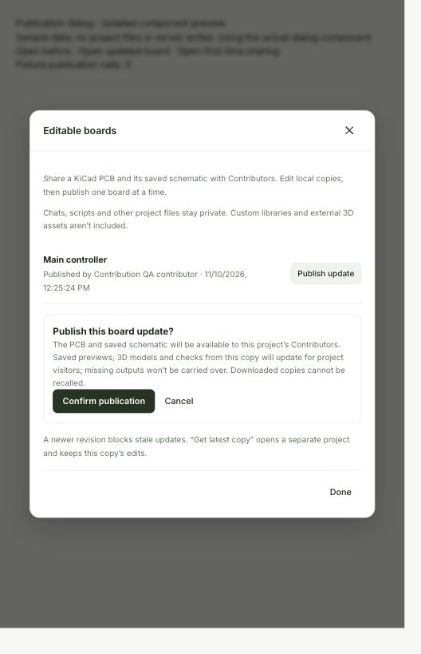
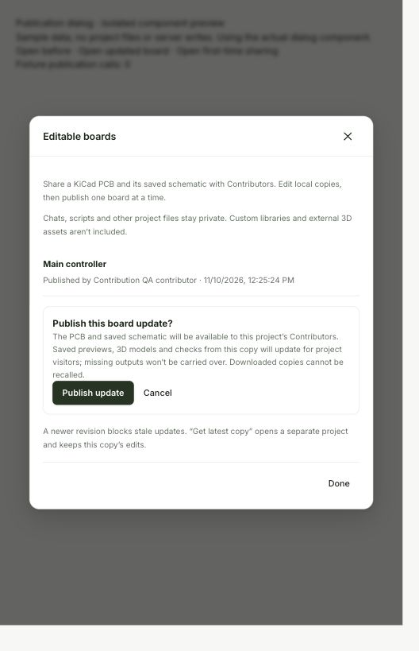

# Publication confirmation UX

The selected board's row action is hidden while its confirmation is open. The final action is **Publish update**, or **Share editable board** for first-time source sharing. During the request it reads **Publishing…** and is disabled. Cancel restores the row action.

Before/after captures below render the actual ContributionsDialog component with synthetic client methods in an isolated browser preview. The before component comes from d533559a. These are component-rendering checks, not a desktop/cloud integration test. The running desktop app was handling another project task and was left untouched.

Visible checks passed: one Publish update action during confirmation, Cancel recovery, disabled Publishing… state, successful fixture completion, and one Share editable board action for first opt-in. No real board upload was performed. Desktop typecheck and production build passed.

