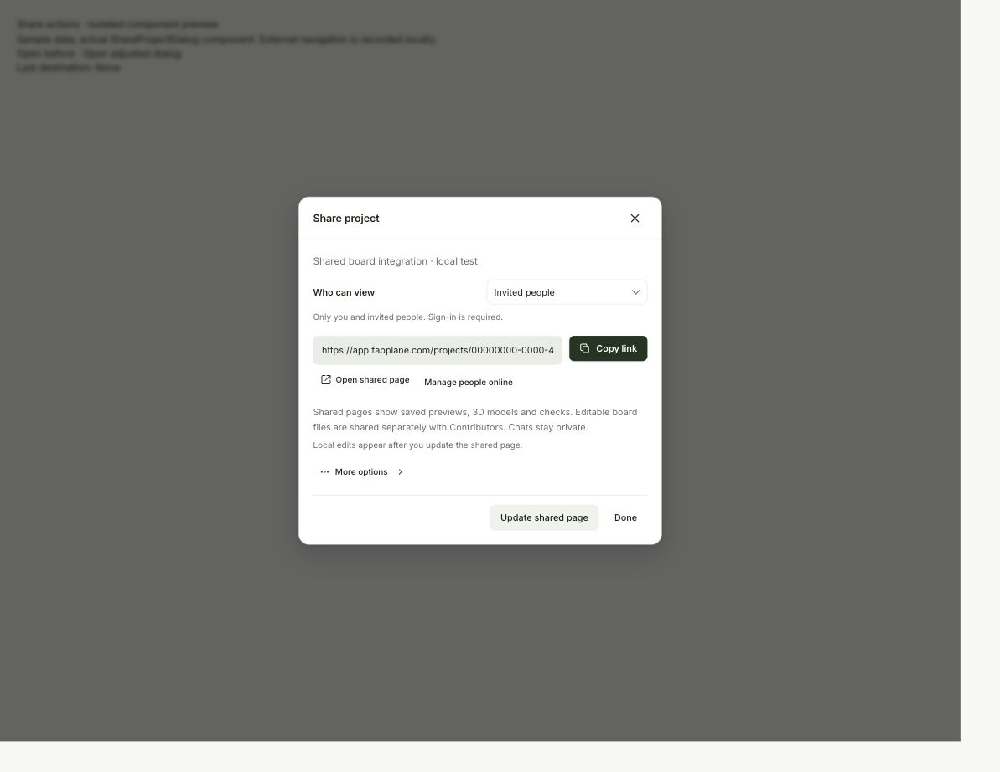
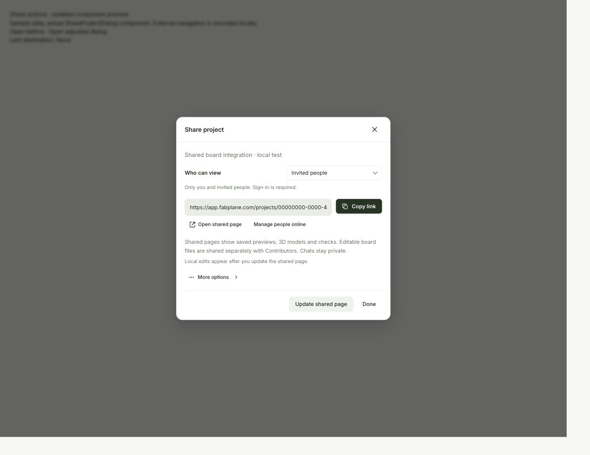
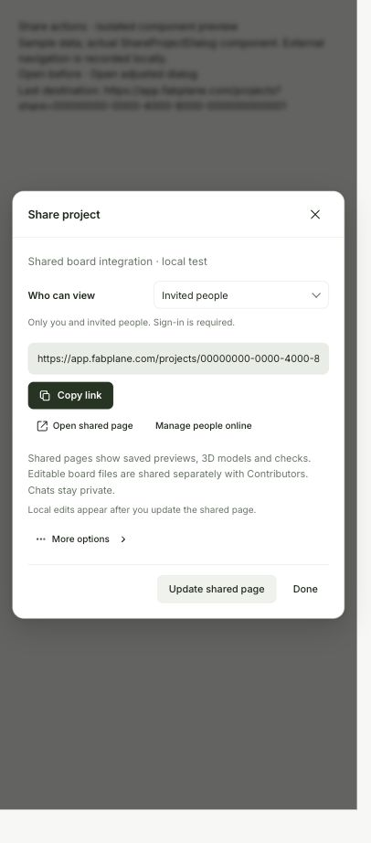

# Share action alignment

Open shared page and Manage people online now share a flex row with centered alignment, an 8 px gap, and wrapping when space runs out. Both retain the same small button size, ghost variant and original destination handlers.

Actual ShareProjectDialog before/after component renders use synthetic restricted-project data in an isolated local browser preview. The baseline component is from e1608ca4. No native project session was interrupted or real external navigation performed. Both destination handlers were checked through the fixture host: the shared project URL and Projects with its share query respectively. Desktop typecheck passed. Narrow layout stayed within the dialog. These captures are component checks, not new desktop/cloud integration coverage.

