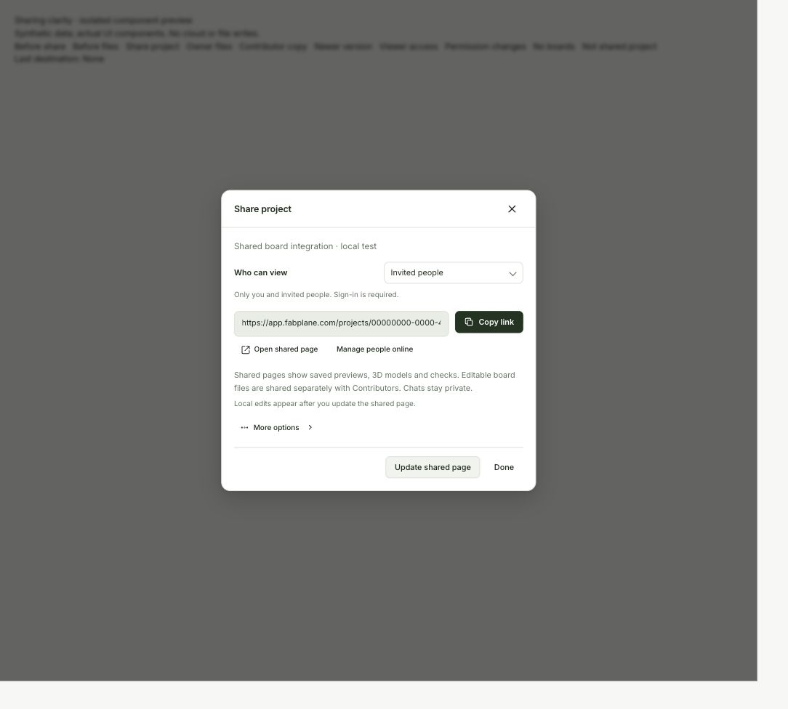
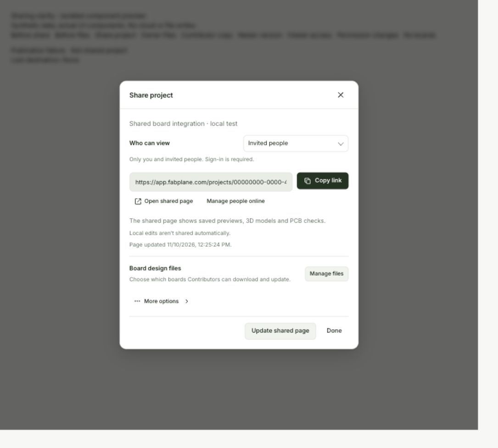
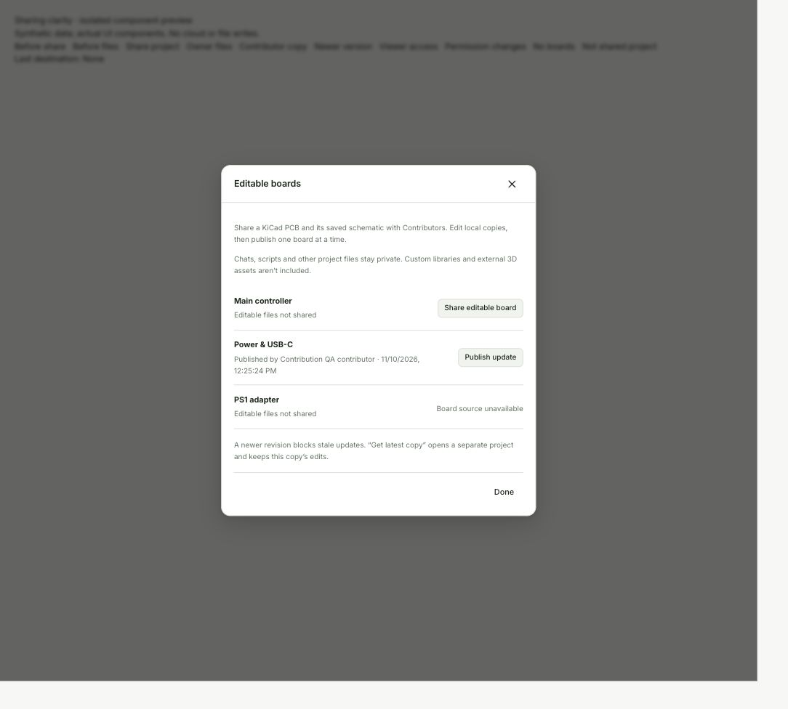
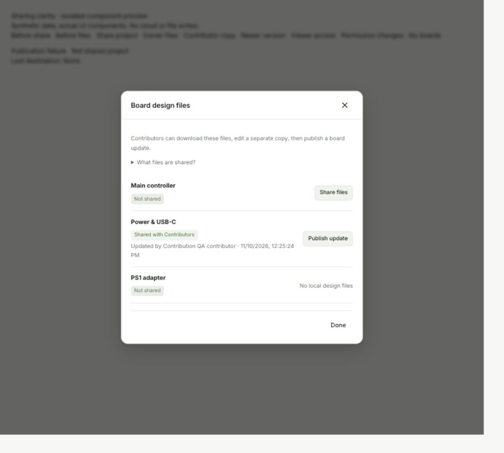

# Sharing concepts and dialog clarity

## State model

| Scope | Choices / states | Meaning |
| --- | --- | --- |
| Project access | Not shared · Invited people · Anyone with the link | Whether an online project is available and who can view it |
| Board design files | Not shared · Shared with Contributors | Whether the owner has explicitly uploaded the native PCB/schematic for Owner/Contributor access |
| Local copy comparison | Newer version available | A recovery condition comparing the saved base to the shared version; not another publication state |

Viewing a shared page does not grant native design-file access. Files are a PCB and optional saved schematic, not another type of board. Local edits are not automatically published. Existing manual snapshot/board update behavior is preserved; no backend status enum, permission, migration, or automatic merge was added.

## UI changes

- Share project separates online viewing from a visible **Board design files → Manage files** section. File management is no longer hidden behind the ambiguous Editable boards label in More options.
- Shared-page date is visible and success messages use the same viewing language. Advanced scope details are shorter.
- The file dialog is **Board design files**, with only Not shared / Shared with Contributors status labels and separate author/date metadata. Initial publication says **Share files**; subsequent publication remains **Publish update**.
- File inclusion/exclusion detail expands on demand. Confirmation names the selected board and retains the missing-output and downloaded-copy cautions.
- Share → Manage files switches to one dialog. Done returns to Share, preserving its parent state instead of stacking two modal overlays.
- A missing local base says to get the shared copy, without falsely claiming that an unknown local copy is older. A newer known base comparison has separate guidance. No local source and an empty project have clear messages.
- A pending confirmation becomes disabled when the refreshed role/revision no longer permits publication. Retry clears an earlier action error before checking again.
- Browser terminology and per-board file states match desktop.

## Validation

Actual desktop components were exercised through visible CUA clicks in an isolated browser preview with synthetic client responses. Baseline source:44614f54. Before/after show the same sample project/boards; these are component captures, not a newly installed desktop/cloud integration run. The active native project was not interrupted.

Passed component checks: Share→Manage files→Done navigation with one dialog; not-shared/shared file rows; named first-share confirmation and Cancel; newer-copy guidance; Viewer downgrade disabling an open Publish confirmation; unshared project disabling Manage files; empty project guidance; failed fixture publication and Retry clearing its alert; expandable file contents; compact375px-target layout. An initial fixture attempt was reset by HMR during the build; the failure/retry check was repeated after the build and passed. No real upload/download/access mutation was performed by the component fixture.

Actual local browser check separately navigated Home→Projects→synthetic shared project→Board design files. The section and all three rows used the new labels; no project mutation was performed. Desktop typecheck/production build and browser typecheck/production build passed. Build artifacts checked for source maps/references. Native/cloud handoff and earlier staging blockers remain outside this polish validation.

[Compact sharing dialog](after-share-narrow.png) · [Compact file dialog](after-files-narrow.png) · [Board-specific confirmation](after-confirm.png) · [Newer copy](after-newer-copy.png)
