# Sharing status and warning gallery

Captured on November 10, 2026 (Asia/Bangkok), using the current desktop UI source at `0a97fe0be21189eb66bc70898d3014a7cdb99ae3`.

These are browser captures of the actual `ShareProjectDialog`, `ContributionsDialog` and `DownloadedCopyDialog` components with synthetic project, person and service data. They are not generated designs, production account screenshots or evidence of a cloud integration run. Dialog regions were framed at capture time; the screenshots were not retouched.

**There are three project visibility choices and only two board-file publication states.** “Newer version”, access warnings, errors, confirmations and progress messages describe the local situation or an action; they are not extra publication states.

| Kind | Values |
| --- | --- |
| Project visibility | Not shared · Invited people · Anyone with the link |
| Board design files | Not shared · Shared with Contributors |

No real project was published, overwritten, downloaded or given new access for this gallery. No credentials, tokens or user board designs are included. The sample link is not a usable shared project.

## Project visibility and access

### 01. Project: Not shared

Who can view is Not shared. Manage files is disabled until the project is shared.

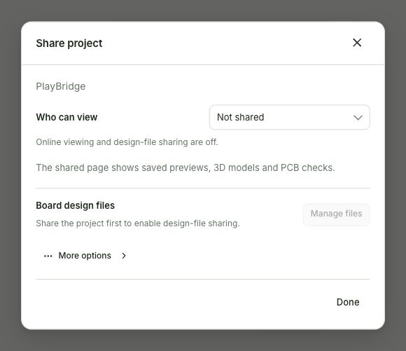

### 02. Project: Invited people

Only invited accounts can open the project; sign-in is required.

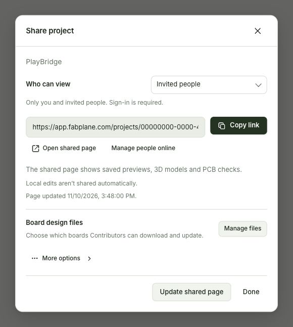

### 03. Project: Anyone with the link

The published page can be viewed without signing in. This does not expose design files to visitors.

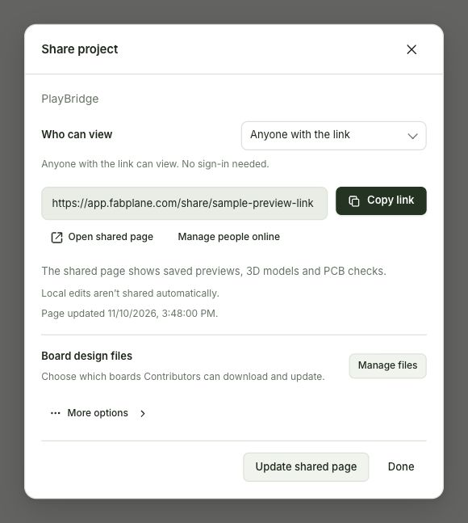

### 04. Turn off project sharing

Selecting Not shared shows the effect before Save changes: online viewing and design-file access stop; previously downloaded copies remain. This is an inline warning, not a separate confirmation popup.

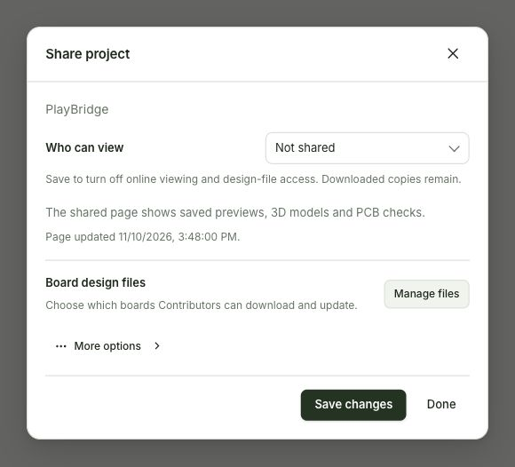

### 05. Sign-in required

The warning appears inside Share project, with Account settings and Retry.

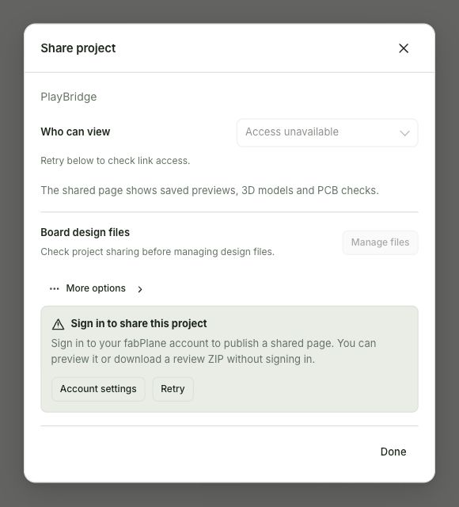

## Board publication and confirmations

### 06. Board files: Not shared

Only the owner can explicitly share this board’s source files for the first time.

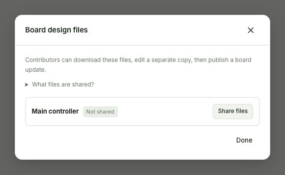

### 07. Confirm first file sharing

Share files opens this inline confirmation. The row action is replaced by one final Share files action and Cancel.

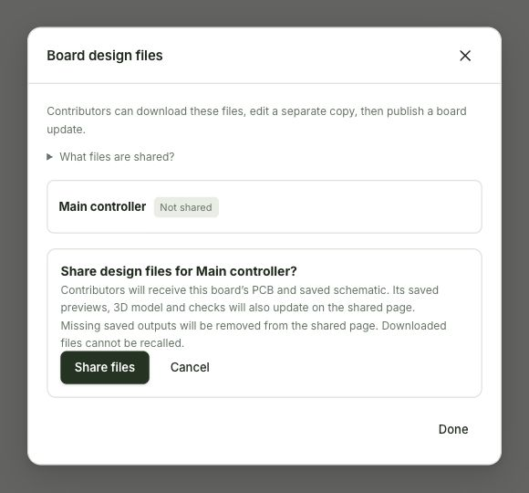

### 08. Board files: Shared with Contributors

The author and saved publication time identify the shared revision. Publish update opens a confirmation.

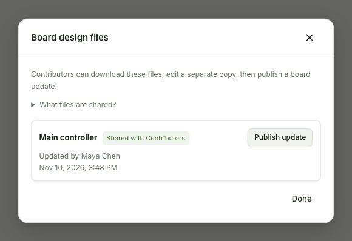

### 09. Confirm a board update

Publishing replaces the shared board files and refreshes its saved visitor outputs. The existing copy warns that missing outputs are removed and downloaded files cannot be recalled.

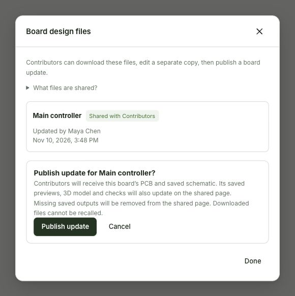

### 10. Publication succeeded

Board update published is a temporary success notice, not an additional file-sharing state. This capture uses a simulated success response.

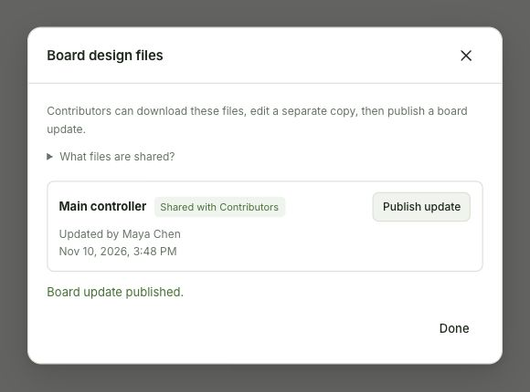

## Warnings and recovery

### 11. A newer version is available

Publish update is unavailable; Get latest copy is offered. Local edits are kept.

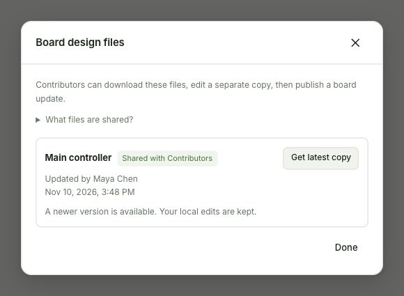

### 12. Get a shared copy first

A local board without a matching shared base cannot publish over an existing revision.

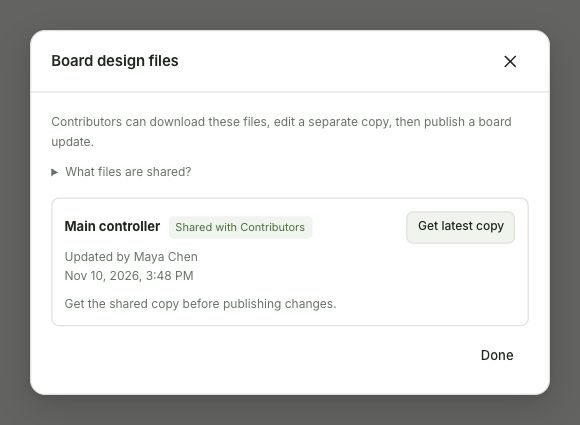

### 13. Local design files unavailable

The publication state can still be Shared with Contributors, while this local copy has no usable design files to publish.

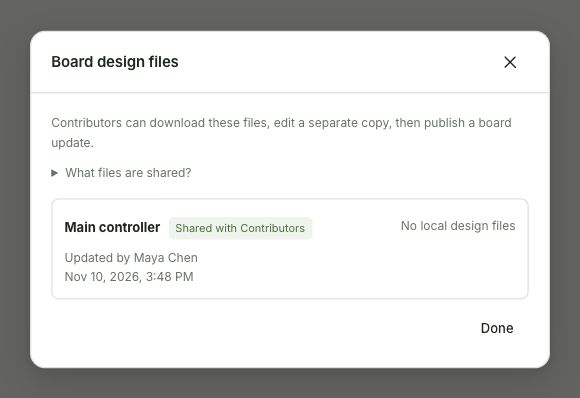

### 14. Viewer access

The local files are retained, but publishing and downloading newer design-file copies require Contributor access.

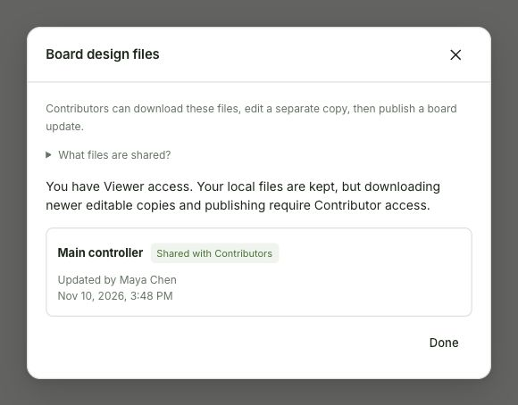

### 15. No boards

The empty state guides the user to add or import a board.

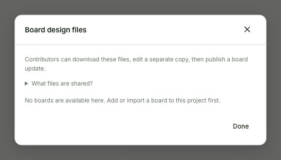

### 16. Conflict during publication

A simulated concurrent update produces the actual API conflict wording. The refreshed board offers Get latest copy and the final Publish update button is disabled.

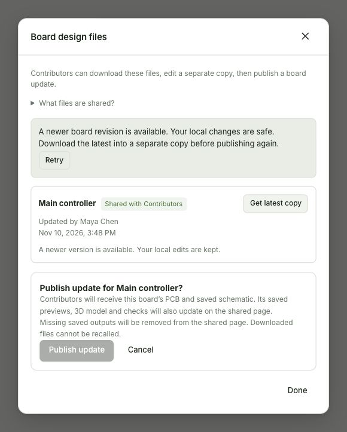

### 17. Open the separate downloaded copy?

The confirmation explains that opening a separate project preserves the current project’s files and conversations. The download response is simulated; no file download is claimed.

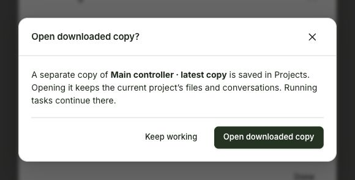

### 18. Finish open edits before switching

Open downloaded copy is disabled while the current project has unfinished edits. Keep working returns to the current copy.

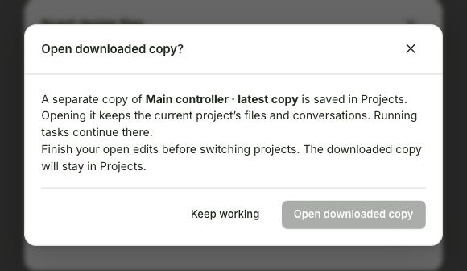

### 19. Publication failed

A simulated service failure displays its message and Retry. The confirmation remains available because no newer revision is reported.

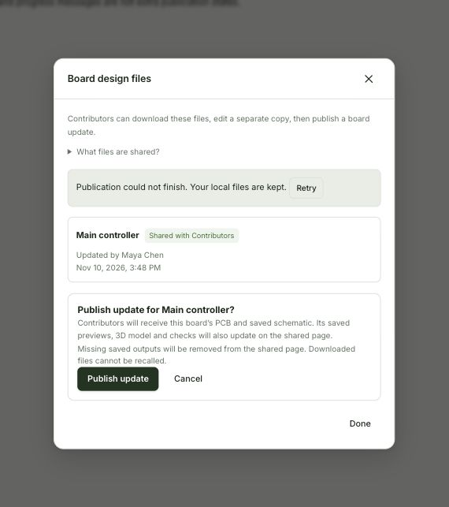

## Scope and progress

### 20. Included files and access

Expanded scope distinguishes included KiCad files, excluded project assets and allowed roles.

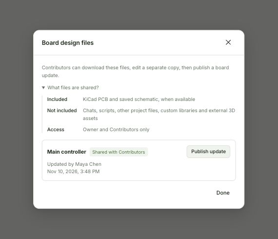

### 21. Publishing in progress

During a pending request, Publish, Cancel, Done and Close are disabled. The fixture holds the request pending for this capture.

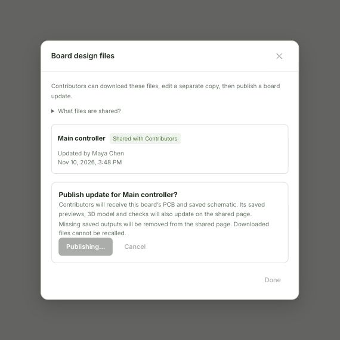

## Visible walkthrough

Starting point: an isolated scenario chooser, separate from the user's running desktop profile and local API. Each scenario was selected with a visible button; confirmation, disclosure, Cancel, Retry and Get latest copy were then exercised through visible UI controls.

| Step | Visible path | Expected and observed UI outcome | Result | Evidence |
| --- | --- | --- | --- | --- |
| 1 | Project · Not shared | Who can view is Not shared. Manage files is disabled until the project is shared. | Passed (component UI only) | [Capture](01-project-not-shared.jpg) |
| 2 | Project · Invited people | Only invited accounts can open the project; sign-in is required. | Passed (component UI only) | [Capture](02-project-invited-people.jpg) |
| 3 | Project · Anyone with the link | The published page can be viewed without signing in. This does not expose design files to visitors. | Passed (component UI only) | [Capture](03-project-anyone-with-link.jpg) |
| 4 | Invited people → Who can view → Not shared; leave unsaved | Selecting Not shared shows the effect before Save changes: online viewing and design-file access stop; previously downloaded copies remain. This is an inline warning, not a separate confirmation popup. | Passed (component UI only) | [Capture](04-turn-off-sharing-warning.jpg) |
| 5 | Project · Signed out | The warning appears inside Share project, with Account settings and Retry. | Passed (component UI only) | [Capture](05-sign-in-warning.jpg) |
| 6 | Board · Not shared | Only the owner can explicitly share this board’s source files for the first time. | Passed (component UI only) | [Capture](06-board-not-shared.jpg) |
| 7 | Not shared → Share files | Share files opens this inline confirmation. The row action is replaced by one final Share files action and Cancel. | Passed (component UI only) | [Capture](07-first-sharing-confirmation.jpg) |
| 8 | Board · Shared with Contributors | The author and saved publication time identify the shared revision. Publish update opens a confirmation. | Passed (component UI only) | [Capture](08-board-shared-with-contributors.jpg) |
| 9 | Shared with Contributors → Publish update | Publishing replaces the shared board files and refreshes its saved visitor outputs. The existing copy warns that missing outputs are removed and downloaded files cannot be recalled. | Passed (component UI only) | [Capture](09-publish-update-confirmation.jpg) |
| 10 | Confirmation → Publish update; simulated success | Board update published is a temporary success notice, not an additional file-sharing state. This capture uses a simulated success response. | Passed (component UI only) | [Capture](10-publication-success.jpg) |
| 11 | Board · Newer version | Publish update is unavailable; Get latest copy is offered. Local edits are kept. | Passed (component UI only) | [Capture](11-newer-version-blocked.jpg) |
| 12 | Board · No base copy | A local board without a matching shared base cannot publish over an existing revision. | Passed (component UI only) | [Capture](12-shared-copy-required.jpg) |
| 13 | Board · Missing files | The publication state can still be Shared with Contributors, while this local copy has no usable design files to publish. | Passed (component UI only) | [Capture](13-no-local-design-files.jpg) |
| 14 | Board · Viewer access | The local files are retained, but publishing and downloading newer design-file copies require Contributor access. | Passed (component UI only) | [Capture](14-viewer-access-warning.jpg) |
| 15 | Board · Empty project | The empty state guides the user to add or import a board. | Passed (component UI only) | [Capture](15-no-boards.jpg) |
| 16 | Conflict scenario → Publish update → Publish update | A simulated concurrent update produces the actual API conflict wording. The refreshed board offers Get latest copy and the final Publish update button is disabled. | Passed with friction (component UI only) | [Capture](16-concurrent-update-conflict.jpg) |
| 17 | Newer version → Get latest copy | The confirmation explains that opening a separate project preserves the current project’s files and conversations. The download response is simulated; no file download is claimed. | Passed (component UI only) | [Capture](17-open-downloaded-copy-confirmation.jpg) |
| 18 | Download with unfinished edits → Get latest copy | Open downloaded copy is disabled while the current project has unfinished edits. Keep working returns to the current copy. | Passed (component UI only) | [Capture](18-unfinished-edits-warning.jpg) |
| 19 | Publication error → Publish update → Publish update | A simulated service failure displays its message and Retry. The confirmation remains available because no newer revision is reported. | Passed (component UI only) | [Capture](19-publication-error.jpg) |
| 20 | Shared with Contributors → What files are shared? | Expanded scope distinguishes included KiCad files, excluded project assets and allowed roles. | Passed (component UI only) | [Capture](20-design-file-scope.jpg) |
| 21 | Publishing pending → Publish update → Publish update | During a pending request, Publish, Cancel, Done and Close are disabled. The fixture holds the request pending for this capture. | Passed (component UI only) | [Capture](21-publishing-in-progress.jpg) |

Cancel restored the first-share row action. After a conflict, Cancel dismissed the confirmation; Retry cleared the error while keeping Get latest copy. After a generic publication failure, Cancel and Retry returned to the normal shared-board row. Keep working dismissed the downloaded-copy prompt and showed that the current copy is kept. The unfinished-edit prompt disabled switching.

## UX findings and proposed adjustments

| Priority | Finding | Impact | Proposed adjustment | Retest |
| --- | --- | --- | --- | --- |
| P2 | The update confirmation remains visible after a concurrent update has made it obsolete (capture 16). | The disabled Publish update action competes with the recovery path and repeats the sharing explanation. | Dismiss the obsolete confirmation when a refreshed revision or role prevents publication; retain the conflict message and Get latest copy. | Simulate a concurrent update during confirmation; only the error and valid recovery action remain. |
| P2 | The update confirmation explains refreshed outputs, but does not explicitly say it replaces the currently shared board files (capture 09). | A contributor may hesitate about what gets replaced. | Use “Replace the currently shared version with your local board files?” and retain the missing-output and downloaded-copy notes. | Read the confirmation without outside context; identify what changes and what remains local. |

These are observations and proposals; this screenshot-only update does not change product behavior. The public-link Manage people destination inconsistency noted in the conversation remains outside this evidence-only task.

## Coverage limits

- Completed: 21 rendered states and dialogs inspected; visible component interactions for confirmation, cancellation, error recovery and switching guard.
- Not tested here: real upload/download integrity, server-side authorization and revision races, invite delivery/acceptance, public-link revocation, native deep-link handoff, loading screens, exhaustive server error messages, mobile or dark mode. Prior integration evidence elsewhere in the PR remains separately scoped.
- Native app, profile and saved board files were left untouched.
- A temporary viewport override was used to recover a browser capture problem; it was reset after capture. Images preserve the rendered UI rather than enforcing identical scaling.
- No source code changed, so the existing typecheck/build results were not rerun for these documentation assets.
