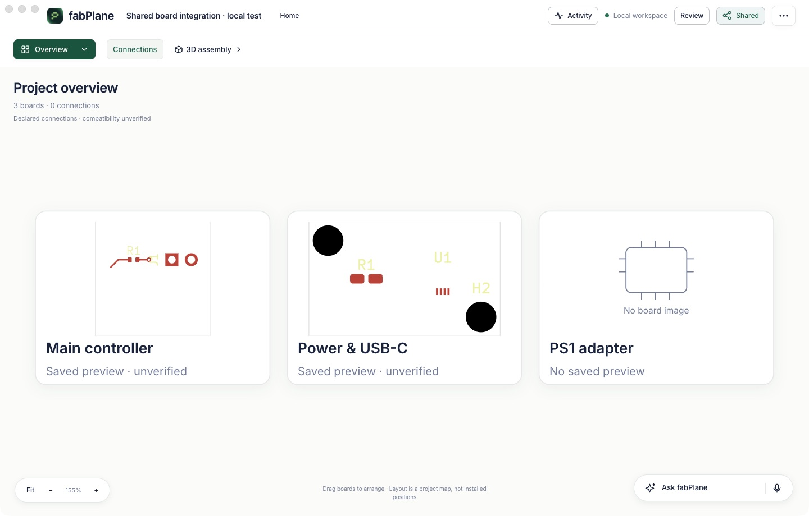
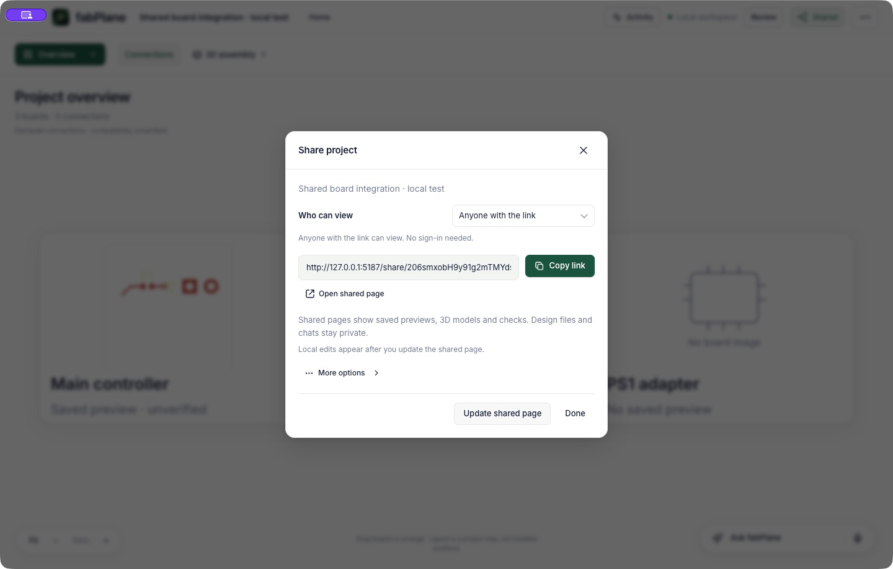
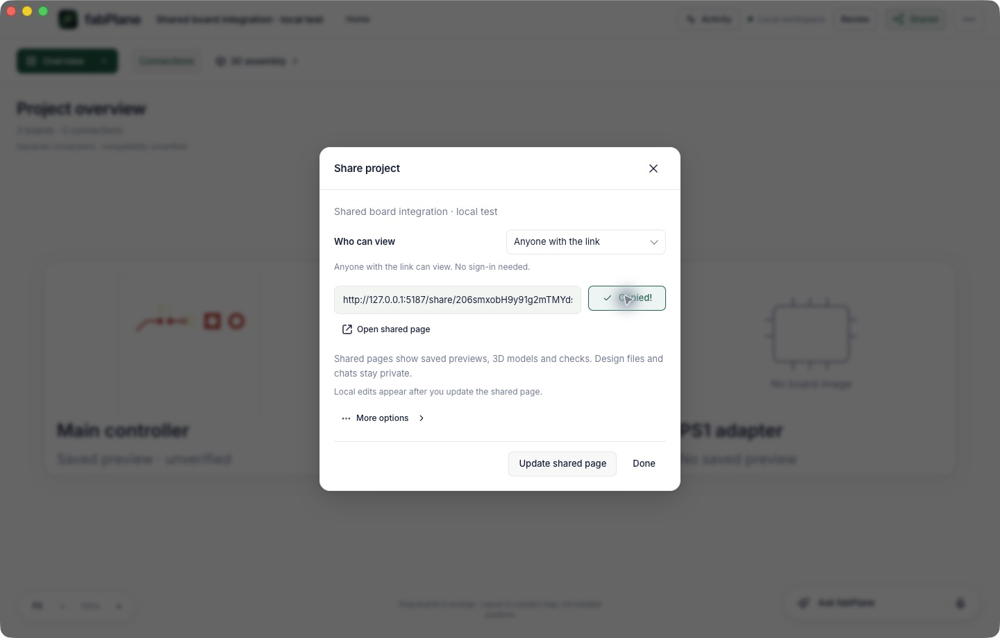
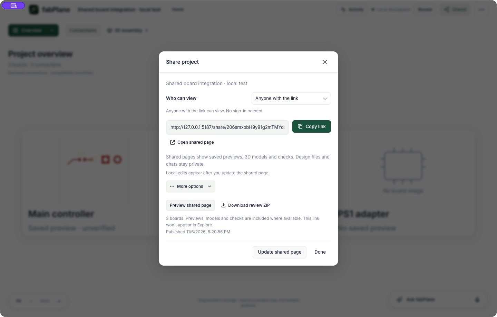
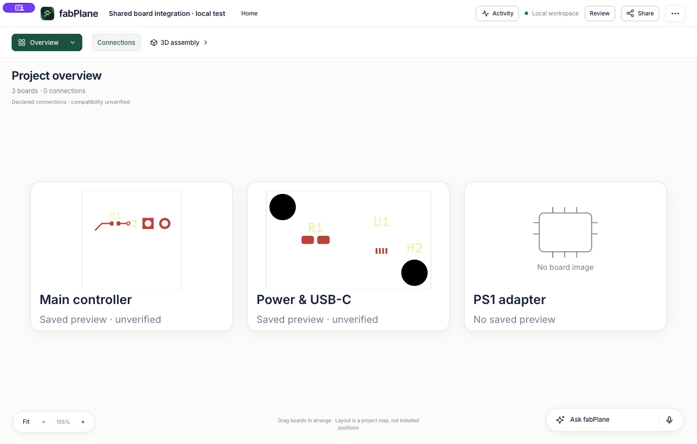
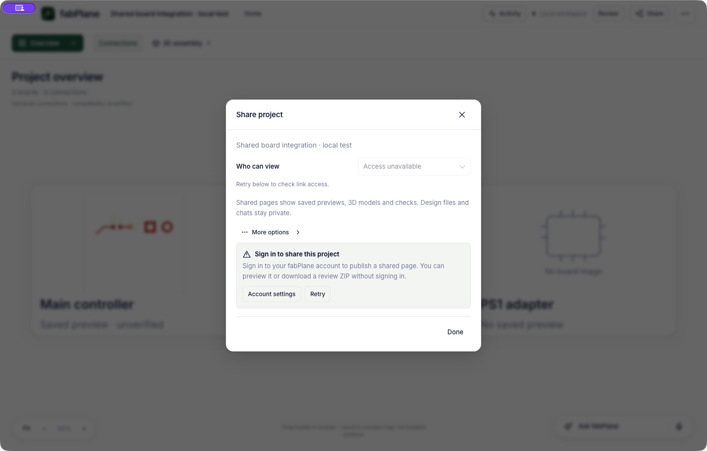
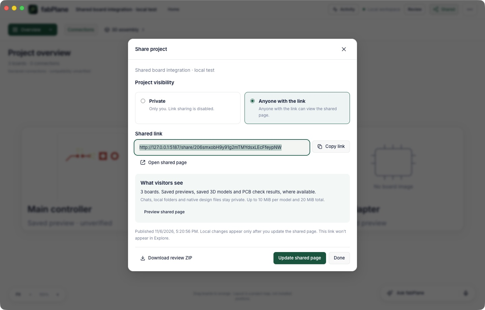

# Project sharing UI evidence

Actual, unaltered captures of the packaged Fabdesk app using an isolated local profile and synthetic three-board project. The main sharing-flow captures correspond to source commit903b2f8b; signed-out captures show the later sign-in prompt refinement. These are implemented screens, not generated concepts.

## Current header

The header uses one control: Share while private, Shared when a published link is active. Both open sharing settings.

## Current sharing dialog

One access dropdown, primary Copy link action, short privacy/freshness notes and explicit create/update/disable actions.

## Copy confirmation and secondary options

## Signed out

Being signed out leaves the normal Share action in the header. The sign-in warning and account action appear inside the dialog. These November9 captures use the existing expired local test session; no publication or access mutation was performed.

## Previous layout

The visible walkthrough verified copy feedback, the native access dropdown and unsaved-choice behavior, local preview, and entry into the existing ZIP flow. This presentation follow-up preserved the active test link; earlier integration testing covered actual publication and revocation.
