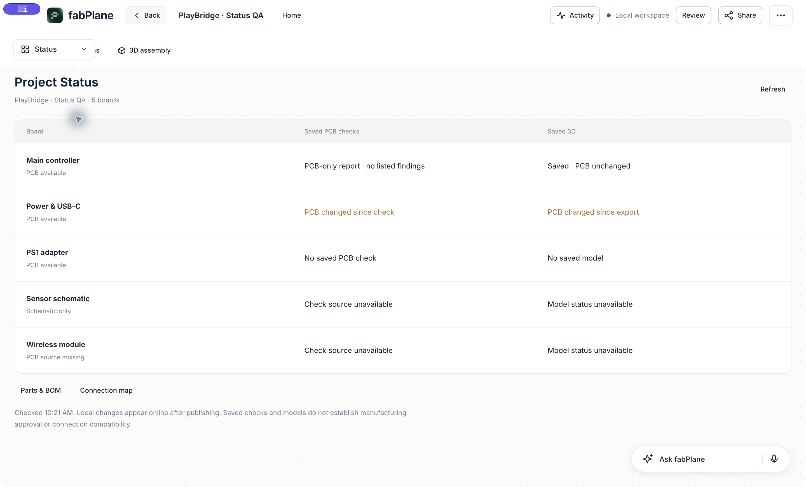
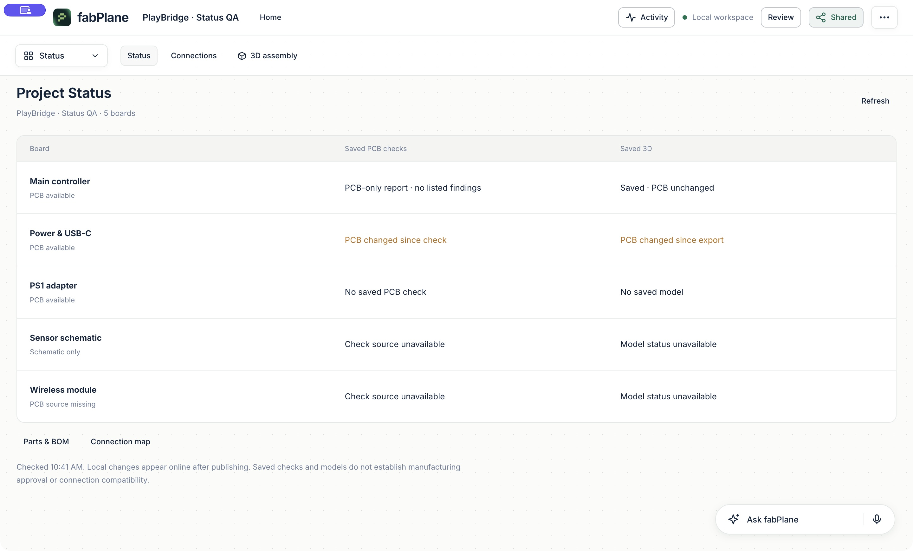

# Project Status MVP — local walkthrough, November 11, 2026

## Main refresh after board history and connections

PR441 is refreshed against main336dffd4, including PR423's dedicated Connections
and History workspaces and the grouped board fit controls. The canvas keeps all
three destinations: Status, Connections and History. The Status shortcut for
the project overview is now labelled Overview; Connection map still opens the
overview's assembly map. A navigation regression verifies that Back returns
through History, Connections and Status without losing the project or draft.

No vendor source or submodule pin was changed; all four checked-out vendor HEADs
match their existing pins. The screenshots and human walkthrough below describe
the earlier native run, before this source merge and the Overview label change.
They are not fresh post-merge native captures or installer acceptance evidence.

The earlier backend DockerHub blocker has been cleared. Companion browser/API
PR191 is merged, and its backend production workflow42975742942 passed, including
API/worker publication and deployment. No production deployment was performed
from this desktop task. Fresh installer and installed-app handoff checks remain
separate release acceptance.

Current refresh checks:

- Root frozen-lockfile installation and full monorepo typecheck passed.
- All root-workspace suites passed sequentially:2966 tests passed,38
  optional/platform cases skipped,0 failures,25592 assertions. Root script
  tests separately passed95/95 with323 assertions. The new Back-navigation
  regression is included; its focused store suite passed37 tests/252 assertions.
- The first parallel workspace run hit the existing agent-discovery test's5s
  timeout. That test and the entire agents workspace passed in isolation, then
  all workspace suites passed serially without changing timeouts or agent code.
  The first script run lacked the installed Node path; correcting the test
  command environment made the actual worker-thread packaging check pass.
- Core and desktop production builds passed, with no source-map files or
  sourceMappingURL references in desktop output. Main's history/connection
  implementations and all vendor source/pins remain unchanged.

Disposable PlayBridge fixtures, isolated desktop profile, local API and fresh migrated database. Native files and saved outputs were prepared before the test; publication and invitations used visible app controls. Four protected KiCad files were hash-checked unchanged afterward. These are actual captures, not generated designs.

## Demonstrated through the UI

- Home → project → Status: five source designs, saved PCB checks and saved 3D. Matching, changed, missing-output, schematic-only and missing-source examples are distinct.
- Status values open the correct board’s saved 3D or PCB-check view. Back returns to Status. Parts & BOM opens the project BOM and its missing-source explanations; Connection map opens the existing map and compatibility qualification.
- Desktop restricted publication → browser sign-in → project-specific people controls. Copy link changes to Copied!.
- First board-file sharing → Cancel preserves Not shared; confirming shares one board, with author/time. Subsequent publication explicitly warns it replaces the shared files, updates that board, and clears old success feedback before another confirmation.
- Intended Viewer accepted the copied, email-bound invitation and saw all published board statuses. Owner removal cleared the already-open Viewer page.
- Anonymous public link displayed the saved 3D. Switching it to Restricted cleared the already-open page and model. Both restricted and public-link Manage people actions opened this project's owner controls.
- Intended Contributor accepted a separate invitation. One design-file disclosure showed only the explicitly shared board's download action. Download feedback appeared; the downloaded ZIP was not independently inspected in this run.

## Findings and fixes

1. Desktop project navigation overlapped the workspace dropdown. Reserve toolbar space and stack navigation at narrow widths. The final native capture confirms the wide-layout fix.
2. Website model detail said unverified despite the confirmed saved receipt. It now uses the same qualified label as the summary; the public model walkthrough showed the corrected caption.
3. An added outer files disclosure was empty for Viewers and nested the existing Owner/Contributor disclosure. Removed the outer wrapper. The final Contributor disclosure was checked. After the temporary browser interruption cleared, the owner downgraded the member to Viewer through normal UI; re-entering as that account retained the Status page and removed file controls entirely.
4. A previous publication-success notice remained under a newly opened confirmation. Clear old notice/error on opening the next confirmation; actual successful publication followed by reopening confirmed this fix.
5. Removed a Team boards account-menu link brought by the sharing dependency port: its unrelated workflow is absent from main.

## Limits and remaining acceptance

- Browser automation initially timed out during the role-downgrade step, then inventory timed out. After the full typecheck completed, UI control recovered. A separate final pass changed the member to Viewer and re-entered that account: Status remained available and design-file controls were absent. This does not claim a concurrent open-page downgrade test.
- Concurrent stale-copy protection has automated regression coverage; the new obsolete-confirmation dismissal was code-reviewed, but a fresh two-copy UI race was not repeated here.
- Fresh copied-engine startup hit its 60-second deadline and left an orphan helper, which was stopped. The refreshed app ran with the supported installed-engine override; it is not a clean installer pass. Core first launch was also slow. Signing checks passed; notarized/release installer and installed-app deep-link acceptance remain open.
- The merged staging worker build succeeded. Backend deployment failed twice on DockerHub TLS handshake timeouts (nginx, then Bun). No production deployment, live OAuth/verified-email delivery, or deployed integration is claimed.
- Status is saved evidence, not completion, manufacturing approval, physical fit, or electrical compatibility. Website values reflect publication time, not live desktop work. Custom libraries/external assets remain excluded.
- No old-main before capture was available during the failed fresh launch. The desktop initial image is an intermediate implementation before the overlap fix, not a baseline-main image.

## Native evidence

Initial implementation, before the navigation fix:

Final native Status:

Final replacement confirmation:

Final verification addendum: full desktop monorepo typecheck passed. Browser production React-runtime/account/viewer/ZIP checks passed (9 tests, 49 assertions). The earlier browser-control interruption was preserved above and subsequently resolved for the final Viewer check.
