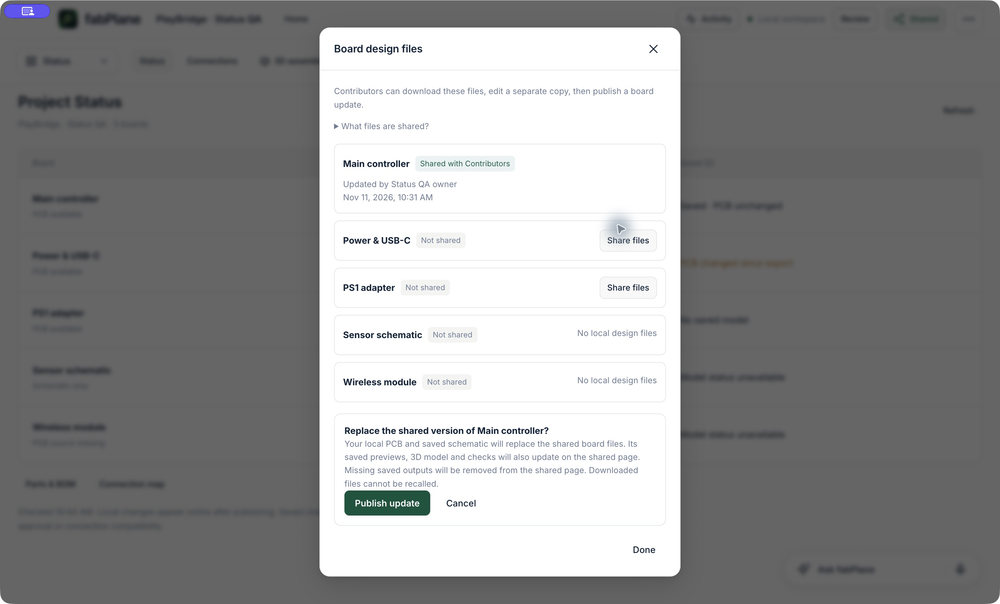

# Project Status MVP — local walkthrough, November 11, 2026

Disposable PlayBridge fixtures, isolated desktop profile, local API and fresh migrated database. Native files and saved outputs were prepared before the test; publication and invitations used visible app controls. Four protected KiCad files were hash-checked unchanged afterward. These are actual captures, not generated designs.

## Demonstrated through the UI

- Home → project → Status: five source designs, saved PCB checks and saved 3D. Matching, changed, missing-output, schematic-only and missing-source examples are distinct.
- Status values open the correct board’s saved 3D or PCB-check view. Back returns to Status. Parts & BOM opens the project BOM and its missing-source explanations; Connection map opens the existing map and compatibility qualification.
- Desktop restricted publication → browser sign-in → project-specific people controls. Copy link changes to Copied!.
- First board-file sharing → Cancel preserves Not shared; confirming shares one board, with author/time. Subsequent publication explicitly warns it replaces the shared files, updates that board, and clears old success feedback before another confirmation.
- Intended Viewer accepted the copied, email-bound invitation and saw all published board statuses. Owner removal cleared the already-open Viewer page.
- Anonymous public link displayed the saved 3D. Switching it to Restricted cleared the already-open page and model. Both restricted and public-link Manage people actions opened this project's owner controls.
- Intended Contributor accepted a separate invitation. One design-file disclosure showed only the explicitly shared board's download action. Download feedback appeared; the downloaded ZIP was not independently inspected in this run.

## Findings and fixes

1. Desktop project navigation overlapped the workspace dropdown. Reserve toolbar space and stack navigation at narrow widths. The final native capture confirms the wide-layout fix.
2. Website model detail said unverified despite the confirmed saved receipt. It now uses the same qualified label as the summary; the public model walkthrough showed the corrected caption.
3. An added outer files disclosure was empty for Viewers and nested the existing Owner/Contributor disclosure. Removed the outer wrapper. The final Contributor disclosure was checked; the final Viewer-hide retest was interrupted.
4. A previous publication-success notice remained under a newly opened confirmation. Clear old notice/error on opening the next confirmation; actual successful publication followed by reopening confirmed this fix.
5. Removed a Team boards account-menu link brought by the sharing dependency port: its unrelated workflow is absent from main.

## Limits and remaining acceptance

- Browser automation timed out during the last role-downgrade step, then its inventory also timed out. That final downgrade/Viewer-hide check and additional UI tests remain incomplete. No failure was converted into a pass.
- Concurrent stale-copy protection has automated regression coverage; the new obsolete-confirmation dismissal was code-reviewed, but a fresh two-copy UI race was not repeated here.
- Fresh copied-engine startup hit its 60-second deadline and left an orphan helper, which was stopped. The refreshed app ran with the supported installed-engine override; it is not a clean installer pass. Core first launch was also slow. Signing checks passed; notarized/release installer and installed-app deep-link acceptance remain open.
- The merged staging worker build succeeded. Backend deployment failed twice on DockerHub TLS handshake timeouts (nginx, then Bun). No production deployment, live OAuth/verified-email delivery, or deployed integration is claimed.
- Status is saved evidence, not completion, manufacturing approval, physical fit, or electrical compatibility. Website values reflect publication time, not live desktop work. Custom libraries/external assets remain excluded.
- No old-main before capture was available during the failed fresh launch. The desktop initial image is an intermediate implementation before the overlap fix, not a baseline-main image.

## Native evidence

Initial implementation, before the navigation fix:

Final native Status:

Final replacement confirmation:

