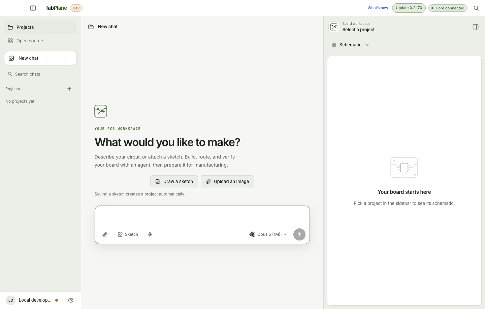
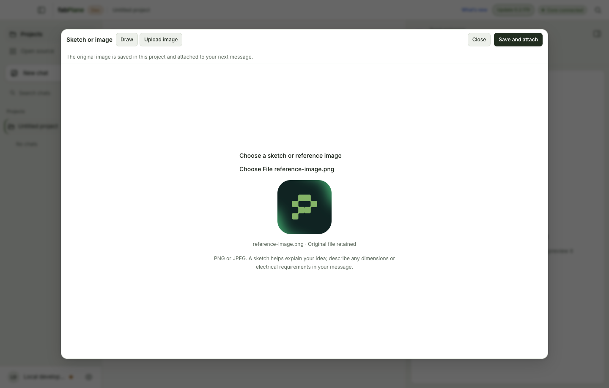
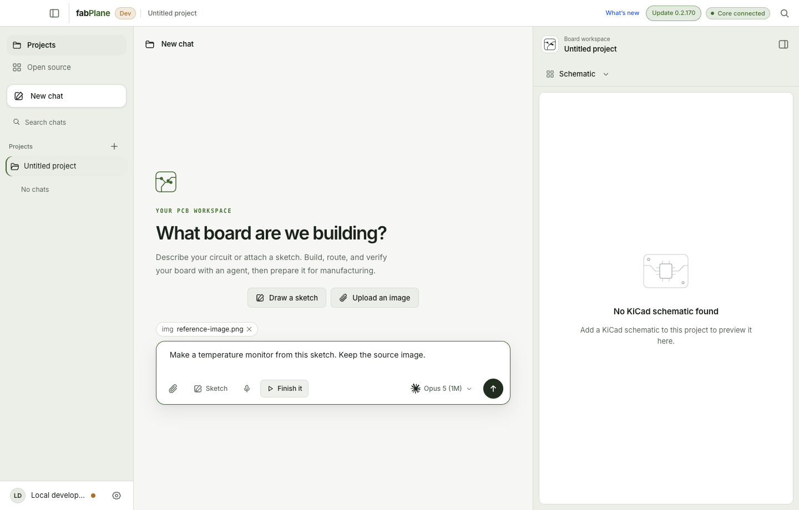

# Sketch-first onboarding: first implementation slice

Parent design roadmap: [#388](https://github.com/TensorFleet/fabdesk/pull/388). This slice keeps the existing shell while making sketch entry usable before manual project setup. It does not implement the full canvas shell, multi-board editing or the concept's requirements review.

## Behavior

- A new chat offers **Draw a sketch** and **Upload an image**. The existing Sketch action and shortcut remain available.
- Draw and Upload are two modes of one dialog. PNG/JPEG upload shows a preview and saves the original bytes; drawing continues to export PNG through Excalidraw.
- First save creates an ordinary local `Untitled project` using the existing project API. Opening/canceling creates nothing. Failed upload retries into the same project. On a remote core, creation follows that core's existing project storage behavior.
- The typed projectless draft and its attachments move into the new project. Unsent conversations are keyed by project; saved attachment paths and drafts survive reload. Existing version-5 unsent drafts migrate to the selected project's slot, including when another thread is open.
- Upload completion uses the destination captured when opening the dialog. It cannot attach to whichever conversation happens to be active later.
- Saving does not start an agent, generate a PCB or submit a message. The user can describe requirements before sending.
- An already-existing projectless conversation is not silently moved. The dialog offers a new project chat and preserves the original conversation. History adoption remains a separate #347 task.

Tabs remain useful within a task. This work has Draw / Upload modes, and future PCB / Schematic / 3D or output tabs are compatible with the design. The goal is less competing chrome and fewer panels open by default, not a ban on tabs.

[System Studio](https://github.com/TensorFleet/system-studio) is an additional reference for transitions, selection details and scope. Its README describes an independent prototype with scripted replies and representation-only manipulation; do not treat it as a native editor or compatibility engine. Keep its animation ideas alongside the accepted Fabdesk canvas concepts, honor reduced-motion preferences and avoid shifting the user's camera on background updates.

## Validation and remaining limits

Verified in an isolated native Electron development app with separate core/profile/project directories:

1. Start without a selected project, type a description, choose a known repository PNG fixture and save.
2. One project is created, the description is retained, and the image is attached to the new project's unsent message. No agent run/thread is started.
3. Saved image bytes equal the original fixture exactly.
4. Full renderer reload restores the selected project, typed description and attachment.
5. Switching to a second project shows a separate empty draft and no old attachment; switching back restores the first draft.
6. Draw mode loads Excalidraw; empty drawing is rejected. Cancel and empty-drawing validation create no extra project.

Automated checks: root `bun run typecheck` passes; client-core tests pass (169); UI tests pass (213). New cases cover creation/upload retry, concurrent project creation, project isolation, late adoption, version-5 migration and persisted attachment rehydration.

The full root `bun run test` was also attempted outside the restrictive sandbox. It is **not green**: a KiCad mechanical-truth timeout and 17 core failures (run-history retention and one queued-message timing case) remain outside the changed files. No core, KiCad or vendor code was changed. Resolve/recheck these before merging; do not report the whole suite as passing. The earlier sandbox run additionally denied process inspection and loopback servers.

Still to validate/implement: full drawing-to-PNG save in the native app, JPEG walkthrough, server-failure UI exercise, durable editable sketch scenes, projectless history adoption, requirements review, other fresh-start routes and the single-canvas shell. This slice does not complete phase 1 of the roadmap.

## Actual app screenshots

These are captures of the implemented dev app, not generated concepts. The shell is deliberately still the existing workspace. The upload preview uses the repository app icon as an arbitrary PNG fixture; no electronic design is inferred from it. Some early background captures were stale and excluded here. The upload capture predates the final copy/active-mode styling polish; behavior is unchanged.

### Fresh start

### Image preview

### After saving and reopening

