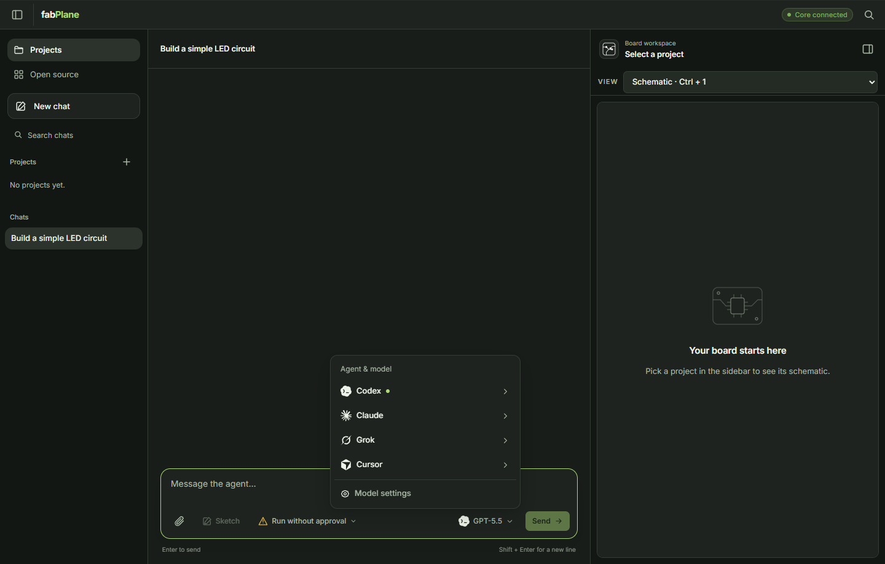

# Provider logos

Capture source: e08ca472bf26096e24ac1bba98e2b522a0a37f68.

The composer shows the provider logo and model name, replacing the provider name and separator. The menu shows logos for all supported providers: Codex, Claude, Grok, and Cursor. Provider names remain in accessible labels and tooltips. Marks are bundled locally from [Lobe Icons](https://github.com/lobehub/lobe-icons); pinned source and MIT license are beside the component. No runtime download or dependency was added.

Verified with actual UI components and mock API data in Windows Edge Chromium at 1440 x 920 and 960 x 600: four menu logos, switching every provider, 18 px sizing, accessible provider labels, Escape focus return, and no horizontal document overflow. UI typecheck, UI tests, and desktop build passed. Physical Mac was not rerun.

