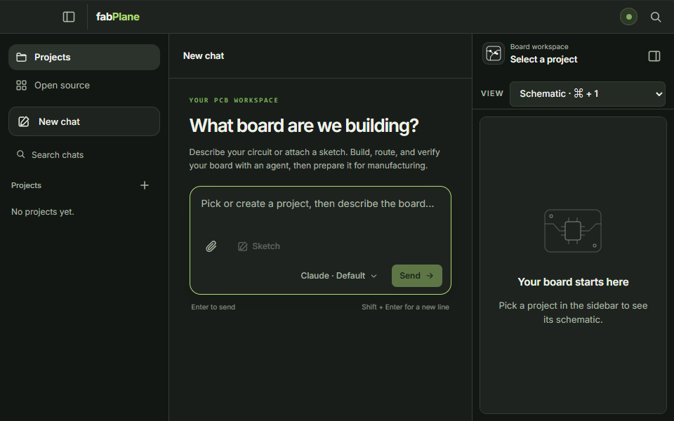
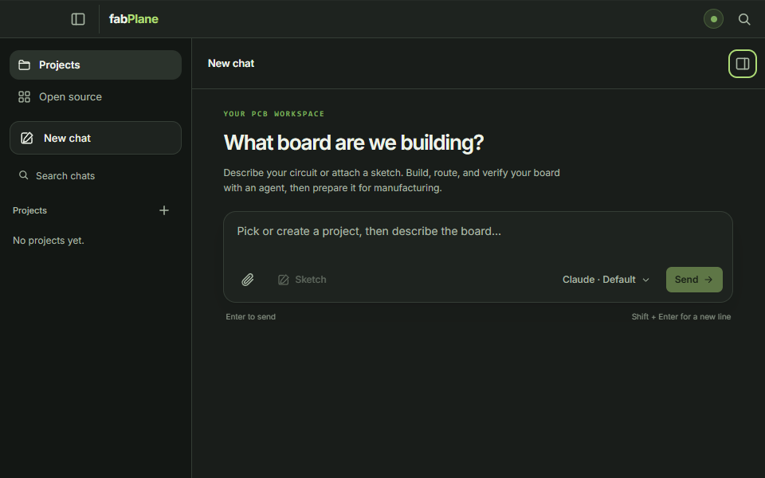

# One board toggle

Before: main `6ddbfa27c09f3613c0719e599700d79144b86b39`.
After: UI fix `65fc7d9684f41b1e719b7c6e817e32a2c102e0f8`.

Screenshots use the actual AppShell and child components with isolated mock API data, the macOS host adapter, and the same 960 x 600 viewport. They are Chromium renderer captures on Windows, not native Mac screenshots.

- Before: chat and board both show a board toggle.
- After: one persistent workspace button stays at the right edge as the board slides.
- Closed: the same button retains keyboard focus and reopens the board.

| Before | After |
| --- | --- |
|  |  |

## Checks

- Root `bun run typecheck`: passed.
- `bun run --filter '@fabdesk/ui' test`: 110 passed, zero failures.
- Browser checks at 1440 x 920 and 960 x 600 for both `darwin` and `win32` host adapters: one control; identical coordinates and DOM node throughout animation; focus retained; rapid reversals; Enter/Space; sidebar toggle; reduced motion; Ordering Back-button clearance; no horizontal document overflow. See checks.json.
- Main reproduced two controls in both capture sizes.
- Full backend suite and desktop build were not repeated for this six-file UI-only fix. The local PCB submodule remains at its prior checkout; its pin is unchanged in this PR.
- Physical Mac verification remains pending. On a current Mac build: open a chat with the board open, confirm no second icon in the chat header, then repeatedly close/reopen the board by mouse and keyboard. Check the icon stays in the far-right corner at both window sizes.
