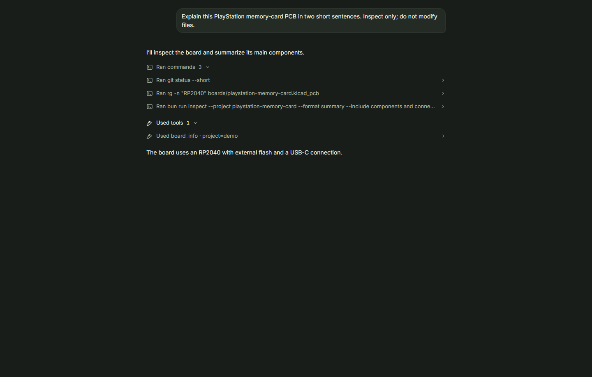
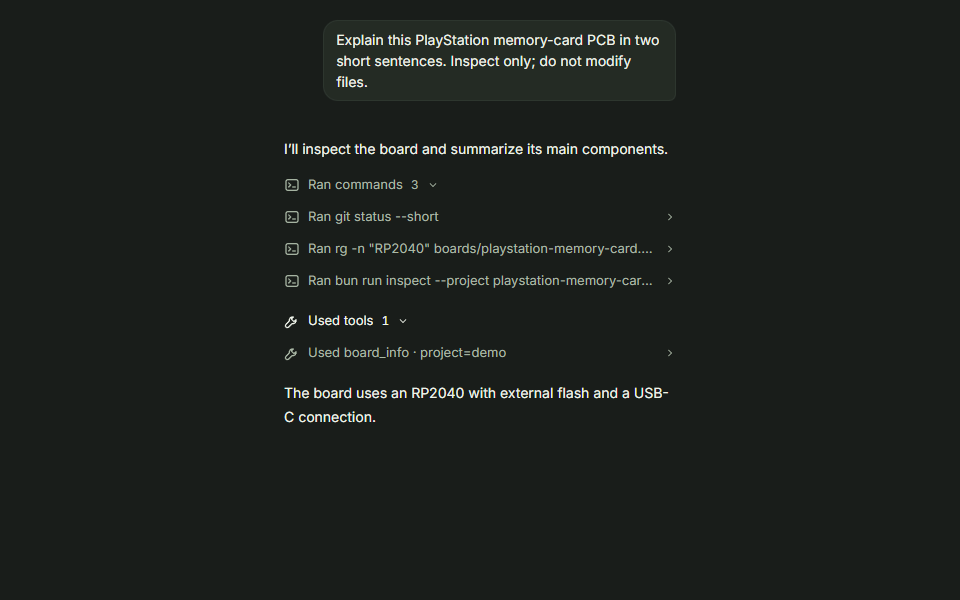

# Compact chat and activity

Capture source: 9eb6caf51a6c5d37edf58c96b92f4d1302ef8d66. Screenshots use the actual MessageBubble and ToolGroup components with mock messages in Edge Chromium, not a live agent run. Viewports: 1440 x 920 and 960 x 600; the narrow capture constrains the content to a 432 px chat pane.

- User bubbles: 12 px horizontal / 8 px vertical padding, 21 px line height.
- Tool groups: quiet expandable rows without nested outer boxes. Terminal icon for shell commands; wrench icon for other tools.
- Individual rows show the command or tool summary; expand for complete arguments, tool name, and output. Errors remain visible, pending calls are not presented as complete, and image rendering is retained.

Verified both sizes: exact computed bubble spacing, keyboard expansion, untruncated output in details, error/pending/running labels, and no horizontal document overflow. UI typecheck, 110 UI tests, and desktop build passed. Physical Mac was not rerun.

