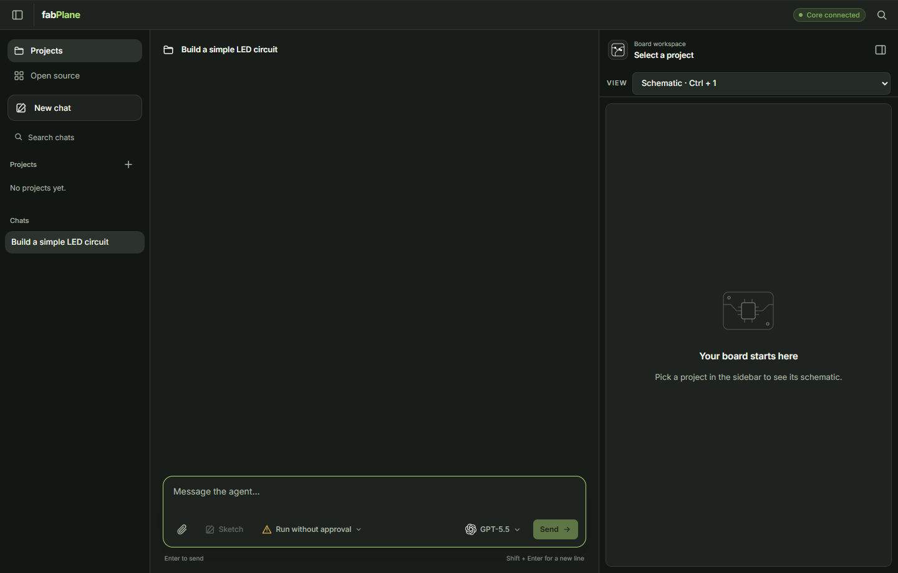
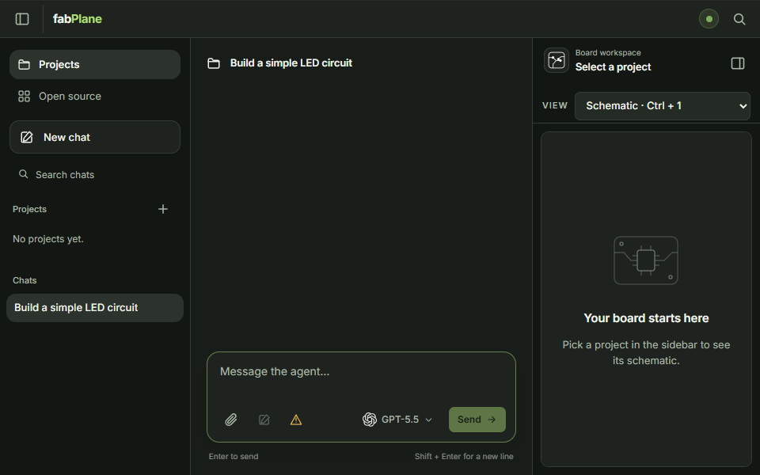

# Chat header

Capture source: 62975f615677513dc878674b244aa92b47192c43.

Added an 18 px folder icon before the chat title with a 12 px gap. Removed the bottom divider from the chat header. Long titles still truncate; run/pin indicators remain available.

Actual UI components with mock API data in Windows Edge Chromium at 1440 x 920 and 960 x 600. Verified icon, zero bottom border, and long-title truncation without horizontal overflow. UI typecheck and desktop build passed. Physical Mac was not rerun.

