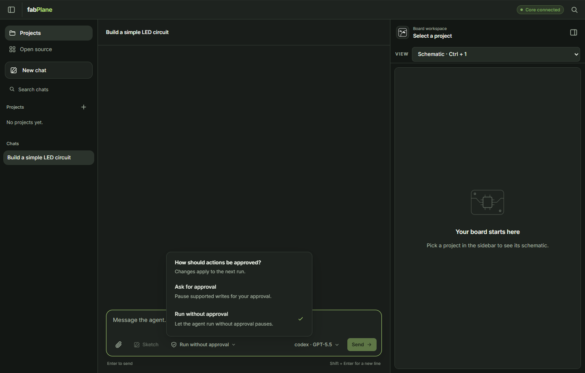
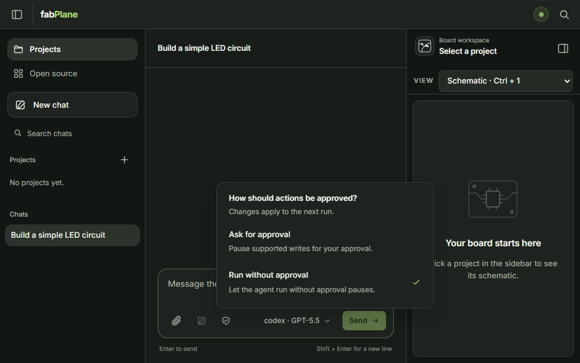

# Composer permissions

Source: `a7b5c5e96b972770743f6302553f5644056fa074`.

The chat header now shows the title and existing pin/run status. Agent/model remains in the composer. Existing chats have a shield button in the composer that opens the approval choices; the old header toggle is removed.

- **Ask for approval:** pauses supported writes for approval.
- **Run without approval:** runs without approval pauses.
- Changes take effect on the next run; the existing useSetRuntimeMode hook and daemon validation are reused. This is not a change to permission enforcement or new-chat defaults.
- A rejected save retains the prior mode and shows the error. Escape/selection return focus; outside clicks preserve the clicked target; Tab advances to the next toolbar control.
- Compact panes use an accessible icon/tooltip. At the 300 px chat minimum, the model and run controls get a separate row rather than disappearing.

## Verification

Actual AppShell/Composer components with isolated mock API data in Windows Edge Chromium, at 1440 x 920 and 960 x 600. Checks passed for header cleanup, popup bounds, successful saves in both directions, rejected saves, pending state, arrow/Home navigation, Enter, Escape, Tab and outside-click focus. A running chat at the 300 px pane minimum kept permissions, model, Stop and Queue visible without horizontal overflow. No real permission setting or agent run was changed during these checks.

UI typecheck and 110 UI tests passed. Desktop build passed. Physical Mac was not rerun.

