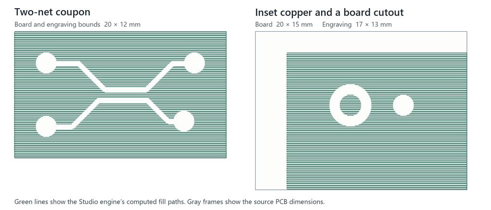

# ComMarker Studio native SVG import on Windows

On 2026-11-24, an offline test loaded the SVG importer and shape engine from ComMarker Studio 1.0.41 for Windows x64. Each SVG imported as one group with one compound Bézier object. The importer returned success and left Fill off. Enabling one horizontal Fill layer produced the paths below. The 0.1 mm spacing is a geometry test input. No material calibration or laser operation was part of this test.

| Input | Native artwork bounds | Native Fill result |
| --- | --- | --- |
| [FabDesk two-net coupon](../../examples/omni-x-copper-coupon-remove.svg) | 20 × 12 mm | 166 paths. Hatches cross the gap at (10, 6) and the field at (1, 1). They leave the two trace centres at (10, 5.5) and (10, 6.5), the pads at (3, 3) and (16, 8.5), and the exterior at (21, 6) clear. |
| [Inset, copper ring and cutout](inset-ring-cutout.svg) | 17 × 13 mm inside a 20 × 15 mm board, offset 3 mm from the left and 2 mm from the top | 81 paths. Hatches cover the copper ring's centre at (9, 7) and the field at (16, 7). They leave the ring metal at (10.5, 7), the board cutout at (14, 7) and the retained edge strips clear. |

Coordinates are in millimetres from the top left of the source board. Probes compared the expected region with actual horizontal segments on the nearest native hatch row within 0.05 mm. The plot draws the coordinates returned by Studio's engine. The gray board frames are annotations.

To check visually in Studio, create a blank project, choose **Vector**, import either SVG and select its group. Compare the selection dimensions with the table, then enable **Fill** to inspect the geometry. On the inset fixture, stretching the selected shape to the full board size would distort the artwork.

The isolated test called the installed importer's `parserData`, asked the shape engine to generate its geometry, and read its bounds and computed Fill paths. The lab binding depends on private C++ layouts specific to this Windows build. FabDesk's application code uses the SVG handoff. Mac Studio and physical isolation still require separate verification. [Vendor downloads](https://commarker.com/download-center)

| Tested file | SHA-256 |
| --- | --- |
| Windows Studio executable | `cc4e1656eba20a5b041fd923bd09f5a12fb2e5484ca0dc3072048dc90847a9cb` |
| `plugs/svg_importer.dll` | `267efff520cc0130a759fb571daa649952d8e24023722ce3ebddf862588cb564` |
| `shape.dll` | `db84e25d18d9074a81a49df62f4cebbee6e6302bdd4b82cd4925459cdb68b144` |
| Coupon SVG bytes generated by packaged KiCad and FabDesk | `c3b95a5735a24db523ec62494f6bc27778d53f7b62e41658f76db1c7cf98d4c2` |
| Inset fixture SVG | `50a8818db69ad39e42e80b3faeb5fd0508098a7c2505aeb5b565261361b1a282` |
